<!-- page 1 -->

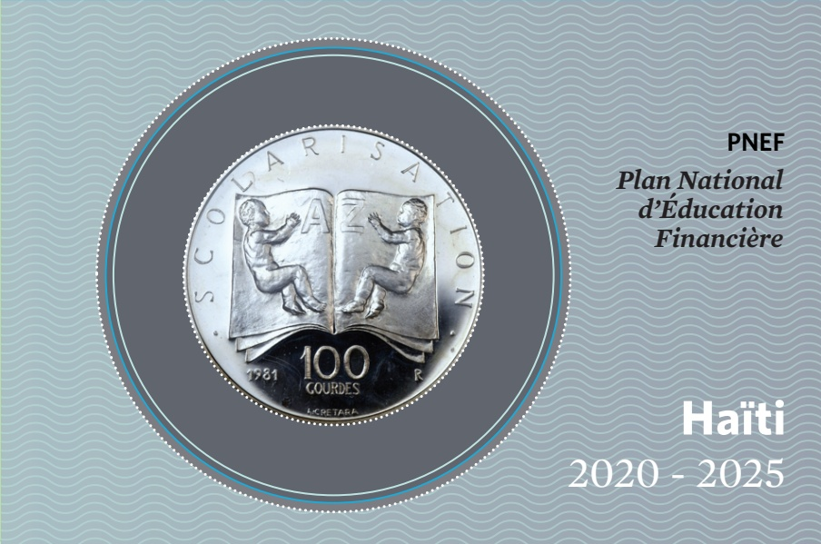

PNEF

Plan National

d'Éducation

Financière

Haiti

2020 - 2025

<!-- page 2 -->

Cartographie de l'Inclusion Financière en Haïti

| Brand/Category | Count |
| --- | --- |
| L'Artibonite | 600 |
| Nord | 446 |
| Sud | 387 |
| Sud-Est | 328 |
| Centre | 262 |
| Nord-Ouest | 240 |
| Grand'Anse | 174 |
| Nippes | 171 |
| Nord-Est | 120 |

Nombre de points

d'accès par type

de prestataire

| Category | Value |
| --- | --- |
| Agents non bancaires | 2.711 |
| Maisons de transfert | 1.901 |
| Banques commerciales | 326 |
| IMFs | 179 |
| Caisses populaires | 133 |

Cartographie d'Inclusion

Financière « FINclusion 2017 »

<!-- page 3 -->

Acronymes et Abréviations
Aperçu
Le Mot du Gouverneur
Contexte et Justification
L'éducation financière : pourquoi faire ?
L'éducation financière : Pilier de la Stratégie
Nationale d'Inclusion Financière
Contexte de l'inclusion et l'éducation financières en Haïti
Les Opportunités d'un Plan National d'Éducation Financière
Partenariat pour une vision partagée d'éducation financière en Haïti
Cadre socio-économique et financier du PNEF
Structure de la population en Haïti
Ecosystems de l'éducation formelle
Les activités générales de revenus
Niveau d'inclusion bancaire dans les départementes d'Haïti
Inégration financière
4
5
6
8
10
11
12
13
14
15
16
17
18
19
20
21
22
23
24
25
26
27
28
29
30
31
32
33
34
35
36
37
38
39
40
41
42
43
44
45
46
47
48
49
50
51
52
53
54
55

<!-- page 4 -->

ACME Association pour la Coopération avec la Micro-Entreprise

APB Association Professionnelle des Banques

AFI Alliance pour l'Inclusion Financière

AIC Alternative Insurance Company (Firme privée d'assurance en Haïti)

ANACAPH Association Nationale des Caisses Populaires Haïtiennes (ANACAPH)

BIC Bureau d'information sur le Crédit

BID Banque Interaméricaine de Développement

BRH Banque de la République d'Haïti

CAF Banque de Développement Latino-Américaine

CARE Cooperative for Assistance and Relief Everywhere

CONATEL Conseil National des Télécommunications

DIGCP Direction d'Inspection Générale des Caisses Populaires

FINSCOPE Enquêtes sur les demandes de produits et services financiers, Haïti 2018

IDRC Centre de recherche pour le développement international (CRDI)

IFNB Institution financière non bancaire

IHSI Institut Haïtien de Statistique et d'Informatique

IMF Institution de Microfinance

KNFP Konsèy Nasyonal Finansman Popilè

MARNDR Ministère de l'Agriculture, des Ressources Naturelles et du Développement Rural

MAST Ministère des Affaires Sociales et du Travail

MEF Ministère de l'Économie et des Finances

MENFP Ministère de l'Éducation Nationale et de la Formation Professionnelle

MPME Les micros, petites et moyennes entreprises

MUSO Mutuelles de Solidarité

OCDE/OECD Organisation de Coopération et de Développement Économiques

ONG Organisation Non Gouvernementale

OPS Organisation Panaméricaine de la Santé

PACFL President's Advisory Council on Financial Literacy

PNEF Plan National d'Éducation Financière

SNIF Stratégie Nationale d'Inclusion Financière

USAID Agence des États-Unis pour le Développement International

UNICEF Fonds des Nations Unies pour l'Enfance

VSLS Village Savings and Loans

WB World Bank / Banque Mondiale

WOCCU World Council of Credit Union / Conseil Mondial des Coopératives

<!-- page 5 -->

C'est à travers la banque centrale du pays - Banque de la République d'Haïti (BRH), le Ministère de l'Éducation Nationale et de la Formation Professionnelle (MENFP) et le Ministère de l'Économie et des Finances (MEF) que l'État Haïtien a défini la substance et les modalités de mise en œuvre du Plan National d'Éducation Financière d'Haïti (PNEF), un projet qui se veut l'une des priorités liées à l'exécution de la Stratégie Nationale d'Inclusion Financière (SNIF). Le PNEF, qui doit s'étendre sur cinq ans (2020-2025), s'aligne sur les objectifs et actions de la SNIF. En tant que politique publique, l'éducation financière vise non seulement à renforcer les compétences financières personnelles des citoyens haïtiens, mais aussi à responsabiliser les entreprises sur le plan du développement de leurs connaissances, attitudes, compétences et comportements financiers. Le PNEF est le fruit d'un processus participatif coordonné incluant plusieurs acteurs.

Sont impliqués :

## Des Autorités

Banque de la République d'Haïti (BRH)

• Ministère de l'Économie et des Finances (MEF)

• Ministère de l'Éducation Nationale et de la Formation Professionnelle (MENFP)

Des Associations / Fédérations / IMF / ONG

Des Fournisseurs de services financiers

Le Secteur de l'Éducation

Des Entreprises et des Firmes

Des Particuliers

Des Instituts de Recherche et Écoles Professionnelles

Une Communauté de Bailleurs de fonds

<!-- page 6 -->

## Le Mot du Gouverneur

Le taux de bancarisation de 11% qui prévaut dans le milieu haitien reflète la faiblesse de l'accès aux comptes bancaires des consommateurs financiers haïtiens. C'est ce que révèlent les résultats des enquêtes FinScope, Haïti 2018, ayant conduit à la rédaction du Plan National d'Éducation Financière (PNEF). Selon les conclusions du FinScope, 73% des personnes interrogées n'épargnent pas, 71% sont régulièrement à court d'argent par manque de revenus, 25% ont toujours des difficultés financières, 51% sont fauchées suite aux dépenses de subsistance et 87% n'empruntent pas par crainte d'endettement. Toutefois, quelque 53% des ménages ont exprimé le besoin d'accéder à une éducation financière.

Selon les informations relevées de la base de données de FINDEX¹, l'inclusion financière en Haïti a connu des progrès importants pendant ces cinq dernières années. Elle est passée de 27% en 2014 pour atteindre 34% en 2019. Grâce aux contributions du secteur financier et de la FinTech, le taux d'inclusion financière s'est donc accru même s'il reste faible comparé aux autres pays de l'Amérique Latine et de la Caraïbe. La Stratégie Nationale d'Inclusion Financière (SNIF), lancée en 2014, considère l'éducation financière comme l'un de ses cinq piliers, tout comme la protection du consommateur financier. Dans le contexte du PNEF, l'éducation financière se définit comme « Un processus par lequel les consommateurs financiers arrivent à s'approprier d'un socle de connaissances et de compétences ainsi qu'un savoir-faire financier, susceptibles de favoriser chez eux des comportements et des attitudes financiers plus responsables, leur permettant de mieux lutter contre l'exclusion financière et de contribuer réellement à la croissance économique en Haïti ». Dans un contexte de précarité financière aussi marquée, et vu la maîtrise imparfaite des outils et mécanismes financiers modernes, l'élaboration de ce Plan s'inscrit dans la ferme conviction des différents acteurs impliqués qu'une éducation financière de qualité et concertée viendra faciliter une utilisation plus rationnelle des produits et services financiers et stimuler un accroissement de revenus. Aussi cette éducation devra-t-elle renforcer la confiance des consommateurs financiers dans le système financier, inciter la propension à l'épargne et favoriser un plus grand développement économique.

Par ailleurs, la préparation du Plan National d'Éducation Financière (PNEF) a permis à la BRH d'inventorier, à travers le territoire haïtien, un ensemble d'interventions en matière d'éducation financière. La banque centrale, l'institution régulatrice du secteur financier, apprécie ces efforts qui, auparavant, avaient été déjà consentis par les parties prenantes pour accompagner les

<!-- page 7 -->

consommateurs de produits et services financiers dans leurs choix financiers. Le PNEF devra renforcer l'efficacité de ses actions et faciliter leur intégration. En effet, guidé par les bonnes pratiques et les principes en matière d'éducation financière de l'Organisation de Coopération et de Développement Économiques (OCDE) et de l'Alliance pour l'Inclusion Financière (AFI), le PNEF est prévu pour durer cinq ans (2020-2025). Il vise, d'une part, à offrir une ligne directrice pour le développement et la coordination de nos différentes actions en matière d'éducation financière et d'autre part, à soutenir les partenariats sectoriels pour la promotion de l'inclusion et de l'éducation financières.

Dans la mise en œuvre du PNEF, des efforts collectifs vont se concentrer sur l'ensemble de la population. Un accent particulier sera mis sur les femmes, les jeunes et les entrepreneurs, groupes cibles de la Stratégie Nationale d'Inclusion Financière, de façon à faire diminuer leur risque d'exclusion financière et à stimuler leur prospérité. Les Nouvelles Technologies de l'Information et de la Communication (NTIC) sont appelées à jouer un rôle essentiel dans l'exécution du PNEF et à la vulgarisation des informations.

Si l'éducation financière est nécessaire, elle n'est pas suffisante. Elle ne pourra pas se substituer à la régulation. Pour qu'elle soit porteuse de changements, il lui faut l'accompagnement d'autres programmes touchant la protection des consommateurs, de codes de conduite précis et d'une

politique financière encourageant la transparence et la compétition sur le marché financier. Faisons de ce Plan un projet commun et investissons dans l'éducation financière pour une Haïti plus résiliente financièrement et économiquement, au bénéfice de tous !

Jean Baden Dubois

<!-- page 8 -->

## Introduction

Le développement et la mise en œuvre du Plan National d'Éducation Financière (PNEF) en Haïti, en tant qu'outil stratégique, représentent un élément central dans l'exécution de la Stratégie Nationale d'Inclusion Financière (SNIF) dont le but est de favoriser l'accès aux produits et services financiers à la population. Ce document constitue une matérialisation du quatrième pilier de la SNIF dont l'objectif est de « créer un marché mieux informé, susceptible d'attirer davantage de consommateurs vers des institutions financières formelles et de favoriser une concurrence accrue entre elles »

Ce livret, retrace les grandes orientations d'Haïti en matière d'éducation financière. Il fournit un cadre pour la mise en place d'une approche coordonnée visant à une meilleure utilisation des ressources financières existantes et à l'évaluation de l'efficacité des actions qui seront entreprises par la communauté des praticiens élargie. Soutenu par un ensemble d'acteurs, le document est élaboré selon l'approche méthodologique qui suit.

## Méthodologie

### 1. Le cadre institutionnel

Le Plan National d'Éducation Financière (PNEF) constitue une réponse de l'État Haïtien, à travers la Banque de la République d'Haïti (BRH), le Ministère de l'Économie et des Finances ainsi que le Ministère de l'Éducation Nationale et de la Formation Professionnelle, aux résultats des enquêtes FinScope Haïti 2018, Protection des Consommateurs. Cette recherche nationale, sur la capacité de la demande, a été conduite sur un échantillon de plus de quatre (4) mille ménages. Cette étude a été préparée, en collaboration avec plusieurs partenaires locaux dans le cadre du projet « Finance Inclusive » soutenu par l'USAID.

Les préoccupations soulevées par cette étude ont suscité la mise en place d'un Comité de pilotage sur l'éducation financière en 2019, de façon à aborder le problème de manière plus systémique. Les supports des organisations tels que l'Alliance Mondiale pour l'Inclusion Financière (AFI) et le Centre de Recherche et de Développement International (CRDI) ont été mis à contribution.

<!-- page 9 -->

### 2. Organisation et validation de l'étude

• Etat des lieux et identification des praticiens en éducation financière (21 acteurs avec des programmes éparses financés par des fonds externes)

• Approche holistique de la question (Le Comité de Pilotage est formé d'institutions publiques et privées)

• Bonnes pratiques internationales (AFI, CRDI, OCDE)

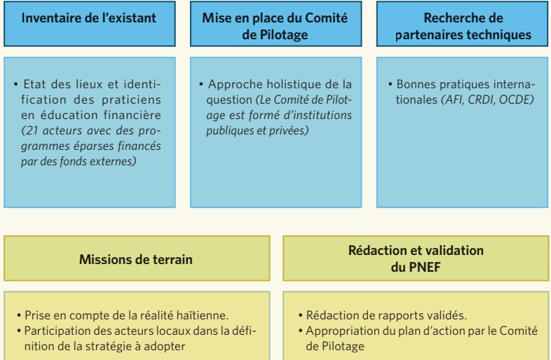

## Missions de terrain

• Participation des acteurs locaux dans la définition de la stratégie à adopter

## Réduction et validation du PNEF

• Rédaction de rapports validés.

• Appropriation du plan d'action par le Comité de Pilotage

<!-- page 10 -->

| Responsabilisation et protection | Responsabilise et protège plus efficace-ment les consommateurs des produits et services financiers |
| --- | --- |
| Utilisateurs et confiance | Produits financiers de plus en plus complexes et variés; l'éducation financière favorise une plus grande confiance dans leur utilisation |
| Protection contre les fraudes | Protection contre les fraudes et les escroqueries (par exemple, sensibiliser les individus aux systèmes pyramidaux) |
| Réduction de pauvreté et développement | Contribution essentielle des systèmes financiers à la réduction de la pauvreté et au développement |
| Prospérité et équité | Promouvoir la prospérité partagée et l'équité entre hommes et femmes |

<!-- page 11 -->

Stratégie Nationale d'Inclusion Financière

| Services financiers pour faciliter l'inclusion financière et augmenter le bien-être | Crédit pour la croissance économique | Services financiers de proximité | Education et protection des consommateurs | Renforcement des institutions et des infrastructures financières |
| --- | --- | --- | --- | --- |

Suivi et Evaluation (S&E)

<!-- page 12 -->

| Category | Planification (%) | Education Financière (%) |
| --- | --- | --- |
| Autonomisation des consommateurs et inclusion financière | 7 | 13 |
| Financement responsable | 22 | 37 |
| Éducation financière et développement productif | 71 | 50 |
| Education financière et développement productif | 71 | 51 |
| Souhaitée | 25 | 37 |

<!-- page 13 -->

Eviter le manque de coordination et des initiatives fragmentées

Impliquer de nombreuses parties prenantes et définir des priorités communes

Mobiliser et faciliter une affectation efficace et efficiente des ressources financières provenant du secteur public, des bailleurs de fonds, et des institutions de développement pour une plus grande promotion de l'éducation financière.

Faciliter le CHANGEMENT (le plan national n'est pas une fin en soi mais un moyen)

<!-- page 14 -->

## Opportunités pour le plan national

PNEF est inclus et est lié au pilier 4 de la Stratégie Nationale d'Inclusion Financière (SNIF)

• Equipe intégrée dédiée à l'éducation financière au sein de la BRH, MEF, et MENFP. Soutien du Comité de Pilotage

• Ministère de l'Éducation Nationale et de la Formation Professionelle et d'autres acteurs souhaitent développer l'éducation financière dans les écoles

## Opportunités pour les acteurs

Variété d'acteurs comprenant des particuliers, des institutions de développement, le secteur financier, des ONGs et Bailleurs de fonds: opportunités de partenariat

• Expérience à long terme de certains acteurs développant et testant des programmes d'éducation financière

• Connaissance suffisante pour enseigner efficacement l'éducation financière: impact sur le comportement, suivi des programmes et évaluation de l'impact

<!-- page 15 -->

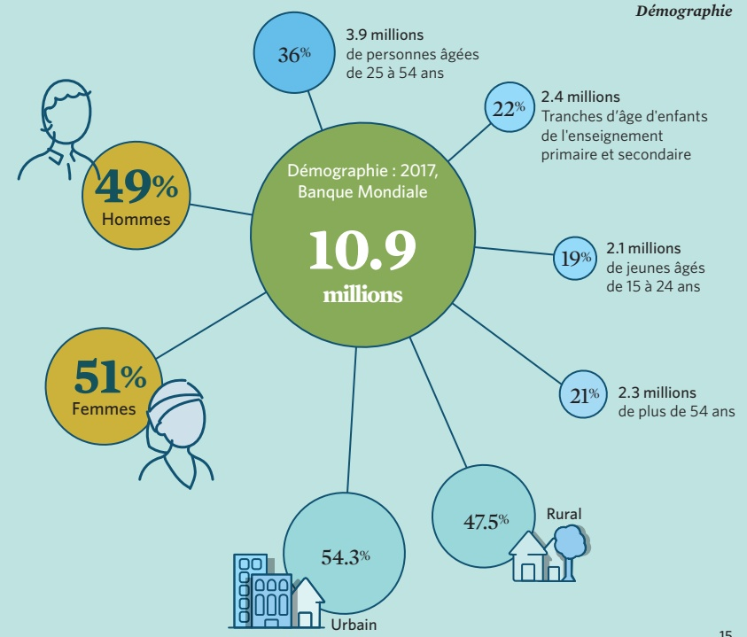

<!-- page 16 -->

Structure de la population en Haïti

|   |  |  |  |
| --- | --- | --- | --- |
|   | Masculin | Féminin | Total |
| Population totale d'Haïti | 5, 420,284 | 5, 562,083 | 10, 982,367 |
| Total Enfants (5 - 14) | 1, 229,744 | 1, 191,242 | 2, 420,986 |
| Enfants 0 - 5 | 647,509 | 624,264 | 1, 271,773 |
| Enfants 5 - 9 (primaire) | 627,975 | 605,610 | 1, 233,585 |
| Enfants 10 - 14 (Cycle Fondamental) | 601,769 | 585,632 | 1, 187,401 |
| Total jeunes (15 - 24) | 1, 082,700 | 1, 082,513 | 2, 165,213 |
| Jeunes 15 - 19 (Cycle secondaire) | 564,633 | 558,733 | 1, 123,366 |
| Jeunes 20 - 24 | 518,067 | 523,780 | 1, 041,847 |
| Total adultes (25 - 64) | 2, 225,093 | 2, 368,258 | 4, 593,351 |
| adultes 25 -34 | 913,031 | 941,931 | 1, 854,962 |
| adultes 35 - 54 | 1, 021,593 | 1, 107,994 | 2, 129,587 |
| adultes 55 - 64 | 290,469 | 318,333 | 1, 854,962 |
| Total Senior (65 ou plus) | 235,238 | 295,806 | 531,044 |
| Total population rurale |   |   | 5, 013,889 |
| Total population urbaine |   |   | 5, 968,477 |

Selon les indicateurs établis par la Banque Mondiale en 2017, en termes de structure démographique, Haïti compte une population totale de 10,9 millions d'habitants, dont 2,4 millions d'enfants dans les tranches d'âge de l'enseignement primaire et secondaire ; 2,1 millions de jeunes âgés de 15 à 24 ans ; 3,9 millions de personnes âgées de 25 à 54 ans ; et 2,3 millions de plus de 54 ans. Selon les estimations de la Banque Mondiale, 45,7% de la population totale (5 millions environ) vivent dans des zones rurales et 54,3% (5,9 millions environ) dans les zones urbaines, avec une concentration importante dans la région métropolitaine de Port-au-Prince, qui compte quelque 2,6 millions d'habitants.

<!-- page 17 -->

## Ecosysteme de l'éducation formelle

Enseignants 70,009

a. Enseignants Femmes 28%

b. Enseignants Hommes 72%

Écoles 13,599

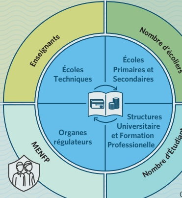

a. Écoles publiques 22.02%

b. Écoles non publiques 77.98%

c. Écoles fondamentale du troisième

cycle du secondaire 3,477

Élèves 2,210,221

a. Élèves Filles 1,090,027

b. Élèves Garçons 1,20,194

c. Elèves du secteur publique 486,620

d. Élèves du secteur non-publique 1,723,601

Centres de Formation Professionnelle 138

a. Publique 17

b. Privée - Sous le contrôle du MENFP 17

c. Sous le contrôle du MAST 199

d. Sous le contrôle du MARNDR (Damien) 10

<!-- page 18 -->

|   | TOTAL | Hommes | Femmes |
| --- | --- | --- | --- |
| Travailleurs | 29% | 18% | 26% |
| Indépendants | 26% | 18% | 27% |
| Élevage et Pêche | 23% | 15% | 17% |
| Dépendants de Transferts | 15% | 13% | 12% |
| Pas de revenus | 10% | 9% | 7% |
| Travailleurs Informels | 10% | 13% | 8% |
| Autres revenus | 8% | 10% | 6% |

<!-- page 19 -->

Les Départementts d'Haïti

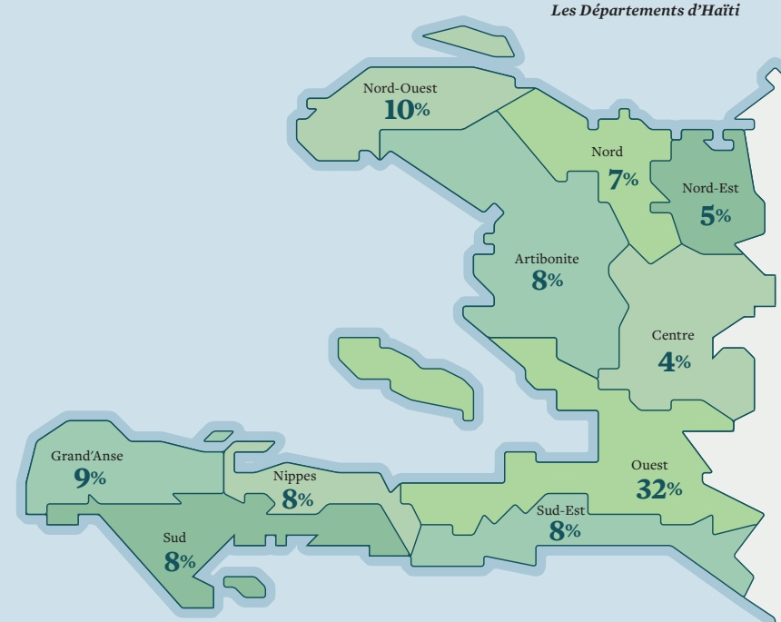

<!-- page 20 -->

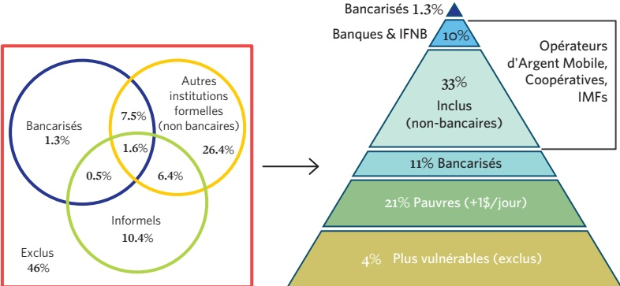

Chevauchement de l'inclusion financière

Remarque: En raison du nombre de personnes qui utilise les services des institutions financières bancaires et non bancaires, la population «exclue» est de 46%.

## Chevauchements

"Les consommateurs utilisent généralement une combinaison de produits et services financiers pour répondre à leurs besoins financiers"

• 1% des adultes utilisent exclusivement des services bancaires, et 26% utilisent exclusivement d'autres mécanismes formels.

• 16% utilisent une combinaison de mécanismes bancaires et / ou d'autres mécanismes formels et / ou informels pour gérer leurs besoins financiers, indiquant ainsi que leurs besoins ne sont pas entièrement satisfaits par le seul secteur formel.

• 10% de la population adulte s'appuient uniquement sur des mécanismes informels tels que des groupes d'épargne informels et des groupes de crédit pour économiser ou emprunter de l'argent ou pour couvrir des risques.

<!-- page 21 -->

| Category | Value (%) |
| --- | --- |
| 20 % Jamais | 20 |
| 25 % Toujours | 25 |
| 80 % CAUSES DE CETTE INSUFFISANCE DE FONDS |   |
| Planification et suivi - Combien de fois êtes-vous à court d'argent pour acheter des produits de première nécessité? (%) | 33 |
| Pas souvent | 24 |
| Souvent | 33 |
| Desquies imprévues ou autres besoins essentiellesly | 8 |
| Achat de médicaments / Soins de santé | 7 |
| Les voisins peuvent compter sur vous en cas de difficultés | 49 |
| Les amis ou voisins peuvent compter sur vous en cas de difficultés | 36 |
| La possibilité de compter sur l'Église ou groupes religieux en cas de difficultés | 36 |

COMMENT FAITES-VOUS FACE AUX OBLIGATIONS FINANCIÈRES EN CAS DE DIFFCULTÉS? (%)

<!-- page 22 -->

## Capacité financière

Gestion d'argent et Recherche de conseils financiers

| Category | Value (%) |
| --- | --- |
| Avez-Vous LE CONTRÔLE | 44 |
| Contrôle avec l'autres | 10 |
| Aucun contrôle Ne sait pas | 11 |
| DÉPENSES | 35 |

| Nombre de S'adressent | Enjeuxement pour la annuiture (%) |
| --- | --- |
| Ne vont nulle part pour des conseils | 32 |
| S'addressent à un membre de la communauté | 10 |
| S'adressent à un membre de la famille ou à un ami | 8 |
| S'adressent aux personnes âgées de la communauté | 7 |
| S'adressent à l'époux/ épouse - partenaire | 5 |
| S'adressent à la banque ou professionnel financier | 2 |
| Autres sources | 1 |
| S'adresse à un collègue ou employeur | 1 |

<!-- page 23 -->

Environ 53% des adultes estiment avoir besoin de plus d'informations sur leurs finances personnelles

Accès aux informations financières

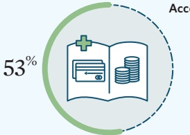

| Category | Value (%) |
| --- | --- |
| Comment épargner | 51 |
| Comment investir | 50 |
| Comment budgetiser | 37 |
| Comment obtenir un prêt | 27 |
| Avantages ou inconvénients, modalités et conditions des produits financiers | 13 |
| Quels produits financiers sont disponibles | 13 |
| Comment utiliser un produit financier | 12 |
| Comment choisir un produit financier | 12 |

ÉDUCATION FINANCIÈRE

SOUHAITÉE (%)

<!-- page 24 -->

Définition de l'éducation financière dans le contexte International

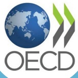

## OCDE

• Devenir plus sensible aux risques et opportunités en matière financière;

• Faire des choix raisonnés en toute connaissance de cause;

• Prendre d'autres initiatives efficaces pour améliorer leur bien-être financier;

Savoir où trouver une assistance financière.

## Banque Mondiale

• La capacité interne d'agir dans le meilleur intérêt financier;

• Ensemble d'attitudes, compétences, compréhensions pour la sélection et utilisation de services financiers;

• Possibilité d'accès à des services financiers en fonction des besoins des consommateurs.

<!-- page 25 -->

## Éducation financière: Quelle définition pour Haïti?

## En Haïti il s'agit de:

## ☑

S'approprier d'un socle de connaissances, de compétences et de savoir faire financiers

Afficher un comportement et des attitudes financiers plus responsables

Lutter contre l'exclusion financière et contribuer à la croissance économique

<!-- page 26 -->

## Les Principes Directeurs et Compétences Financières

Soutenir la SNIF visant à réduire la pauvreté et les inégalités économiques pour TOUS les Haïtiens.

Réduire les écarts social, financier et économique qui affectent les femmes, en les considérant comme l'un des groupes cibles prioritaires identifiés.

Encourager l'utilisation d'outils d'éducation financière numériques afin de réduire la fracture numérique et de promouvoir la sensibilisation, la connaissance et la confiance dans les services financiers numériques et les solutions d'argent mobile.

Réaliser des changements durables dans les attitudes et le comportement du public cible.

Encourager le travail conjoint et la collaboration entre différents acteurs des secteurs publics, privés et de la société civile afin de réaliser des objectifs communs.

Développer des activités sur la base des initiatives existantes et expériences précédentes facilitant les meilleures pratiques et les directives parmi tous les acteurs pour accroître la qualité, l'ampleur et la durabilité des initiatives.

Mettre en place des mesures/procédures de suivi et d'évaluation pour les progrès réalisés et leur résultat pendant la période de mise en oeuvre (moyen terme, fin du cycle).

<!-- page 27 -->

## MISSION

• Mobiliser les acteurs des secteurs clés pour promouvoir l'éducation financière.

• Favoriser un meilleur bien-être et une plus grande stabilité financière.

## VISION

• Comprendre l'utilité de certains produits et services financiers, leur fonctionnement et leurs avantages.

• Construire une solide communauté de praticiens en éducation financière.

• Compétitivité dans la fourniture de produits et services financiers et une amélioration générale de leur qualité.

• Définition des principaux groupes cibles.

- Domaines thématiques transversaux à prendre en compte dans les groupes cibles.

• Mettre en place un cadre de suivi et d'évaluation.

## PNEF 2020-2025

## OBJECTIF

• Développer les compétences financières des populations et renforcer les institutions financières.

• Améliorer l'alphabétisation financière.

• Entretenir et élargir une communauté de professionnels en éducation financière.

• Responsabiliser les consommateurs des produits et services financiers.

## LIGNES D'ACTION PRINCIPALES

• Environnement qui fournit les informations et les outils nécessaires à tous les Haïtiens.

• Elargissement des connaissances, compétences, attitudes et confiance.

• Décisions éclairées et responsables des finances personnelles, familiales et commerciales

pouvant renforcer leur bien-être financier et leur résilience.

<!-- page 28 -->

Groups Vulnérable

Les besoins financiers de base de cette tranche de la population restent le lissage de la consommation et la réduction des risques par le biais d'instruments d'épargne, d'assurance, de transfert et potentiellement de pension et ce, en liaison avec les programmes d'assistance sociale mis en place par l'État. Ceci est d'autant plus important que les personnes les plus pauvres sont plus susceptibles de se tourner vers les services informels, typiquement plus coûteux et risqués.

Exemples de compétences nécessaires en éducation financière : Autonomisation des populations vulnérables (bénéficiaires de prestations sociales), gestion des risques et du cycle des catastrophes, stratégies de résilience et d'atténuation des risques (via l'utilisation des plateformes numériques), stratégie d'épargne, etc.. Quant au sous-ensemble des personnes retraitées, leur sensibilisation aux escroqueries et aux fraudes est une question de plus en plus importante.

Total Actuel: 2.5M

<!-- page 29 -->

## Micros, petites et moyennes entreprises (MPME)

Les MPMEs sont en grande partie informelles et, dans la majorité des cas, se concentrent dans des activités générant très peu de valeur ajoutée pour l'économie. L'un des principaux obstacles à leur développement est l'absence d'accès aux capitaux nécessaires au démarrage ou à l'extension de leurs activités. La raison en est un manque évident tant de formation technique que d'informations disponibles sur leur historique de crédit et les garanties qu'elles peuvent offrir.

Viennent ensuite les contraintes systémiques, telles que les coûts d'enregistrement, le temps nécessaire à l'obtention d'une autorisation d'exploitation, etc.

Exemples de compétences nécessaires en éducation financière : Compétences de base en gestion flux de trésorerie, comptabilité, budgétisation, microcrédit, micro-assurance, gestion des risques, stratégies de résilience, plan d'entreprise, stratégies d'épargne, etc..

<!-- page 30 -->

## Agriculteurs

De nombreux petits-producteurs ne peuvent résister aux effets de la précarité de l'activité agricole, et se voient obligés de migrer vers les grandes villes. Pour contrer cette tendance, plusieurs programmes visant à améliorer la productivité du secteur agricole et sa capacité à générer des revenus ont été lancés. Ces activités ont été prises en compte dans l'élaboration du Plan National d'Éducation Financière. Les besoins des agriculteurs comprennent principalement l'assurance-récolte, des crédits adaptés au secteur agricole exploité (en tenant compte de la maturité de la récolte) et des dépôts qui peuvent leur permettre de conserver leur capital ou de servir de garantie.

Exemples de compétences nécessaires en éducation financière : Compétences de base en gestion — flux de trésorerie, comptabilité, budgétisation, microcrédit, micro-assurance, gestion des risques et du cycle des catastrophes, stratégies de résilience et d'atténuation des risques, stratégies d'épargne, etc. Ces thèmes devraient inclure des considérations relatives à l'éducation financière des femmes.

Total Actuel: 1M

<!-- page 31 -->

## Femmes

Comparées aux hommes, les femmes ont un accès plus restreint à l'éducation. Cependant, les femmes occupent une place importante au sein de la population active du pays. Plus de 50% d'entre elles exercent des activités économiques, principalement dans le secteur commercial, les ventes, les transports, les hôtels, les services communautaires et l'agriculture. Malgré cela, beaucoup d'entre elles sont confinées dans le secteur informel. Étant donné la forte participation des femmes à la vie active du pays, le plan national doit les accompagner.

Exemples de compétences nécessaires en éducation financière : Priorités monétaires, budget familial, épargne et planification, identification des institutions et services financiers existants, discernement des avantages et inconvénients de chaque institution et produit, compréhension des coûts (directs et indirects) et des responsabilités (remboursement), etc.. Un des thèmes transversaux à considérer parmi les groupes cibles est l'autonomisation des femmes et des filles.

<!-- page 32 -->

## Les principaux groupes cibles

Jeunes

Dans le cadre de la mise en oeuvre de la Stratégie Nationale d'Inclusion Financière, il est important de mettre à la disposition des jeunes des produits et services financiers tels que des prêts à l'éducation et à la formation et, s'agissant des promoteurs de projets, des produits de microassurance et de capital-risque.

Exemples de compétences nécessaires en éducation financière : Programmes scolaires (approché d'impact graduel sur les compétences de base, mathématiques, etc.), compréhension des produits et services financiers susmentionnés, culture numérique et sensibilisation au numérique, stratégies d'épargne et d'emprunt responsable, etc.. Outils d'apprentissage spécifiques en fonction des contextes des jeunes (milieux formels et informels) : les jeux numériques de divertissement, disponibles en ligne.

Total Actuel: 2.165M

Target: 1M

Personnes vivant en zones rurales

La plupart de la population rurale n'a pas encore accès aux services financiers de base tels que les structures de paiement, l'épargne financière et les dispositifs de crédit du système financier formel. Cependant, la téléphonie mobile en Haïti offre une occasion unique de bancariser les exclus du système traditionnel et de leur offrir l'accès, à moindre coût, à des produits et services financiers numériques tels que dépôts, prêts, virements de fonds nationaux ou internationaux et, même, assurances.

Exemples de compétences nécessaires en éducation financière : Compétences de base en gestion — flux de trésorerie, comptabilité, budgetisation, microcrédit, microassurance, gestion des risques, gestion du cycle des catastrophes, stratégies de résilience et d'atténuation des risques, stratégies d'épargne, connaissances numériques de base en matière de sensibilisation, etc.

<!-- page 33 -->

# Travailleurs migrants et leurs familles

Compte tenu de l'importance des transferts sans contrepartie vers Haïti, surtout ceux qui facilitent les investissements productifs, il est nécessaire de mettre à la disposition des travailleurs migrants et de leurs familles des services de transfert rapides, facilement accessibles et à prix modéré.

Exemples de compétences nécessaires en matière d'éducation financière : Permettre aux expéditeurs et destinataires d'envois de fonds (nationaux et internationaux) de bénéficier des meilleurs prix et de se concentrer sur les opportunités d'investissements productifs, en plus de la consommation, de l'épargne et de la planification ; identifier les opérateurs et les services de transfert d'argent existants ; scruter les opportunités latentes et discerner les désavantages potentiels, en exemple: le programme Haiti Greenback 2.0, lequel cible les questions d'éducation financière en faveur des receveurs de transfert.

<!-- page 34 -->

## AXE PRIORITAIRE 1 : CONSOLIDATION D'UNE COMMUNAUTÉ DE PRATICIENS EN ÉDUCATION FINANCIÈRE

## Raisonnement

Au coeur de la mise en oeuvre du plan national d'éducation financière, il convient de renforcer l'appropriation et la capacité des différents praticiens de l'éducation financière dans cette tâche commune. Ceci ne sera possible que par une communication étroite entre eux, un partage des meilleures pratiques et en renforçant les capacités permettant d'améliorer la qualité des services, les initiatives et les programmes. Les résultats doivent être surveillés, suivis et évalués.

Objectif Coordonner les praticiens existants et nouveaux en éducation financière (concepteurs, responsables de la mise en œuvre, donateurs) dans le but de promouvoir les meilleures pratiques internationales, le renforcement des capacités et un sentiment de « communauté » attirant davantage de soutien interne et externe à cette cause.

## Acteurs / groupes PNEF :

cibles - PNEF responsable et coordonateurs (BRH, MENFP, MEF)

- PNEF processus de consultation (Comité de Pilotage)

PNEF Unité de mise en oeuvre (Groupes de travail)

Programmes d'éducation financière (Acteurs):

- Concepteurs de programmes d'éducation financière (MENFP, École, ONG, Secteur Financier)

- Mise en oeuvre de programmes d'éducation financière (écoles, IMF, mutuelles, fondations, banques, société de développement etc.)

Bailleurs de fonds des programmes d'éducation financière (gouvernements, donateurs nationaux et internationaux)

<!-- page 35 -->

| Besoins / Competences | - Marque du PNEF, campagnes nationales\n- Coordination des acteurs d'éducation financière et des programmes\n- Renforcement des capacités |
| --- | --- |
| Outils / Programmes | - Utiliser la télévision, la radio ou la presse pour promouvoir une campagne nationale d'éducation financière.\n- Site Web national : référence pour le contenu de l'éducation financière et peut inclure une liste de matériel pédagogique provenant de sources non gouvernementales approuvées ainsi que de ministères.\n- Événement / ateliers de renforcement des capacités. |
| Sujet transversal : genre et femmes | - Une optique de genre dans la communication du plan d'éducation financière est fortement recommandée. |
| Sujet transversal : numérique | Une page Web dédiée avec la marque SNIF / PNEF est fortement recommandée. Une plateforme numérique ayant pour objectif de partager des informations et des campagnes avec la population ciblée et de partager des informations entre les praticiens d'éducation financière. |
| Référence document / plan existant | Certains pays ayant mis en place des stratégies d'éducation financière ont développé une forte communauté de praticiens de l'éducation financière, par exemple : Australie, Canada, Colombie, Pérou, Rwanda, Seychelles. |

<!-- page 36 -->

## AXE PRIORITAIRE 2 : ÉDUCATION FINANCIÈRE DANS LES ÉCOLES ET UNIVERSITÉS

Raisonnement L'éducation financière dans les écoles et les universités ciblant les enseignants, les élèves de différents niveaux d'enseignement et la communauté scolaire dans son ensemble permettent à long terme de développer une culture financière forte en Haïti, qui se reflétera dans les générations futures. Pratiquement toutes les stratégies d'éducation financières pour être durables doivent consacrer des ressources à un objectif similaire. L'éducation financière dans les écoles et les universités devrait viser à développer les compétences des enfants et étudiants aux différentes étapes de la croissance cognitive et fournir des conseils pratiques aux générations d'élèves sur le point de commencer leur cycle de vie productif. En partant du principe de la formation des formateurs comme raison d'assurer une transmission optimale des connaissances et des compétences. Les enseignants devraient d'abord être exposés et formés à ces supports.

## Objectif

Garantir que les élèves des niveaux primaires et secondaires ainsi que les universitaires de l'enseignement formel sont bien préparés aux notions de base de finances personnelles, y compris d'épargne, et connaissent bien les options des institutions financières et des services financiers, ainsi que les droits et responsabilités en tant qu'utilisateurs de ces services.

Acteurs / groupes - Etudiants : à partir du secondaire, beaucoup d'entre eux rejoindront bientôt cibles une vie économique active

- Enseignants : Enseignement primaire, secondaire et universitaire

<!-- page 37 -->

| Besoins / Compétences | - Calcul de base, choix parmi différentes options\n- Fonction de l'économie et des institutions et services financiers\n- Identifier les droits et les responsabilités dans l'utilisation de produits et services financiers\n- Pour que les enseignants fournissent le matériel et la formation leur permettant d'être plus autonome financièrement |
| --- | --- |
| Outils / Programmes | - Curriculum : développement de cours en éducation financière à des niveaux multiples en français et en créole\n- Formation : il conviendrait de proposer aux enseignants existants un perfectionnement professionnel en matière d'éducation financière, ainsi qu'une préparation initiale à l'université pour les nouveaux enseignants. |
| Sujet transversal : genre et femmes | Le matériel et les leçons devraient être révisés avec une approche sensible au genre afin d'éviter tout biais involontaire entre les sexes et d'attirer l'attention des étudiants et des étudiantes. |
| Sujet transversal : numérique | - Développer une approche numérique pour soutenir les leçons avec du matériel numérique et interactif, y compris des vidéos, des audiovisuels combinés avec du divertissement et des jeux, et des applications complémentaires pour les enseignants et les étudiants.\n- Sensibilisation à la culture financière numérique |
| Référence document / plan existant | Récemment, la Banque centrale d'El Salvador, par l'intermédiaire de son comité d'éducation financière, a éveloppé du matériel de formation pour les enseignants en éducation de base. |

<!-- page 38 -->

## AXE PRIORITAIRE 3 : AUTONOMISATION DES MICROENTREPRENEURS URBAINS ET RURAUX

| Raisonnement | Selon la structure économique d'Haïti où 29% des adultes sont déclarés indépendants et 23% de petits exploitants de l'agriculture et de la pêche, dont l'activité complémentaire pourrait éventuellement être transférée à une microentreprise, il est essentiel de renforcer leur capacité/compétences financières de base avec l'objectif de permettre des activités durables et productives qui pourraient éventuellement être pleinement intégrées dans le système financier formel. |
| --- | --- |
| Objectif | Garantir la qualité et l'utilité des programmes et matériels de formation en micro-entrepreneurs et d'éducation financières actuels et futurs. |
| Acteurs / groupes cibles | - Micro-entrepreneurs en milieu rural\n- Micro-entrepreneurs en milieu urbain\n- MPME appartenant à des femmes\n- Remarque : les micro-entrepreneurs peuvent être vus dans une définition large (incluant les agriculteurs et les éleveurs par exemple) |
| Besoins / Compétences | - Micro-entrepreneuriat (comptabilité / gestion de trésorerie / financement)\n- Connaissances sur l'épargne et investissements/assurance des actifs\n- Connaissances et confiance dans les produits et services financiers et sensibilisation aux programmes gouvernementaux/gestion de plaintes\n- Connaissances et utilisation de la microfinance (microcrédit) |

<!-- page 39 -->

| Outils / Programmes | Actuellement, différents programmes sont proposés par différentes parties prenantes. Une révision de ceux-ci en tenant compte de leurs groupes cibles et de leur contexte pourrait permettre de développer une bonne pratique du contenu minimum que ces programmes devraient inclure. |
| --- | --- |
| Sujet transversal : genre et femmes | - Examiner le contenu et la conception des programmes existant dans une perspective sexospécifique afin de s'assurer que le matériel et les techniques d'apprentissage répondent aux besoins des hommes et des femmes.\n- Concevoir des programmes spécifiques pour les micro-entrepreneurs femmes répondant à des défis et à des demandes spécifiques et conçues sur mesure pour leur fournir des compétences en matière de négociation et des compétences non techniques permettant de réussir dans les affaires. |
| Sujet transversal : numérique | Soutenir et promouvoir le développement d'outils numériques pour renforcer les attitudes, les compétences et les comportements des micro-entrepreneurs et les orienter vers les ressources disponibles pour le renforcement des capacités. |
| Référence document / plan existant | Palmis Mikwofinans Sosyal (PMS) d'Entrepreneurs du Monde est un programme de microfinance destiné à aider les micro-entrepreneurs à développer leurs activités génératrices de revenus et à sortir leur famille de l'extrême pauvreté. PMS comprend des cours de formation pour améliorer l'impact de ses services de financement. |

<!-- page 40 -->

## AXE PRIORITAIRE 4 : MIGRANTS ET LEURS FAMILLES

Raisonnement Les migrants et les familles dépendant des envois de fonds en Haïti représentent une proportion importante de la population haïtienne, soit 15% des adultes (âgés de 15 ans et plus), et les personnes dépendantes de ces envois de fonds sont également représentées par une proportion plus élevée de femmes (58% de femmes 42% des hommes) à des âges extrêmes (52% de moins de 2 ans et 12% de plus de 60 ans). L'éducation financière pour beaucoup de ces ménages représente une opportunité de trouver le moyen d'inciter et de permettre une planification à plus long terme et une résilience supplémentaire grâce à la constitution d'actifs et à l'insertion de ces familles dans des services financiers formels susceptibles de contribuer à la réalisation de ces objectifs.

Objectif Soutenir les expéditeurs et les destinataires d'envois de fonds en compétences afin de comparer activement les différents services financiers, droits et responsabilités et le meilleur moyen de se plaindre et de dénoncer les abus des fournisseurs de services financiers, de planifier à long terme et de recherche des débouchés commerciaux.

Acteurs / groupes - Expéditeurs et destinataires des transferts de fonds (internationaux cibles et nationaux)

- Associations de migrants

- Mutuelles, Institutions de Microfinance (MFls) et caisses populaires

<!-- page 41 -->

| Besoins / Compétences | Comment utiliser efficacement les fonds de transfert, trouver des options de financement à des taux d'intérêt plus abordables, constituer des actifs, préparer un budget personnel et se préparer à des urgences imprévues, développer des activités productives et développer les compétences entrepreneuriales des destinataires. |
| --- | --- |
| Outils / Programmes | Développer des contenus spécifiques pour les destinataires des transferts de fonds, spécialement pour les femmes. |
| Sujet transversal : genre et femmes | Étant donné que la majorité des femmes reçoivent des envois de fonds (58% contre 42% des hommes), les programmes spécifiques de VSLS (Village Savings and Loans) et des IMF doivent être axés sur leurs besoins et sur les moyens de garantir la sécurité, d'investir dans des activités productives et de renforcer la résilience. |
| Sujet transversal : numérique | L’utilisation de matériel audiovisuel et de narration est fortement recommandée (le taux d’analphabetisme est plus élevé chez les femmes âgées dans les zones rurales), des vidéos et des messages SMS en guise de rappel à la sauvegarde sont des outils possibles à encourager. |
| Référence document / plan existant | Programme Haïti Greenback 2.0 en matière d’éducation financière. |

<!-- page 42 -->

## AXE PRIORITAIRE 5 : GROUPES VULNERABLES EXTRÊMES

| Raisonnement | Les groupes vulnérables représentent une proportion élevée d'Haitien, en raison notamment de conditions météorologiques extrêmes et d'événements naturels. Selon le recensement de 2012, près de 40% des Haïtiens vivant en zones rurales et 20% des zones urbaines vivent sous le seuil de pauvreté. L'éducation financière de ces groupes implique des compétences supplémentaires à infuser, telles que, par exemple, les compétences générales, la confiance en soi et l'autonomie. Les méthodologies ciblant ces groupes ont déjà été construites avec succès par certains acteurs de l'éducation financière, et le PNEF devrait trouver des moyens de poursuivre le soutien et la recherche de ces méthodologies pour les rendre évolutives et durables. |
| --- | --- |
| Objectif | Soutenir et encourager de nouvelles méthodologies et voies pour développer les programmes existants destinés aux populations vulnérables. |
| Acteurs / groupes cibles | - Individus et ménages en dessous du seuil de pauvreté\n- Personnes déplacées / familles (stratégie d'adaptation aux chocs)\n- Enfants, personnes du troisième âge, etc. |
| Besoins / Compétences | - Compétences non techniques, y compris la confiance en soi et l'autonomie\n- Développement d'une activité productive\n- Finances personnelles : budgétisation, épargne, emprunt responsable\n- Stratégies de résilience (renforcement du réseau social) |

<!-- page 43 -->

| Outils / Programmes | - Les programmes existant de « remise des diplômes » ont été évalués et permettent de responsabiliser les gens et d’offrir des compétences financières\n- Développement d’outils comportementaux ciblant les groupes vulnérables |
| --- | --- |
| Sujet transversal : genre et femmes | - Les femmes de ces groupes présentent un intérêt particulier en raison de leur importance dans la constitution de réseaux au sein des communautés, de leur résilience et de leurs capacités de transmission. Il convient donc de souligner son rôle en tant que groupes cibles potentiels au sein de cette priorité. |
| Sujet transversal : numérique | - Les programmes d’éducation financière bien adaptés au contexte et utilisant des outils numériques doivent être explorés et encouragés à utiliser VSLS (Village Savings and Loans) et d’autres institutions comme catalyseurs. |
| Référence document / plan existant | - Le programme “La voie vers une vie meilleure” de Fonkoze pour permettre aux femmes les plus pauvres d’Haïti de se sortir de l’ultra pauvreté. |

<!-- page 44 -->

## AXE PRIORITAIRE 6: AUTONOMISATION ET PROTECTION DES CONSOMMATEURS

Raisonnement L'autonomisation des consommateurs de services financiers est cruciale pour la mise en place d'un système financier plus compétitif, stable et résiliente. Haïti est sur la voie d'accroître son inclusion financière, notamment par le biais d'institutions financières non bancaires et des services financiers numériques. En outre, les initiatives de responsabilisation des consommateurs destinées à permettre aux utilisateurs financiers actuel et futur de tirer davantage parti du bien-être généré par les services financiers grâce à l'épargne, aux emprunts responsables et aux services financiers innovants, notamment la culture financière numérique, sont parfaitement alignés sur les autres priorités définies par la SNIF.

Objectif Développer la sensibilisation des institutions financières en matière de gestion et d'éducation financière du personnel ; sensibilisation des clients à la protection des consommateurs, à la connaissance et à la confiance dans les produits et services financiers.

Acteurs / groupes - Institutions financières : Banque centrale, banques commerciales, IMF, IFNB, etc.

- Gestion des institutions financières

Personnel des l'institutions financières

- Clients des institutions financières

<!-- page 45 -->

<table><tr><td>Besoins / Compétences</td><td>- Techniques d'économie et de budgétisation (planifier à l'avance)</td></tr><tr><td>- Sensibilisation à la protection des consommateurs (prévention de la fraude / droits de recours / conditions des produits financiers</td></tr><tr><td>- Emprunt / crédit / crédit responsable</td></tr><tr><td>- Produits financiers supplémentaires : argent mobile, assurance, microassurance, etc.</td></tr><tr><td>- Éducation et sensibilisation aux obligations de BRH déjà lancées</td></tr><tr><td>Outils / Programmes</td><td>- Des campagnes de sensibilisation dans une approche progressive pour cibler différents groupes et en utilisant différents canaux, en particulier au moment où les personnes ont besoin de services financiers, sont idéales.</td></tr><tr><td>- L'éducation ludo-éducative combinant des feuilletons radiophoniques et des messages clés d'enseignement supérieur s'est avérée gagnant en ampleur et en impact.</td></tr><tr><td>Sujet transversal : genre et femmes</td><td>Un expert en genre devrait examiner le contenu des campagnes d'éducation pour s'assurer qu'il fait appel aux choix et aux préférences des femmes et qu'il répond à des besoins spécifiques.</td></tr><tr><td>Sujet transversal : numérique</td><td>Les applications numériques, y compris les jeux, les vidéos, y compris la narration, et une campagne de messages SMS devraient être promus en tant qu'outils.</td></tr></table>

<!-- page 46 -->

Consolidation d'une forte communauté de praticiens en éducation financière

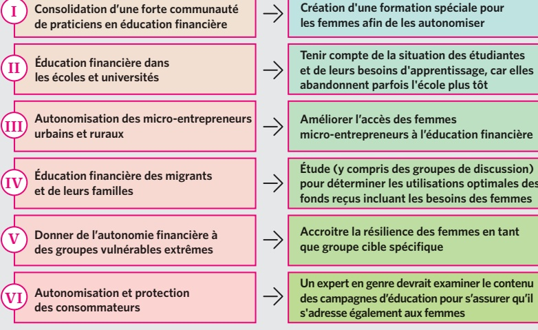

Ⅱ Éducation financière dans les écoles et universités

III Autonomisation des micro-entrepreneurs urbains et ruraux

IV Éducation financière des migrants et de leurs familles

Création d'une formation spéciale pour les femmes afin de les autonomiser

V Donner de l'autonomie financière à des groupes vulnérables extrêmes

Tenir compte de la situation des étudiantes et de leurs besoins d'apprentissage, car elles abandonnent parfois l'école plus tôt

Autonomisation et protection des consommateurs

Améliorer l'accès des femmes

micro-entrepreneurs à l'éducation financière

Étude (y compris des groupes de discussion)

pour déterminer les utilisations optimales des

fonds reçus incluant les besoins des femmes

Accroitre la résilience des femmes en tant

que groupe cible spécifique

Un expert en genre devrait examiner le contenu

des campagnes d'éducation pour s'assurer qu'il

s'adresse également aux femmes

46% familles monoparentales | 77.5% dans le secteur du commerce

29.3% dans les services | 6% transport

(Source : Entrepreneurs du Monde, 2018)

<!-- page 47 -->

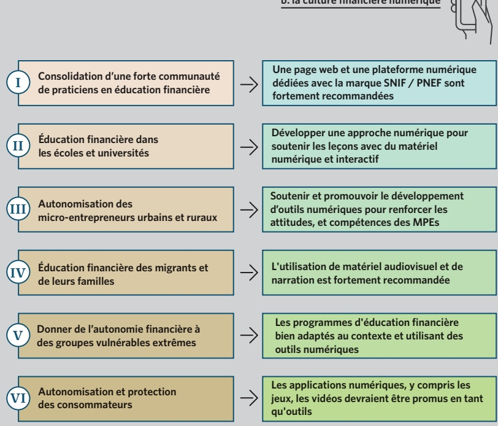

I Consolidation d'une forte communauté de praticiens en éducation financière

Ⅱ Education financière dans les écoles et universités

Une page web et une plateforme numérique dédiées avec la marque SNIF / PNEF sont fortement recommandées

III Autonomisation des micro-entrepreneurs urbains et ruraux

IV Éducation financière des migrants et de leurs familles

Soutenir et promouvoir le développement d'outils numériques pour renforcer les attitudes, et compétences des MPEs

V Donner de l'autonomie financière à des groupes vulnérables extrêmes

VI Autonomisation et protection des consommateurs

Les programmes d'éducation financière bien adaptés au contexte et utilisant des outils numériques

Les applications numériques, y compris les jeux, les vidéos devraient être promus en tant qu'outils

<!-- page 48 -->

• La Strategie Nationale d'Inclusion Financière soutient le Plan National d'Éducation Financière.

## Forces

• Appui à la direction, à la coordination et au suivi de la BRH, du MEF et du MENFP.

• Plusieurs acteurs des secteurs public, privé et social, développement une gamme de différentes initiatives d'éducation financière.

Bailleurs de Fonds internes et externes désireux et capables de soutenir diverses initiatives coordonnées.

age.

• Capacité à tirer parti des expériences actuelles de littératie numérique.

Synergies potentielles entre les initiatives d'autres politiques du SNIF, notamment avec la protection des consommateurs de produits financiers.

• Pr

Opportunités

## Faiblesses

## Avant le PNEF

· Modèle de coordination à ses débuts.

Absence d'une unité spécialisée en éducation financière pour guider la mise en oeuvre.

· Absence de systèmes d'évaluation et de notification.

• Actions d'éducation financière dispersées avec un financement dispersé.

• Besoin d'une meilleure coordination des bailleurs de fonds actuels et potentiels

L'instabilité sociale peut retarder la mise en œuvre et les ressources.

Manque de sensibilisation du grand public aux questions d'éducation financière.

Manque de prise de conscience / d'appui des avantages potentiels d'éducation financière par certains des acteurs privés.

• Difficultés à atteindre certaines populations cibles à grande échelle et de

manière durable.

Menaces

<!-- page 49 -->

## SECRETARIAT PNEF

Suivre les résolutions, être un intermédiaire entre le comité de haut niveau et le Comité de Pilotage, diriger le S&E du PNEF.

## AUTORITE DE HAUT NIVEAU LEADERSHIP ET COORDINATION PNEF

BRH

Diriger le parcours du PNEF, y compris la planification, la mise en oeuvre, le suivi et l'évaluation du PNEF selon une approche coordonnée.

Réviser en temps utile les décisions stratégiques soumises par le Comité de Pilotage, liées en particulier au pilier Éducation Financière du SNIF.

BRH, MENFP, MEF

## COMITE DE PILOTAGE PNEF

Soutenir la direction et la coordination du PNEF en partageant une expertise technique dans diverses perspectives d'éducation financière.

## MEMBRES DU COMITE DE PILOTAGE

GROUPES DE TRAVAIL SUR L'IMPLÉMENTATION

EXPERTS IDENTIFIÉS À L'INTERIEUR

DU COMITE DE PILOTAGE

<!-- page 50 -->

## Comité de Pilotage du PNEF - Unité Consultative

Responsabilités

Soutenir la démarche technique pour la conception, l'élaboration et la mise en œuvre du PNEF

## Acteurs

• Association pour la Coopération avec la Micro-Entreprise (ACME)

• Alternative Insurance Company (AIC)

• Association Nationale des Institutions de Micro-Finance d'Haïti (ANIMH)

• Association Professionnelle des Banques (APB)

• Banque de la République d'Haïti (BRH)

· CARE Haiti

• Fédération des caisses populaire Le Levier

• Finance pour Tous / WOCCU

• Institut Haïtien de Satistique et d'Informatique (IHSI)

• Konsèy Nasyonal Finansman Popilè (KNFP)

• Ministère de l'Économie et des Finances (MEF)

• Ministère de l'Education Nationale et de la Formation Professionnelle (MENFP)

• Ministre du Commerce et de l'Industrie (MCI)

• Université Quisqueya (UNIQ)

<!-- page 51 -->

<table><tr><td>GROUPE DE TRAVAIL PNEF</td><td>PRIORITÉS</td><td>DIRIGÉ PAR  $ ^{{*}} $</td></tr><tr><td>Groupe de travail #1</td><td>Communauté de praticiens de l'éducation financière</td><td>BRH</td></tr><tr><td>Description\nObjectif : obtenir l'adhésion et renforcer la propriété des différents praticiens de l'éducation financière au cœur de la mise en œuvre du PNEF.</td></tr><tr><td>Groupe de travail #2</td><td>L'éducation financière à l'école et à l'université</td><td>MENFP\nSupport :\nBRH, Ministère de la Jeunesse et des Sports</td></tr><tr><td>Description\nObjectif : 1) développer les compétences des enfants aux différents stades de la croissance cognitive et fournir des conseils pratiques aux générations d'élèves sur le point de commencer ou de commencer leur cycle de vie productif, 2) un programme de formation de formateurs pour les enseignants.</td></tr><tr><td>Groupe de travail #3</td><td>Autonomisation des micro-entrepreneurs</td><td>MCI/ Direction de l'Entrepreneur et du Développement Industriel (DEDI), DGI</td></tr><tr><td>Description\nObjectif : Renforcer les compétences financières de base des micro-entrepreneurs pour permettre des activités durables et productives qui pourraient éventuellement être pleinement intégrées au système financier formel.</td></tr></table>

<!-- page 52 -->

## Le tableau de mise en œuvre du PNEF

<table><tr><td>GROUPE DE TRAVAIL PNEF</td><td>PRIORITÉS</td><td>DIRIGÉ PAR  $ ^{{*}} $</td></tr><tr><td>Groupe de travail #4</td><td>Migration et envois de fonds</td><td>BRH\nSupport :\nAssociation des maisons de transfert</td></tr><tr><td>Description\nObjectif : Encourager et permettre une planification à long terme et une résilience supplémentaire grâce à la constitution d’actifs pour les expéditeurs et les destinataires d’envois de fonds.</td></tr><tr><td>Groupe de travail #5</td><td>Groupes Vulnérables Extrêmes</td><td>Fonkoze\nSupport :\nANACAPH et AHFI (Alliance Haïtienne pour l’Inclusion Financière)</td></tr><tr><td>Description\nObjectif : Insuffler aux compétences de base le comportement financier, comme par exemple les compétences générales, la confiance en soi et l’autonomie, ainsi que</td></tr></table>

Objectif : Insuffler aux compétences de base le comportement financier, comme par exemple les compétences générales, la confiance en soi et l'autonomie, ainsi que les compétences et attitudes de base en finances personnelles.

<!-- page 53 -->

<table><tr><td>GROUPE DE TRAVAIL PNEF</td><td>PRIORITÉS</td><td>DIRIGÉ PAR  $ ^{{*}} $</td></tr><tr><td>Groupe de travail #6</td><td>Autonomisation et protection des consommateurs\nDescription\nObjectif : Développer la sensibilisation des institutions financières en matière de gestion et d'éducation financière du personnel ; sensibilisation des clients à la protection des consommateurs, à la connaissance et à la confiance dans les produits et services financiers.\nSujets transversaux : genre\nDescription\nObjectif : Donner plus d'occasions aux filles, aux jeunes femmes et aux femmes de renforcer leurs capacités et de les responsabiliser à travers un changement d'attitude, de connaissances et de compétences.\nSujets transversaux : canal numérique\nDescription\nObjectif: Construire une identité numériques et renforcer la sensibilisation et l'alphabétisation au numérique en Haiti.</td><td>BRH, APB et MCI/ Direction du Contrôle de la Qualité et de la Protection du Consommateur (DCQPC)</td></tr><tr><td>Support du Groupe de travail PNEF</td><td>Choisir un responsable dans chaque groupe de travail</td></tr><tr><td>Sujets transversaux : genre\nDescription\nObjectif : Donner plus d'occasions aux filles, aux jeunes femmes et aux femmes de renforcer leurs capacités et de les responsabiliser à travers un changement d'attitude, de connaissances et de compétences.\nSujets transversaux : canal numérique\nDescription\nObjectif: Construire une identité numériques et renforcer la sensibilisation et l'alphabétisation au numérique en Haiti.</td><td>Choisir un responsable dans chaque groupe de travail</td></tr></table>

<!-- page 54 -->

## Autorités Administratives : BRH, MEF, MENFP

## Associations / Fédérations

• Association Nationale des Institutions de Micro Finance d'Haïti (ANIMH)

• Association pour la Coopération avec la Micro Entreprise (ACME)

• Association Professionnelle des Banques (APB)

• Fédération Le Levier

• Konsèy Nasyonal Finansman Popilè (KNFP)

## Fondations et ONGs

· CARE Haiti

• Entrepreneurs du Monde

• Finance pour Tous

Fondation Fonkoze

Oxfam Haiti

## Fournisseurs de services financiers

• ACME

• AIC

• Digicel ("Mon Cash")

FINCA Haiti

• Natcom (LajanCash)

## Fournisseurs d'éducation formelle

Écoles publiques

Écoles privées

• Associations d'enseignants

• Associations de parents

• Les universités

Écoles Professionelles

Institutions de développement et donateurs : AFD, AFI, Banque Mondiale, OECD/INFE, BID, IDRC, USAID, donateurs nationaux.

<!-- page 55 -->

Le PNEF d'Haïti suivra le calendrier de la SNIF afin de garantir des synergies spécifiques dans les phases de formulation de mise en œuvre et d'évaluation

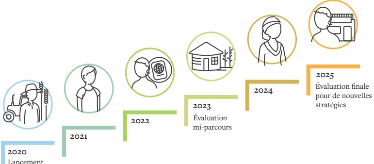

LE CALENDRIER D'EXÉCUTION DU PNEF S'ÉTALERA

SUR LA PERIODE DE 2020 À 2025

Une évaluation mi-parcours se tiendra en 2023, période à laquelle une consultation des acteurs sera réalisée pour apprécier l'impact des actions menées et, au besoin, d'ajuster les interventions.

<!-- page 56 -->

## Quelle définition pour Haïti?

S'approprier d'un socle de connaissances, de compétences et de savoir faire financiers

Afficher un comportement et des attitudes financiers plus responsables

Lutter contre l'exclusion financière et contribuer à la croissance économique

Ministère de l'Éducation

Nationale et de la Formation

Professionnelle (MENFP)

Port-au-Prince, Haiti

Tel: +509 4894-2908

Tel: +509 2811-9035

http://menfp.gouv.ht/

Port-au-Prince, Haïti

Tel: +509 2992-1067

Tel: +509 2558-6665

http://www.mef.gouv.ht/

Ministère de l'Économie et des Finances (MEF)

Banque de la République

d'Haïti (BRH)

Port-au-Prince, Haiti

Tel: +509 2299-1063

www.brh.ht

Alliance for Financial Inclusion (AFI)

Kuala Lumpur, Malaysia

Tel: +60 3 2776 9000

www.afi-global.org
