<!-- page 1 -->

BANQUE DE LA RÉPUBLIQUE D'HAÏTI

# Compilation des discours du Gouverneur Charles Castel

2007 - 2015

<!-- page 2 -->

## Contents

PROFIL DU GOUVERNEUR CHARLES CASTEL ..... 4
A. EXPERIENCES PROFESSIONNELLES ..... 4
B - ÉTUDES UNIVERSITAIRES ..... 5
C- SÉMINAIRES ET CONFÉRENCES ..... 5
D. AFFILIATION ..... 6
2007 ..... 7
SIGNATURE DU PROTOCOLE D'ACCORD ENTRE LA BRH ET L'AGENCE FRANÇAISE DE DEVELOPPEMENT (AFD) - LE 20 NOVEMBRE 2007 7
DISCOURS D'INVESTITURE CONSEIL D'ADMINISTRATION BRH – 27 SEPTEMBRE 2007) ..... 9
DISCOURS FIN D'ANNEE 2007 ..... 15
2008 ..... 17
IN MEMORIAM ANTONIO ANDRE – LESLIE DELATOUR / SEPTEMBRE 2008 ..... 17
LA CONSTRUCTION DU SIÈGE SOCIAL : UN BEL EXEMPLE DE CONTINUITÉ ..... 20
INAUGURATION DE L'ATELIER DE TRAVAIL SUR LE SYSTEME DE PAIEMENTS INTERBANCAIRES HAITIENS - MONTANA LE 26 MARS 2008 ..... 21
29EME ANNIVERSAIRE DE LA BANQUE CENTRALE - ..... 24
2009 ..... 28
LANCEMENT DU LIVRE PELOU ..... 28
LANCEMENT DU PROGRAMME DU PROGRAMME DE CERTIFICAT EN GESTION DES POLITIQUES PUBLIQUES - AMERICAN UNIVERSITY ..... 31
30EME ANNIVERSAIRE DE LA BRH - 25 SEPTEMBRE 2009 – KARIBE ..... 35
29 – 30 – 31 OCTOBRE 2009 (CARICOM) ..... 46
11 DECEMBRE 2009 ..... 49
UNIVERSITE QUISQUEYA - COLLATION DE GRADES - 20 DECEMBRE 2009 ..... 50
2010 ..... 55
LES MOYENS DE PAIEMENT - 24 SEPTEMBRE 2010 - KARIBE ..... 55
COLLOQUE MICROFINANCE - 28 SEPTEMBRE 2010 - ..... 58
2011 ..... 61
POSE DE LA PREMIERE PIERRE DU CENTRE DE CONVENTION ET DE DOCUMENTATION (CDC) - 27 JANVIER 2011 – RUE PAVEE ..... 61
LANCEMENT DU LIVRE ELECTRONIQUE - 11 MAI 2011 – LE RITZ - ..... 65
BANQUE MOBILE - LE 10 JANVIER 2011 ..... 69
SERVICE DE PAIEMENT MOBILE - 2011 - PARC-HISTORIQUE ..... 72
REHABILITATION DU CENTRE-VILLE DE PORT-AU-PRINCE - 18 JUILLET 2011 ..... 75
2012 ..... 79

<!-- page 3 -->

ETATS GENERAUX DE L'INVESTISSEMENT EN HAÏTI - MARS 2012 ..... 79
VOIES ET MOYENS DE L'INCLUSION FINANCIERE EN HAÏTI. – AVRIL 2012 ..... 82
2013 ..... 89
REHABILITATION CENTRE-VILLE - 13 JUIN 2013 - CENTRE-VILLE ..... 89
DEVELOPPEMENT FINANCIER ET STABILITE MACROECONOMIQUE A LONG TERME – ..... 93
9 AVRIL 2013 - ..... 93
2014 ..... 101
CROISSANCE DU CREDIT ET DESEQUILIBRES ÉCONOMIQUES - AVRIL 2014 ..... 101
VENTE SIGNATURE DU GUIDE DE NUMISMATIQUE - OASIS - (EN ATTENTE) ..... 111
CONFERENCE SUR LA RELANCE DU CREDIT A LA PRODUCTION – KARIBE - LES 9 ET 10 JUIN 2014 ..... 112
CONFERENCE SUR LA POLITIQUE MONETAIRE FACE AUX DEFIS DE LA CROISSANCE – 8-9 AOUT 2014 - KARIBE ..... 116
ATELIER INCLUSION FINANCIERE - 30 SEPTEMBRE 2014 – KARIBE ..... 118
LANCEMENT DU BUREAU D'INFORMATION SUR LE CREDIT (BIC) - 21 OCTOBRE 2014 – KARIBE ..... 122
FETE DE FIN D'ANNEE 2014 – BANQUE CENTRALE - ..... 125
2015 ..... 126
SOMMET FINANCIER DU GROUPE CROISSANCE - ..... 126
DISCOURS D'AUREVOIR - CENTRE DE CONVENTION ..... 127
PHOTOS DIVERS ..... 129
BASQUIATS - DECEMBRE 2009 – QUISQUEYA ..... 129
SIGNATURE DU CONTRAT DU CENTRE DE CONVENTION ..... 130
DINER - ..... 131
VIETEL – TELECO ..... 132
RETOUR DU « SERMENT DES ANCETRES » ..... 134

<!-- page 4 -->

Profil du Gouverneur Charles Castel

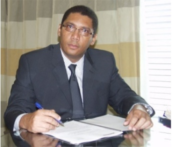

### A. EXPERIENCES PROFESSIONNELLES

• Banque de la République d'Haïti (BRH) (O2/95-12/15)

○ Gouverneur (09/07-12/15)

○ Directeur Général et Membre du Conseil d'Administration (04/04 –09/07)

○ Directeur des Affaires Juridiques (01/96 - 03/04)

○ Membre du Comité de Politique Monétaire (96)

○ Directeur de la Supervision des Banques (01/98-07/99)

○ Conseiller du Gouverneur (02/95 - 01/96)

Membre de la Commission Technique auprès de la Commission Mixte (Public-Privé) pour le Fonds Hispaniola

- Membre de la Commission d'Elaboration de la loi sur les Coopératives d'Epargne et de Crédit

• Conseil de Modernisation des Entreprises Publiques (05/97 - 12/97)

Directeur Exécutif et Conseiller Juridique. Accomplissement principal: la planification, l'exécution et la finalisation de la modernisation de la Minoterie d'Haïti et du Ciment d'Haïti.

- Membre de la Commission d'Elaboration de la loi sur la modernisation des entreprises publiques (03/96-07/96)

Membre du Groupe Technique de la Commission présidentielle sur la réforme du droit des sûretés. (03/96 - 11/96)

<!-- page 5 -->

• Université d'Etat d'Haïti

○ Institut National d'Administration, de Gestion et des Hautes Études Internationales et Faculté de Droit et des Sciences Économiques (INAGHEI et FDSE)

Professeur en Finance et Economie Bancaire (10/91 - 08/95)

·

Economiste au Directoire Technique, unité d'appui au Conseil d'Administration.

EDH (10/91-11/92)

Economiste, Département de Planification Centrales et Demande

Mission Economique Nationale sous la coordination du PNUD (04/93 - 06/93)

Consultant

Ministère du Commerce et de l'Industrie (06/87 - 06/89)

Chef du Service de Législation Commerciale et Industrielle

## B - Études Universitaires

• Columbia University, New York

Master of Laws, Financial and Banking Law (08/00)

• State University of New York, Albany, New York

Master of Arts in Economics (08/91)

Concentration: Financial Economics/ International Economics

FULBRIGHT Scholarship (06/89)

• Université d'Etat d'Haïti, Port-au-Prince, Haïti

○ Faculté de Droit et des Sciences Économiques (FDSE)

Licence en Droit (06/87)

○ Institut National d'Administration, de Gestion et des Hautes Études Internationales

Licence en Administration des Affaires (06/87)

## C- SÉMINAIRES ET CONFÉRENCES

• World Bank (11/03)

Regulatory and Supervisory Issues in Contractual Savings

<!-- page 6 -->

• New York Institute of Finance

Mergers and Acquisitions (04/99)

• International Monetary Fund (05/96)

Current Legal Issues affecting Central Banks

• International Law Institute (10/95)

Capital Markets: Development and Regulation

State University of New York at Buffalo (05-06/89)

International Executive Program in Management

### D. AFFILIATION

• Membre du Barreau des Avocats de Port-au-Prince (91)

• Membre de la World Jurist Association

• Membre de l'Association des Economistes Haïtiens

• Membre de la Fondation Haïtienne de l'Environnement

<!-- page 7 -->

# Signature du protocole d'accord entre la BRH et l'Agence Française de Développement (AFD) - le 20 novembre 2007

Monsieur l'Ambassadeur de France,

Madame la Directrice de l'AFD,

Collègue Philippe Lahens du Conseil de la BRH,

Nous nous félicitons de la signature de cet accord entre la BRH et l'AFD qui vient sceller une coopération qui est en fait l'aboutissement de négociations et de discussions entre nous autres et l'AFD pour que nous puissions arriver à harmoniser les interventions de la BRH dans le domaine du microcrédit et de la micro-finance.

L'Ambassadeur a bien souligné cet effort d'harmonisation quand il a parlé tantôt de la coopération canadienne qui intervenait au niveau du secteur des Coopératives Épargne et de Crédit qui représentent des institutions financières de dépôt qui reçoivent des dépôts du public.

Aujourd'hui, il s'agit d'inaugurer les efforts de la BRH en tant qu'autorité de supervision et de régulation dans un secteur particulier de la micro-finance qui ne reçoit de dépôt du public mais qui a besoin d'une attention particulière pour pouvoir identifier les différents agents qui interviennent sur le terrain.

Pour le moment, on a la sensation de ne pas savoir trop bien ce que font pas mal d'acteurs, donc, le premier volet d'intervention de la BRH dans le cadre de ce protocole d'accord sera de recenser toutes les activités de micro-finance pour que nous puissions réellement savoir qui est qui et qui fait quoi dans le secteur.

L'autre aspect constituera en la mise en place d'un cadre juridique et réglementaire à partir de ce que l'on trouvera comme existant ; et le dernier volet sera le renforcement de la capacité de réglementation et de supervision dans ce secteur.

Cela est important car il faut mettre en harmonie le secteur microcrédit, que ce soit celui qui ne reçoit

<!-- page 8 -->

pas de dépôts du public, je vous dirai tout de suite pour que vous ayez une idée de l'importance de ce secteur. Aujourd'hui, chez nous, ce secteur représente 15% du crédit total à l'économie, ce n'est pas sans raison que nous disons que c'est un secteur qui est à ses premiers balbutiements et il y a seulement quelques années que ce secteur bénéficie d'un encadrement formel non seulement des autorités mais aussi de la coopération internationale.

Je pense que c'est important pour nous de mettre l'accent sur ce secteur parce qu'il paraît non significatif, cependant c'est un secteur qui s'adresse à une frange défavorisée de la population qui généralement n'a pas accès au crédit, donc il s'agit de renforcer l'infrastructure juridique pour qu'on puisse mieux protéger ce type de crédit, car ce n'est pas du bénévolat, ce n'est pas de la charité, c'est du crédit qui doit être remboursé. Il n'est pas question que des institutions de microcrédit, que ce soit des coopératives ou des institutions qui ne reçoivent pas de dépôts deviennent insolvables par les crédits qu'ils apportent. Ce n'est pas de la charité, nous le répétons, donc il faut que ces crédits-là soient mieux protégés pour que ces institutions-là restent pérennes et continuent à servir et à contribuer à la croissance et à la réduction de la pauvreté dans le pays.

<!-- page 9 -->

# Discours d'Investiture Conseil d'Administration BRH – 27 Septembre 2007

Monsieur le Premier Ministre,

Monsieur le Président du Sénat,

M. le Ministre de l'Économie et des Finances,

Honorables sénateurs,

Mesdames, Messieurs les Membres du Corps diplomatique,

Mesdames, Messieurs les membres de la communauté bancaire,

Monsieur le Représentant Résident du FMI.

Messieurs les représentants des organismes internationaux,

Mesdames, Messieurs les membres du personnel de la BRH,

Mesdames et messieurs,

Créée en 1979, la BRH en est à sa 22ème installation de conseil nommé pour 3 ans, alors qu'en 28 ans elle aurait dû en voir neuf. Jusqu'en 1991, en 12 ans, elle en a connu 16, avec une longévité moyenne de 9 mois. Depuis décembre 1991, cependant, la BRH a eu à sa tête six conseils. Cette stabilité institutionnelle a largement contribué au renforcement de la banque centrale.

D'apparence banale, la cérémonie de ce matin est en fait une victoire de la loi et des institutions, l'expression de la légalité en marche dans la mesure où elle est l'aboutissement d'une nomination et d'une approbation effectuées dans le respect scrupuleux de la procédure tracée par la loi et de la Constitution. Nous, du Conseil d'Administration de la BRH, sommes honorés de la confiance que le Président de la République a placée en nous en exerçant sa prérogative constitutionnelle de nomination.

Nous avons hautement apprécié la qualité du travail du Sénat qui s'est focalisé sur ses responsabilités constitutionnelles pour établir et suivre un processus de ratification objectif et juste. Cela ne peut que

<!-- page 10 -->

renforcer la légitimité de la BRH et de son Conseil, dans le cadre de la poursuite de ses missions

fondamentales.

Au plan de la politique monétaire, le Conseil s'attachera à préserver et à consolider les acquis en matière de stabilisation macroéconomique. Les efforts de stabilisation consentis au cours des trois dernières années, se sont soldés par une appréciation de la gourde avec un taux de change passant d'environ 45 à 37 gourdes, une réduction sensible de la volatilité sur le marché local des changes, une baisse notoire de l'inflation d'environ 40% en 2003 à 7,6% en août 2007, et une augmentation considérable des réserves nettes de change dont le stock, qui était de 17 millions de dollars en mars 2004, a atteint environ 300 millions de dollars en septembre 2007. Au regard de cette performance, nous tenons à saluer les contributions respectives du Gouverneur Raymond Magloire et du Conseiller Georges Henry Fils en 2004-2007.

Vu le poids de la politique fiscale dans la détermination du succès de la politique monétaire, on n'aurait pas su enregistrer ces bons résultats sans une discipline budgétaire propice à la stabilisation monétaire. C'est pourquoi le Conseil s'en voudrait de passer sous silence la bonne collaboration qui a existé avec le Ministre de l'Économie et des Finances, Henry Bazin, de 2004-2006, qui a initié la discipline fiscale, laquelle est non seulement poursuivie, mais renforcée par le Ministre Daniel Dorsainvil, Grand Argentier du Gouvernement Préval-Alexis.

La crédibilité de la politique monétaire que l'on peut définir comme étant la perception du public que la banque centrale prendra toutes les mesures nécessaires pour garder l'inflation à des niveaux tolérables, cette crédibilité se gagne difficilement et se perd avec une facilité déconcertante. La stabilité des prix ne peut donc être qu'une quête permanente, une préoccupation quotidienne du Conseil d'Administration.

Néanmoins la nécessité de consolider les acquis de la stabilisation ne devrait pas occulter le coût élevé de la politique monétaire axée essentiellement sur le recours aux bons BRH, pour stériliser l'excédent de liquidité et ce faisant, contenir l'inflation. Ces coûts financiers sont de moins en moins supportables par la BRH. Et l'on ne pourra pas faire l'économie d'un dialogue avec l'Exécutif et le Législatif pour préserver les assises financières de la BRH.

A court terme, le Conseil va s'employer à prendre des mesures influencant des variables sur lesquelles il a un niveau confortable de contrôle. Notamment, il envisage d'élargir l'accès aux bons BRH à des opérateurs autres que les banques, en vue d'améliorer la transmission des taux d'intérêts des bons aux déposants. Mais cela ne peut être qu'un palliatif. Et le Conseil est convaincu qu'il n'y a pas de succédant

<!-- page 11 -->

à l'internalisation par l'Etat Central, sous une forme ou sous une autre, du coût du service de la dette publique interne. Le moyen le plus rapide est de payer à la BRH l'intégralité des dépenses au titre des opérations de stérilisation de la liquidité excédentaire, générée principalement, jusqu'en 2004, par le financement monétaire du déficit budgétaire, ce qui peut paver la voie à la substitution progressive des bons du Trésor aux bons BRH. Ceux-là étant incontournables comme ancrage dans la perspective d'un approfondissement financier en Haïti.

Il faut éviter d'alimenter l'idée que la stabilité monétaire est une panacée et que la BRH peut accomplir beaucoup plus qu'elle n'en soit capable. Au fait, la stabilité monétaire est une condition nécessaire à la croissance. Elle est loin d'être suffisante. Particulièrement, la BRH a observé depuis plusieurs années une certaine inélasticité du crédit aux taux d'intérêts. C'est que, le taux d'intérêt ne peut pas nécessairement compenser tous les freins structurels au crédit et à l'investissement. En effet, il y a beaucoup d'aspects de la politique économique qui, tout en ayant une certaine pertinence pour la politique monétaire et la stabilité financière, échappent totalement au contrôle de la banque centrale. Par exemple, la posture budgétaire, la politique de réglementation et de supervision des secteurs non financiers, le caractère informel d'une bonne partie de l'économie, les systèmes et niveaux de taxation et d'imposition, l'efficacité policière et judiciaire, la perception de sécurité dans les transactions et les relations contractuelles sont autant de facteurs qui influent sur le niveau d'activité et peuvent influencer la stabilité financière.

Il y a de ces facteurs, relevant de l'efficacité de certaines institutions publiques, sur lesquels la BRH n'a aucune prise. Par contre, certains freins au crédit, comme la sécurité dans les transactions et les relations contractuelles, peuvent être substantiellement mitigés, sinon levés par des initiatives législatives et des innovations institutionnelles. Le point de vue du Conseil est que la banque centrale, tout en maintenant son indépendance par rapport aux pouvoirs politiques, doit instaurer un dialogue continu avec ces derniers, agissant comme conseiller sur des questions ayant un impact sur le crédit et l'investissement où son expertise est pertinente.

C'est ainsi que la BRH s'est montrée proactive en initiant un ensemble d'actions visant à lever les barrières susmentionnées. En l'occurrence, il convient de signaler :

- la création du Bureau d'Information sur le Crédit qui fournira aux banques des données concernant la situation d'endettement et le comportement des différents débiteurs du système;

• l'élaboration d'un projet de loi sur le Bureau d'Information sur le Crédit ;

<!-- page 12 -->

• l'élaboration du projet de loi sur la copropriété ;

- l'élaboration et la promotion de la loi sur le gage sans dépossession. Ce dernier, une fois ratifié, devrait permettre aux institutions financières du pays d'accepter en garantie certains biens tels les équipements et conséquemment ouvrir l'accès au crédit à de petits entrepreneurs ;

• l'élaboration d'un projet de loi général sur les sûretés.

Au niveau de la supervision des institutions financières, la BRH continuera à s'assurer que les régulés fonctionnent conformément à la loi, à la réglementation et aux normes internationales régissant la matière, c'est-à-dire qu'elle veillera à ce que la prise de risque par les banques, avec en grande partie les ressources des déposants, ne leur soit pas préjudiciable.

La BRH a tiré des leçons des crises de la Socabank, de la Socabel et de la Promobank même si elle a pu les résoudre avec un certain succès, en évitant des pertes pour les déposants et en conjurant les risques de contamination du système. Ces crises ont mis en exergue plusieurs carences législatives auxquelles il convient de remédier par une législation plus adaptée à la nouvelle réalité du système bancaire. Dans cet objectif, l'Exécutif a soumis récemment au Parlement un projet de loi devant mieux régir le fonctionnement des institutions financières. Cette loi, quand elle est votée par le Parlement, permettra à la BRH d'intervenir plus promptement et avec une autorité accrue dans la résolution des problèmes bancaires. Le régime de la faillite des banques a été remanié, pour répondre à cette préoccupation et permettre à la BRH de disposer des instruments légaux nécessaires l'habilitant à intervenir avant que la situation d'une banque ne devienne désastreuse et prévenir ainsi sa débâcle.

A terme, avec l'aide d'organismes financiers internationaux spécialisés, la BRH compte étendre son contrôle aux institutions de micro-finance (non coopératives) et aux autres institutions financières s'adonnant à des activités de crédit et de dépôt ou impliquées sous une forme ou une autre dans des activités d'intermédiation.

La BRH poursuivra ses actions visant le renforcement de la supervision des coopératives d'épargne et de crédit par:

• l'élaboration et la mise en œuvre de normes prudentielles de base;

• le renforcement de la formation des inspecteurs;

• La mise à jour du cadre légal régissant le secteur;

<!-- page 13 -->

• La consolidation du secteur en fédérations régionales avec l'appui du Groupe Desjardins.

Au plan de l'efficacité du système des paiements, la BRH compte procéder à la mise en œuvre du Système de Paiements Interbancaire Haïtien (SPIH). Ce système va permettre à un agent économique ayant son compte dans une banque « A » de transférer de l'argent à un autre agent économique ayant son compte dans une banque « B ». Il implique le passage d'un délai de clearing moyen de 5 jours pour le chèque à zéro jour pour ce système, car les fonds sont disponibles immédiatement. Cela aura pour effet de faciliter les transactions et d'augmenter la circulation des capitaux à travers le pays et ainsi dynamiser la vie économique.

La BRH poursuivra ses efforts de modernisation du système de paiements haïtien et l'amélioration des services offerts à ses clients institutionnels via :

○ le paiement du salaire des fonctionnaires haïtiens par crédit direct aux comptes bancaires

de leur choix, en collaboration étroite avec le Ministre de l'Économie et des Finances;

o la mise à jour du système SWIFT (Système de Messagerie Financière) $ ^{1} $ et la formation continue y associée;

○ la réduction des délais de compensation et des coûts des services bancaires ;

○ la modernisation des guichets externes et l'élargissement de leur champ de couverture;

○ la réduction des frais de services sur les opérations vers l'étranger.

L'amélioration continue de la gouvernance à la BRH est une priorité pour le Conseil. Cela requiert entre autres le renforcement des fonctions d'audit et de contrôle internes, le respect scrupuleux des politiques et procédures établies et une plus grande responsabilisation des directions opérationnelles pour permettre au Conseil d'accorder plus de temps et d'attention à la gouvernance et d'affiner les mécanismes de prise de décision. Cela ne peut que renforcer la BRH en tant qu'institution.

Au niveau de l'organisation et de la gestion internes de la banque, le nouveau Conseil compte procéder au renforcement des fonctions « Ressources Humaines » et «Gestion Financière », et à l'harmonisation des politiques intra institutionnelles conformément aux standards d'une banque centrale moderne.

<!-- page 14 -->

Dans des situations extrêmes, en politique monétaire comme en supervision bancaire, les questions complexes risquent de devenir politiques. Le malheur veut que dans ces cas la passion tende à prendre le pas sur la raison, et l'émotion à perturber le jugement.

Dans les cas récents de la Socabank, de la Socabel et de la Promobank, la BRH peut s'enorgueillir de s'être acquittée de sa mission d'éviter une catastrophe systémique avec la rigueur, la sérénité et le professionnalisme dont toute banque centrale doit faire montre dans de telles circonstances. Néanmoins, ces cas ont souligné la nécessité de consentir des efforts plus intenses et plus systématiques dans la communication avec le public, la presse et les pouvoirs publics pour une meilleure compréhension des enjeux et objectifs des politiques poursuivies et des mesures prises par la banque centrale. Ces initiatives auront la vertu de renforcer la crédibilité de la BRH dans la poursuite des objectifs tant de politique monétaire que de stabilité financière.

La BRH fait face à un défi additionnel au niveau du personnel de comptabilité et d'audit des banques en général. En effet, depuis un certain temps, nous assistons au départ pour l'étranger d'un nombre important d'inspecteurs de banques, de vérificateurs indépendants, de contrôleurs internes et de professionnels comptables d'une manière générale ; le système de surveillance et de vérification des banques en est considérablement affecté. Leur remplacement n'est pas toujours évident. Aussi, avec le concours de l'Ordre des Comptables Professionnels Agréés d'Haïti (OCPAH) et de certains organismes étrangers spécialisés en la matière, la BRH, pour pallier le déficit causé par ces départs, envisage-t-elle, à travers son institut de formation (l'IFBC) de mettre sur pied un programme de perfectionnement en comptabilité et en vérification au profit des jeunes diplômés haïtiens. Ces comptables, une fois leur perfectionnement achevé, seront disponibles tant pour la BRH que pour le système financier.

## Mesdames, Messieurs,

Nous ne pouvons pas trop répéter qu'une bonne politique monétaire ne peut être menée indépendamment d'une bonne politique fiscale. Nous sommes confiants qu'avec la collaboration du Ministère de l'Économie et des Finances, de nos partenaires financiers internationaux et de notre personnel duquel nous attendons beaucoup en termes de discipline, d'éthique et de professionnalisme, la BRH continuera à remplir pleinement sa mission, au bénéfice de la nation.

Merci.

<!-- page 15 -->

## Discours fin d'année 2007

Chers Collègues,

C'est un plaisir pour moi d'être avec vous aujourd'hui et de formuler les vœux les meilleurs au nom du Conseil d'Administration à l'occasion de la Noël et du Nouvel an.

Une année qui s'achève, une année qui s'en vient comme l'a dit Madame Paul, la tradition veut, et il n'y aura pas d'accroc à celle-ci à la BRH, que nous fêtions ce passage. Cela fait déjà trois mois que ce Conseil est en place et il a inauguré son mandat sous le signe de la rigueur et de l'efficacité.

Cette année, nous voulons insister sur la nécessité qu'à la Banque Centrale, les employés collaborent étroitement avec le Conseil pour bien garder la barque de l'Institution, et je peux vous dire que cela commence à porter fruit parce que déjà pour la première fois depuis des années, la Banque Centrale a enregistré des profits d'environ 30 millions de gourdes en octobre.

J'espère que tout le monde ici quelque soit le niveau auquel il se trouve dans la hiérarchie pourra comprendre la nécessité de reconnaître que la BRH se retrouve dans une situation financière délicate. Le plan d'austérité mis en place n'est pas gratuit, il participe tout simplement de cet effort de rétablir l'équilibre financier à la Banque Centrale ; en ce sens, nous vous demandons de bien comprendre ce qui se passe.

L'année 2008, nous allons la placer sous le signe de 3 grands thèmes fondamentaux : « Dynamisme, efficacité et Efficience ».

Dynamisme : Nous aimerions voir à l'œuvre des employés dynamiques très imbus de leur rôle et de leur utilité à la Banque Centrale. Vous connaissez tous la théorie du maillon faible de la chaîne. Une chaîne ne peut pas être plus solide sans son maillon le plus faible, nous ne voulons pas avoir à la Banque Centrale de maillon faible, vous devez tous comprendre qu'il n'y a pas de sinécures à la Banque et que vous tous vous contribuez à l'efficacité et au rayonnement de cette entreprise, je dis bien entreprise car la BRH est également une entreprise.

Efficacité : Parce que la Banque Centrale doit jouer son rôle et remplir sa mission au bénéfice de la communauté bancaire, bénéfice de l'économie nationale et du bien-être national. « Ne sous-estimez

<!-- page 16 -->

pas ce que vous faites comme travail à la Banque, vous êtes tous utiles et le Conseil d'Administration s'attend à ce que vous montriez énormément de dévouement et de rigueur dans l'accomplissement de vos tâches, que ce soit à la Caisse, que ce soit dans la rue quand vous conduisez les fourgons, que ce soit au niveau des relations internationales et autres. Chaque personne est indispensable, vous n'êtes pas là pour autre chose que pour contribuer et nous attendons à ce que vous le montriez chaque jour.

Efficiency : Elle tombe en étroite ligne de l'effort de rigueur et d'assainissement financier entrepris par le Conseil depuis son arrivée il y a trois mois. Nous ne pouvons pas dire aux Banques privées que nous voulons réduire les dépenses d'intérêt sur les bons en continuant à gaspiller, le gaspillage doit être évité dans tous les aspects de l'administration de la Banque.

Donc, je vous demande de faire l'effort pour que les tâches, les missions de la Banque Centrale soient

accomplies au moindre coût possible, en ce sens je salue les efforts entrepris par la Direction Générale

qui a pris le taureau par les cornes pour initier et implémenter ce programme d'assainissement

financier.

Encore une fois, je vous souhaite pour l'année qui s'en vient au nom du Conseil d'Administration tous nos vœux de bonheur, de succès et de santé. J'espère que votre productivité sera à la hauteur de l'ambition que le Conseil d'Administration place en vous et nous faisons appel à votre compréhension pour que la famille de la BRH regarde dans la même direction et travaille dans le sens de l'efficacité, dans la poursuite des missions de l'Institution.

Je vous remercie.

<!-- page 17 -->

## 2008

## In Mémoriam Antonio André – Leslie Delatour / Septembre 2008

A côté de la conservation des acquis, la célébration des valeurs d'une nation peut inspirer les jeunes et futures générations et jouer un rôle majeur dans le maintien et le renforcement du tissu national. Ainsi, la BRH saisit l'opporunité de cette publication pour rappeler à la mémoire nationale deux hommes qui ont présidé à sa destinée à des moments différents, mais également compliqués, de notre histoire. Deux hommes de trajectoires différentes, mais unis par la conscience profonde de l'importance de la stabilité comme condition nécessaire au progrès économique aussi bien que du rôle délicat et essentiel de la banque centrale dans la lutte pour la préservation de la valeur interne et externe de notre monnaie. D'où leur combat pour préserver l'intégrité institutionnelle et le caractère technique de la banque. Au nom de celle-ci et de la nation, nous leur disons merci. Comme l'essentiel n'est pas de pleurer ces hommes mais plutôt de continuer leurs bonnes actions, attachons-nous à faire en sorte que leurs efforts n'aient pas été vains.

Premier gouverneur de la Banque de la République d'Haïti, Antonio André est né aux Cayes en 1912 où il obtient ses diplômes d'avocat et de comptable. Monsieur André débute sa carrière en qualité de professeur de mathématiques. Il fait son entrée dans le système financier à l'âge de vingt ans en 1932 à la succursale de la BNRH des Cayes. Il gravit progressivement tous les échelons de la banque occupant la position de Directeur à Jérémie, au Cap-Haïtien et aux Cayes, et en devient le Président du Conseil d'Administration en 1960. Ce poste gardé jusqu'en 1975, puis repris en 1976, lui permet jouer un rôle de premier plan à la division de la BNRH en BNC (Banque Nationale de Crédit, bras commercial de la banque d'état) et BRH (Banque de la République d'Haïti, banque centrale) dont il devint le premier gouverneur. Il a également occupé des postes d'administration dans diverses entités publiques ou parapubliques, notamment à titre de président des conseils d'administration des Télécommunications d'Haïti S.A.M., de l'Institut de Développement Agricole et Industriel, et de la Minoterie d'Haïti. Il a également été ministre du commerce et de l'industrie et conseiller spécial en affaires

<!-- page 18 -->

économiques et bancaires auprès de Présidents de la République d'Haïti. Antonio André a été un personnage prééminent de la scène économique et financière d'Haïti pendant plus de vingt ans. Il faut notamment porter à son crédit le maintien de la rigueur monétaire et de la stabilité de la gourde dans un contexte économique et politique, à une période où la banque centrale fonctionnait plutôt comme une caisse d'émission.

Leslie Delatour a profondément marqué l'histoire récente de la BANQUE DE LA REPUBLIQUE D'HAÎTI (BRH) pendant son mandat à la tête de cette institution entre 1994 et 1997. Né le 2 janvier 1948 à Port-au-Prince, il fait ses études supérieures en sciences politiques, en économie et en politiques publiques en Amérique du Nord, notamment à l'UNIVERSITE DU QUEBEC A MONTREAL, à la JOHNS HOPKINS UNIVERSITY (Washington D.C.) et à la UNIVERSITY OF CHICAGO. Après une année à la BANQUE INTERAMERICAINE DE DEVELOPPEMENT (BID) Washington D.C. comme jeune professionnel, il rentre en Haïti en 1975 pour travailler à L'INSTITUT NATIONAL DES RESSOURCES MINERALES (INAREM).

Il prête ses services comme Consultant au MINISTERE DU COMMERCE ET DE L'INDUSTRIE (pour les négociations textiles avec les Etats-Unis), à la USAID, pour des études empiriques approfondies sur le secteur agro-industriel haïtien, et plus tard, au début des années 1980, au MINISTERE DE L'ÉCONOMIE ET DES FINANCES, particulièrement pour les négociations avec la Banque Mondiale. En 1984, il devient économiste de la BANQUE MONDIALE chargé de l'Amérique Centrale avant d'accepter le poste de Ministre de l'Économie et des Finances du CONSEIL NATIONAL DE GOUVERNEMENT (CNG) en mars 1986, poste qu'il occupe jusqu'en février 1988. On lui doit une réforme en profondeur de la fiscalité haïtienne et une réorientation tout aussi importante de l'économie vers l'initiative privée ainsi que le développement et la préservation de sa compétitivité internationale.

Comme Gouverneur de la BRH, Leslie Delatour entreprend de moderniser entièrement l'organisation et les opérations de l'institution ainsi que la conduite de la politique monétaire qui devient plus transparente avec la publication systématique des statistiques monétaires. Il met en place le COMITE DE POLITIQUE MONETAIRE (en mars 1997), une instance formelle de consultation auprès du Conseil d'Administration, après avoir introduit (en novembre 1996) les BONS BRH, un instrument de contrôle indirect de la liquidité du système bancaire comme

<!-- page 19 -->

alternative aux réserves obligatoires. Ses efforts dans ce domaine ont contribué à renforcer la capacité de la Banque Centrale à poursuivre les objectifs de stabilité macroéconomique que lui impose la loi. Egalement, la fonction de supervision bancaire fait l'objet d'une transformation radicale sous l'inspiration du Gouverneur Delatour qui met en œuvre un cadre moderne de surveillance en conformité avec les normes et recommandations du COMITE DE BALE sur la prévention des crises bancaires.

Evidemment, des réformes d'une telle envergure n'auraient pas été possibles sans des mesures transversales tout aussi énergiques comme le vaste programme de recrutement de cadres qualifiés combiné à un programme de formation courte et longue, interne et externe, du personnel, la mise en place d'un réseau télématique et financier liant directement la banque des banques au reste du système bancaire et l'informatisation complète de la BRH. Le souci d'améliorer le cadre de travail des employés et l'environnement physique de la Banque Centrale a conduit Leslie Delatour directement à la conception du nouvel immeuble situé à l'angle des Rues du Quai et Pavée. Ce projet, commandé à la firme BENJAMIN, PETIT & FORTUNE, a révélé un Delatour "urbaniste", résolu à maintenir le siège de la banque au bas de la ville, confiant dans l'avenir de la capitale et convaincu de la nécessité de sauver le centre-ville de Port-au-Prince.

<!-- page 20 -->

## La construction du siège social : Un bel exemple de continuité

Le 23 janvier 1987, l'État Haïtien concède une propriété à la Banque de la République d'Haïti au Champs de Mars pour la construction de son nouveau Siège Social.

Le 16 juin 1993, le Conseil d'Administration, présidé par M. Bonivert Claude, a décidé de faire l'acquisition de la propriété (fond et bâtisses) Ex-Madsen, sise à l'angle des rues du Quai et Pavée, pour la construction du Siège Social de la BRH.

Le 8 novembre 1993, le Conseil d'Administration présidé par Bonivert Claude signe un contrat avec la firme BPF Architectes & Ingénieurs Associés pour rénover deux bâtiments du complexe devant loger la Direction de l'Information et de la Technologie de la BRH.

Le 26 janvier 1996, le Conseil d'Administration, présidé par M. Leslie Delatour, décide de maintenir le siège social au bas de la ville et de construire le Bâtiment sur le site Ex-Madsen.

Le 21 janvier 2000, la firme BPF Ingénieurs et Architectes Associés soumet le plan de l'immeuble.

Le 23 mars 2000, le Conseil d'Administration, présidé par M. Fritz Jean, décide de confier les travaux d'exécution et de finalisation des études à la firme française BOUYGUES BATIMENT.

Le 8 mai 2000, le projet de construction du nouveau Siège Social à la rue du Quai commence et en mai 2002, le conseil et les employés prennent logement et inaugurent le local.

Le 9 décembre 2005 on entame les travaux pour la construction d'une cour intérieure reliant les anciens bâtiments au nouvel immeuble. Et, le 7 août 2006, le conseil dirigé par Raymond Magloire, inaugure la construction faite sous la supervision de l'architecte Rachel Barjon.

<!-- page 21 -->

Inauguration de l'atelier de travail sur le Système de Paiements Interbancaires Haïtiens - Montana le 26 mars 2008.

Nous nous félicitons au niveau de la Banque Centrale d'avoir pu associer le Groupe Croissance aux efforts visant à la vulgarisation du Système de Paiements Interbancaires Haïtiens.

Nous nous félicitons de votre présence en si grand nombre qui témoigne de l'intérêt que vous manifestez pour le SPIH.

Je veux dès le départ vous faire savoir que cette séance d'information sur le SPIH est organisée pour que vous, détenteurs d'enjeux sachiez exactement les règles du jeu et l'utilisation que vous pouvez en faire.

Nous dirons que le SPIH est un sous-système du système de paiement qui a la valeur ajoutée à savoir qu'il permet aux utilisateurs ou clients des Institutions Bancaires de faire des virements en faveur de bénéficiaires d'autres Banques.

En d'autres termes jusqu'ici vous pouviez demander à la Banque « A » dont vous êtes client de créditer le compte d'un partenaire en affaires en débitant votre compte.

Il faudra noter que cette facilité se limitait uniquement dans le temps à la Banque dans laquelle vous détenez le compte, aujourd'hui peu importe la Banque de la personne en faveur de qui vous vouliez faire le transfert l'opération pourra se dérouler sans problème et ceci représente la grande valeur ajoutée.

Le SPIH présente aussi d'autres avantages par rapport aux chèques car vous autres financiers je sais que vous souffrez énormément des délais de compensation et grâce au SPIH ces types d'opérations peuvent s'effectuer le même jour.

Concretement le message que nous entendons faire passer c'est qu'il n'y a aucune raison pour qu'un ordre de virement que vous donnez aujourd'hui ne puisse s'exécuter le même jour.

La mise en place du Système du SPIH participe du souci et des efforts de la Banque Centrale en vue de l'amélioration du système de paiements en le rendant plus efficace, plus efficient sans en compromettre l'intégrité.

<!-- page 22 -->

Nous pouvons vous garantir que les transactions à travers le SPIH se feront en toute sécurité pour vos

avoirs sans compromettre la confidentialité et l'intégrité du système bancaire.

Nous nous félicitons également de votre présence qui démontre votre intérêt dans la bonne compréhension d'un système que la BRH et ses partenaires ont tenu à mettre à votre disposition.

Je dois vous dire chers participants que cette séance d'information est une première car la BRH a tenu à se mettre en face des détenteurs d'enjeux et des utilisateurs du système bancaire.

La Banque tient à vous communiquer directement les règles du jeu parce que très souvent nous entendons des utilisateurs se plaindre en divulguant des informations tout à fait erronées sur la réalité sur tel ou tel instrument ou mécanisme c'est en ce sens que la BRH souhaite développer une politique de proximité avec vous.

Cette réunion nous permet aussi de vous présenter les cadres de la BRH chargés du système de paiement ainsi vous êtes en mesure de mettre des visages sur les noms.

Nous avons avec nous en tout premier lieu Mr Théodore Noël Directeur de la Caisse qui travaille à la BRH depuis 35 ans, M. Donald Déjoie également Directeur de la Caisse et du Réseau et M. Jean Baden Dubois le Directeur de l'Information et de la Technologie ce sont donc ces cadres de la BRH que nous devons féliciter en premier lieu pour la mise en place du SPIH sans oublier notre Directeur de l'Unité d'Organisation et Méthode M. Stephan Heraux.

Nous tenons aussi à remercer nos partenaires des banques du système qui ont consenti beaucoup d'efforts pour que le SPIH s'établisse sans compromettre la sécurité de vos avoirs.

En ce sens, je dois vous dire que nous avons été très prudents parce que le SPIH est opérationnel depuis octobre sans que nous n'ayons à faire de la publicité autour car nous voulions être sûrs qu'il n'y ait aucun pépin aucun bug.

Aujourd'hui au niveau du Conseil et de la Haute Direction de la BRH nous sommes fiers de vous annoncer que ce système marche très bien.

J'ai parlé tantôt de dialogue, au nom du Conseil nous souhaitons qu'il puisse se poursuivre en faisant part de vos frustrations par écrit car à la BRH nous ne pouvons pas réagir aux « zins ».

<!-- page 23 -->

Il faut que les frustrations soient exprimées ainsi avec nos partenaires du système bancaire la BRH aura identifié les points qui posent problème et essayer d'y remédier.

Je ne vais pas être long nos techniciens vont élaborer sur les règles de fonctionnement en vous expliquant ses tenants et aboutissants d'une part et en insistant d'autre part sur vos droits et obligations sans en négliger l'aspect lié aux coûts de transactions.

J'espère que vous allez répondre présent à d'autres invitations de la Banque Centrale sur des questions d'importance.

Je termine en indiquant que le SPIH à d'autres applications car avec le Ministère de l'Économie et des Finances nous envisageons le paiement par crédit direct sur les comptes des employés de la fonction publique.

Ceci représentera une avancée significative car le compte de l'agent de la fonction publique pourra être crédité directement de la BRH à sa banque que ce soit à travers une succursale de Petit Goâve ou du Cap Haïtien sans qu'un messager n'ait à venir récupérer des chèques qui parfois se perdent.

Donc nous souhaitons votre participation active à cette séance qui inaugure j'espère, une longue série de rencontres qui vont faciliter le dialogue entre la BRH et vous autres.

Encore une fois je vous souhaite bonne séance d'information sur le SPIH tout en vous encourageant à utiliser ce nouvel instrument qui entre dans le cadre de l'engagement pris par la BRH pour contribuer à la modernisation du système.

<!-- page 24 -->

## 29 ème anniversaire de la Banque Centrale -

Nous autres du Conseil d'Administration, nous saisissons cette opportunité que nous avons chaque année de partager un moment agréable avec tout le personnel de la Banque et c'est le moment aussi de faire connaître les projets du Conseil partant du principe et nous allons essayer d'y remédier qu'il y a définitivement un déficit de communication au niveau de la Banque et il faudra l'améliorer. Donc je vous annonce tout de suite que dans sa 30ème année le Newsletter de la Banque verra le jour où l'on aura systématiquement les informations internes de l'Institution.

Par la même occasion puisque nous parlons de publication nous tenons à saluer en votre présence

l'effort réalisé par la Direction de la Monnaie et des Affaires Économiques qui a renoué comme le

Directeur l'a dit si bien avec une longue tradition de publication technique à la BRH.

Nous invitons par la même occasion la Direction des Affaires Juridiques à renouer avec sa publication et nous invitons tout le monde à emboîter le pas pour que la poursuite de l'excellence se fasse à la BRH de façon plus transparente, bref pour que nous soyons plus visibles.

Nous nous enorgueillissons d'autant plus que cette initiative de la MAE a été très bien reçue dans le public, en témoigne les commentaires du journaliste économique bien connu Kerner Pharel. Je partirai des propos d'introduction du célébrant et de notre collègue Hugues Claude, qui a rappelé que par le travail nous poursuivons l'œuvre de création et le célébrant n'a pas manqué de prôner la rigueur dans la fraternité et la convivialité et je pense que c'est cet esprit qui nous anime au sein de la BRH. Je pense que c'est pour le mieux, tout en respectant les limites dictées par la rigueur, nous puissions communiquer, collaborer, dans la fraternité. Je vous exhorte à faire beaucoup d'efforts pour garder cet esprit à la Banque je pense qu'il est fondamentale pour la poursuite des objectifs et des grandes missions de l'institution. Et ça non pas pour le bien-être de la Banque ou de ses employés mais au bénéfice du bien commun car la BRH reste et demeure une institution nationale.

Comme Rotchild l'a si bien dit nous avions une feuille de route énoncée lors de notre discours d'installation il y aura bientôt un an et renouvelée lors de la fête en décembre dernier. C'est le moment de mettre l'emphase sur les réalisations, tout en vous faisant remarquer que le travail que nous accomplissons à la BRH est une œuvre d'étape. Nous avons, mes collègues et moi du Conseil d'Administration, la chance d'être à la tête de la BRH notamment pour poursuivre une construction

<!-- page 25 -->

entamée par nos prédécesseurs.

Et c'est l'occasion de saluer toutes ces personnes qui ne sont pas avec nous soit parce qu'elles nous ont quitté, soit parce qu'elles ne sont plus à la Banque. J'aurai une pensée spéciale pour le Gouverneur Bonivert Claude, qui a vraiment initié le projet de modernisation de la Banque Centrale. Je vous demande de l'applaudir.

Une pensée spéciale également pour celui qui a compris et qui a poursuivi ses efforts parfois dans la douleur, parfois dans l'incompréhension mais je pense qu'avec le recul beaucoup de gens ont fini par comprendre que c'était nécessaire il s'agit du très regrette Lesly Delatour qui a été et qui demeure un personnage incontournable fondamental dans l'histoire de la BRH. Nous pensons également à tous ces directeurs, tous ces employés qui nous ont laissé ; nous pensons à Osias qui animait la Banque, nous pensons à Richard Baptiste, nous pensons à Philippe Lahens pas le gouverneur mais son cousin Ti Philippe, tous ces anciens collègues qui ont pavé la voie à la modernisation de la banque et nous saluons leurs efforts. Nous nous enorgueillissons de pouvoir dire qu'au niveau des grandes missions de la Banque, nous avons quand même au cours des onze derniers mois à notre actif pas mal de réalisations. En tant que caissier de l'État, la BRH doit travailler à l'efficacité et à l'efficience et nous pouvons dire aujourd'hui que le crédit direct ou le paiement des employés, des agents de la fonction publique est aujourd'hui une réalité. Je suppose que tout le monde ici est plus ou moins au courant du projet mais pour résumer disons tout simplement qu'un juge de paix des Gonaïves n'a pas à recevoir du ministère des finances via le Ministère de la Justice, un chèque s'il a un compte dans une banque de cette ville ; son compte peut être crédité directement. Donc les résidents de Jérémie, une zone encore plus isolée, comprendront davantage l'importance de cette opération.

Aujourd'hui le Conseil d'Administration de la Banque s'estime très chanceux d'avoir en son sein un Directeur Général qui réalise un travail de rationalisation avec autant d'efficacité. Mais comme il le dit si bien ceci se fait avec la compréhension et la sagacité de beaucoup d'assistants que ce soit au niveau des Ressources Humaines, au niveau de la Direction Financière, au niveau de la Direction Administrative cela est possible grâce à la collaboration agissante et parfois spontanée de beaucoup de cadres qui comprennent la nécessité de rationaliser ces dépenses. Je vous en remercie (vous vous connaissez).

Comme on le sait, la Banque Centrale remplit des missions importantes pour la nation. Certains croient qu'elle représente l'institution la plus importante du pays et cela n'est pas sans pression sur vous autres

<!-- page 26 -->

employés et vous comprendrez sur le Conseil d'Administration. Ainsi avec de telles missions aussi cruciales pour la nation vous comprendrez qu'il est impérieux que nous pensions à la continuité des affaires au sein de la banque même en cas de crise. Donc depuis, le conseil présidé par le Gouverneur Fritz Jean on a commencé à mettre en œuvre le projet de site de contingence le back up center, une mini BRH surtout au niveau des opérations informatiques et de caisse. Nous pouvons vous dire que ce site situé à Boutilliers est complété physiquement et nous espérons que ce centre sera opérationnel avant la fin de l'année 2009. C'est quand même une œuvre importante accomplie par la BRH, d'autres institutions d'État qui l'ont compris et commence à nous solliciter pour que nous puissions abriter leurs « servers » et que nous leur louions un petit espace au niveau de notre site de contingence. Je pense qu'au niveau des réalisations globalement qu'on a fait le tour nous avons également des projets immobiliers d'envergure. Des projets qui visent à l'amélioration des conditions de travail. L'un des projets chers à Monsieur Leroy, c'est la réhabilitation de la section que j'appellerai la section Ressources Humaines, il y a beaucoup de problèmes et ce à quoi nous voulons arriver c'est la standardisation de la qualité des services offerts aux employés aussi bien que dans les nouveaux ou dans les anciens locaux. Nous pouvons vous dire que cette année il va y avoir une rénovation sérieuse au niveau de cette section-là. Pour abriter le bureau de crédit bientôt vous allez voir un chantier qui va démarrer dans quelques semaines au niveau de l'ancien immeuble Berhmann donc on aura une passerelle du jardin à cet immeuble et ce sera quand même une continuation de la cour intérieure, vous verrez, ce sera tout à fait en harmonie avec ce que nous avons et que vous aimez déjà. Un autre projet, celui-là plus important qui nous tient à cœur, c'est le projet du parking. Nous pouvons vous dire qu'au niveau du Conseil nous sommes arrivés à un consensus, vous aurez un parking de qualité à la Banque Centrale au niveau M&S I, II et nous ambitionnons, ce n'est pas encore sûr, d'avoir une passerelle sur la rue Pavée qui vous permettra d'atteindre vos bureaux de travail en toute sécurité. Mais tout cela nous pouvons pas le faire sans les ressources humaines compétentes, le recyclage est important, la formation est importante et nous pensons à élaborer des programmes de formation longue sur place parce que vous savez tous les problèmes qu'il y a eu avec le programme des lauréats et des difficultés de rétention des cadres d'principalement par rapport aux offres canadiennes et à la situation d'insécurité dans le pays mais nous nous disons que même s'ils partent, ils vont contribuer à renforcer le prestige national et enverront des transferts en clair ils pourront toujours contribuer. Nous sommes une institution nationale, nous voyons les choses globalement, la seule variante sera que nous allons essayer d'avoir ces programmes sur place à la BRH avec peut être l'apport de quelques docteurs dont nous sommes fiers.

<!-- page 27 -->

Nous avons des discussions avec la American University où enseigne actuellement le professeur Weiner Aubourg, ancien cadre de la banque qui détient un PHD en économie, Ludovic Comeau qui a également un PHD en économie est disposé à contribuer, il enseigne dans l'État d'Illinois aux USA donc tout cela pour vous dire qu'il y a beaucoup d'initiatives que nous essayons de mettre en place et un projet cher au Directeur Général c'est le projet de perfectionnement en comptabilité et en vérification.

L'enjeu est de taille, nous pouvons le comprendre. Nous ne pouvons faire de la Supervision bancaire, de la supervision des coopératives d'épargne et de crédit sans cet intermédiaire obligé que représente l'auditeur et le vérificateur. Il nous faut en produire et nous en produirons 20 ou 30 par année. Nous en perdrons 15 mais 15 resterons et sur 10 ans nous en aurons 150. Il est évident que c'est par l'éducation que nous pouvons arriver à développer ce pays et nous tous, au Conseil souscrivons à cette idée. En clair, vous entendrez bientôt des nouvelles intéressantes du côté de l'IFBC sous la coordination du conseiller Rémy Montas.

Maintenant la grande question : nous sommes tous conscients de l'érosion du pouvoir d'achat en raison de la flambée des prix. Je sais que beaucoup d'entre vous sont sur la corde raide et en fonction de ceci nous pouvons vous annoncer un ajustement de salaire de 15% effectif dès le mois d'octobre, ajustement qui est plus ou moins équivalent au taux d'inflation. Par ailleurs, nous avons décidé d'accorder une prime supplémentaire de 5,000 gourdes aux employés recevant des émoluments de moins de 20,000 gourdes.

Comme on le constate, beaucoup de projets sont en cours et dans le cadre de la modernisation de la Banque à tous les niveaux y compris les Ressources Humaines. Les débuts sont prometteurs et nous vous demandons seulement de poursuivre les efforts entamés. Avec un tel état d'esprit, la BRH fera face aux défis futurs comme elle l'a fait dans le passé. Nous vous disons encore une fois Bonne fête.

Merci.

<!-- page 28 -->

## 2009

## Lancement du Livre Pelou

Une nation ne peut pas vivre qu'au présent. Si elle ne sait pas d'où elle vient, elle saura difficilement où elle va. Cela est encore plus vrai dans les moments d'adversité, où les problèmes semblent insolubles, où les défis paraissent insurmontables. Face aux errements du présent, le passé est source de repère, de prestige et de confiance. On exalte les succès passés non pas pour s'installer dans une auto-admiration narcissique et stérile mais plutôt pour se ressourcer, puiser un supplément d'âme et se motiver à redoubler d'ardeur pour transformer les mécomptes en succès et progresser pour le bien-être de tous.

C'est dans ce sens que nous est imposé un devoir de mémoire vis-à-vis des jeunes et futures générations; que la préservation du patrimoine physique et de la mémoire collective représente un bien public, au-delà des avantages économiques, notamment touristiques, qu'on peut en tirer. C'est dans cette perspective que nous saluons l'initiative et les efforts qui ont abouti à la publication de l'œuvre d'Edouard Pelou. Fidèle à son engagement de conservation des valeurs nationales, la BRH a décidé d'appuyer cette publication dans le cadre de son trentième anniversaire.

Nous en savons gré à Monsieur Edouard Pelou d'avoir été le chroniqueur attentif de la saga de notre pays au cours de la période 1930 - 1980, d'avoir su saisir et immortaliser des scènes de la vie de tous les jours ainsi que les rues, les édifices, les places publiques qui en ont été les théâtres. Cette œuvre vient réduire le déficit d'images sur certains moments importants de notre passé. On dit souvent qu'une image vaut mieux que mille mots. Les photos ont l'avantage d'être plus parlantes, plus édifiantes, plus fidèles et plus objectives que les mots. L'œuvre de Pelou nous renseigne sur ce qu'ont été nos espaces urbains et nous rappelle que nous avons su faire des œuvres belles et décentes bien après la geste de 1803. Cette œuvre nous interpelle. Et c'est là sa grande valeur.

<!-- page 29 -->

D'un autre côté, on ne peut s'empêcher de comparer l'avant et l'après, le passé et le présent. Et la métamorphose nous comble de tristesse. Il est déplorable que nous n'ayons pas su protéger certains de nos acquis urbains. Cette défaillance n'a pas rassuré les investisseurs. Pis encore, elle a découragé de nouvelles initiatives ambitieuses et audacieuses, et a encouragé l'abandon du centre-ville. Comme si on pouvait aller bien loin. Comme s'il y avait un havre où la réalité ne peut nous rattraper.

Certes, la dégradation urbaine n'est qu'un épiphénomène qui reflète des déséquilibres plus profonds de notre économie, notre démographie et notre aménagement du territoire. D'une part, un déséquilibre marqué entre la croissance de la population et celle de la production et de l'emploi. En effet, notre produit intérieur brut (PIB) réel a pratiquement stagné de 1980 à 2006 (avec une décroissance notable de 1991 à 1994²) alors que, dans le même temps, notre population est passée de 5.2 millions à 9 millions d'habitants. D'autre part, une forte concentration des activités productives et des infrastructures et des services sociaux de base dans les villes, en particulier à Port-au-Prince, ce qui a valu à cette ville d'être appelée la République de Port-au-Prince.

Il est hors de question d'occulter les causes profondes de la détérioration urbaine à laquelle nous faisons face. Au contraire, il nous faut les reconnaître et nous employer à rechercher et mettre en œuvre des solutions durables dans le cadre de politiques publiques pragmatiques et cohérentes. Parallèlement, nous ne devons pas nous dispenser des efforts de conservation et de mise en valeur de notre patrimoine urbain.

En choissant, en tant qu'institution nationale, de maintenir son siège et d'approfondir sa présence au bas de la ville, la BRH a refusé la démission et la fuite en avant et s'est engagée dans la lutte pour la conservation et la mise en valeur d'un espace urbain vieux de plus de deux siècles. Au bout du compte, nous n'aurons pas plus que ce que nous aurons su faire et conserver. Il ne fait pas de doute que nous sommes plus pauvres aujourd'hui en partie parce

<!-- page 30 -->

que nous ne conservons pas nos acquis. Une société qui ne conserve pas n'accumule pas et ne peut prétendre à la richesse. Cette conclusion est implacable.

Le choix est clair. La cause est juste. Il nous faut conserver notre front de mer, notre bord de mer et notre bas de la ville. Ils constituent peut-être notre plus beau joyau et ils ne peuvent être transportés ni à Pétion-Ville ni à Furcy. C'est parce que justement nous sommes pauvres et que nous ne pourrons pas facilement les refaire qu'il faut conserver cette partie de l'héritage national. L'Institution Saint Louis de Gonzague, l'Ecole Elie Dubois, la Bibliothèque Nationale, le Lycée Toussaint Louverture, les Presses Nationales (Rue du Centre), le Collège Bird (Rue de l'Enterrement), la Radio Nationale (Rue du Magasin de l'Etat), le Parliament, le Ministère des Affaires Étrangères, la Mairie etc. sont des symboles forts qui disent long sur le parcours de la ville.

La BRH ne désespère pas de sensibiliser tous les détenteurs d'enjeux du bas de la ville à la nécessité de se colletter au problème. Elle demeure convaincue que cet espace urbain peut être reconquis et réhabilité pouce par pouce. C'est un travail de longue haleine. Il faut donc commencer maintenant. Quand ces efforts porteront fruit, cette petite victoire pourra redonner confiance en notre capacité de contrôler notre espace.

<!-- page 31 -->

# Lancement du Programme du Programme de Certificat en Gestion des Politiques Publiques - American University

Excellence Messieurs les membres du Gouvernement.

Mesdames, Messieurs les Recteurs et Doyens des Universités

Mesdames, Messieurs Les Membres du Corps Diplomatique

Madame Le Vice Recteur des Affaires académiques de American University

Monsieur le doyen de la Faculté d'Administration Publique de American University

Mesdames Messieurs Les Représentants des Médias

Mesdames Messieurs Directeurs de la BRH

Mesdames Messieurs les professeurs du Programme

Mesdames, Messieurs les Etudiants du Programme

Mesdames, Messieurs distingués Invités

## Remerciements aux Invités

En mon nom personnel et au nom du Conseil d'administration de la Banque de la République d'Haïti, je vous remercie d'avoir répondu à notre invitation portant sur le lancement officiel du programme de Certificat en Gestion des Politiques Publiques réalisé en partenariat avec la American University. Ce programme qui a débuté en juin de l'année en cours a été conçu dans le souci de mettre à la disposition du pays des cadres de haut niveau dans les champs académiques les plus recherchés par l'Administration Publique. La participation a été ouverte aux étudiants de nos universités publiques et privées ainsi qu'aux cadres de l'Administration Publique et de la BRH.

## Mise en contexte du programme

Haiti est aujourd'hui à une phase de son histoire où des initiatives gouvernementales et privées sont mises en place pour permettre de renforcer la compétitivité de l'économie et d'attirer des

<!-- page 32 -->

investissements directs étrangers. Ces efforts ont commencé à porter fruit à travers notamment le financement international privé du port de Labadie.

Le programme économique du Gouvernement vise à la fois une croissance économique soutenue et une réduction substantielle de la pauvreté. L'atteinte de ces objectifs impliquera pour les institutions nationales, un ensemble de nouveaux défis qui nécessiteront l'utilisation d'un noyau de cadres compétents. C'est dans cet esprit de contribution au renforcement institutionnel que l'initiative BRH/American University a été implémentée.

La conception de même que l'instrumentalisation de ce programme font partie de toute une série d'initiatives prises par la Banque Centrale dans les domaines de l'Économie, la Finance, Les Finances Publiques, les sciences de la gestion en général et à fortiori la comptabilité. Le programme de Master en Comptabilité (Contrôle-Audit-vérification) en partenariat avec les Universités Quisqueya et Paris Douze est la dernière initiative du genre.

## Le programme lui-même

Je tiens à préciser que nos étudiants bénéficient des mêmes privilèges que ceux régulièrement inscrits au même programme, aux Etats-Unis. Ils sont également astreints à respecter strictement les règlements de l'Université et sont donc l'objet d'une évaluation rigoureuse qui conditionnera l'obtention de leur diplôme.

Au titre des privilèges qui leur sont accordés, il convient de mentionner l'accès illimité à la bibliothèque virtuelle de l'AU ainsi que les ordinateurs, mis à leur disposition par l'IFBC, avec un accès internet à haut débit. Une semaine par mois ils ont des cours magistraux avec d'éminents professeurs de AU dépêchés depuis Washington DC. Ils ont également accès à des tuteurs haïtiens qui leur fournissent une assistance dans le cadre de séances de travaux dirigés.

A la fin du cycle académique, la BRH procédera à une évaluation formelle du programme pour s'assurer qu'il a effectivement répondu aux objectifs recherchés. Ceci permettra à la banque de statuer sur l'opportunité de poursuite de l'initiative, pour les années à venir.

## Remerciements

Je tiens à remercier la American University, bras droit de la BRH dans la mise en œuvre de cette formation. Il faut citer en particulier

<!-- page 33 -->

Le Dr. Phyllis Peres – Vice Recteur des Affaires Académiques

Le Dr. William Leo Grande – Doyen de la Faculté de Politiques Publiques. Cette dernière faculté est l'organe principal du programme à travers les professeurs qui assurent les cours, et je cite :

- Les professeurs Georges Guess Directeur Adjoint du Centre pour la Démocratie et la Gestion des Elections,

Daniel Mullins Directeur du Centre pour la Recherche en Finances Publiques.

• Robert Carroll ex Vice-ministre, sous le gouvernement du Président Georges W. Bush, au Département du Trésor Américain,

• Et, enfin René W. Aubourg Directeur des Programmes Internationaux du Centre pour la Recherche en Finances Publiques et qui est lui même en charge du Programme de certificat en Gestion des Politiques Publiques.

Nous les remercions pour leur dévouement, le temps qu'ils accordent aux étudiants du programme, la qualité des cours et du matériel mis à la disposition des étudiants.

Il faut également remercier toute l'équipe de l'IFBC dirigée par Madame Nancy Lamothe qui ont tous été partie prenante de tout ce processus et dont nous saluons le dévouement et le professionnalisme.

Je tiens également à remercier les différentes institutions participantes et je veux citer le Bureau du Premier Ministre, le Ministère de l'Économie et des Finances, le Ministère de la Planification, le Ministère des Travaux Publics, la Faculté des Sciences et l'Université Notre Dame. Toutes Institutions dont les dirigeants et les étudiants ont spontanément répondu à notre appel.

## Remerciement à Wiener Aubourg

Je tiens ici à marquer le moment et à donner un remerciement spécial à Monsieur Aubourg, ancien cadre supérieur de la Banque et surtout l'un des responsables de la mise en œuvre du programme des lauréats initié par le Gouverneur Leslie Delatour en 1995. Monsieur Aubourg est responsable pour l'AU de ce programme ainsi que de programmes au Cameroun et d'autres pays d'Afrique.

##  $ \underline{\text{Conclusion}} $

Nous voulons considérer que ce programme-pilote ouvrira une fenêtre sur des partenariats à venir avec AU et d'autres universités et dans des domaines variés.

<!-- page 34 -->

Mesdames, messieurs étudiants de ce programme, vous êtes des précurseurs et votre responsabilité est lourde : de votre succès dépend la viabilité et la pérennité de ce programme et nous allons compter sur vous. Il ne faudra pas nous décevoir.

La Faculté d'Administration Publique de AU a été créée en 1934 en tant que programme et est devenue par la suite une faculté à part entière de cette université. Dans l'Amérique du New Deal, il était impératif de créer une école permettant de faire face aux nouveaux défis auxquels était confrontée cette future grande puissance. Doter le pays d'une administration publique avec des cadres à la formation solide étant l'un des instruments donné par le Président Roosevelt et John Fletcher Hurst, premier président de L'AU en 1893.

Sans vouloir faire un véritable parallèle avec notre pays (dimensions et gigantisme oblige !), mais... nous sommes en train de sortir d'une crise qui a duré presque deux décennies pour ne pas dire plus, et nous nous préparons à prendre un essor. Est-ce ENFIN l'annonce d'un renouveau réel pour Haïti ? Nous le souhaitons !

Merci

<!-- page 35 -->

30ème Anniversaire de la BRH - 25 septembre 2009 – Karibe.

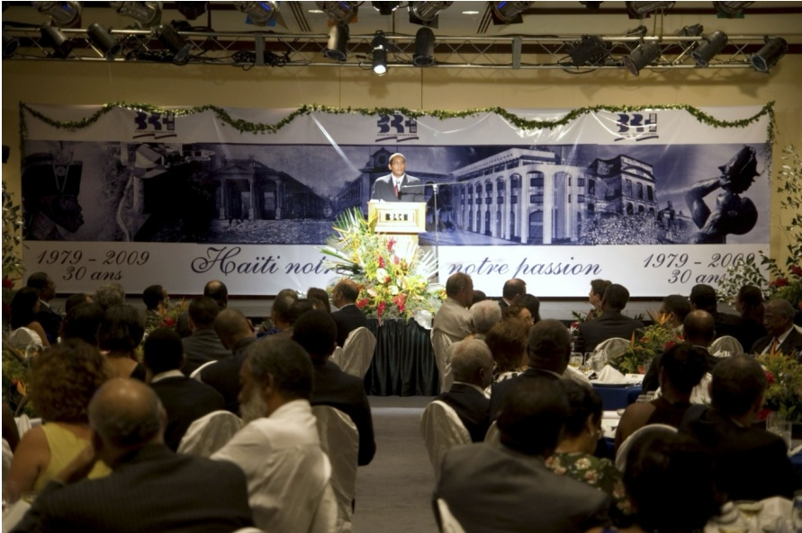

Monsieur le Représentant du Président de la République,

Monsieur le Président de l'Assemblée Nationale,

Madame la Première Ministre,

Mesdames et Messieurs les membres du Corps diplomatique,

Mesdames et Messieurs les Ministres,

Mesdames et Messieurs les Parlementaires

Monsieur le Représentant Spécial du Secrétaire Général des Nations Unies

Mesdames et Messieurs les Directeurs de banque.

Chers Collaborateurs.

<!-- page 36 -->

Distingués invités,

J'éprouve un immense plaisir à vous accueillir ce soir pour marquer le 30ème anniversaire de la banque centrale. Au nom du Conseil d'Administration, je vous souhaite la plus cordiale bienvenue à vous, distingués invités et amis de l'institution qui ne cessez de l'accompagner dans l'exécution de sa mission; à vous, représentants des divers secteurs d'activité, partenaires indispensables des efforts de maintien de la viabilité financière et économique; à vous, chers collaborateurs qui menez avec le Conseil le labeur quotidien de rester fidèle à la tradition de service et de qualité de la banque centrale. C'est aussi l'occasion pour moi de rendre hommage à tous ceux qui m'ont précédé à ce poste. Mes collègues du Conseil et moi saluons tous les anciens membres de Conseil qui nous ont fait l'honneur de répondre à notre invitation. Nous avons une pensée spéciale pour les cadres et administrateurs qui sont partis pour l'au-delà.

## Mesdames, Messieurs,

Ce n'est pas par accident que la Banque Centrale a été établie en 1979. La grande inflation des années 1970 souligna les limites des politiques monétaires illusoirement autonomes, basées sur le postulat que les autorités monétaires et fiscales étaient libres des contraintes de balance des paiements. Il était devenu clair que les mesures expansionnistes et inflationnistes n'avaient pas d'impact durable sur les prix des facteurs, notamment les salaires, et sur la production. En fait, ces mesures, et pire leurs anticipations dans un contexte de méfiance, induisaient des ajustements de prix qui gardaient les prix réels inchangés, dans le meilleur des cas. On avait alors, comme résultat fâcheux, la concomitance du chômage et de l'inflation, communément appelée stagflation.

Au niveau mondial, la création de banques centrales autonomes était fortement préconisée comme le moyen le plus sûr et le plus adéquat pour institutionnaliser et crédibiliser la gestion monétaire prudente, avec le mandat clair de travailler à la stabilité de la monnaie.

Dans le même temps, la première moitié des années 70 a été le témoin de l'arrivée chez nous des succursales de banques étrangères, ce qui rendait intolérable l'incongruité de la BNRH, à la fois banque commerciale et banque des banques. Ainsi, en plus d'une autorité monétaire suffisamment autonome par rapport à l'Etat central, le pays avait clairement besoin d'une autorité de supervision bancaire

<!-- page 37 -->

crédible et indépendante des banques. La mission de réglementer et de superviser les banques a été également confiée à la Banque de la République d'Haïti.

Cet anniversaire offre, il me semble, l'occasion de mesurer le chemin parcouru, de réexaminer certains points d'intérêt de l'histoire récente, d'évaluer le cadre opérationnel de la politique monétaire et de tenter un regard vers l'avenir.

La banque centrale était confrontée dès sa naissance à une tâche impossible: défendre la gourde tout en finançant des déficits budgétaires de plus en plus importants dans le cadre de politiques économiques anticycliques. Autrement dit, elle émettait systématiquement plus de gourdes qu’elle n’était capable de racheter à la parité fixe, et, enfin de compte, le stock de réserves se réduisit comme une peau de chagrin.

Pendant pratiquement 15 années, de 1979 à 1994, les autorités ont refusé de reconnaître l'impossibilité du maintien de la parité fixe. Cette période coïncide aussi avec des instabilités institutionnelles frappantes: plus de 10 gouvernements, près de 15 ministres des finances, 14 changements de gouverneur. Dans ce contexte, il est significatif que la durée statutaire de trois ans du mandat du Conseil d'Administration n'ait été respectée pour la première fois qu'en 1994.

## Mesdames, Messieurs,

A la fin de l'embargo en 1994, l'inflation avait atteint des niveaux exceptionnels, proche de 40% l'an et le PIB avait perdu 30% de sa valeur de 1991. L'année 1995 a marqué un nouveau tournant dans la politique monétaire: on admettait finalement que le taux de change était flexible et que la banque centrale se devait d'émettre de la monnaie non plus en fonction de l'offre de devises mais selon les

<!-- page 38 -->

besoins de transactions de l'économie et, donc, selon les objectifs d'inflation. Grâce à la modération des

besoins de financement du secteur public, consécutive à un effort fiscal appréciable conjugué à des

appuis budgétaires de la communauté internationale, l'inflation moyenne a été ramenée à moins de

20% dès l'exercice 1996-97 puis à 13% et à 8.1% au cours des deux exercices subséquents.

Cette bonne gestion macroéconomique s'est poursuivie jusqu'à l'épisode pénible de la crise sociopolitique de 2001-2004, où l'interruption du financement externe allait pousser le gouvernement à recourir au financement de la banque centrale, avec implacablement le même résultat : une inflation de plus de 30% et une baisse du PIB réel de 3.5%.

Depuis 2004, grâce à la bonne coordination des politiques fiscales et monétaires, la banque centrale a pu mener une politique monétaire prudente contribuant ainsi au maintien de la stabilité macroéconomique. Il importe de rappeler que cette performance macro-économique a permis la réduction de plus d'un milliard de dollars de la dette externe d'Haïti, ce qui se traduit par une baisse du service de notre dette d'environ 50 millions de dollars par an, autant de ressources qui peuvent être affectées à des investissements productifs et à la réduction de la pauvreté.

## Mesdames, Messieurs,

Permettez-moi de m'appesantir un instant sur les leçons à tirer de ces deux épisodes pénibles 1991-94 et 2001-04 de notre histoire. La grande valeur des expériences et des crises extrêmes est de nous enseigner à la dure, en sorte que ces souvenirs restent vivaces en nous, avec des cicatrices indélébiles. Malheureusement, nos émotions perturbent souvent notre jugement et nos réflexions s'arrêtent à des récriminations contre des acteurs, sans identifier et analyser les causes profondes de nos déboires.

L'enseignement est pourtant clair et mérite qu'on y insiste :

a) les turbulences politiques sont à éviter. C'est comme la guerre. Tout le monde en sort estropié.

Ce n'est qu'en 2007 d'ailleurs que nous avons pu retrouver notre PIB de 1991 avec une population qui a substantiellement augmenté et donc une misère qui s'est approfondie.

b) le recours effréné au financement monétaire du déficit public induit de fortes inflations, ne produit pas la croissance, et au contraire, contribue souvent à la détérioration de la situation de la production et de l'emploi.

Depuis des siècles de monnaie fiduciaire et, même de monnaie scripturale, si la monnaie n'avait pas de limites, si on pouvait impulser la croissance, de façon durable, par la monnaie, disons-nous que toutes

<!-- page 39 -->

les nations du monde seraient riches, puisqu’elles détiennent toutes, comme partie de leur souveraineté, le privilège de battre monnaie. Et on pourrait aller jusqu’à dire péremptoirement qu’ont fait une grosse bêtise les États qui abdiquent ce privilège sacré pour adhérer à une union monétaire.

J'insiste là-dessus parce que la crédibilité de la politique monétaire implique aussi que la Banque Centrale reste ouverte et réaliste sur ce que peut faire, et encore plus important, ce que ne peut pas faire la politique monétaire.

## Mesdames, Messieurs,

La stabilité monétaire est très fragile si elle n'est pas associée à un système bancaire bien capitalisé et bien géré qui garantisse la sécurité des avoirs des déposants. Les faillites bancaires ont des effets dévastateurs sur la monnaie. Même quand elles sont évitées par un concours financier de l'Etat, celui-ci entraîne généralement des déficits dont le financement est source d'instabilité monétaire.

De façon tout à fait avisée, les réformes monétaires sus évoquées ont été complétées par un renforcement de capacité en matière de réglementation et de supervision bancaires, avec la mise en place du corpus de règles prudentielles inspirées des recommandations du Comité de Bâle. C'est ce corpus qui est encore en place aujourd'hui avec des amendments au gré des nouvelles circonstances.

Grâce à cette capacité, la banque centrale a pu prévenir ou résoudre, avec un relatif succès, plusieurs crises bancaires, notamment le cas de la Metrobank en 1995, de la BIDC en 1998, de la Promobank en 2006 et de la Socabank en 2007, cette dernière avec un concours de l'Etat, à travers la BNC. Il était heureux que celle-ci eût réussi son programme de restructuration entamé dès 1999, ce qui lui permit en 2006 d'être assez capitalisée pour absorber les fonds propres négatifs de la Socabank sans apport de fonds frais de l'Etat.

<!-- page 40 -->

L'actualité financière internationale prouve encore, s'il en était besoin, la justesse de la décision des autorités sur cette question. Aujourd'hui, la BNC, avec le support de la BRH, en dépit de ce choc, demeure une banque bien capitalisée avec des fonds propres de 1.4 milliard de gourdes, bien gérée et rentable avec des profits fort appréciables.

Grâce aux règles de bonne gestion imposées par la banque centrale et au sens de responsabilité des banquiers de la place, notre système bancaire jouit d'une bonne situation au milieu de la crise mondiale, comme en témoigne le maintien du niveau global de rentabilité, de profitabilité et de qualité des actifs.

La banque centrale est attachée à cette stabilité et s'évertue à la maintenir par tous les moyens légaux et institutionnels à sa portée. Nous espérons que le Parliament voterai bientôt le projet de loi bancaire qui autorise la BRH à intervenir de façon encore plus proactive, dès les premières manifestations des difficultés financières.

<!-- page 41 -->

Mesdames, Messieurs,

Le dynamisme importe autant que la stabilité. La dynamisation de l'économie requiert l'accès aux services bancaires et au crédit à l'ensemble de notre population. Dans ce sens, fortement supportées par les coopérations américaine, française et canadienne, les institutions de micro finance jouent un rôle essentiel et ont montré que la micro entreprise peut être rentable et solvable chez nous. Le cadre réglementaire de ces institutions est en cours d'élaboration.

En tant qu'institutions de dépôt, les coopératives d'épargne et de crédit jouent un rôle capital dans la bancarisation du territoire. La banque centrale les aide à se renforcer et se crédibiliser en les réglementant et les supervisant tant sur place que sur pièce, et les encourage fortement à se grouper en fédération. Pour le moment, il y a une fédération de 16 caisses qui bénéficient du support technique de Développement International Desjardins. On espère qu'à terme, les fédérations de caisses populaires pourront participer au système de compensation, ce qui permettra aux déposants de leur réseau d'émettre des chèques, d'utiliser des guichets automatiques ou leur carte de débit dans le cadre du système de compensation automatique qui devrait être une réalité avant la fin de 2010.

L'efficience du système des paiements est un élément essentiel pour la dynamisation du système financier. Les avancées technologiques en autorisent la modernisation quasi permanente, avec des bénéfices certains pour la population. Actuellement, plus d'un quart des soixante mille employés de l'Etat sont payés directement par crédit à leur compte à la banque de leur choix. De même, les délais de paiement et de règlement sont sensiblement réduits par la possibilité offerte de transférer des sommes de banque à banque.

Un système financier efficient doit pouvoir offrir le meilleur rendement possible aux détenteurs des surplus de fonds et le moindre coût possible aux emprunteurs de ces fonds. L'approfondissement financier et la désintermédiation financière tendent vers cet optimum en mettant les prêteurs et les emprunteurs en contact directement. Nous saluons les rares initiatives d'émissions de bons par les entreprises de la place ainsi que la vision de leurs conseillers. Ces initiatives sont à multiplier, et nous encourageons les entreprises privées à faire montre d'une plus grande transparence dans la divulgation de leur bonne rentabilité et solvabilité. D'un autre côté, la fiscalité devrait être ajustée de manière à ne pas tuer ces titres et bloquer un développement fondamentale.

Parallèlement, l'adjudication des bons BRH a été ouverte à des institutions autres que les banques, comme les compagnies d'assurance et les coopératives d'épargne et de crédit. L'année 2010 devrait

<!-- page 42 -->

marquer l'émission de bons du Trésor que le public pourra acquérir et qui représenteront l'actif sans risque à partir duquel on pourra déterminer les prix des actifs financiers en fonction des risques qui y sont associés.

Information et garantie sont deux éléments essentiels à la réduction du risque et du coût du crédit. La Banque Centrale a été très activiste dans l'élaboration et la passation de la loi sur le gage sans dépossession. La possibilité d'offrir des équipements en garantie devrait réduire les coûts de fonds pour toutes catégories d'emprunteurs, de l'entreprise de construction à la micro industrie de la ferronnerie. D'autre part, le fonctionnement du Bureau d'Information sur le Crédit appelé à traiter et divulguer l'information sur les emprunteurs devrait réduire l'asymétrie de l'information entre prêteurs et emprunteurs et faire baisser le coût du crédit.

Par ailleurs, l'industrie financière est intensive en ressources humaines et n'est pas viable sans des hommes et des femmes qualifiés en économie, finance, comptabilité et audit. Si à la banque centrale, le personnel bénéficie de programmes de formation continue qui le rend plus performant dans ses tâches quotidiennes, nous nous impliquons aussi, au-delà de la satisfaction de nos besoins propres, dans la constitution d'une masse critique de techniciens qualifiés à la mesure de nos ambitions de développement.

C'est dans ce cadre que se situe la mise en œuvre, à la suite du programme de lauréats établi en 1996, d'un programme en Analyse de Politiques Publiques en partenariat avec l'American University de Washington DC., ouvert à l'administration publique et aux lauréats de nos facultés. L'objectif est de former, tous les deux ans, une vingtaine de cadres qui détiendront un certificat post-gradué de l'American University. En outre, la BRH finance un programme de Maîtrise en comptabilité (option Contrôle/Audit) - en partenariat avec la Faculté des Sciences Economiques et Administratives de l'Université Quisqueya et l'Université de Paris XII au profit des jeunes comptables haïtiens. Le programme porte sur 15 mois et a commencé la semaine dernière.

## Mesdames, Messieurs,

Il est reproché parfois à la Banque Centrale de mener une politique trop rigoureuse qui ne stimule pas la production, ou de mener une politique de change qui encourage les importations. Ce sont là des reproches qui retiennent notre attention car nous sommes convaincus que le but de la politique

<!-- page 43 -->

monétaire ne peut pas être la stabilité en soi, mais plutôt la stabilité comme un moyen de rassurer les épargnants et les investisseurs afin de stimuler la croissance et le développement économiques.

Qu'il me soit permis de rappeler que la Banque Centrale ne pratique pas de taux de change ou d'intérêts multiples avec des discriminations entre secteurs. Le taux de change est flexible, les banques choisissent librement leurs débiteurs, les projets qu'elle finance, les montants prêtés et les taux auxquels elles prêtent.

Le postulat de base de notre politique monétaire est que l'inflation est un phénomène monétaire à terme et qu'une perte de valeur soutenue de la monnaie n'est possible que si la quantité émise dépasse systématiquement la valeur de la richesse créée. Il est également admis que les anticipations des agents jouent un rôle crucial à cet égard.

C'est pourquoi nous pensons que l'essentiel est de créer et de maintenir des conditions transparentes de stabilité monétaire et financière propres à garder la confiance du secteur privé et à stabiliser ses anticipations d'inflation et de change.

Dans ce sens, la communication des autorités monétaires avec le secteur privé et le public en général est devenue un élément essentiel du capital de crédibilité de la politique monétaire. Cela fait longtemps que la banque centrale n'est plus « une énigme dans un mystère ». Outre nos rapports annuels, notre bulletin statistique trimestriel et nos diverses publications périodiques, nous maintenons depuis 10 ans un site internet où le public intéressé obtient toutes les informations sur l'évolution des agrégats, sur les opérations de la banque centrale et sur le système bancaire. Par ailleurs, la banque centrale partage volontiers avec le secteur privé bancaire la plupart des éléments d'information utilisés aux réunions du Comité de Politique Monétaire. Les états financiers de l'institution sont également publiés. En outre, une Note de Politique Monétaire parait chaque trimestre pour expliquer nos décisions en la matière.

Dans tous les programmes financiers, lesquels sont largement diffusés, les objectifs d'inflation sont annoncés avec des cibles intermédiaires de croissance de la base monétaire et de la masse monétaire.

Dans la poursuite de ces objectifs, la BRH utilise un mix d'outils, notamment les réserves obligatoires, les bons BRH et les avoirs extérieurs, pour moduler la croissance de la monnaie. Comprenez que la vente de dollars correspond à un retrait de gourdes et donc à une réduction de la masse monétaire et vice versa.

Nous pouvons vous assurer que les fluctuations du change occupent une place importante dans nos délibérations étant donné qu'elles modifient les prix relatifs. Elles induisent donc, toutes autres choses

<!-- page 44 -->

étant égales par ailleurs, des changements de la demande entre les produits et services haïtiens et ceux

qui sont produits à l'étranger.

## Mesdames, Messieurs,

La meilleure façon pour la Banque Centrale de contribuer à la croissance durable est d'entretenir une inflation basse, stable et prévisible. Ce climat, s'il peut être associé à des facteurs structurels et administratifs favorables aussi bien qu'à d'autres politiques publiques cohérentes et effectivement implémentées, incitera les entreprises à investir à long terme avec une confiance accrue, dans les secteurs où nous pouvons obtenir et garder des avantages compétitifs. Le change seul, sans les préalables structurels, ne peut pas faire ce miracle, tout comme les baisses de taux d'intérêt n'entraînent pas souvent une augmentation des investissements industriels de long terme à cause des freins extra économiques.

Dans un environnement de fortes défaillances structurelles, l'économie est prise dans un cercle vicieux où il est souvent observé, entre autres distorsions et désarticulations, que les taux d'intérêt et le change ont un impact très limité sur la production qui présuppose des investissements à long terme avec forcément des délais longs de récupération du capital. Seules les réformes structurelles et institutionnelles crédibles qui s'inscrivent dans la durée peuvent venir changer les perceptions de risques et nous faire atteindre le seuil à partir duquel l'économie se place dans un cercle vertueux où les stimuli classiques peuvent effectivement jouer pour la dynamiser.

Les différentes réformes, actuellement en cours, visent à nous rapprocher de ce seuil et nous commençons à en voir les manifestations. C'est dans ce cadre qu'il faut situer entre autres : les efforts pour tirer pleinement avantage de la loi HOPE II ; les efforts pour réduire la porosité de nos frontières qui peut rendre ineffective la politique commerciale nationale même la mieux pensée ; la levée progressive des blocages administratifs comme la réduction récente des délais de constitution des sociétés anonymes ; les efforts de production d'électricité et de construction d'un réseau routier ; sans manquer de noter l'obligation faite à l'investisseur stratégique, dans le document d'appel d'offres de modernisation de la Téléco, de construire une dorsale numérique reliant les différents points de notre territoire. Sur ce dernier point, comme je l'ai souligné dans d'autres discours et interventions publiques, vu l'insuffisance des revenus de l'Etat, le recours aux capitaux privés n'est pas à exclure pour l'exécution de projets d'infrastructure publique.

<!-- page 45 -->

Il est rassurant et encourageant de noter que, de plus en plus, un consensus semble se dégager autour de ces points fondamentaux. Dans ce sens, nous saluons les travaux des différentes commissions présidentielles, notamment celle sur la compétitivité dont le rapport préliminaire suscite déjà des débats animés et de bonne foi sur nos opportunités.

La politique monétaire est une politique publique, et la stabilité à long terme qu'elle cherche à livrer, un bien public. La Banque Centrale supporte les efforts des commissions et participera au dialogue incontournable pour arriver à la cohérence de toutes les politiques publiques en vue de la mise en place des préalables et la levée des freins à la croissance soutenue sans laquelle nous ne pouvons pas sensiblement améliorer les conditions de vie de la population. Ensemble, dans la concorde et le pragmatisme, nous pouvons y arriver.

## Mesdames, Messieurs,

Je me surprends parfois à rêver de la Banque Centrale de 2039. Des gamins et des gamines qui ne savent rien aujourd'hui de ces questions ennuyeuses ont la responsabilité de son administration. Le siège de la Banque est à la même place, mais dans un centre-ville réhabilité et convoité. Certains employés viennent y travailler en train de Gressier ou de la Croix des Bouquets. Le Président de la Commission Finances du Sénat dit au Gouverneur que sa politique est trop restrictive parce que le chômage est ausses de son taux naturel de 15%, et que la croissance de 2039 n'est que de 9%. Les revenus touristiques sont de plusieurs milliards de dollars. Les enfants de nos enfants vont à l'école, notre jeunesse est allante et sourit à la vie, nos vieux et vieilles sont contents d'une mission bien accomplie. La misère est derrière nous et nous voguons vers la prospérité.

Et vous savez quoi ? Je me dis pourquoi pas.

Merci.

<!-- page 46 -->

29 - 30 - 31 Octobre 2009 (CARICOM) (Discours non disponible)

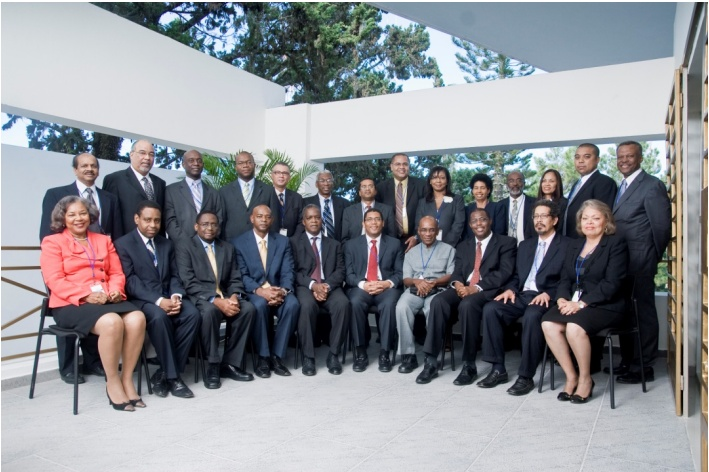

<!-- page 47 -->

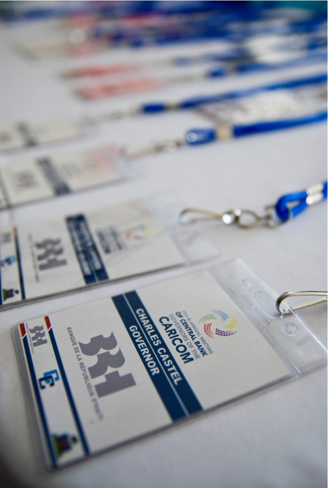

<!-- page 48 -->

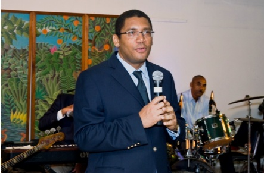

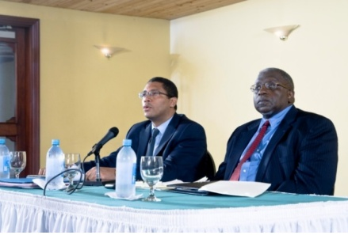

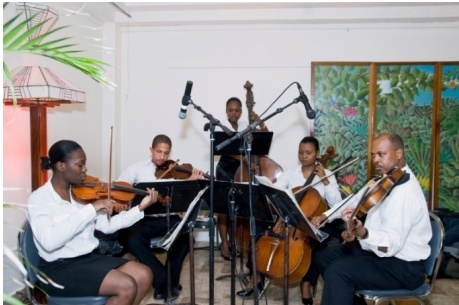

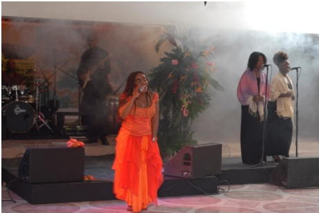

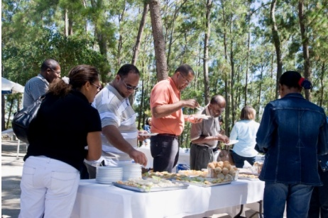

<!-- page 49 -->

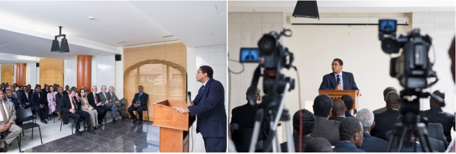

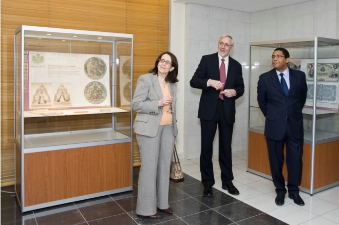

<!-- page 50 -->

Université Quisqueya - Collation de Grades - 20 décembre 2009

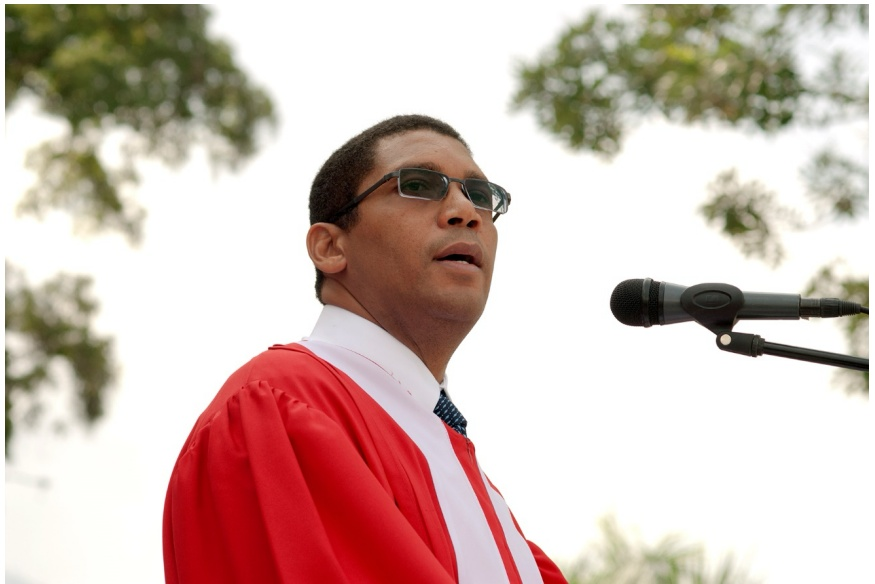

Je remercie le Recteur de l'Université Quisqueya de m'avoir invité pour m'adresser à vous, étudiants

finissants de la promotion 2009. J'ai été enseignant et c'est la plus belle et la plus générue des

professions. J'y reviendrai un jour. Permettez avant de commencer et alors que je viens de parler des

enseignants, de penser à ma mère qui m'a formé et que des générations entières d'écoliers ont eu le

privilège d'avoir comme éducatrice.

Je suis heureux de vous avoir avec moi pour tenter de vous dire une infime partie de ce que j'aurais aimé vous dire pendant quatre ans si j'avais eu l'honneur d'être votre professeur.

Je suis heureux d'être reçu dans ce nouvel espace, dans ce nouvel édifice, fruit d'un effort important et qui témoigne du travail acharné de votre recteur et de toute l'université. Cet immeuble dont elle est aujourd'hui dotée devra inspirer les générations futures d'étudiants à de grands accomplissements.

<!-- page 51 -->

Mais ce campus ne serait qu'un espace vide et creux s'il n'avait des enseignants de qualité et des administrateurs sérieux. Jacky Lumarque, Recteur de cette université est l'un des hommes dont ce pays a vraiment besoin : enseignant et administrateur, il nous donne un exemple de ce qu'est la ténacité et l'acharnement à vouloir faire, à vouloir accomplir. Vous avez besoin de modèles, il en est un, prenez exemple sur lui et vous ne pouvez que réussir.

Ces quatre ans ont été lourds de sacrifices autant pour vous que pour vos parents. A qui il est beaucoup donné, il sera beaucoup demandé. Dans un pays où la majorité des femmes et des hommes n'a pas accès à ce droit fondamentale qu'est l'éducation, ceux qui ont le privilège d'y accéder n'ont pas que des droits ils ont aussi et surtout des devoirs. Privilégiés, à ces privilèges ne seront associés que des responsabilités. Et, de très lourdes mesdemoiselles, mesdames et messieurs les impétrants.

J'ai voulu répertorier pour vous certains de vos devoirs. La liste n'est pas exhaustive : inspirez vous en, mais n'y restez pas collés !

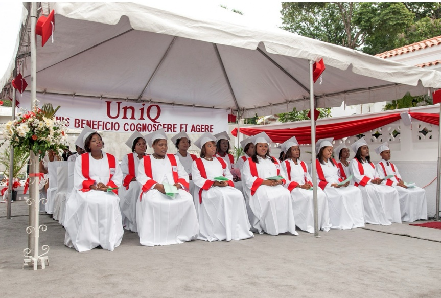

Devoir de réussite personnelle : il va de soi que bien gagner sa vie, est une obligation envers soi même et ses proches et je sais que vous serez à même de le faire : l'excellence de votre formation y contribuera certainement. Mais lorsque je parle de réussite personnelle, je parle d'éducation et de

<!-- page 52 -->

connaissances : ne vous laissez jamais envahir par la médiocrité. Vous avez travaillé dur pour l'obtention de ce premier diplôme. Je vous engage à poursuivre votre éducation et à approfondir vos connaissances tous les jours de votre vie. Ne vous laissez pas scléroser, faites travailler votre esprit encore et toujours. Emerveillez-vous de tout : du sourire d'un enfant à la beauté d'une rose à peine éclose. Apprenez, lisez, écoutez... et, Mesdemoiselles, Mesdames et Messieurs les impétrants rappelez-vous que seule l'excellence est la récompense du travail bien fait, la réussite vous sera donnée de surcroit.

Je ne suis ce que je suis et n'accomplirai pleinement mon destin que grâce à l'éducation que j'ai. C'est mon leitmotiv quotidien. J'ai une soif permanente d'apprendre, de comprendre et de prendre tout ce que je peux absorber. Je me demande toujours de toute rencontre : qu'as-tu appris de tout ceci ?

Permettez-moi donc de vous parler de moi, un peu. J'ai, comme vous, obtenu mes deux premiers diplômes en Haïti : à la faculté de droit et à l'INAGHEI. Je suis fier d'être un produit du système éducatif haïtien, comme vous. Du bon système éducatif haïtien, je veux dire... de celui où les enseignants se dévouent pour faire passer un savoir.

De celui où les étudiants ont à cœur de travailler pour l'obtention de leurs notes et de leurs diplômes.

De celui où la facilité et où la médiocrité n'ont pas de place. De celui où l'on va en cours pour apprendre

à réfléchir ou pour apprendre tout court. De celui où l'espace universitaire est un lieu de réflexion,

d'apprentissage, de choc des idées et de concertation vers l'excellence!

A la Banque de la République d'Haïti, nous croyons dans l'éducation, la formation et l'excellence. C'est pourquoi nous venons de lancer deux programmes presqu'en parallèle l'un avec la « American University » où nous formons des cadres de l'administration publique, en analyse des politiques publiques et l'autre avec votre alma mater, l'université qui m'a donné le plaisir de m'adresser à vous aujourd'hui. L'Université Quiqueya où nous sponsorisons un master en comptabilité.

Devoir de vous perfectionner tous les jours. J'ai vu une interview de Nelson Mandela il y a quelques années et tout en déplorant d'avoir passé ses plus belles années en prison : vingt-sept ans ; il s'est tout de même déclaré heureux d'avoir eu ce temps pour accomplir la tâche la plus difficile qu'un être humain aura à accomplir : se changer soi-même.

<!-- page 53 -->

Ne vous laissez donc pas enfermer dans la prison de vos propres démons, de vos propres préjugés!

Colère, envie, préjugés et jalousie sont des démons qui nous guettent tous. En vous laissant emprisonnés par eux, vous ne pourrez jamais accomplir ce destin lumineux que je vois pour vous.

L’apprentissage vous viendra sur vos lieux de travail respectifs, certes, mais bien plus souvent en écoutant les autres, les ainés, en vous mettant à l’école des autres. Je le dis tous les jours à mes enfants et je vous le dis aujourd’hui : l’Autre quel qu’il soit a toujours une nouveauité à vous dire et à vous apprendre. Ecoutez, apprenez, entendez... la sagesse vous viendra seulement lorsque vous saurez faire tout cela.

Devoir d'humilité : Avec l'éducation vient le savoir et la certitude de l'ignorance face à la somme de tous les savoirs à acquérir ! Soyez humbles car même si la formation que vous venez de recevoir est l'une des meilleures que ce pays peut offrir, il n'en reste pas moins que vous avez encore énormément à apprendre. Et, du plus petit au plus grand de ce monde, vous avez à apprendre de lui. Rien, jamais ne justifiera l'arrogance ! Soyez toujours des étudiants : de la vie et des Hommes.

Devoir d'expression libre : un Etre Humain ne doit sa valeur qu'à la liberté de sa pensée et à sa capacité de l'exprimer encore plus librement ! Parlez encore et toujours, vous êtes des êtres libres comme l'aigle souverain et comme le phare en pleine tempête. Exprimez-vous de cette parole libératrice qui fait de vous des Hommes et permet de soulever des montagnes!

Devoir de rassembler, d'unir et d'inclure. Nous vivons malheureusement dans un pays ou l'exclusion est le sort de plus d'un. Vous devrez tous les jours de votre vie mener ce combat pour que jamais plus un être humain en Haiti n'ait faim, n'ait peur, ne souffre et ne meure par manque de moyens. Vous devrez investir les arènes du pouvoir et des décisions pour vous battre pour que chaque haïtien ait droit à la santé, à l'éducation, à des repas chaud quotidiens. Pour que chaque enfant ait un père et une mère travaillant dans des conditions humainement acceptables. Vous battre pour que les collines soient verdoyantes et que l'eau recommence à jaillir et à arroser nos plaines. Tels des Gouverneurs de la Rosée, je vous envoie aujourd'hui faire revivre toutes les sources de ce pays. La tâche est titanesque mais elle est vôtre et vous en êtes capables.

Devoir de se battre contre les injustices et contre l'impunité: Je suis un avocat et je sais que ce que je vais vous dire est difficile à accomplir. Mais... laissez-moi vous aider à rêver d'une Haïti idéale où toutes

<!-- page 54 -->

les femmes et tous les hommes sont égaux vraiment face à tout. D'une Haïti où la criminalité est à zéro et où tous respectent les règles du jeu.

Devoir de servir et d'aider ! L'éducation ne vous donne que la responsabilité d'être humble et de toujours donner. Votre génération aura la responsabilité d'être celle qui changera ce pays et ses mentalités. J'ai appris que le meilleur moyen d'enrichir sa vie est de contribuer à rendre celle des autres plus belle et plus riche. Je vais vous envoyer comme des bergers semer la bonne parole. Contribuez à faire du concept de service la nouvelle manière de vivre et de penser des haïtiens.

L'éducation que vous avez reçue est l'un des plus puissants instruments que vous aurez pour changer ce pays et le monde ! Utilisez-la à bon escient. Vous êtes notre avenir. Laissez-nous être un moment sur vous épaules et voir l'avenir que vous nous apportez. Vous êtes aujourd'hui porteurs de ce pays et du monde ! Aujourd'hui ne marque pas la fin de vos études, mais le début du reste de votre vie.

Bonne Chance!

20 décembre 2009

<!-- page 55 -->

## 2010

## Les moyens de paiement - 24 septembre 2010 - Karibe

Haïti: On dit souvent, et c'est vrai, que les moyens de paiement sont à l'économie ce que le sang est au corps humain. Toute transaction finit par un règlement; la facilité et la rapidité avec lesquelles ce règlement peut se faire contribuer à la productivité de la population. Se libérer de la dépendance du cash présuppose la disponibilité d'autres moyens de paiement fiables, parce que plus sécurisés tout en offrant des possibilités de règlement très simples et très rapides. Le cash permet le paiement direct au bénéficiaire ou au prestataire de biens ou de services, sans intervention d'une tierce partie dépositaire.

Les autres moyens de paiement (chèque, carte de débit, téléphone mobile, et les autres à venir) qui sont des ordres de paiement à une tierce partie dépositaire, requièrent au préalable l'existence d'un compte chez ce dépositaire, et participent de la tendance inexorable à la dématérialisation. Celle-ci n'altère en rien, et ne doit absolument pas occulter, la réalité juridique du lien entre le déposant et le dépositaire, point de départ et d'ancrage obligé de toute analyse rigoureuse et cohérente de ces mécanismes.

L'émergence et l'utilisation des nouvelles technologies auront certainement de profonds effets sur les mécanismes de paiements. Il est anticipé que ces technologies refaçonneront l'environnement compétitif, et c'est pourquoi il est crucial de garder les repères et l'adéquation de ces développementes aux exigences de stabilité et de crédibilité du système financier dont les différents organes doivent être dûment réglementés et supervisés.

Pour que la prédominance du cash se réduise, il faut donc que, quel que soit le médium utilisé, les ordres de paiement soient universellement acceptés et rapidement exécutés. Seule cette égalité dans l'efficacité viendra induire la préférence pour les ordres de paiement à efficacité égale, à efficiency et sécurité supérieures. L'acceptation universelle implique l'interopérabilité qui permette aux différents réseaux d'interagir, avec des flux d'informations et de valeurs de réseau à réseau. Ce pont entre les différents réseaux, c'est exactement la fonction du système de compensation automatique à travers la «plateforme nationale» mise en place par la banque centrale, qui prévient les ilotages et unit les différents organes en un système intégré, cohérent, efficient et efficace.

Imaginez une marchande de Sainte Suzanne qui voyage à Port-au-Prince avec une simple carte de débit pour régler ses transactions, ou mieux qui ne voyage pas du tout mais simplement négocie l'acquisition

<!-- page 56 -->

de marchandises avec le grossiste du Cap-Haïtien au téléphone et règle cette transaction à travers ce même téléphone, même quand son grossiste et elles, utilisent des réseaux bancaires différents.

Imaginez des chèques digitalisés qui se prêtent à la compensation automatique. Cela résoudra ipso facto les longs délais de compensation. La compensation pourra se faire au pire le jour suivant le dépôt du chèque.

Tout cela n'est nullement un rêve. Cette possibilité est déjà au robinet. Nous l'avions annoncée pour la fin de cette année, nous y sommes presque, en dépit des perturbations du 12 janvier. Et nous allons vous en faire la démonstration.

Les opportunités sont énormes. Il y a un an, le « mobile banking » n'était pas à l'ordre du jour chez nous.

Aujourd'hui, il s'inscrit dans l'agenda national du système de paiements et est en passe de devenir une

réalité. La banque centrale a été très clairvoyante en se dotant d'une plateforme qui puisse supporter et

faciliter ces développementements. Elle a également émis des lignes directrices qui doivent guider les

initiatives relatives aux opérations de banque à distance (BAD).

Ainsi, tant au plan technologique que du point de vue de la réglementation, à la banque centrale, nous sommes au rendez-vous. Nous saluons dans ce sens les partnerships entre banques et opérateurs téléphoniques en vue d'offrir principalement à la frange de notre population actuellement non bancarisée des services adéquats avec tous les bénéfices financiers, économiques et sociaux qui y sont associés.

A moyen et à long terme, le système de paiements national renforcé induira une meilleure efficiency dans la conduite des transactions internationales. Ce volet du processus est crucial pour notre économie ouverte, fortement dépendante des flux de biens et de services et des flux financiers internationaux. Les transferts privés reçus de notre diaspora, principale rentrée de la balance des paiements du pays, représentent environ 25% du Produit Intérieur Brut. Les frais élevés de transactions qui y sont liés pénalisent les bénéficiaires. Les avancées en matière de « Mobile Banking » constitueront un élément de concurrence qui aura des incidences sur la baisse de ces frais.

Nous vous remercions de votre présence aujourd'hui. Nous avons fait l'effort de réunir une belle brochette d'experts dans le domaine qui va vous entretenir tant de l'approche de la banque centrale que des expériences internationales avec les meilleures pratiques et les travers à éviter. J'espère que les différentes sessions seront animées de vos questions et de vos remarques, je sais que vous en avez

<!-- page 57 -->

beaucoup, et qu'à la fin de la journée, l'agenda que nous nous apprêtons à vous soumettre sortira enrichi de votre participation.

Je déclare les débats ouverts et vous remercie.

<!-- page 58 -->

## Colloque microfinance - 28 septembre 2010 -

La banque de la République d'Haïti est heureuse de s'associer au Ministère de l'Économie et des Finances pour la réalisation de ce colloque dont l'objectif principal est d'identifier les éléments clefs d'une politique nationale de développement de la micro finance chez nous.

Qu'il nous soit permis d'attirer l'attention des participants sur des points fondamentaux pour :

i) la réglementation de ce secteur ;

ii) le renforcement de sa résilience aux chocs sociaux et naturels ;

iii) sa capacité de dépasser le financement du micro-commerce et de jouer pleinement son rôle dans le financement de l'artisanat, de la micro-industrie et des professionnels manuels.

Au plan de la réglementation, pour nous, à la banque centrale, la microfinance est de la finance. Certes, elle dessert un segment de marché particulier, dans un environnement et avec des contraintes spécifiques, notamment au niveau du monitoring des prêts et la proximité nécessaire avec les débiteurs. Pour autant, elle ne mérite pas moins d'être réglementée selon les principes qui régissent, entre autres, la lutte contre le blanchiment des avoirs, la protection de l'épargne et la concentration des risques.

Cependant, cette réglementation doit être préservée de la lourdeur et des complications qui peuvent venir compromettre le développement du secteur et sa capacité à jouer pleinement son rôle de porteur de croissance et développement. Il faut éviter l'amalgame et tenir compte des différentes catégories d'institutions opérant dans le secteur.

Dans ce sens, une distinction claire et tranchée doit être faite entre les institutions de dépôt que sont les coopératives d'épargne et de crédit et les entités qui prêtent sans recevoir de fonds du public. Celles-ci seront supervisées de manière à s'assurer qu'elles se confinent strictement à leur rôle de prêteurs non débiteurs du public.

Par contre, les CECs doivent être réglementées et supervisées dans l'objectif de protéger les avoirs du public. Rappelons dans ce sens, que la banque centrale supervise plus d'une centaine de caisses, et travaille avec une fédération qui regroupe plusieurs caisses d'épargne et de crédit.

<!-- page 59 -->

A ce propos, il importe de souligner que le regroupement des caisses en fédérations, dans le cadre d'une supervision pyramidale, prévue dans la loi sur les CECs est un sine qua non pour leur intégration complète au système financier principal, et surtout au système de paiements. En effet, c'est par les fédérations, admises à la chambre de compensation, que les clients des caisses pourront jouir des bénéfices d'un système de paiements intégré, au même titre que les clients des banques. Soulignons en passant qu'en dépit de cette lacune au niveau des fédérations, les CECs ont été admises aux adjudications de bons BRH et en détiennent à date un encours d'environ 250 millions de gourdes.

De plus, la multiplicité des caisses complique la surveillance. La taille de certaines entités compromet leur viabilité et ne justifie nullement les dépenses de supervision. Il est impératif que le secteur soit assaini par l'encouragement de la fusion de certaines caisses. D'où l'idée d'un fonds d'assainissement des CECs pour lequel la banque centrale plaide depuis tantôt six ans. La supervision pyramidale par les fédérations et l'assainissement par les fusions sont, à côté des programmes quasi-permanents de formation des administrateurs et dirigeants, incontournables pour le renforcement du secteur et la rationalisation de sa supervision.

Nous espérons que l'introduction prochaine des activités de banque à distance, via notamment les cartes de débit et les téléphones mobiles favorisera l'inclusion financière et, en même temps, révolutionnera les circuits de commercialisation de la micro finance. Il est évident que la « banque à distance » va créer de nouveaux défis pour les parties concernées, il est tout aussi évident que l'effet conjugué des institutions financières, des opérateurs de téléphonie mobile et de la banque centrale, autorité de supervision, aplanira les sentiers pour l'atteinte d'objectifs profitables tant aux demandeurs qu'aux fournisseurs de services financiers. Il s'agira de savoir tout mettre en œuvre pour saisir cette opportunité.

Au plan de la résistance aux chocs, les débiteurs du secteur suscitent l'admiration par leur grand dynamisme, leur sérieux, leur créativité, leur agilité et leur courage, même dans les circonstances les plus dévastatrices, comme les grandes inondations des Gonaïves et de Mapou, les troubles sociopolitiques de 2004 et de 2008, et le désastre du 12 janvier. Ils rebondissent toujours, et leurs ressorts fondent la résilience de leurs créanciers. Mais même ces ressorts peuvent atteindre leur limite d'élasticité. Ces débiteurs méritent une protection plus sûre. Il s'agit aujourd'hui de capitaliser sur ces expériences pour les rendre moins vulnérables. Il est donc tout à fait avisé d'établir en leur faveur des mécanismes d'assurance contre pertes suite à ces désastres. Une telle initiative est de loin plus

<!-- page 60 -->

structurante, et pas nécessairement plus coûteuse pour les bailleurs, que les appels à l'aide

immanquables à toutes les calamités, lesquelles deviennent de plus en plus fréquentes.

Jusqu'à présent, la microfinance finance essentiellement le micro-commerce. C'est beaucoup et nous apprécions tous les efforts pour qu'elle fasse mieux ce qu'elle fait déjà assez bien. Mais, elle jouera pleinement son rôle dans le progrès et l'intégration des classes défavorisées quand elle dépassera le commerce pour systématiquement financer l'artisanat, la micro-industrie et les professionnels manuels.

Le challenge est énorme parce que cette catégorie de débiteurs ne peut nullement s'accommoder des taux d'intérêt actuellement pratiqués que seule la vitesse de rotation des fonds dans le commerce rend tolérables. Mais cette frange industrieuse de notre population ne peut pas être laissée au bord de la route.

Or, seul le financement adéquat de ses équipements et la formation professionnelle ciblée peuvent venir autoriser l'amélioration de sa productivité et de ses revenus.

Nous encourageons donc le recours aux mécanismes de garantie tels que le crédit-bail et le gage sans dépossession, et à l'assurance contre les vols et pertes. De plus, un fonds de soutien au développement de ces activités devrait garantir partiellement ces crédits. Pour augmenter la productivité, les revenus et les chances de succès de ces débiteurs, ces prêts peuvent être précédés d'une formation professionnelle d'appoint qui affine les capacités techniques et offre des rudiments de gestion et de finance personnelle.

Je forme le vœu que ce colloque prenne compte de ces défis nationaux pour l'élaboration d'une stratégie nationale de développement du secteur avec des objectifs pertinents et ambitieux ainsi que des voies et moyens adéquats dans le cadre d'une approche pragmatique et réaliste.

Au nom de la BRH, je vous souhaite bon succès.

<!-- page 61 -->

# Pose de la Première pierre du Centre de Convention et de Documentation (CDC) - 27 Janvier 2011 - Rue Pavée.

Monsieur le Premier Ministre,

Mesdames, Messieurs les Ministres,

Honorables Sénateurs,

Messieurs les ambassadeurs,

Madame le Consul Général des Etats-Unis d'Amérique,

Mesdames, Messieurs les représentants du secteur bancaire,

Mesdames, Messieurs les représentants de la communauté des affaires,

Chers invités,

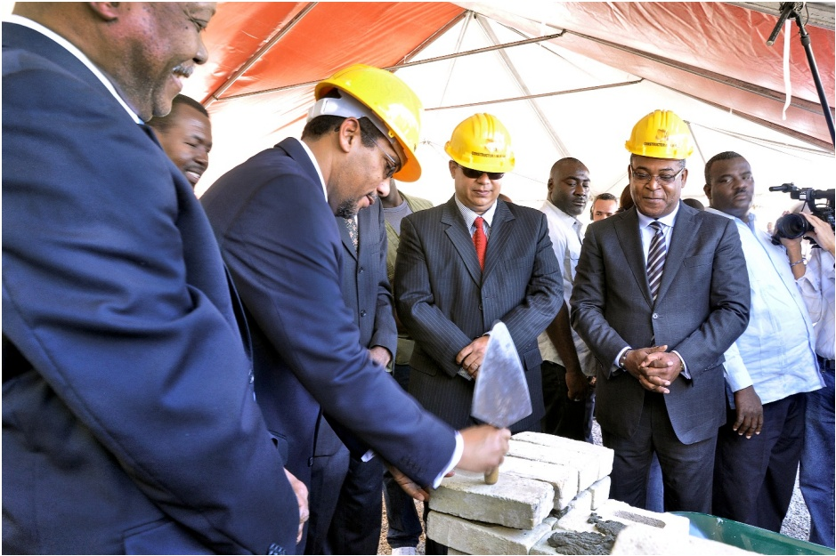

<!-- page 62 -->

Je vous remercie d'être avec nous aujourd'hui pour la pose de la première pierre du Centre de Conférence et de Documentation de la banque centrale. Mes collègues du Conseil d'Administration et moi-même voulons exprimer notre appréciation du travail de nos collaborateurs qui nous ont supportés tout au long de l'évolution de ce projet, particulièrement Stéphane Héraux et Charles Leroy, sans lesquels ce projet serait resté au stade d'idée. Merci spécialement aussi à l'architecte Gaylord Esper qui a su mobiliser toute une équipe d'architectes et d'ingénieurs pour concevoir un bâtiment fonctionnel et beau.

Nous avons une pensée toute particulière pour nos collaborateurs disparus le 12 janvier 2010, notamment Patrick Petit-Frère, tombé à une dizaine de mètres de là où je vous parle. Sa technicité et son intellectualité mêlées à une humilité et une sagesse rares faisaient de lui une valeur sûre tant à la haute direction de la banque qu'au Comité de politique monétaire.

Pour tous nos disparus qui nous resteront chers, nous devons nous battre contre l'adversité et nous remettre de cette catastrophe qui nous a heurtés à un moment où nous semblions avoir rompu avec la stagnation et l'instabilité, après 5 années de bonne gestion macroéconomique et de croissance positive, à un moment où les espoirs étaient raisonnablement autorisés. Cette ironie du tremblement de terre est bien rendue par ces propos de l'ambassadeur de France en Haïti, Didier Lebret, le 3 février 2010, repris dans le livre mémorial des éditions Nota Bene :

« On aurait pu penser, on s'était même pris à l'imaginer, collectivement, qu'une page était en train de se tourner. Haïti se construisait, enfin, une fois n'est pas coutume, pacifiquement, à l'abri des hommes, de leur folie, de leur cupidité, de leur aveuglement. La malédiction semblait s'éloigner. Le 12 janvier, à 16 heures 53, le destin d'Haïti a pourtant une fois encore basculé. »

Eh bien, ce destin, notre destin, au nom de nos disparus, battons-nous pour le prendre en main, pour bâtir un avenir meilleur avec des hommes et des femmes forts, et des institutions fortes.

Ce projet participe justement de la persistance de la banque centrale, depuis tantôt 16 ans, à dire non à la fuite en avant, non à l'abandon, et oui à la conservation et à la réhabilitation du centre-ville historique de Port-au-Prince, qui doit demeurer un de nos repères, une de nos boussoles, un de nos standards. Cet engagement est celui d'une institution nationale qui vit en première loge, de par sa localisation, la dégradation d'un de nos joyaux urbains; d'une institution qui a plusieurs fois expérimenté les limites des incitations purement monétaires à l'investissement, tels que les taux d'intérêt, sans la levée des freins infrastructurels, juridiques et institutionnels; d'une institution qui est convaincue que la fuite en avant

<!-- page 63 -->

ne peut rassurer les investisseurs, que, de toute façon, la mer et les ports ne pourront monter plus haut, à Pétion-Ville, qui connaît malheureusement aujourd'hui les effets dévastateurs d'un envahissement excessif. Tant que nous fuirons devant nos problèmes au lieu de nous y colleter, nous perdrons nos normes et repères, nous nous égarerons, nous n'irons pas bien loin et aurons tout simplement répliqué les mêmes ornières et horreurs.

Disons tout de suite et avec la plus grande clarté, s'il en est encore besoin: il est hors de question d'occulter les causes profondes de la détérioration urbaine à laquelle nous faisons face et qui ne se limite malheureusement pas à Port-au-Prince. Cette dégradation est en grande partie la conséquence de l'évolution asynchrone de notre revenu national et de notre population, exacerbée par la forte concentration des activités productives ainsi que des infrastructures et services sociaux de base dans les villes, à Port-au-Prince en particulier. Qu'il suffise de rappeler que notre PIB réel a pratiquement stagné de 1980 à 2006 alors que notre population a doublé depuis 1975.

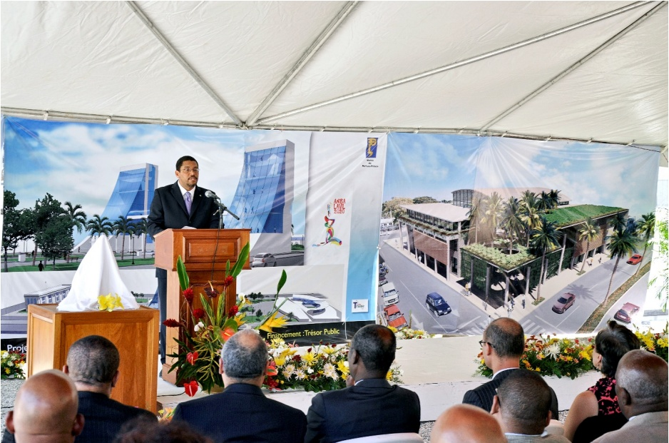

C'est seulement en reconnaissant ces causes profondes que nous pourrons rechercher et mettre en œuvre des solutions durables dans le cadre de politiques publiques cohérentes. Nous pouvons le faire, nous trouverons les ressorts pour le faire, tel est l'acte de foi de la banque centrale dans nos capacités

<!-- page 64 -->

nationales, le sens de la persistance et de l'approfondissement de sa présence au bas de la ville. Nous
refusons de croire que nous sommes condamnés à dégringoler. Pour arrêter la descente et commencer
à remonter la pente, il nous faut trouver en nous ce supplément d'âme, de concertation, de
dévouement, de tolérance et d'empathie pour croire en l'autre sans lequel il n'y aura jamais ce « nous »,
ce collectif qui gagne, conquiert et progresse.

Les initiatives et manifestations d'intérêt relatives au centre-ville sont encourageantes. Le Président de la République l'a inscrit en grandes lettres dans l'agenda national en mettant en place un Comité de Réhabilitation présidé par le Ministre des Finances et dont le maire et le président de la Chambre de Commerce sont membres à part entière. Le Premier Ministre s'est déjà installé au bord de mer. Le Ministre des Finances a retenu les services de la fondation Prince Charles pour l'élaboration du plan d'ensemble de l'espace, et celle-ci travaille sans relâche, avec le Comité de Réhabilitation et les propriétaires fonciers, dans le cadre d'un processus transparent, ouvert et interactif, à l'élaboration du plan d'aménagement de l'espace. Le Fonds Monétaire International, pour supporter la reconstruction des capacités de l'Etat et des collectivités territoriales, a agréé l'allocation, à partir de l'allégement de sa créance sur Haiti, de 25 millions de dollars pour le Palais de Justice, 25 millions de dollars pour le Parlement, et 10 millions de dollars pour la Mairie de Port-au-Prince. Celle-ci a déjà son projet à son siège historique à la rue du Quai. Les banques de la place ont déjà manifesté leur velléité de reconstruire au centre-ville. Le marché Hyppolite a été reconstruit dans toute sa splendeur grâce à 13 millions de dollars, contribution de la Digicel. L'Institution Saint-Louis de Gonzague, Le Nouveau Collège Bird et l'Eglise épicopale (Sainte Trinité) veulent agrandir leurs espaces à la rue du Centre, à la rue de l'enterrement et à la rue Pavée respectivement. Tout cela lié aux efforts de formalisation de l'informel permettra d'établir une masse critique d'activités structurées et un environnement salubre et sécuritéaire au centre-ville.

Le centre-ville donc, une tâche lourde parmi beaucoup d'autres tâches lourdes auxquelles nous devrons nous atteler. Œuvrons ensemble pour l'accomplir. Elle est possible. Elle est simplement difficile.

Merci de votre attention.

<!-- page 65 -->

# Lancement du livre Electronique - 11 mai 2011 - Le Ritz -

Permettez que je commence mon allocation par une anecdote. En classe de littérature haïtienne, en 1ère, le frère Raphael Berrou nous présenta le premier tome fraichement paru de la série "Les Blancs débarquent" de Roger Gaillard en nous lisant tout fier la dédicace de l'auteur: "Au frère Raphael Berrou, Fafa, le premier qui, du doigt, me montra la beauté". Bien entendu, nous n'avions pas manqué de le taquiner, en le traitant de vantard, de la fierté manifeste et de l'émotion qu'il éprouvait à la lecture de ces mots de l'ancien élève, mots empreints d'affection certes, mais aussi de respect et de reconnaissance. Mais, au fond, nous avions été touchés de la satisfaction légitime de l'éducateur qui avait fait de la formation des jeunes, un sacerdote. Nous avions également compris qu'il nous offrait encore une fois un modèle d'excellence, qu'il nous montrait à nous aussi la beauté, cette fois-ci celle vivante d'un éducateur infatigable et d'un intellectuel tenace dans sa quête de vérité historique. De Roger Gaillard, nous avions retenu l'attachement et l'appréciation de l'ancien élève, devenu lui-même chercheur, écrivain et enseignant émérite, du rôle du frère Raphael dans sa sensibilisation aux belles lettres, l'éveil de son esprit et sa naissance à la vie intellectuelle.

Justement, nos fils et nos filles, nous devons les former, comme nous en prenons l'engagement dans notre Dessalinienne, les éveiller, leur donner des exemples dont ils peuvent tirer fierté, et des références auxquelles ils aspirent et que, nous le souhaitons, ils dépasseront. C'est en semant les grains de la culture dans notre jeunesse pleine de talents que nous récolterons ces hommes et ces femmes qui, selon le mot de Dantès Bellegarde, seront " physiquement vigoureux, d'intelligence claire, de cœur droit, de volonté énergique, adapté au milieu haïtien et capable, au besoin, de le dominer pour le modifier dans le sens du mieux économique et intellectuel de la nation".

Ce site, à l'initiative conjointe de la BRH et de la Société Haïtienne d'Histoire, de Géographie et de Géologie est destiné à mettre à la disposition des étudiants, des formateurs et des chercheurs, les pièces incontournables ainsi que les résultats des recherches passées et actuelles sur l'histoire et la géographie d'Haïti, accompagnés, quand il en est besoin, de mises en contexte historiques et de notes bibliographiques sur la vie des auteurs.

Evouer ces hommes, ce n'est pas invoquer de vains fantômes, c'est rappeler à leur vraie fonction des hommes dont l'œuvre a été marquante. Conserver leurs œuvres, c'est conserver l'accès à une documentation fondamentale, encourager et faciliter les recherches pour combattre l'inclination à

<!-- page 66 -->

l'opinion hâtive et légère, inviter à l'humilité devant les faits et les chiffres dans une analyse objective
des faits économiques et sociaux pour des décisions formées et informées.

Cette rigueur scientifique, cette approche rigoureuse, peut être inculquée dès le secondaire à travers l'enseignement de l'histoire et de la géographie, en insistant sur les statistiques relatives à l'espace et la population ainsi que la lecture directe, de première main, d'auteurs fondamentaux comme Turnier, Chatelain, Marcelin, Kernizan, Anglade, etc. C'est dans ce cadre qu'il faut situer cet effort de diffusion de ces œuvres dans lequel la Bibliothèque Nationale avec son réseau de bibliothèques municipales, le réseau de bibliothèques de la FOKAL, celui de la Direction Nationale du Livre, les bibliothèques patrimoniales de Saint Louis de Gonzague et du Petit Séminaire Collège Saint Martial sont appelés à jouer un rôle crucial.

Nous disons souvent que l'histoire est un perpétuel recommencement. Admettons que beaucoup d'aspects de la nôtre ne soient pas à recommencer. La répétition perpétuelle de l'histoire est peut-être le sort le plus probable des peuples qui la méconnaissent, qui la tronquent ou la biaisent avec émotion, ce poison qui perturbe le jugement, compromet l'indépendance d'esprit, et entretient les errements. La recherche indépendante, l'analyse froide et objective, la circonspection dans les opinions sont essentielles pour comprendre le passé, en éviter les écueils, et arbitrer réalisement entre les priorités, compte tenu des moyens disponibles, pour définir et conduire des politiques publiques cohérentes.

Que de fois ne nous sommes-nous pas surpris à observer que les propos de 1904 sont encore d'actualité aujourd'hui. Comme ce passage d'Anténor Firmin: "Dans tous les pays, dans toutes les races, le progrès ne s'effectue, ne devient tangible que si les couches sociales inférieures, qui forment toujours la majorité, tendent à monter en intelligence, en puissance, en dignité et en bien-être. Là où la politique dite éclairée, ne consiste qu'à perpétuer l'inférieurité de ces couches, formant l'assise même de la nation, en exploitant leur ignorance, il n'y a plus de progrès possible."

Firmin avait tout vu et tout dit. Il semble que nous n'ayons pas encore atteint un consensus là-dessus, et c'est vraisemblablement le mal qui nous ronge. On peut le dire aujourd'hui en des termes plus modernes comme mobilité sociale, élargissement de la classe moyenne, augmentation de la productivité, répartition de richesse et de revenus. Mais Firmin avait tout dit et avait déjà défini les caractéristiques incontournables de tout projet de développement sérieux.

Nous avons choisi ce passage édifiant d'Anténor Firmin. Nous aurions pu tout aussi bien citer Rosalvo Bobo (notamment sur le centenaire de l'indépendance, étrangement ressemblant au contexte de 2004),

<!-- page 67 -->

Frédéric Marcelin, Georges Sylvain et bien d'autres auteurs de la fin du 19e ou du début du 20e siècle. C'est que les atavismes ont la peau dure, mais finissons-en avec le premier de tous, arrêtons de nous lancer des pierres, de nous auto flageller pour bâtir ensemble, dans la concertation et l'harmonie, une Haïti qui croît et se développe. Chaque jour, nous écrivons notre histoire. Belle ou hideuse, selon que nous aurons choisi d'être vertueux ou vilains, elle sera notre histoire et expliquera, dans une large mesure, notre situation et notre mentalité dans le futur.

La concrétisation de ce programme est le résultat d'un dialogue constructif avec plusieurs personnes clefs: Michel Hector, Pierre Buteau, Georges Corvington, Jean Casimir, Gaetan Mentor de la Société Haïtienne d'Histoire et de Géographie; Françoise Beaulieu Thybulle de la Bibliothèque Nationale, le frère Ernst Even de la Bibliothèque de Saint-Louis de Gonzague, Patrick Tardieu de la Bibliothèque du Petit Séminaire Collège Saint Martial, de Michèle Pierre-Louis de la FOKAL. Nous saluons leurs efforts et leur engagement, dans un contexte difficile et avec des moyens limités, à conserver et diffuser la documentation sur Haïti.

Nous tenons à remercier particulièrement Pierre Buteau et Yves Romain Bastien qui se sont attelés à la tâche de moine de la relecture des deux premiers ouvrages qui vous sont offerts: Le Régime Foncier en Haïti, de Raymond Renaud et Les États-Unis et le Marché Haïtien, d'Alain Turnier ; les départementes et services de technologie, de communication et de graphisme de la Banque Centrale. La liste des œuvres et auteurs est ouverte, la Société Haïtienne et la banque centrale sont dans l'attente de vos suggestions pour l'enrichissement de cette collection patrimoine.

Œuvrons tous pour une documentation haïtienne enrichie et accessible, et attachons nous à plus de rigueur dans l'analyse des faits économiques, sociaux et politiques, en pérennisant ce projet initié par la S.H.H.G.G et la BRH.

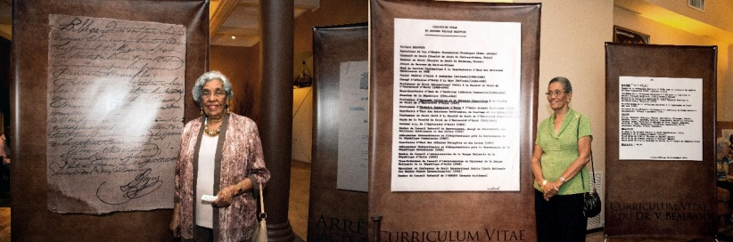

<!-- page 68 -->

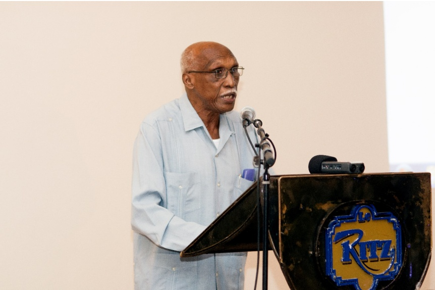

Collection des 30 ans de la BRH

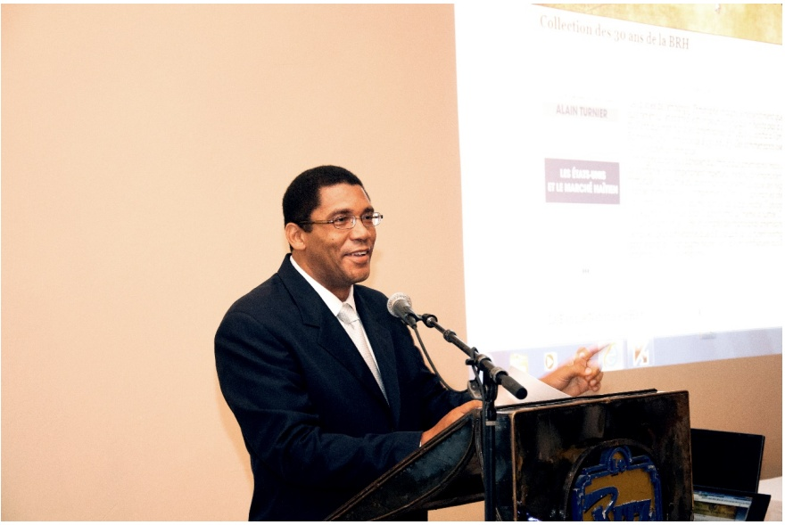

<!-- page 69 -->

# Banque mobile - le 10 janvier 2011

Monsieur l'Ambassadeur des Etats-Unis d'Amérique.

Madame la Directrice de la USAID en Haïti.

Monsieur le Directeur Général de la Scotiabank.

Monsieur le Directeur Général de la Digicel.

Monsieur le Représentant du CONATEL,

Mesdames, Messieurs les Membres du projet HIFIVE.

Mesdames, Messieurs,

Il m'est très agréable de participer aujourd'hui à cette cérémonie qui vient couronner les efforts des pionniers de la banque mobile en Haïti. Je leur dis « Félicitations et bon travail ». Je tiens à souligner de façon toute particulière mon appréciation du dévouement de la Gates Foundation et de la USAID pour faire de la banque mobile une réalité chez nous. Je salue également l'activité et la diligence des banquiers et des opérateurs téléphoniques qui ont permis d'offrir la banque mobile à notre population.

Il est significatif et réconfortant que nous ayons cette cérémonie deux jours avant le premier anniversaire du plus grand drame de notre histoire. Comme pour signifier que: « nou la, nou ka la, fòk nou batay pou nou la pi bien, pi bel, pi solid ».

A la banque centrale, nous avons accueilli cette initiative avec, enthousiasme mais aussi avec prudence.

Enthousiasme parce que nous reconnaissons que la banque mobile peut aider à augmenter l'efficience du système de paiements et à offrir l'accès aux services financiers essentiels à une frange non encore desservie de la population.

Prudence, parce que la banque mobile ne doit pas mettre en danger les acquis au plan de la stabilité financière et de l'intégrité du système de paiements.

<!-- page 70 -->

C'est cette double préoccupation de progrès et de stabilité qui a motivé notre choix du modèle basé sur la banque, où la banque mobile n'est qu'un sous-élément des activités bancaires en général, avec tout ce que cela comporte de bénéfice pour les déposants en terme de sécurité de leurs avoirs, de leur capacité à effectuer des paiements universellement acceptés aussi bien que de leur enregistrement à une banque qui les connait et qui puisse éventuellement leur octroyer du crédit.

L'utilisation d'un appareil mobile pour ordonner un paiement ne change pas la relation juridique

fondamentale entre le déposant et le dépositaire. Ainsi, la banque mobile, c'est encore la banque, sauf

que les ordres sont donnés au banquier à travers le téléphone au lieu de la carte de débit, de l'internet,

ou du chèque. Il s'agit donc là d'opérations strictement réservées aux institutions financières de dépôt,

les seules entités admises à recevoir, sur une base autonome, des fonds du public ou de leurs

sociétaires.

Nous notons avec satisfaction que les opérateurs téléphoniques et les banques ont suivi jusqu'ici les lignes directrices émises par la banque centrale en se mettant en synergie pour créer des consortiums de banque mobile, où la banque est ultimement responsable devant la banque centrale de la sécurité des avoirs des déposants et du respect des tous lois et règlements applicables aux aspects financiers de ces opérations. Si nous voulons éviter des distorsions sur les marchés et les pertes de bien-être qu'elles entraineraient immanquablement, il est crucial que chaque opérateur se confine strictement au domaine de compétence dans lequel il a été autorisé à fonctionner, C'est ainsi, et seulement ainsi, que nous éviterons le désordre, la confusion dans les rôles et responsabilités.

Par ailleurs, l'interopérabilité - c'est-à-dire la possibilité de communication, de transaction et de règlement entre clients des différents réseaux, sans entrave et sans pénalisation - doit être une caractéristique essentielle des banques mobiles. De même qu'un client d'une banque peut accepter un chèque tiré sur une autre banque, de même que le déposant d'une banque peut virer une somme en faveur d'un déposant d'une autre banque, de même que bientôt le détenteur d'une carte de débit pourra ordonner de débiter son compte et de créditer le compte d'un vendeur domicilié à une autre banque, de même, le client d'un réseau de banque mobile devra pouvoir transiger et régler avec des clients d'un autre réseau. C'est là une exigence minimale à laquelle tous les opérateurs doivent satisfaire.

<!-- page 71 -->

Afin de favoriser des « réseaux ouverts », la banque centrale a joué un rôle de pionnier en introduisant : en 1997 un réseau de fibre optique interbancaire ; en 2006, le système de paiement interbancaire pour les transferts et les crédits directs de banque à banque ; et en septembre 2010, une plateforme de paiement universel, pour le traitement de tous les paiements, quels que soient le mécanisme et l'appareil utilisés.

Il est vrai que la banque par téléphone est porteuse de belles promesses aux plans économique et social. Œuvrons à ne pas rater les bénéfices que nous pouvons en tirer. Elle n'est cependant pas une panacée. Elle ne peut être qu'un support, non pas un succédané, à des politiques publiques cohérentes pouvant promouvoir la croissance durable, la création d'emplois, l'augmentation de la productivité et des revenus, et la réduction progressive et irréversible de la pauvreté.

Dans son champ de compétence, la banque centrale contribue à la mise en place de structures et conditions favorables au crédit et à l'investissement. C'est ainsi que le mois dernier, le Fonds de Garantie Partielle du Crédit, avec le support de la BID, de la Banque Mondiale, du FMI et du Trésor Américain, a été officiellement lancé. C'est dans ce sens aussi que nous encourageons le dépassement du financement du micro-commerce, déjà très utile, pour promouvoir systématiquement la micro-industrie et les métiers (menuisier, tailleurs, plombiers, etc) par des crédits associés à une formation professionnelle préalable, fondamentale ou d'appoint, pour augmenter la productivité et les revenus des bénéficiaires. Un pays qui ne sait pas produire ne peut pas produire. Il faut que nous réapprenions à produire. D'un autre côté, à chaque catastrophe, des débiteurs du secteur de la microfinance perdent énormément, parfois les gains de plusieurs années de dur labour. Il est donc juste de travailler systématiquement à la mise en place d'un programme d'assurance contre sinistres pour les débiteurs de ce secteur, avec une dotation publique de départ, suivie de primes qui peuvent être un pourcentage des intérêts versés. Jusqu'ici, dans le cadre de ces deux initiatives, le dialogue entamé avec les institutions de micro finance et des partenaires internationaux, notamment la BID et la USAID, est encouragement.

La route est longue sans nul doute. Pour que nos actions produisent des résultats significatifs et pérennes, nous devons aborder les choses avec ordre, rigueur, lucidité et pragmatisme. Les défis auxquels nous faisons face nous l'imposent.

Merci de votre attention.

<!-- page 72 -->

# Service de Paiement mobile - 2011- Parc-Historique

Mesdames et Messieurs Bonsoir,

Je suis Charles Castel Gouverneur de la Banque Centrale.

Je tiens au nom de la Banque Centrale a salué cette initiative prise par l'USAID et la Fondation Bill and Melinda Gates visant à la promotion des services de paiements mobiles en Haïti.

Comme l'a souligné l'un des intervenants notre ami Kesner Pharel les transactions électroniques ne représentent pas une panacée, l'économie réelle doit fonctionner mais cela ne nous dispense pas de créer un environnement de facilitation et de travailler à l'inclusion financière je pense que c'est très important de le souligner.

Si vous regardez les chiffres relatifs à la concentration de dépôts par rapport à la population ceux-ci démontrent que la richesse est concentrée à Port-au-Prince avec comme résultat l'exode rural d'où la nécessité de mettre en œuvre une politique de décentralisation.

Il est évident que les opérateurs deviennent de plus en plus conscients de cette situation ce qui augure un avenir meilleur pour l'ensemble de notre population.

En évoquant le thème de l'inclusion financière nous tenons à remercier l'USAID et la Fondation Bill and Melinda Gates pour cette initiative, nous pensons que tout ce qui peut donner accès à notre population défavorisée aux services bancaires de base est salutaire.

Il faut noter que les coûts d'opérations des succursales de banques sont importants, le nombre élevé des non bancarisés au niveau des régions les plus reculées à donc une explication car les structures à mettre en place dans ces endroits sont coûteuses.

Avec le téléphone mobile on peut réaliser beaucoup de choses cependant il faudra mitiger les risques de déstabilisation du système financier. Car nous ne voulons pas créer de problèmes au niveau de notre système car jusqu'à présent le secteur bancaire a démontré qu'il est relativement stable et les événements récents ont montré la résilience de ce système.

<!-- page 73 -->

Il y a donc un trade off clair entre l'accès aux services financiers de base et la stabilité il existe donc des nuances entre le mobile payment et le mobile banking .Je rappelle que la Banque Centrale à la responsabilité de l'efficacité de l'efficiency et de l'intégrité du système de paiement car à la fin de la journée il va quand même y avoir un transfert de fonds entre deux acteurs car tout ne peut se faire au téléphone donc à la fin des séances il faudra recourir à des agents qui doivent être agrées et nous à la BRH nous encourageons les banques et les opérateurs de téléphonie mobile qui sont représentés ici à se mettre ensemble pour que nous ayons en Haïti une formule gagnante où justement au-delà du modèle de mobile payment les dépôts de petits épargnants soient gérés par les banques et il faudra qu'il y ait un lien direct entre la banque et son client.

Nous ne voulons pas que l'on reproche à la Banque Centrale de bloquer ce développement en matière de services de paiements mobiles nous ne voulons pas que l'on nous reproche de mettre les bâtons dans les roues des opérateurs qui souhaitent bénéficier de ces incitations de la fondation Gates mais nous pouvons vous donner la garantie que nous travaillons déjà sur les lignes directrices pour accélérer le processus.

Je dois à nouveau répéter qu'au niveau de la BRH nous avons opté après mures réflexions pour une interface direct entre la Banque et son client en clair les citoyens comprendront qu'ils ont un dépôt à la Banque x.

Comme l'a indiqué Kesner Pharel le monde a évolué vers la dématérialisation de la monnaie toutefois le mobile banking, le mobile payment ne change pas la réalité de la relation juridique contractuelle qui existe entre un banquier et un client c'est toujours un dépôt, un transfert qu'on reçoit d'un client.

Il ne faut pas oublier qu’il existe aussi l’aspect autonome de la transaction car dès lors qu’un citoyen s’adonne au commerce de l’argent non pas en contrepartie d’un service ou d’un bien mais tout simplement pour en être le dépositaire ou le transférer cela veut dire clairement que vous faites le commerce de l’argent et les banques les maisons de transferts sont les entités habilitées à faire ces transactions donc nous n’allons pas créer des brèches dans notre système financier, induire la méfiance du public donc faisons le bien pour que cela résiste au temps.

Nous nous félicitons donc de cette initiative qu'ont prises plusieurs banques et operateurs pour se mettre ensemble et je pense que d'ici à deux ou trois mois nous allons avoir un début de matérialisation de ces relations et le public va commencer à voir la différence.

<!-- page 74 -->

Je dois aussi souligner que je n'ai pas entendu parler des institutions de micro finance des coopératives d'épargne et de crédit il me semble que ce soit des institutions qui travaillent à la bancarisation d'Haïti depuis longtemps je l'ai déjà signalé à Mme Greathouse je pense qu'au-delà de ces incitations il faudrait qu'on donne une attention particulière à ces entités car elles sont déjà dans l'inclusion financière parce qu'elles facilitent l'épargne et le crédit dans les milieux reculés et dans ce sens elles travaillent en complémentarité avec les banques donc je souhaite fortement que ces institutions bénéficient d'une attention particulière dans le cadre de cette initiative.

Au niveau des lignes directrices nous allons nous assurer que le marché n'est pas dominé par un seul opérateur il faut que toutes les banques puissent y participer il faut éviter ce que l'on appelle dans le jargon le first mover advantage donc il faut que toutes les banques de la place arrivent à offrir ce service car il s'agit là d'une opportunité extraordinaire pour qu'elles puissent étendre leurs réseaux et cela représenter a une excellente opportunité à l'ensemble de la population Haïtienne.

Au niveau des agents, nous insistons sur le lien direct qui doit exister entre les clients et la banque. Les clients doivent s'assurer que ses avoirs sont placés dans une banque d'où l'importance de la protection des déposants autrement cela va créer une perte de confiance dans le système.

Autre aspect important à prendre en compte, la prévention du blanchiment des avoirs, nous pensons qu'il va falloir limiter les montants et le nombre de transactions car au premier abord car cette formule s'adresse à une couche bien précise de la population le marché étant déjà segmenté.

Pour aboutir à l'intégration complète du système de paiement l'inter polarité est importante la compatibilité entre les différentes plateformes est vitale pour la Banque Centrale autrement il faudrait qu'à partir du mobile banking que des transferts puissent se faire entre un client de la plateforme A au client de la plateforme B sans problème.

Je tiens pour terminer à vous féliciter une nouvelle fois pour cette initiative je vous donne la garantie que la Banque Centrale vous accompagnera tout en émettant le vœu que nous ne pouvons pas en saisissant une opportunité créer tellement de problèmes que celle -ci ne puisse pas résister au temps donc il faudra bien assurer la mise en œuvre de ce projet pour le bien de la population Haïtienne.

Je vous remercie.

<!-- page 75 -->

## Réhabilitation du Centre-ville de Port-au-Prince - 18 juillet 2011

Mesdames, messieurs,

Permettez que je vous demande d'observer une minute de recueillement à la mémoire de Guiteau

Toussaint dont l'assassinat crapuleux dans la soirée du 12 juin a occasionné le renvoi à aujourd'hui de

cette cérémonie qui aurait dû se tenir le lundi 13 juin.

## Monsieur le Président,

La Banque de la République d'Haïti est honorée de votre choix de son siège pour marquer la nécessité de réhabiliter le centre-ville de Port-au-Prince, avec comme déclencheur la construction d'édifices publics principalement le long des rues du Champ de Mars et du Quai, dans le cadre d'un effort d'assainissement et de réhabilitation de l'un des plus beaux morceaux de notre réel urbain, jadis témoin de notre capacité de bien faire, aujourd'hui témoin gênant et pathétique de nos turpitudes. Ces constructions se feront principalement et initialement, à partir de 60 millions de dollars de la réduction de la dette du FMI (pour le Palais de Justice, le Parliament, la Cour des Comptes et la Mairie) et de 200 millions de dollars pour environ 15 autres bâtiments que la banque centrale donnera en location-vente à l'Etat.

Les constructions publiques, conjuguées à une meilleure couverture policière et à l'amélioration de la sécurité, joueront un rôle de catalyseur de l'investissement privé au bas de la ville, au bord de mer, poumon économique par où transite la grosse partie du commerce international d'Haïti, et contribueront ainsi à l'atteinte des objectifs de croissance, de réduction de la pauvreté et de création d'emplois. Cet espace sera, demain, un motif de confiance dans notre capacité de nous ressaisir et nous prendre en main. Permettez que je rende aussi aujourd'hui un hommage à quelqu'un qui n'a pas pu être avec nous pour des raisons personnelles: le Ministre de l'Économie et des Finances, Monsieur Ronald Baudin, Président de la Commission de Facilitation et de Réhabilitation du Centre-ville qui n'a jamais marchandé ses efforts pour l'élaboration de ce plan de réhabilitation et aussi pour dialoguer avec les propriétaires du bas de la ville et les rassurer.

Monsieur le Président, permettez que j'utilise votre cri du cœur lors de votre discours d'investiture: "Sa k te gentan gen la a ?". En effet, en effet, dans la concorde, avec cohérence, patience et ténacité, il est

<!-- page 76 -->

peu de défis que nous ne finirons pas par relever. Cet acte de foi dans nos ressorts, la banque centrale

l'a fait par le maintien et l'approfondissement de son établissement au bas de la ville. Votre présence, en

son siège, construit il y a seulement douze ans, et en face de son futur Centre de Convention et

Documentation dont la construction est entamée à l'issue d'un processus d'appel d'offres international

ouvert, transparent et crédible, votre présence ici, monsieur le président, indique que vous appréciez

nos efforts et nous encourage nous tous à la Banque. Nous vous en remercions.

Il est vrai que notre réalité poignante, nous la vivons chaque jour, chaque minute même. Nous devons néanmoins nous la rappeler, objectivement, en chiffres, tel un écolier hanté mais pas tétanisé par ses mauvaises notes de second trimestre. Notre revenu per capita est de $700 par année, comparé à 5,000 pour nos voisins, 53% de nos compatriotes sont âgés de 20 ans ou moins, notre population croît à 2% l'an, nos villes, principalement Port-au-Prince, sont congestionnées et dégradées, notre couverture végétale ne dépasse pas 2% de notre territoire alors qu'elle en représentait 60% en 1930. Notre budget total, pour l'année 2011, est financé à près de 60% par des supports internationaux et le budget d'investissement de l'Etat, à 88% (incluant les Fonds Petro caribe et l'annulation de dette du FMI). Nous dépendons donc dramatiquement des flux de biens, de services et d'aide externes, ce qui nous rend vulnérable aux chocs de prix internationaux, aux aléas et aux humeurs de la conjoncture mondiale. A ce rythme de croissance de la population, l'économie doit croître à environ 9% l'an pour doubler notre revenu national dans dix ans. Ce sont nos notes de second trimestre et ce que nous devons faire au troisième trimestre. Et nous sommes au troisième trimestre.

Nous sommes obligés d'arbitrer entre les urgences, les grandes priorités et les priorités. Pour briser le cercle vicieux de la pauvreté et emprunter résolument la voie du développement soutenu et durable, notre génération à la lourde, mais combien exaltante, obligation de s'atteler à la tâche, dans la concertation et l'harmonie, pour mettre le pays définitivement sur la voie de la croissance et du beau.

Ce décollage sera facilité par l'établissement d'un cadre de politiques publiques visionnaires, cohérentes, inscrites sur le long terme, implémentées par des institutions publiques fortes parce qu'elles auront été dotées des moyens humains et matériels nécessaires à leur efficacité. Des ministères, des services publics ainsi que les piliers de notre régime politique (parlement, pouvoir judiciaire, cour des comptes) adéquatemment logés participent de cette préoccupation de renforcement des capacités institutionnelles de l'Etat pour une nation apte à prendre son destin en main parce qu'elle aura su mobiliser à son service une masse critique de compétences et de talents, au service des besoins immédiats et d'un meilleur traitement de la population. Cela est incontourable, et le faire au centre-

<!-- page 77 -->

ville, c'est saisir une opportunité unique pour conserver et réhabiliter un espace historique et stratégique, et signaler de façon non équivoque, dans l'action planifiée, notre résolution de nous colletter à nos problèmes au lieu de les fuir pour tout simplement les reproduire ailleurs, à Pétion-Ville par exemple. Le développement des rues du Champ de Mars et du Quai en deux corridors d'établissements publics modernes encouragera les initiatives privées pour un développement harmonieux, guidé par un zonage connu et observé de tous, dans le souci constant de la légalité et du respect des droits des propriétaires.

Mais, nous le savons tous, ce n'est pas par accident que nos espaces se sont détériorés, et continuent de se détériorer. Cette situation est avant tout la conséquence de l'érosion de l'autorité de l'Etat, de l'évolution asynchrone de notre population et de notre production. En effet, de 1975 à nos jours, nous avons subi une quasi-stagnation de notre revenu national, un doublement de notre population en l'absence de projets pour augmenter l'offre de logements formels. Il est donc impératif de multiplier les initiatives porteuses de croissance, d'élargissement de l'assiette fiscale et de création d'emplois, en même temps que les efforts pour ralentir la croissance de la population, augmenter sa productivité, et induire sa répartition plus équilibrée et mieux planifiée sur l'ensemble du territoire.

C'est dans cette perspective qu'il faut situer la mise en place du fonds de garantie partielle du crédit, le projet de mise en place d'écoles professionnelles associées au financement de la micro-industrie, l'élimination de réserves obligatoires sur les ressources bancaires financant l'immobilier, l'initiative Kay-Pam de la BNC et de la BPH pour offrir, grâce à un mécanisme mis en place par la BRH, un taux d'intérêt fixe de 8% sur dix ans au bénéfice notamment des agents de la fonction publique et des débiteurs satisfaisant tous aux critères de solvabilité requis. Ce mécanisme autorisant les taux d'intérêt fixes à long terme, pour des catégories précises de débiteurs, sera élargi à toutes les banques de la place. Dans cette perspective aussi, on ne peut que louer les initiatives pour améliorer l'accès à l'éducation dont l'impact sera certain sur la compétitivité de l'économie à travers une productivité améliorée de la population active, son accès à des revenus plus élevés et la réduction de son taux de croissance.

Monsieur le Président, à l'aube de votre journée au timon des affaires, Je crois être en mesure de vous assurer que le système financier est enthousiaste, mais attentiste en raison des limitations posées par les grandes insécurités sur l'investissement privé, notamment l'insécurité dans les transactions et l'insécurité foncière. Cette dernière, peut-être la plus pesante, constitue l'un des principaux obstacles à la relance du crédit et de l'investissement. La levée de ce frein requiert une approche créative et des mesures drastiques qui s'écartent certes des solutions traditionnelles, mais sont nécessaires pour le

<!-- page 78 -->

démarrage des grands chantiers porteurs de croissance soutenue. C'est seulement par l'entreprise, par l'alliance du capital et du travail, que nous créerons la richesse et accéderons à un meilleur niveau de vie.

La tâche est aussi dure qu'incontournable. Aujourd'hui, nous ne pouvons être une foule sans visage, oublieux de nos obligations, indifférents au sort de nos concitoyens, rebelles aux idéaux de nos pères fondateurs. Au contraire, interpelés par notre réalité bouleversante, conscients de la gravité du moment, nous sommes convaincus que notre plein engagement est indispensable pour l'amélioration sensible des conditions d'existence chez nous.

C'est dans cet esprit que nous saluons, Monsieur le Président, votre détermination, et formons à votre endroit des vœux de succès dans la poursuite de l'œuvre de reconstruction nationale, tout en vous réitérant l'engagement de la banque centrale au maintien, en coordination avec le Gouvernement, d'un cadre macroéconomique stable, propice à la croissance et au développement.

Merci.

<!-- page 79 -->

## 2012

# Etats Généraux de l'Investissement en Haïti - Mars 2012

Monsieur le Président de la République,

Mesdames, messieurs les Ministres,

Monsieur le Directeur du CFI,

Mesdames, messieurs de la communauté des affaires,

Mesdames, Messieurs,

C'est un plaisir de participer à cette réflexion sur l'investissement, les moyens de le stimuler, de lever les contraintes qui freinent son expansion et compromettent la croissance de la production et de l'emploi. Je félicite le Ministre Laleau d'en avoir pris l'initiative et le remercie d'y avoir associé la banque centrale.

Je commencerai mes remarques en rappelant que la plus grande contribution de la banque centrale à la croissance économique d'un pays est le maintien d'un taux d'inflation stable et bas, venant autoriser des taux d'intérêt propices à la croissance du crédit privé. Dans cette optique, la banque centrale estime avoir mené à bien sa mission en poursuivant, depuis plus de cinq ans, une politique monétaire prudente – aidée par une politique fiscale saine - où l'offre de monnaie a été guidée par l'augmentation des avoirs extérieurs et de la demande de crédit bancaire privé, et non par la demande de crédit public.

La tâche n'a pas été facile parce que les prix de vente des biens et services en Haïti sont déterminés non seulement par la demande mais aussi par des éléments de coûts très importants comme le taux de change, les prix en devises des matières premières et intrants importés et aussi le degré de concurrence parmi les fournisseurs sans oublier la rigidité de la demande des produits de première nécessité comme les céréales, le sucre, le pétrole, etc. Il nous a fallu tenir compte de tous ces chocs, de tous ces facteurs erratiques dans l'économie mondiale encore très précaire et aussi des multiples incertitudes de la vie publique nationale pour ajuster la politique monétaire vers une inflation modérée, (à 7.7% l'an en janvier 2012 comparé à 8.3% en décembre 2011) et un niveau des taux d'intérêt nominaux susceptible

<!-- page 80 -->

de favoriser les investissements privés et la croissance. Il a fallu trouver la combinaison qui favorise la stabilité des prix sans découvager la croissance.

Le maintien de cette posture monétaire – conjointement avec d'autres mesures ponctuelles comme la création du Fonds de Garantie Partielle du Crédit en 2010, l'appui au programme Kay Pam de la BNC et de la BPH en 2011, l'élimination des réserves obligatoires sur les ressources financant la construction, a valu une reprise soutenue du crédit bancaire au secteur privé. En effet, l'encours du crédit bancaire au secteur privé a augmenté de 25% en 12 mois, accélérant une expansion du crédit réel commencée en 2009, et ce dans le maintien de l'excellente qualité du portefeuille du système bancaire.

Mais il n'y a pas lieu d'être triomphant. La croissance du PIB, de 5.5% en 2011, est encore trop faible. La projection de croissance pour 2012 est de 8%. Cependant, nous devons croire à 9% au moins si notre ambition est de doubler, en 10 ans, notre revenu per capita vu la croissance annuelle de 2% (trop forte) de notre population. L'histoire des 7 dernières m' a renforcé dans la conviction que la stabilité macroéconomique, tout nécessaire qu'elle soit, doit être associée à des politiques microéconomiques et sectorielles pour encourager les initiatives privées et impulser l'investissement, avec une attention particulière aux métiers, à la petite et moyenne entreprise et le crédit en milieu rural pour une croissance intégrée et inclusive. Cette croisade pour l'investissement n'est donc pas seulement juste, pertinente et opportune. Elle est aussi incontourable.

Nous sommes à un carrefour crucial où la croissance soutenue est impérative. L'investissement, local et étranger, est la voie obligée du décollage irréversible de notre pays. Il est impérieux de créer et de maintenir un cadre propice à son épanouissement. Pour y arriver, il importe de créer un nouvel état d'esprit, une mentalité de richesse plus favorable à l'entrepreneur (grand ou petit) et à la prise de risque, à changer le regard de nos compatriotes sur les processus de création des revenus et de la richesse, et sur la nécessaire alliance du capital et du travail pour nous sortir graduiellement de la pauvreté. On nous dira que c'est difficile. Que cela soit difficile n'invalide en rien la nécessité de l'entreprise. Que la route soit longue est un argument de plus pour avancer d'un pied ferme et résolu, et en faire une obsession, non pas passagère, mais bien nationale et permanente dont chacun de nos compatriotes est imprégné comme un facteur clef de la croissance et du développement.

A la banque centrale, nous observons avec satisfaction le consensus qui se dégage dans la société autour de la nécessité de faire face aux obstacles structurels et infrastructures à l'investissement. Cela nécessite, par endroits, des réformes légales et institutionnelles relativement profondes. Mais

<!-- page 81 -->

ironiquement et heureusement, assez souvent, cela requiert de simples changements de détail dans les traitements administratifs, voire dans les états d'esprit et les comportements.

De toute façon, c'est par un "kombit" qui implique et sensibilise tous les acteurs que nous arriverons à changer la donne. Il est souhaitable que de cette réflexion sorte une feuille de route largement diffusée, et qu'il s'ensuive des rapports de progrès réguliers.

## Mesdames, Messieurs,

La Banque de la République d'Haïti, qui se retrouve au confluent des secteurs public et privé, à travers les moyens de paiements et le système financier, tient à rester au service des agents économiques et à les accompagner pour une croissance inclusive, soutenue et durable.

<!-- page 82 -->

# Voies et moyens de l'inclusion financière en Haïti. - Avril 2012.

Mesdames, Messieurs,

C'est un plaisir de participer à cette conférence. Je félicite mon ami Roro Pharel pour cette initiative et je le remercie pour son invitation et aussi pour la place réservée depuis l'année dernière à la BRH à ce forum. La banque centrale s'estime heureuse de contribuer à de tels événements destinés à éveiller la conscience des agents et à les aider à prendre des décisions rationnelles en vue de la modernisation des comportements et du progrès économique.

Parmi les principaux problèmes de l'heure, l'exclusion financière d'une grande partie de la population présente un défi majeur aux décideurs de la politique économique. Elle interpelle notre conscience, pour reprendre une expression moderne. Comment insérer ou intégrer ces agents producteurs et consommateurs aux flux de services financiers classiques? Comment mobiliser ces épargnants en actifs oisifs traditionnels comme le bétail sur bien, les arbres fruitiers, les lopins de terre vers des placements plus rentables offerts par la finance moderne ?

Pour sûr, l'économie nationale a dépassé le troc, la monnaie sous forme de billets de banque et de pièces étant utilisée dans toutes les transactions spatiales et temporelles en Haïti. Mais, la majeure partie de la population n'a pas encore accès aux services financiers de base comme les facilités de paiements bancaires, les instruments d'épargne financière sans mentionner les facilités de crédit du système financier formel.

## Les Promesses de la Banque Mobile

Aujourd'hui, nous avons en Haïti environ 2 millions de clients bancaires avec 200 succursales de banques dont 65% sont situées à l'intérieur de la région métropolitaine de Port-au-Prince. Le coût élevé de l'établissement d'une succursale classique dans une localité reculée (i.e. éloignée par rapport à une grande ville) continuera d'être un obstacle majeur à une plus grande pénétration.

Environ 80% des clients des coopératives d'épargne et de crédit et des institutions de micro-finance non bancaires vivent dans les aires métropolitaines les plus importantes. Dans le même temps, 48% de notre

<!-- page 83 -->

population vit en milieu rural et n'est pas adéquatement desservie. Ces chiffres montrent de façon très éloquente une fracture significative, et aussi une opportunité, au niveau de la pénétration des services bancaires de base.

D'un autre côté, la pénétration de la téléphonie cellulaire en Haïti dépasse les 4 millions de clients, ce qui offre une opportunité unique de bancariser les "sans-banques", par l'utilisation du téléphone portable pour effectuer des paiements. Ainsi, on peut drastiquement réduire le coût de service dans les zones reculées et donc pallier la fracture bancaire.

La modernisation du système de paiements par la mise en place de la plateforme universelle de paiements qui se prêtera aux transactions via la plupart des instruments existant actuellement (cartes de débit, cartes prépayées, cartes de crédit, téléphone cellulaire).

L'adoption du modèle basé sur la banque comme seul fournisseur de service bancaire, i.e. une approche où les banques et les compagnies de téléphone peuvent se mettre en consortium, la banque étant ultimement la seule entité responsable de l'avoir des déposants ainsi que de la conformité des opérations aux normes en vigueur, notamment celles relatives à la lutte contre le blanchiment des avoirs.

L'émission des lignes directrices permettant aux banques d'utiliser des agents pour étendre leur réseau.

Deux consortiums, T-Cash et Tchotcho Mobile, opèrent actuellement avec environ six cent cinquante

mille clients. Dans les faits, plusieurs banques et maisons de transfert utilisaient déjà des établissements

commerciaux locaux disséminés à travers le pays pour payer les bénéficiaires de transferts.

L'exigence d'interopérabilité faite à tous les opérateurs afin d'assurer l'universalité de ce mode de paiement. En d'autres termes, cette forme de paiement devra être universellement acceptée sans égard au réseau dont émane l'ordre du client.

La BRH continuera d'évaluer les bénéfices potentiels des innovations technologiques dans la quête permanente d'efficacité et d'effécience du système de paiements et de réduction de l'exclusion financière.

<!-- page 84 -->

## L'élargissement de l'accès au crédit

Les institutions de microcrédit ont montré au cours des dix dernières années un dynamisme qui les rend incontournables dans les efforts d'élargissement du crédit aux couches défavorisées de la population, notamment au niveau du petit commerce. Aujourd'hui, le crédit de ces institutions représente environ 15% du crédit total à l'économie et est largement concentré dans le petit commerce.

Il s'agit aujourd'hui d'aménager les conditions permettant d'étendre les bénéfices du crédit à la micro-industrie et aux métiers. Cela permettra d'exploiter toutes les opportunités offertes par le microcrédit pour la promotion d'une croissance inclusive, équitable et durable. Dans ce cadre, des programmes de formation professionnelle pourront améliorer le savoir-faire et la productivité de nos techniciens, autorisant ainsi des revenus plus élevés et un élargissement graduel de la classe moyenne. De plus, des programmes d'assistance à la formation d'entreprise ainsi que le recours aux mécanismes de garantie (tels que le leasing, le gage sans dépossession, le cofinancement, la garantie partielle du crédit) pourront mitiger les risques et coûts de financement d'équipements au bénéfice de ces professionnels.

## Des exigences de Réformes Structurelles et de Croissance

L'exclusion financière n'est pas d'origine financière. Elle reflète une exclusion plus large, traduit la marginalisation de larges segments de la population en raison de leurs niveaux de revenus et de leurs faibles capacités d'épargner, en d'autres termes, le degré de pauvreté matérielle du pays. Ces hommes et femmes sont exclus du système formel parce qu'ils sont pauvres, parce que la précarité de leur situation et l'informité de leurs opérations rendent leur statut financier trop risqué.

Donc le problème ne saurait être résolu uniquement par des mesures financières. Certes, celles-ci ont un impact significatif sur une frange importante de la population. Néanmoins, ne serait-ce que pour qu'elles produisent leur plein effet sur l'inclusion et la réduction de la pauvreté, il est primordial que des mesures structurelles et une croissance économique soutenue viennent augmenter le revenu par habitant, réduisent les risques et facilitent l'accès aux services financiers.

Par exemple, la question de l'identité et de l'identification unique est un obstacle majeur à l'égalité véritable des citoyens, en termes d'opportunité et d'accès aux facilités d'épargne et de crédit. Bien plus qu'un million de compatriotes sont sans acte de naissance, et 2 millions n'ont pas un document officiel d'identification. Cela représente un défi majeur et devrait faire l'objet d'un chantier national si

<!-- page 85 -->

l'exclusion financière doit être combattue. Le recours aux caractéristiques biométriques comme moyens d'identification unique est l'une des pistes à explorer. Même avec ses limites -par exemple, cela ne résoudra pas les problèmes de succession ces mécanismes contribueraient à améliorer grandement le niveau d'information sur la population, facilitant entre autres l'information sur le crédit, la réduction des risques et des coûts du crédit, et l'accès au crédit.

De même, nous savons tous que le régime foncier contraint significativement, entre autres choses, le crédit immobilier, les développementations immobiliers, et l'accès au logement. Nous savons aussi que les aléas climatiques, l'absence d'assurance dans le secteur agricole, la variabilité des prix agricoles, les choix de politique commerciale, la porosité de nos frontières rendent le financement bancaire des activités de production nationale (agricoles notamment) excessivement risqué et, par conséquent, privent un pourcentage significatif de la population active du crédit bancaire, un ingrédient essentiel à la croissance économique.

Tout cela appelle des changements profonds par des réformes légales et institutionnelles basées sur un diagnostic réaliste de notre situation et l'identification de ce qui est possible dans le contexte qui est le nôtre. En toute humilité, nous devons nous inspirer des modèles adoptés par nos pairs de la région, car ces modèles ont donné des résultats probants en matière d'amélioration du niveau de vie et du bien-être collectif. Il ne faut pas réinventer la roue.

Depuis des décennies, Haïti a été prise dans une spirale descendante de stagnation économique, de démographie galopante, de faibles ressources fiscales, de capacité très limitée d'investissement dans les ressources humaines, dans les infrastructures physiques et dans les institutions, conduisant à l'instabilité sociopolitique qui complique et aggrave la situation.

Au niveau actuel de 13% du PIB, les revenus fiscaux ne sont pas en mesure de soutenir les dépenses publiques qui ont atteint 30% du PIB au cours des dernières années. Cette brèche fiscale –financée presqu’à 100% par les dons externes-pose le problème de la « soutenabilité » des dépenses dans le moyen terme si l'Etat doit maintenir une stratégie pro-croissance et anti-pauvreté. Il est difficile d'envisager une baisse des dépenses publiques vu le dénuement actuel de la population. Donc, ce sont les revenus fiscaux qui doivent augmenter, certes par la pression fiscale, mais surtout par l'élargissement de l'assiette fiscale résultant d'une croissance tirée par l'investissement privé. Il est donc impératif d'implémenter des mesures qui portent les plus grandes promesses de contribuer à une croissance forte et soutenable pendant que l'on renforce graduellement les capacités de l'Etat par des

<!-- page 86 -->

réformes légales et institutionnelles.

En d'autres termes, la question est d'identifier les politiques qui portent les plus fortes probabilités de succès, qui permettraient de créer, notamment par des « actions soigneusement ciblées », un cercle vertueux de forte croissance inclusive porteuse de « soutenabilité » fiscale et permettant à l'Etat d'investir dans les services publics, les infrastructures et les institutions. En même temps, ce cercle vertueux favorisera l'amélioration de la gouvernement, la gouvernance et la gestion d'ensemble du pays par des institutions démocratiques plus efficientes et plus résilientes appelées à renforcer les progrès économiques, sociaux et politiques.

## Actions soigneusement ciblées vers la « soutenabilité »

Il y a lieu de noter que, malgré tous les chocs négatifs récents, la situation économique a continué à s'améliorer avec l'aide de la communauté internationale, avec un degré de stabilité macroéconomique confortable, une croissance positive, des améliorations notables dans la gouvernance et la sécurité.

La stabilité macroéconomique a permis à la Banque Centrale de réduire les taux d'intérêt nominaux et promouvoir la croissance du crédit privé à travers: a) l'élimination des réserves obligatoires sur toutes les ressources bancaires financant les prêts immobiliers; b) la réduction des ratios prudentiels sur la concentration du crédit immobilier c) la création d'un guichet de liquidité à l'intention de deux banques commerciales d'Etat dans le cadre d'un programme de crédit immobilier garantissant un taux d'intérêt nominale fixe de 8% sur 10 ans et d) la mise au point avec le ministère de l'Économie et des Finances d'un Fonds de Garantie Partielle du Crédit visant les petites et moyennes entreprises. Ces mesures ont largement contribué à l'augmentation de 25% du crédit privé en 2011.

Il y a lieu de noter des investissements importants dans les infrastructures et les secteurs sociaux, notamment l'éducation et la santé. Par ailleurs, des investissements privés significatifs ont été enregistrés dans les télécommunications, dans l'hôtellerie et le tourisme et dans la sous-traitance internationale, bien desservis par un système bancaire solide et bien capitalisé. En outre, un consensus national semble se dégager sur la croissance inclusive comme élément clé pour l'élargissement de la classe moyenne et la réalisation de la croissance durable et le développement.

L'objectif déclaré et poursuivi est de construire sur ces réalisations pour renforcer la croissance et l'emploi moyennant des initiatives ciblées susceptibles de mitiger les risques et attirer des investissements locaux et étrangers. Ces initiatives consistent en la création de Zones Economiques

<!-- page 87 -->

Spéciales et en des pôles régionaux de croissance avec la construction d'infrastructures clés par le secteur public, par le secteur privé, ou en partenariat entre les secteurs public et privé. Ces mesures devraient permettre d'atteindre une croissance économique soutenue et des revenus publics accrus pour financer des investissements publics viables et opportions.

Les Zones Economiques Spéciales par Partenariat Public-Privé ont pour but de stimuler le développement de secteurs économiques compétitifs comme le tourisme. Dans ce cadre, l'Etat fournit ou facilite l'acquisition de terrains et investit dans les projets d'infrastructure ; l'Etat fournit également les stimulants fiscaux et autres encouragements aux investisseurs. L'objectif est un développement intégré à travers l'exécution d'un ensemble cohérent de politiques publiques en appui au secteur ciblé. Par exemple, dans le tourisme, les investissements dans l'hôtellerie devraient être liés aux investissements privés/public dans les ports, aéroports, routes, électricité et sécurité.

Cette approche a déjà contribué à des investissements étrangers directs significatifs, notamment dans le secteur de la confection qui a bénéficié récemment d'une injection de $100 millions dans la construction du parc industriel de Caracol, dans le nord du pays. Le port de Labadie est également un exemple de réussite d'une Zone Economique Spéciale qui reçoit les plus gros navires de croisière du monde et rapporte des devises et des revenus importants au pays et à la zone ainsi qu'à l'Etat. Le modèle sera étendu à d'autres pôles de croissance à la faveur d'une nouvelle législation à soumettre au parlement très prochainement.

## Mesdames, Messieurs,

Haïti ne peut plus se permettre le luxe de tolérer l'exclusion financière d'agents économiques aussi importants. Par-delà l'aspect humanitaire, l'exclusion prive l'économie nationale de ressources considérables. A la BRH, il nous semble que la première ligne d'attaque se situe au niveau de la microfinance, qui fait l'objet de la plus grande attention avec une réglementation et une supervision adéquates qui assurent son fonctionnement harmonieux, son intégrité et son développement.

Il nous semble également que des mécanismes de garantie partielle du crédit et de cofinancement peuvent être étendus, dans le futur, à des secteurs risqués pour atténuer les risques et augmenter la profitabilité des investissements dans certains secteurs. En outre, la téléphonie mobile est porteuse d'une technologie qui réduit les coûts des services bancaires et les rend accessibles à certains secteurs.

<!-- page 88 -->

autrefois exclus. Nous avons pris des mesures concrètes en ce sens pour favoriser l'ouverture de comptes bancaires dans ce «marché monétaire mobile» en allégeant les formalités initiales, moyennant des contrôles et des limitations strictes.

Tout cela nous amène à appeler les acteurs clefs de la société à mettre en œuvre ce cadre de synergie entre l'Etat, la population et les investisseurs, pour qu'enfin Haïti décolle vers une croissance soutenue et un développement durable à l'instar de nos voisins de la région qui ont commencé après nous.

Merci.

<!-- page 89 -->

## 2013

## Réhabilitation Centre-ville - 13 juin 2013 - Centre-ville

Mesdames, messieurs,

Permettez que je vous demande d'observer une minute de recueillement à la mémoire de Guiteau

Toussaint dont l'assassinat crapuleux dans la soirée du 12 juin a occasionné le renvoi à aujourd'hui de

cette cérémonie qui aurait dû se tenir le lundi 13 juin.

## Monsieur le Président,

La Banque de la République d'Haïti est honorée de votre choix de son siège pour marquer la nécessité de réhabiliter le centre-ville de Port-au-Prince, avec comme déclencheur la construction d'édifices publics principalement le long des rues du Champ de Mars et du Quai, dans le cadre d'un effort d'assainissement et de réhabilitation de l'un des plus beaux morceaux de notre réel urbain, jadis témoin de notre capacité de bien faire, aujourd'hui témoin gênant et pathétique de nos turpitudes. Ces constructions se feront principalement et initialement, à partir de 60 millions de dollars de la réduction de la dette du FMI (pour le Palais de Justice, le Parliament, la Cour des Comptes et la Mairie) et de 200 millions de dollars pour environ 15 autres bâtiments que la banque centrale donnera en location-vente à l'Etat.

Les constructions publiques, conjuguées à une meilleure couverture policière et à l'amélioration de la sécurité, joueront un rôle de catalyseur de l'investissement privé au bas de la ville, au bord de mer, poumon économique par où transite la grosse partie du commerce international d'Haïti, et contribueront ainsi à l'atteinte des objectifs de croissance, de réduction de la pauvreté et de création d'emplois. Cet espace sera, demain, un motif de confiance dans notre capacité de nous ressaisir et nous prendre en main. Permettez que je rende aussi aujourd'hui un hommage à quelqu'un qui n'a pas pu être avec nous pour des raisons personnelles: le Ministre de l'Économie et des Finances, Monsieur Ronald Baudin, Président de la Commission de Facilitation et de Réhabilitation du Centre-ville qui n'a jamais marchandé ses efforts pour ce plan de réhabilitation et aussi pour rassurer, dialoguer avec les riverains, les propriétaires du bas de la ville.

<!-- page 90 -->

Monsieur le Président, permettez que j'utilise votre cri du cœur lors de votre discours d'investiture: "Sa k te gentan gen la'a ?". En effet, en effet, dans la concorde, avec cohérence, patience et ténacité, il est peu de défis que nous ne finirons pas par relever. Cet acte de foi dans nos ressorts, la banque centrale l'a fait par le maintien et l'approfondissement de son établissement au bas de la ville. Votre présence, en son siège, construit il y a seulement douze ans, et en face de son futur Centre de Convention et Documentation dont la construction est entamée à l'issue d'un processus d'appel d'offres international ouvert, transparent et crédible, votre présence ici, monsieur le président, indique que vous appréciez nos efforts et nous encourage nous tous à la Banque. Nous vous en remercions.

Il est vrai que notre réalité poignante, nous la vivons chaque jour, chaque minute même. Nous devons néanmoins nous la rappeler, objectivement, en chiffres, tel un écolier hanté mais pas tétanisé par ses mauvaises notes de second trimestre. Notre revenu per capita est de $700 par année, comparé à 5,000 pour nos voisins, 53% de nos compatriotes sont âgés de 20 ans ou moins, notre population croît à 2% l'an, nos villes, principalement Port-au-Prince, sont congestionnées et dégradées, notre couverture végétale ne dépasse pas 2% de notre territoire alors qu'elle en représentait 60% en 1930. Notre budget total, pour l'année 2011, est financé à près de 60% par des supports internationaux et le budget d'investissement de l'Etat, à 88% (incluant les Fonds Petro caribe et l'annulation de dette du FMI). Nous dépendons donc dramatiquement des flux de biens, de services et d'aide externes, ce qui nous rend vulnérable aux chocs de prix internationaux, aux aléas et aux humeurs de la conjoncture mondiale. A ce rythme de croissance de la population, l'économie doit croître à environ 9% l'an pour doubler notre revenu national dans dix ans. Ce sont nos notes de second trimestre et ce que nous devons faire au troisième trimestre. Et nous sommes au troisième trimestre.

Nous sommes obligés d'arbitrer entre les urgences, les grandes priorités et les priorités. Pour briser le cercle vicieux de la pauvreté et emprunter résolument la voie du développement soutenu et durable, notre génération à la lourde, mais combien exaltante, obligation de s'atteler à la tâche, dans la concertation et l'harmonie, pour mettre le pays définitivement sur la voie de la croissance et du beau.

Ce décollage sera facilité par l'établissement d'un cadre de politiques publiques visionnaires, cohérentes, inscrites sur le long terme, implémentées par des institutions publiques fortes parce qu'elles auront été dotées des moyens humains et matériels nécessaires à leur efficacité. Des ministères, des services publics ainsi que les piliers de notre régime politique (parlement, pouvoir judiciaire, cour des comptes) adéquatement logés participent de cette préoccupation de renforcement des capacités institutionnelles de l'Etat pour une nation apte à prendre son destin en main parce qu'elle aura su

<!-- page 91 -->

mobiliser à son service une masse critique de compétences et de talents, au service des besoins immédiats et d'un meilleur traitement de la population. Cela est incontourable, et le faire au centre-ville, c'est saisir une opportunité unique pour conserver et réhabiliter un espace historique et stratégique, et signaler de façon non équivoque, dans l'action planifiée, notre résolution de nous colletter à nos problèmes au lieu de les fuir pour tout simplement les reproduire ailleurs, à Pétion-Ville par exemple. Le développement des rues du Champ de Mars et du Quai en deux corridors d'établissements publics modernes encouragera les initiatives privées pour un développement harmonieux, guidé par un zonage connu et observé de tous, dans le souci constant de la légalité et du respect des droits des propriétaires.

Mais, nous le savons tous, ce n'est pas par accident que nos espaces se sont détériorés, et continuent de se détériorer. Cette situation est avant tout la conséquence de l'érosion de l'autorité de l'Etat, de l'évolution asynchrone de notre population et de notre production. En effet, de 1975 à nos jours, nous avons subi une quasi-stagnation de notre revenu national, un doublement de notre population en l'absence de projets pour augmenter l'offre de logements formels. Il est donc impératif de multiplier les initiatives porteuses de croissance, d'élargissement de l'assiette fiscale et de création d'emplois, en même temps que les efforts pour ralentir la croissance de la population, augmenter sa productivité, et induire sa répartition plus équilibrée et mieux planifiée sur l'ensemble du territoire.

C'est dans cette perspective qu'il faut situer la mise en place du fonds de garantie partielle du crédit, le projet de mise en place d'écoles professionnelles associées au financement de la micro-industrie, l'élimination de réserves obligatoires sur les ressources bancaires financant l'immobilier, l'initiative Kay-Pam de la BNC et de la BPH pour offrir, grâce à un mécanisme mis en place par la BRH, un taux d'intérêt fixe de 8% sur dix ans au bénéfice notamment des agents de la fonction publique et des débiteurs satisfaisant tous aux critères de solvabilité requis. Ce mécanisme autorisant les taux d'intérêt fixes à long terme, pour des catégories précises de débiteurs, sera élargi à toutes les banques de la place. Dans cette perspective aussi, on ne peut que louer les initiatives pour améliorer l'accès à l'éducation dont l'impact sera certain sur la compétitivité de l'économie à travers une productivité améliorée de la population active, son accès à des revenus plus élevés et la réduction de son taux de croissance.

Monsieur le Président, à l'aube de votre journée au timon des affaires, Je crois être en mesure de vous
assurer que le système financier est enthousiaste, mais attentiste en raison des limitations posées par
les grandes insécurités sur l'investissement privé, notamment l'insécurité dans les transactions et
l'insécurité foncière. Cette dernière, peut-être la plus pesante, constitue l'un des principaux obstacles à

<!-- page 92 -->

la relance du crédit et de l'investissement. La levée de ce frein requiert une approche créative et des mesures drastiques qui s'écartent certes des solutions traditionnelles, mais sont nécessaires pour le démarrage des grands chantiers porteurs de croissance soutenue. C'est seulement par l'entreprise, par l'alliance du capital et du travail, que nous créerons la richesse et accéderons à un meilleur niveau de vie.

La tâche est aussi dure qu'incontournable. Aujourd'hui, nous ne pouvons être une foule sans visage, oublieux de nos obligations, indifférents au sort de nos concitoyens, rebelles aux idéaux de nos pères fondateurs. Au contraire, interpelés par notre réalité bouleversante, conscients de la gravité du moment, nous sommes convaincus que notre plein engagement est indispensable pour l'amélioration sensible des conditions d'existence chez nous.

C'est dans cet esprit que nous saluons, Monsieur le Président, votre détermination, et formons à votre endroit des vœux de succès dans la poursuite de l'œuvre de reconstruction nationale, tout en vous réitérant l'engagement de la banque centrale au maintien, en coordination avec le Gouvernement, d'un cadre macroéconomique stable, propice à la croissance et au développement.

Merci.

<!-- page 93 -->

# Développement Financier et Stabilité Macrééconomique à Long Terme – 9 avril 2013 -

Madame la Ministre déléguée à la lutte contre la pauvreté extrême et aux droits de l'homme ;

Monsieur le président du Group Croissance ;

Chers collègues et collaborateurs de la communauté bancaire ;

Distingués invités.

J'éprouve un réel plaisir à inaugurer cette conférence annuelle sous le thème de la Gouvernance Financière. Ces débats, organisés par le Group Croissance, sont devenus un rendez-vous incontourable de la réflexion économique et sociale chez nous. Nous tenons à exprimer encore une fois notre appréciation de cette initiative et à féliciter particulièrement Roro Pharel.

Vous l'avez bien compris la présence parmi nous ce soir, du Premier Ministre témoigne de l'engagement du Gouvernement de la République à faire avancer le pays par le développement du crédit, ce qu'il a dit clairement. Il est évident qu'avec la communauté bancaire, la banque centrale partage la tâche lourde d'élargir l'accès du crédit tant au bénéfice de la communauté haïtienne qu'à celui de la croissance et de développement.

Le secteur financier doit principalement faire le pont entre les entités en surplus et en déficit de fonds.

La diversification de la gamme des actifs financiers (dépôts bancaires, bons du Trésor, obligations et actions d'entreprises) autorise une meilleure rémunération de l'épargne, encourage la formation du capital et facilite la disponibilité de ressources à long terme pour le financement des entreprises et des projets.

Les investisseurs doivent être en confiance à tout moment. A la longue, grâce à cette confiance, des sociétés émettront de plus en plus de titres, des investisseurs individuels et institutionnels, comme les fonds de pension, les achèteront, et la liquidité s'accroitra. Il s'ensuivra de ce fait un élargissement continu de la gamme des produits financiers disponibles. A ce stade, on entre dans une spirale vertueuse de confiance, de liquidité et d'approfondissement financier.

<!-- page 94 -->

Au fond, la confiance est l'élément fondamentale du développement financier. Confiance dans les entreprises émettrices, confiance dans le système financier à travers lequel les titres sont émis, confiance dans la stabilité à long terme du pays. En fait, en dernière analyse, les investisseurs achètent des titres de sociétés profitables et solvables à travers un système financier qui puisse les protéger des abus dans un pays et j'insiste dans un pays qui porte des promesses de stabilité à long terme.

Ainsi, sur un marché financier l'information revêt un caractère central. En effet, aujourd'hui les régulateurs évident, dans la plupart des cas, de se prononcer sur le mérite des titres, laissant ce soin aux investisseurs. Ils insistent plutôt sur la divulgation de toutes les informations disponibles qui puissent éclairer le jugement et les décisions des investisseurs.

Les autorités des marchés financiers se doivent de veiller à ce que soient publiquement disponibles toutes les informations sur les entités émettrices.

Par ailleurs, l'application effective des dispositions fiscales, des normes de comptabilité et d'audit de même que des règles relatives au fonctionnement des conseils d'administration et aux devoirs des administrateurs associés à un corps de professionnels compétents œuvrant dans ces domaines constituent les préalables obligés pour l'établissement d'un système financier crédible, efficace, résilient et pérenne. Dans le cadre des efforts pour la dotation en ressources humaines, la Banque Centrale s'est associée à l'Université Quisqueya pour la mise en place, en partenariat avec l'Université de Paris 12, d'un Master en Comptabilité et Audit.

La feuille de route est donc claire en termes d'initiatives législatives et réglementaires, de construction institutionnelle et de dotation en ressources humaines pour établir la confiance dans le système financier. Cependant il y a une confiance qui est encore plus capitale, la confiance dans le pays.

En effet, pour être solide et jouer pleinement son rôle, le secteur financier se construit sur la stabilité et la prospérité à long terme de la nation. En effet, les cash flows attendus sur un bon de 20, 25 ans, voire de 5 ou 10 ans, ne dépendent pas uniquement de facteurs inhérents aux entreprises et secteurs. L'environnement macro-économique et les choix de politique publique sont tout aussi importants dans la détermination du niveau de risque et du rendement requis d'un investissement.

Dans ce sens, nous nous félicitons sur la stabilité, nous nous félicitons de 9 années de bonne gestion macro-économique, grâce à une coordination systématique et fructueuse des politiques fiscale et monétaire, sous 3 Présidents de la République, 5 Ministres de l'Économie et des Finances et 6 Premiers

<!-- page 95 -->

Ministres, il n'y a pas eu de renversement de politique et cela dit beaucoup de la convergence et de leur cohérence nationale dans le sens de cette bonne gestion macroéconomique. Nous avons eu également, il ne faut pas l'oublier, deux gouverneurs de banque centrale : Raymond Magloire qui n'est pas avec nous et votre serviteur. Je tiens ici à rendre un hommage public aux ministres des finances ici présent je veux citer le ministre des finances sous le gouvernement Alexandre/Latortue : Henri Bazin, mon ami Ronald Baudin second ministre des finances de René Préval, sous le gouvernement Préval/Bellerive et André Lemercier Georges. J'insiste là-dessus parce qu'il est important de le mentionner. Nous nous plaisons très souvent à dire que nous ne faisons rien, mais c'est faux: nous avons eu une bonne décennie, cela n'a pas toujours été facile mais au cours de cette décennie, nous n'avons pas eu de renversement de politique, il y a une ligne et une politique menées qui rassure et dont on n'attend pas le renversement, cela est important. L'idée n'est pas de se donner un satisfecit en se disant « moi, j'ai bien fait ». Ce n'est pas ce dont la nation a besoin, ce n'est pas ce dont les investisseurs étrangers ont besoin.

Cette politique et cette coordination fiscales et monétaires se sont soldés par une i) inflation et un change relativement sous contrôle; ii) des taux de croissance positifs bien que largement insuffisants pour réduire sensiblement la pauvreté et promouvoir une amélioration du bien-être national; iii) des réserves nettes de change historiquement élevées; (elles étaient de 17 millions de dollars en avril 2004 aujourd'hui elles tournent autour de 1,2 milliards de dollars US.) iv) une croissance significative du crédit privé; iv) l'émission de titres par l'Etat pour entamer le financement financier, par des bons vendus aux publics, et non monétaire des déficits publics.

Nous n'allons pas cependant verser dans un triomphalisme, la question est trop sérieuse pour cela et il est impératif de rappeler que cette coordination fiscale et monétaire est facilitée, depuis 2004, par le financement du gap fiscal de notre pays, par l'international. Ce financement du reste du monde, associé aux transferts de nos compatriotes à l'étranger, a également permis de compenser notre déficit commercial annuel de plus de 2 milliards de dollars et de constituer des réserves internationales dépassant largement la norme des 3 mois d'importation, ce qui permet d'aborder plus sereinement, du point de vue de la stabilité, la reconstruction et la relance économique.

<!-- page 96 -->

Ces deux gaps, budgétaire et commercial, doivent devenir des obsessions nationales au même titre que notre démographie galopante, comme les trois clefs de notre stabilité à long terme. Nous avons plus de 4 millions de demandeurs d'emplois, une population croissant à 2% l'an et augmentant de plus d'un million tous les 5 ans; un déficit commercial énorme à combler; un Etat en grand besoin de ressources pour investir dans ses infrastructures, ses institutions comme la police, la justice etc. et son peuple (éducation, santé, etc.).

Face à ce constat, seule une croissance forte et soutenable peut nous permettre de commencer à relever ces défis. Elle n'est pas facile cette croissance. Mais elle est possible.

C'est par l'augmentation de la production que nous pouvons créer des emplois et des revenus de façon significative. C'est ce nous qui permettra aussi de combler d'une part le déficit commercial en exportant davantage et en important mieux, et d'autre part le déficit budgétaire en permettant à l'Etat d'augmenter l'assiette fiscale.

Et pourtant, aujourd'hui, il suffit de regarder la distribution sectorielle de notre crédit pour réaliser nos malaises économiques, avec un biais patent contre la production nationale. En dépit des évolutions positives récentes dont vient de parler le premier ministre, croissance de 30% annuellement en 2011 et 2012), le crédit privé demeure fortement marqué par le poids excessif du commerce, des importations et de la consommation (78%) des d'activités à faible valeur ajoutée et ayant donc peu d'impacts favorables sur la croissance et la création d'emplois durables de même que sur la balance commerciale, avec une part congrue (près de 15%) à l'industrie, et moins de 1% à l'agriculture qui représente plus de 20% du PIB et touche près de 40% de la population).

Ce poids démesuré du commerce ne s'estompera pas en jetant l'anathème sur tels ou tels groupes, avec des arguments souvent contre-intuitifs par rapport à leurs intérêts fondamentaux, comme soutenir par exemple que les banques ne veulent pas donner du crédit à certains secteurs ou à certaines catégories socio-économiques. Comme l'a rappelé, l'autre jour, lors d'une réunion, le président de l'APB/Directeur Général de la ScotiaBank, Maxime D. Charles, soutenir un argument pareil équivaut pratiquement à accuser un hôtelier de ne pas vouloir vendre des chambres d'hôtel, des nuitées dans son hôtel qui serait vide. C'est donc un argument qui ne tient pas la route: si les banques n'octroient pas du crédit, c'est qu'elles ont de bonnes raisons. Le premier ministre a parlé de ces obstacles. Le fait est que le capital, comme partout ailleurs, a une aversion pour le risque pour lequel il demande toujours rémunération. N'oublions jamais que la finance commence par une analyse de risque, et le prix du

<!-- page 97 -->

financement, en dette comme en équité, est déterminé par une évaluation du risque, avec le principe immuable du risk-return trade-off. Un homme de cent ans demande à un assureur (et mon regard se tourne vers Olivier Barrau, présent dans cette salle) une assurance-vie d'un million de dollars. Quelle prime l'assureur va-t-il lui réclamer? Dans la salle quelqu'un pourrait dire un million, d'autres diraient, étant donné qu'il y a des coûts de transaction, ou de la paperasserie, ce montant devrait être un million cent mille ou un million cent dix mille. Quel que soit le cas de figure, la réponse parait évidente à tous. Si nous le comprenons pour l'assureur, pourquoi ne le comprend-on pas pour un banquier qui gère l'argent des déposants à qui il doit restitution intégrale, son la banque centrale va lui demander de payer des pénalités rubis sur ongle. Pourquoi ne pas le comprendre d'un banquier qui a l'assurance que le débiteur potentiel qu'il a devant lui va perdre l'argent? La bonne démarche est donc de s'attaquer aux racines du mal, d'identifier les contraintes et carences, et de s'employer à les éliminer pour faire baisser les risques associés aux activités à haute valeur ajoutée. Et cette conscience du caractère central du risque, elle doit être gouvernementale certes, mais elle doit aussi être nationale, largement ancrée chez tous les détenteurs d'enjeux de la vie économique et politique.

## Heureusement dans cet effort, nous ne partons pas de rien

Vous venez de voir la détermination du premier ministre sur la question du crédit. Il ne se passe pas une semaine où je ne suis pas convoqué soit à la primature soit au palais national pour des discussions sur le crédit. Les membres privés de la communauté bancaire sentent la pression donc, et il y a une heure la ministre déléguée à la réduction de la pauvreté a parlé de changer le nom de sa fonction pour parler de ministère à la création de la richesse. Je pense que l'approche positive est la meilleure.

Premièrement, nous avons un système bancaire stable, qui est un acquis, bien capitalisé et bien géré qui accorde aujourd'hui plus de crédit. Nous venons de parler de cette augmentation, où 15% du total du crédit est alloué à la microfinance.

- Deuxièmement, les travaux de la Commission sur la Compétitivité ont identifié depuis tantôt 3 ans, les secteurs clefs où nous pouvons être compétitifs et les secteurs transversaux que nous devons encadrer et développer.

Troisièmement, les freins à l'investissement sont déjà clairement identifiés : nous parlons de thèmes qui ne font pas vraiment l'objet de controverse au niveau national, c'est-à-dire de sujets sur lesquels tout le monde s'accorde pour dire qu'ils sont effectivement des freins. Le Premier

<!-- page 98 -->

Ministre dans son intervention de tout à l'heure les a formellement cités. La porosité de nos frontières en étant un et que pour y pallier une nouvelle promotion de 100 douaniers sera affectée au contrôle des frontières, ce qui représente une excellente nouvelle pour le pays et qui mérite d'être louée.

- le manque de promotion d'une stratégie commerciale claire protégéant les industries pouvant être compétitives à terme (comme la production animale, certaines céréales, la menuiserie, etc);

L'insuffisance, surtout avec le statut d'Etat fragile d'Haïti, (parce que cela aussi à une implication et une signification pour le risque pays) des poches industrielles, agricoles ou touristiques (comme Caracol et Labadie);

• La qualité des titres de propriété pour l'immobilier et les faiblesses du système cadastral.

Le manque d'information sur le crédit (nous sommes en mesure ce soir de vous annoncer que d'ici l'été 2013, cette année donc, la banque centrale sera en mesure d'inaugurer les travaux du bureau d'information sur le crédit haitien pour que le pays commence à avoir des informations sur le crédit).

• Les insuffisances au niveau des garanties mobilières des suretés mobilières.

Le gage sans dépossession, (la loi existe mais il y a quand même un renforcement constitutionnel à faire).

- La loi sur le leasing est également dans le pipeline: l'assistante technique de l'IFC m'a annoncé ce soir que d'ici la semaine prochaine la banque centrale recevra la première ébauche du projet de loi sur le leasing, ce qui permettra d'avoir d'autres opportunités au niveau du crédit, notamment au niveau du Microcrédit industriel et du Microcrédit au métier.

• La qualité des titres de propriété pour l'immobilier et les faiblesses du système cadastral.

- Quatrièmement, le focus sur le développement des poches est largement accepté, (il y a pratiquement un consensus là-dessus) et les pouvoirs publics s'efforcent à en créer et à doter les différentes régions du pays d'infrastructures essentielles comme les ports et aéroports.

Cinquièmement, des efforts pour une croissance inclusive par le développement des métiers et des micro-industries sont déjà observables. Cinq nouvelles écoles professionnelles sont en construction dans le but d'offrir une formation à de jeunes concitoyens qui pourront soit travailler en entreprise soit se mettre à leur propre compte dans la mécanique, la menuiserie,

<!-- page 99 -->

etc. grâce à un programme de prêts/leasing pour acquisition d'équipements et d'outils (et je peux vous garantir que déjà plusieurs institutions financières ont manifesté beaucoup d'intérêt pour se lancer dans ce créneau-là). En clair, il s'agit de créer pour chacun des créneaux un contexte propice à la création de petites entreprises et d'emplois, avec même un impact positif sur la balance commerciale.

Sixièmement, il se dégage de plus en plus un consensus national sur la nécessité de promouvoir la production agricole, et certaines institutions financières s'engagent déjà timidement dans le crédit agricole. Aujourd'hui, rappelons-le, l'agriculture représente plus de 20% du PIB. Les produits alimentaires de base ont une pondération de plus de 30% dans le total des importations. L'emploi agricole est estimé à 38,1% de l'emploi total, et la population rurale est estimée à plus de 40% du total. Des produits alimentaires consommés sur le territoire de la république, moins d'un tiers est produit chez nous.

Cependant, la relance de la production agricole requiert un cadre de politiques commerciales, et un cadre institutionnel effectivement appliqués, qui assure une demande et une offre viables au regard de la production dans le secteur et de la consommation nationale. Cela vaut d'ailleurs pour le financement de projets porteurs à grande valeur ajoutée dans les autres secteurs.

La qualité des titres de propriété constitue un obstacle à l'utilisation optimale de nos terres à des fins résidentielles, touristiques, agricoles ou agro-industrielles. Vu la démographie galopante, vu nos faiblesses institutionnelles pour prévenir la squattérisations d'espaces nationaux importants avec tout ce que cela comporte en termes de problèmes environnementaux, en santé publique, etc., il est urgent que nous adoptions une solution transitoire en attendant le cadastre national. Et j'invite les professionnels du droit à œuvrer dans le sens de l'adoption de mesures que je qualifierais de conservatoires en conformité avec les dispositions légales et constitutionnelles pour sauvegarder nos terres et nous permettre de prendre avantage des opportunités. Parce que en fin de compte quand on parle de crédit, quand on parle de finance, le système financier ne peut financer que des opportunités ; quand les terres sont squattérisées ce sont des opportunités qui se perdent pour faire des choses intéressantes et pour créer des emplois. Je ne me hasarderai pas à proposer des solutions il y en a pléthore. Mais, messieurs et dames les juristes, de grâce n'attendons pas le cadastre que nous attendons au demeurant depuis déjà des décennies.

<!-- page 100 -->

En conclusion, la stabilité à long terme, dont dépend énormément le développement du système financier sera la résultante de politiques publiques cohérentes tendant à renforcer la compétitivité, la production, la productivité, et l'emploi chez nous de manière soutenable. Nous insistons non seulement sur la production mais également sur la productivité en rappelant quelque chose de fondamental qui nous échappe parfois dans nos débats : nous ne pourrons augmenter le salaire minimum que par l'amélioration, l'augmentation de la productivité et non en décrétant un taux de salaire. Nous saluons les efforts dans ce sens du gouvernement pour augmenter les écoles professionnelles et la formation professionnelle parce que c'est seulement par la productivité qu'on peut augmenter les revenus. L'élargissement de la classe moyenne, qui devrait être l'objectif de tout projet de développement, ne peut se faire qu'avec une réduction de la pauvreté et une augmentation de la productivité. Ce n'est pas en décrétant des taux de salaires, mais seulement en faisant des efforts soutenus pour augmenter la productivité. Nous avons accumulé de grands retards par rapport à ceux qui étaient nos pairs il y a 60 ans du fait de nos errements qui ont induit une évolution asynchrone de notre population qui a doublé de 1975 à nos jours et de notre revenu national qui a stagné de 1982 à 2005.

Depuis 2005, nous avons renoué avec la croissance positive. Le thème de la réduction de la pauvreté par des opportunités d'emploi et d'investissement productifs est présent dans tous nos débats économiques et sociaux. Nous pouvons. Mais il n'y a pas de formules magiques. Ce genre de lutte s'inscrit dans la durée. Elle dépasse le temps court de la politique pour épouser plutôt le temps de la politique publique, celui-là forcément beaucoup plus long, traversant les cycles politiques. Elle est donc nécessairement une affaire participative et de cohésion nationale.

Nous vaincrons uniquement par notre audace, notre obstination, notre patience et notre consistance dans la poursuite de nos objectifs raisonnables par des moyens appropriés et réalistes. Nous le devons à nos pères et mères, nous le devons à nos éducateurs, nous le devons à nos enfants.

Merci

<!-- page 101 -->

## 2014

## Croissance du Crédit et Déséquilibres Économiques - Avril 2014

## Le caractère central du crédit et les préalables incontournables

Il est fondamental pour la bonne marche d'une économie que les unités en déficit de fonds trouvent à se financer par les unités en surplus de fonds. Par essence, le système financier est supposé faciliter cette circulation de fonds au bénéfice de la croissance et du développement durables. Il est un fait que le système bancaire en Haïti ne prête pas assez (43% des dépôts totaux versus 65% dans la Caraïbe par exemple). Cela constaté, est-ce pour ne pas le vouloir ou pour ne pas le pouvoir? C'est la question fondamentale. Et il est heureux qu'aujourd'hui, la question de la croissance du crédit soit aussi présente dans les débats sur la situation économique.

Il faut prendre le temps et le soin de qualifier le crédit dont on veut voir la croissance. Il s'agit d'un crédit au bénéfice de la croissance inclusive et de la stabilité à long terme. Il est crucial que la dynamisation de ce crédit-là soit analysée de façon froide, lucide et réaliste par les différents détenteurs d'enjeux? Cela prend tout naturellement des dialogues et des débats honnêtes où s'expriment des points de vue objectifs, formés et informés sur la question. Qu'il soit permis d'espérer qu'ainsi, on arrivera à un consensus sur les solutions appropriées aux vrais problèmes du crédit. C'est dans cet espoir que, vu l'importance du crédit à des secteurs productifs pour la croissance dans la stabilité, la Banque Centrale a pris le parti d'encourager et de supporter des conférences comme celles organisées sur la finance par le Groupe Croissance.

Rappelons-le dès le départ. La croissance du crédit est un aboutissement, la résultante de mises en place préalables, appelées ici piliers transversaux (la sécurité foncière, la sécurité dans les transactions, l'existence de suretés adéquates, la clarté et la prévisibilité de politiques fiscales, monétaires et commerciales appropriées, dans certains cas (notamment pour l'agriculture), des programmes d'assurance adéquats, etc.) pour mitiger les risques et conforter les créanciers potentiels.

Ces piliers transversaux eux-mêmes existeront quand et seulement quand ils seront reconnus comme indispensables pour la dynamisation d'un crédit soutenable. Soutenable financièrement parce que le débiteur remboursera. Soutenable économiquement quand ce crédit solvable induit de la production et des emplois substantiels dans le sens de la réduction de nos déséquilibres structurels et de la pauvreté.

<!-- page 102 -->

## Soutenabilité: Quel crédit pour quelle croissance?

En d'autres termes, un objectif soutenable de croissance du crédit passe impérativement par des efforts pour qu'un système financier solvable, bien capitalisé et bien géré puisse financer des entreprises et projets viables dans un environnement macro-économique stable. Aujourd'hui, nous pouvons dire que le système financier et le cadre macro-économique sont stables. Ce sont des acquis à sauvegarder et à exploiter. Et il faut les exploiter en les consolidant dans le sens de la réduction de nos vulnérabilités et nos dépendances. Ainsi, le crédit doit pouvoir financer des activités productives, porteuses de croissance de la production et de l'emploi. Dans ce sens, le quoi financer devient tributaire de la question préjudicielle du quoi produire. Eluder celle-ci compromet largement le succès dans les efforts de crédit, et surtout les dividendes d'un crédit productif, solvable et durable.

## Les Progrès réalisés

Il y a eu des progrès significatifs au cours des dix dernières années. Le pays a d'abord rompu avec la croissance négative. En effet, depuis 2004, exception faite de 2010, année du tremblement de terre, avons-nous connu une croissance négative. A part cette parenthèse pénible, l'économie a cru au cours des dix dernières années, même en 2008, année des émeutes de la faim.

| Year | Taux de croissance du PIB réel (en %) |
| --- | --- |
| 2004 | -3,50 |
| 2005 | 1,80 |
| 2006 | 2,32 |
| 2007 | 3,30 |
| 2008 | 0,80 |
| 2009 | 3,00 |
| 2010 | -5,50 |
| 2011 | 5,50 |
| 2012 | 2,90 |
| 2013 | 4,30 |

Pour la même période, nos réserves internationales nettes se sont élevées à plus d'un milliard de dollars, comparé à 67 millions de dollars en 2004.

<!-- page 103 -->

| Year | Reserves internationales nettes (en milliards de dollars) |
| --- | --- |
| 2005 | 0067 |
| 2006 | 0092 |
| 2007 | 0257 |
| 2008 | 0285 |
| 2009 | 0416 |
| 2010 | 1096 |
| 2011 | 1178 |
| 2012 | 1303 |
| 2013 | 1219 |
| 19/3/14 | 1010 |

L'inflation a été ramenée et contenue à des niveaux modérés grâce à une bonne coordination des politiques fiscale et budgétaire, à l'exception des exercices 2008 et 2011 marqués respectivement par des hausses extraordinaires des prix internationaux des produits de première nécessité et des conditions climatiques défavorables.

| Year | Inflation (gisse. annual) |
| --- | --- |
| 2004 | 22.53 |
| 2005 | 15.84 |
| 2006 | 12.40 |
| 2007 | 7.90 |
| 2008 | 19.80 |
| 2009 | -4.70 |
| 2010 | 4.70 |
| 2011 | 10.40 |
| 2012 | 6.50 |
| 2013 | 4.50 |

La pression fiscale s'est largement améliorée passant de 9% en 2004 à plus de 12% aujourd'hui. Comparée à la moyenne caribéenne de 19%, il y a certes de la place pour des améliorations. Néanmoins, celles-ci sont limitées d'une part, par le poids de l'informel dans l'activité économique et la faiblesse du stock d'investissement privé et des valeurs ajoutées y associées ainsi que d'autre part, les bas revenus (en-deçà du niveau imposable) d'une frange importante de notre population, le niveau caribéen est difficilement atteignable par de seules améliorations de l'administration fiscale, sans une augmentation de notre PIB per capita et des réformes en profondeur dans nos politiques fiscales et commerciales.

<!-- page 104 -->

| Year | Pression fiscale |
| --- | --- |
| 2004 | 8,89 |
| 2005 | 9,67 |
| 2006 | 10,35 |
| 2007 | 10,75 |
| 2008 | 10,76 |
| 2009 | 11,69 |
| 2010 | 11,78 |
| 2011 | 12,86 |
| 2012 | 12,90 |
| 2013 | 12,21 |

Par ailleurs, le système bancaire est bien capitalisé et bien géré. Il prête davantage, bien que toujours pas assez. En effet, le ratio prêt sur dépôts totaux est passé de 26% en 2009-10 à 43.4% en septembre 2013, à cause de la croissance plus rapide des crédits privés par rapport aux dépôts. De 2009 à 2013, le crédit privé a presque doublé passant de 35.41 MMG à 63.28 MMG, ce qui représente une augmentation de 79%. Le ratio (prêt / dépôts totaux) de 43.4% est toutefois bien en deçà de la moyenne caribéenne qui est 65%. Pour atteindre ce niveau, notre système bancaire devrait accorder des prêts additionnels de l'ordre de 28 MMG.

| Year | Ratio prêts bruts / Dépots |
| --- | --- |
| 2010 | 2591% |
| 2011 | 2957% |
| 2012 | 3616% |
| 2013 | 4345% |

Le système peut prêter plus, a prêté plus, et doit néanmoins prêter encore plus. Et il n'y a pas l'ombre d'un doute que le système veut prêter plus. Par exemple, en décembre 2013, l'encours des prêts du système aux hôtels est de 1.7 milliard de gourdes et de 2 milliards au Secteur des télécommunications. Cela montre bien que le système peut prêter à des secteurs dynamiques dont la probabilité de

<!-- page 105 -->

remboursement est élevée. Il faut donc se demander sans a priori et en toute objectivité pourquoi il ne prête pas plus.

## La persistance de carences et déséquilibres

En dépit de toutes ces évolutions positives, l'économie ne croît pas assez vite. Les niveaux de 3 à 4% de croissance enregistrés sont juste suffisants pour stabiliser la pauvreté d'une population qui augmente à un peu moins de 2% l'an. Si nous ambitionnons de doubler notre PIB per capita dans 10 ans, il est impératif que notre économie croisse à 9% l'an environ (soit de l'ordre de 7% net de la croissance démographique). Des déséquilibres importants persistent au triple plan de la distribution du crédit, de la balance courante et du budget.

## Forte pondération du Crédit Commercial

Le crédit est lourdement biaisé contre l'industrie (15%) et l'agriculture (près de 0%) qui représente 20% de notre PIB. La plupart des crédits portent sur le financement d'activités commerciales et micro-commerciales, d'importations à faible valeur ajoutée et ayant donc peu d'impacts sur la croissance et la création d'emplois durables. Ces crédits ont un effet pervers sur la balance commerciale.

Repartition du crédit bancaire: septembre 2013

| Category | Percentage (%) |
| --- | --- |
| 24%: Commerce de gros et de détail | 24 |
| 15%: Services et autres | 15 |
| 15%: Industries manufacturers | 15 |
| 11%: Prêts aux particuliers | 11 |
| 16%: Immobilier résidentiel et commercial | 16 |
| 4%: Transport, Entrepot et communication | 4 |
| 5%: Batiments et travaux publics | 5 |
| 10%: electricité Gaz et Eau | 0 |
| 0%: secteur agricole | 0 |

<!-- page 106 -->

## Gap externe et Gap fiscal

Au plan externe, le tableau ci-après montre, avec une clarté aveuglante, l'étendue de notre dépendance avec un déficit de 2.88 milliards de dollars que les transferts de nos compatriotes 1.8 milliard de dollars et les dons officiels 750 millions (baisse de 60% par rapport à 2010) n'arrivent pas à combler.

C'est donc un pays qui doit produire plus, tant pour la substitution aux importations que pour les exportations. C'est la condition sine qua non pour une croissance soutenable sans mise à mal de la stabilité à long terme. Nous avons pour devoir de valoriser le local pour réduire nos dépendances et vulnérabilités, même si cela implique une réduction de nos standards, habitudes, goûts et préférences. Nous ne produisons pas de dollars et n'en générons pas suffisamment. Aussi, devons-nous rester à l'intérieur des limites de nos moyens pour éviter d'exacerber nos déséquilibres.

## Gap externe - Compte courant de la Balance des Paiements

|   | 2008 | 2009 | 2010 | 2011 | 2012 | 2013 (P) |
| --- | --- | --- | --- | --- | --- | --- |
| A. COMPTE DE TRANSACTIONS COURANTES | -204.83 | -122.17 | -101.83 | -323.17 | -434.36 | -539.36 |
| Biens et Services | -1,936.59 | -1,770.19 | -3,270.93 | -3,121.30 | -2,870.72 | -2,879.39 |
| Exportations | 917.20 | 1,034.00 | 1,016.38 | 1,311.69 | 1,324.62 | $ 1,547.66^{{**}} $ |
| Importations | -2,853.80 | -2,804.19 | -4,287.31 | -4,432.98 | -4,195.34 | -4,427.05 |
| Transferts courants | 1,726.21 | 1,635.22 | 3,146.83 | 2,757.13 | 2,367.91 | 2,283.30 |
| Entrées: | 1,843.29 | 1,770.05 | 3,313.80 | 2,997.37 | 2,599.84 | 2,530.99 |
| Dons officiels | 473.54 | 394.50 | 1,840.00 | 1,446.00 | 987.51 | 750.00 |
| Envois de fonds des travailleurs | 1,369.75 | 1,375.55 | 1,473.80 | 1,551.37 | 1,612.33 | 1,780.99 |
| Sorties: | -117.08 | -134.82 | -166.98 | -240.24 | -231.92 | -247.69 |

** : Hausse de près de 14 % des exportations de biens et hausse de 21 % des exportations de services liées à une augmentation du nombre de visiteurs de 19% en 2013

Au plan fiscal, l'Etat arrive à collecter environ 1 milliard de dollars, dépense environ 1.4 milliards de dollars, le gap étant financé par les dons officiels internationaux. En clair, il s'agit d'un Etat, dans un contexte où la population augmente d'environ 200,000 habitants par année, qui n'arrive pas à dégager assez de ressources propres pour investir adéquatement dans ses infrastructures, sa population et ses institutions.

<!-- page 107 -->

## La centralité du Quoi Produire et des encadrements prioritaires

Dans une certaine mesure, ces déséquilibres sont liés et s'alimentent mutuellement, et renvoient inévitablement au "quoi produire" et aux secteurs clefs à dynamiser au vu des avantages compétitifs que nous pouvons y gagner et maintenir. Jusqu'ici, quelle est la situation? Même quand le crédit croît de 79% et que le ratio prêts sur dépôts totaux du système passe de 26% à 43%, comme cela a été le cas au cours des 3 dernières années, qu'arrive-t-il au niveau de la production, de l'emploi, de la balance courante et de la balance budgétaire? Encore une fois, peu d'impacts sur la production et l'emploi, notre capacité d'exporter et notre balance budgétaire, les activités financées étant à faible valeur ajoutée.

Les carences du crédit aux secteurs productifs compromettent la croissance de la production (exportations ou substitutions aux importations) et de l'emploi, rendent illusoire tout objectif sérieux de croissance économique de même que, par voie de conséquence, toute ambition de croissance des recettes de l'Etat. Celles-ci augmenteront par la réduction de la pauvreté, lorsqu'une frange importante de la population accédera à un niveau de revenu imposable, ce qui requiert, encore une fois, un crédit aux activités productives rémunérées au-delà du salaire minimum grâce à une formation et une productivité accrues de la population. Ainsi, le poids excessif du crédit au commerce n'est pas soutenable et peut aggraver chaque jour nos déséquilibres.

Cette situation ne s'estompera pas spontanément parce que les banques ne seront jamais enthousiastes, en tout cas pas massivement, à financer des projets à haut risque menaçant de détériorer leurs portefeuilles et leurs fonds propres. Et la banque centrale, en tant que régulateur et superviseur des banques, serait mal venue de les encourager dans une voie qui risque de mettre à mal la solvabilité du système et la sécurité des avoir des déposants.

Prenons le temps de décrire le scénario sur deux, trois ans maximum. Les banques prêtent aux secteurs risqués, des usines sont montées, les produits ne sont pas vendus, les débiteurs ne peuvent pas payer, les prêts sont provisionnés, les provisions mangent les fonds propres qui deviennent négatifs, l'Etat, pour protéger les avoirs des déposants, doit venir à la rescousse avec, très vraisemblablement, un déficit budgétaire financé par la banque centrale induisant inflation et dépréciation accrue de la monnaie. Qu'aurons-nous accompli? Pas grand-chose si ce n'est que d'avoir perdu des acquis importants au plan de la stabilité macroéconomique et financière. On se retrouverait sans secteurs productifs dynamiques, mais en pire, avec la complication de la perte de stabilité.

<!-- page 108 -->

Il est donc impératif et urgent que des efforts soient consentis pour articuler et exécuter, de façon audacieuse, explicite et non équivoque des politiques nationales qui soutiennent la production et l'emploi, et viennent rassurer et encourager les financiers. Pour la viabilité même des projets, la prévisibilité est importante. Il importe donc que l'Etat, avec un consensus large de la société pour éviter les renversements de politique, dise clairement comment il encadre et supporte les secteurs qu'il entend voir croître. Et a fortiori vu les carences de l'Etat en ressources, la stratégie doit être forcément la mise en place de mécanismes et de politiques qui serviront de leviers qui améliorent le profil de risque de ces secteurs et autorisent dès lors: i) les banques, sans compromettre la qualité de leur portefeuille et leur solvabilité, à puiser dans leur liquidité oisive pour financer des entreprises productives et viables; ii) l'entrée de capitaux frais par des investissements directs étrangers.

Le crédit à la production doit être un parti pris délibéré et explicite de l'Etat qui doit s'attacher à lever tous les obstacles à la viabilité des secteurs productifs, même quand ce disant, on ne peut occulter les risques (sociaux et politiques) associés à certaines transitions de l'importation à la production nationale, notamment au niveau du secteur agricole. Les facteurs qui compromettent la viabilité de nos secteurs productifs sont relativement connus, au nombre desquels on peut citer:

- la porosité de nos frontières qui compromet l'application effective des politiques commerciales;

l'absence d'une stratégie commerciale claire (notamment le régime tarifaire) protégéant les industries pouvant être compétitives à terme (production animale, certaines céréales, la menuiserie, etc.);

• l'insuffisance, surtout avec le statut d'Etat fragile d'Haïti, de poches industrielles, agricoles et touristiques (comme Caracol et Labadie);

- la qualité des titres de propriété et les faiblesses du système cadastral;

- les limites au niveau des garanties mobilières (gage sans dépossession, leasing (loi en préparation), etc.);

- l'absence d'un bureau d'information sur le crédit (projet de loi au parlement, les opérations du BHIC commenceront en été 2014).

- l'absence d'un programme d'assurance-crédit et d'assurance-récolte pour le secteur agricole.

<!-- page 109 -->

Le financement de projets porteurs à grande valeur ajoutée et l'inclusion financière demeurent des défis de taille pour les autorités. L'atteinte des objectifs de croissance inclusive et de réduction substantielle de la pauvreté, dans un contexte d'épargne nationale négative et de dépendance budgétaire envers les ressources externes, passe par la mise en œuvre d'un train de mesures gouvernementales telles :

- l'acquisition par l'Etat de grandes superficies de terre (ou l'utilisation de celles qui lui appartiennent déjà) dans la périphérie de Port-au-Prince et d'autres villes importantes pour effectuer des développementes urbains et fixer le droit de propriété (mise en œuvre déjà entamée, à être intensifiée par le MEF), sans mettre en question les efforts parallèles de plus long terme pour arriver à un système cadastral fiable;

- le renforcement des politiques publiques en vue du développement des pôles géographiques et sectoriels ciblés par les autorités;

- la réduction significative des frais d'inscription hypothécaire (déjà initiée par le Ministère de l'Économie et des Finances, et prévue dans la loi bancaire) pour baisser davantage les coûts de transaction;

- la promotion de programmes de crédits aux métiers par la formalisation de certains opérateurs informels et la formation professionnelle (construction de 5 écoles professionnelles en cours, programme de formation et de financement des chauffeurs propriétaires lancé par le Ministère du Tourisme);

- la mise en œuvre du Programme de Parcs Micro-industriels qui implique une réduction de risques dans la micro-industrie de même que des économies d'échelle et de "scope" résultant du caractère similaire ou complémentaire des activités ciblées. Le Ministère du Commerce et de l'Industrie et le Ministère des Finances travaillent à l'établissement de plusieurs micro-parcs.

- la réduction des freins structurels à l'investissement agricole, notamment par la mise en place de programmes d'assurance-crédit et d'assurance récolte pour l'agriculture. Certaines banques commencent à prêter, bien que timidement, à l'agriculture. Le projet SYFAAH (système de financement et d'assurance agricoles en Haïti) vise la mise sur pied de ces programmes d'assurance agricole.

l'intensification (déjà entamée par le Ministère de la Santé Publique et de la Population) des programmes de contrôle de naissance. Selon les dernières statistiques, le taux de croissance aurait légèrement baissé.

<!-- page 110 -->

Ainsi, des efforts sont consentis pour viabiliser les secteurs productifs et les activités à haute valeur ajoutée. On ne peut que les saluer tout en souhaitant qu'ils soient plus audacieux, systématiques et explicites de façon à édifier les agents économiques et les investisseurs et les financiers en particulier.

La route est longue. Et il n'y a malheureusement pas de raccourcis. Si ces préalables ne sont pas mis en place, dans 30 ans, 40 ans, nous serons encore là, ou plutôt nos enfants seront encore là à parler de crédit dans l'émotion, à se jeter l'anathème, à s'attribuer des torts, à s'imputer des responsabilités dans un contexte encore plus pénible. Plus pénible, et peut-être même plus violent, parce que lors, nous serons 16 ou 17 millions, tout comme en 1975, notre situation était moins difficile à 5 millions. Vous penserez peut-être que je suis pessimiste comme Gouverneur de banque centrale. Je ne suis que réaliste, m'attachant à pointer du doigt le spectre hideux de l'approfondissement de notre misère pour souligner l'urgence des solutions pour conjurer ce mal et peindre un meilleur avenir, fait d'une croissance soutenue qui autorise la réduction de la pauvreté et l'accès à la classe moyenne grâce à un crédit soutenable dans un environnement macroéconomique et financier stable.

<!-- page 111 -->

Vente Signature du Guide de Numismatique - Oasis - (en attente)

<!-- page 112 -->

# CONFERENCE SUR LA RELANCE DU CREDIT A LA PRODUCTION - Karibe - LES 9 ET 10 JUIN 2014.

Mesdames, Messieurs les membres du Gouvernement.

Honorables Parlementaires,

Mesdames, Messieurs les membres du Conseil d'Administration de la BRH,

Mesdames, Messieurs les conférenciers,

Distingués invités,

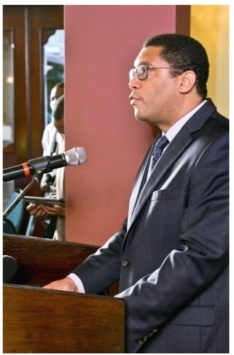

J'ai grand plaisir à vous accueillir ce soir à l'ouverture de cette conférence sur le crédit à la production. Je souhaite la plus cordiale bienvenue aux distingués intervenants étrangers et locaux qui ont bien voulu animer les débats sur cette question cruciale, presqu'existentielle, pour nous en tant qu'Etat-nation.

Je tiens à remercier mon collègue du Conseil, Fritz Duroseau, coordonnateur de notre institut de formation, et à travers lui tout le staff de la banque, pour l'organisation de cette opportunité de réflexions systématiques sur un thème si important.

Cette conférence s'inscrit certes dans le cadre de la commémoration des 35 ans de la banque centrale, mais elle reflète surtout une préoccupation institutionnelle permanente quant aux mécanismes de financement de l'économie soutenables et compatibles avec la mission de la Banque Centrale. Nous sommes arrivés à la conclusion que le crédit aux secteurs productifs est central pour la croissance et la stabilité à long terme, et constitue par conséquent un objectif tout à fait conciliable avec le mandat de stabilité de la Banque Centrale.

A ce propos, permettez-moi de partager avec vous quelques leçons de l'action de la Banque Centrale au cours de 10 dernières années.

La première leçon est que la légitimité et la crédibilité de la banque centrale découlent du respect de son mandat et d'assurer à la fois la stabilité monétaire et la stabilité financière. Or, on observe souvent, comme la crise de 2008 l'a d'ailleurs bien rappelé, que la stabilité monétaire ne garantit pas forcément

<!-- page 113 -->

la stabilité financière. Pis encore, l'instabilité financière menace souvent la stabilité monétaire de même que l'efficacité de la politique monétaire. C'est la raison pour laquelle la banque centrale accorde une attention particulière, au-delà de l'indice des prix à la consommation et de la qualité des actifs des banques, à des variables comme les prix des actifs réels, pour cerner les risques de bulle que les simples mesures conventionnelles de l'inflation ne prennent pas en compte. Ces efforts participent d'une veille macro-prudentielle dont les instruments sont continuellement affinés. Cet attachment à son mandat en toutes circonstances a permis à la banque centrale de maintenir sa crédibilité. Aujourd'hui, le public ne doute ni de la primauté de cet objectif de stabilité ni de sa poursuite, dans toute la mesure du possible, par des actions conjoncturelles appropriées, conventionnelles ou non conventionnelles.

Vu la primauté de l'objectif de stabilité, la croissance du crédit est un sujet aussi important que délicat que la banque centrale aborde avec beaucoup de nuances. Ce crédit est bon toutes les fois qu'il ne compromet pas la stabilité financière et la stabilité monétaire.

La deuxième leçon à tirer, c'est que le crédit peut croître, sans distordre l'appréciation des risques par les banques et sans compromettre, tout au moins dans le court terme, la qualité de leurs portefeuilles et la stabilité financière, mais tout en ayant malheureusement des effets pervers sur la stabilité monétaire. Ces effets pervers viennent du fait que la croissance du crédit, quand elle ne bénéficie pas à des secteurs productifs, risquent d'exacerber les déséquilibres macro-économiques. C'est exactement ce qui s'est passé au cours des quatre dernières années.

En effet, grâce aux différentes mesures d'assouplissement prises par la Banque Centrale pour soutenir l'activité économique après le séisme de 2010, l'encours du crédit a enregistré une augmentation significative. De 2010 à 2013, le crédit privé est passé de 35.41 à 63.28 milliards de gourdes, ce qui représente une augmentation de 79% sur une période de quatre ans.

Comme 60% de ce crédit est dirigé vers le commerce, la consommation et l'importation, il a contribué à aggraver notre déficit commercial et notre dépendance des flux de la diaspora et des aides officielles.

La Banque Centrale a dû réagir par un resserrement monétaire à la fois compréhensible et paradoxal. Compréhensible si on tient compte de la conjoncture.

Paradoxal parce qu'au fond, le système bancaire ne prête pas assez quel que soit l'angle sous lequel on le compare à d'autres pays. Le crédit au secteur privé représente seulement 19% du PIB contre 31% pour les pays à faible revenus et 48% pour les pays de l'Amérique Latine et de la Caraïbe. Seulement

<!-- page 114 -->

43% des dépôts collectés par les banques sont convertis en prêts, alors que dans la région de la Caraïbe,

65% des dépôts bancaires, en moyenne, sont utilisés pour le crédit au secteur privé. Pour atteindre ce

niveau, notre système bancaire devrait accorder des prêts additionnels de l'ordre de 28 milliards de

gourdes, soit environ 7% du PIB de 2013.

La troisième leçon est qu'il faut éviter que le resserrement de la politique monétaire et les hausses de taux d'intérêt ne fragilisent pas des entreprises ou des secteurs et viennent compromettre la stabilité financière. La banque centrale est donc vigilante et se tient prête à intervenir, par des mesures ponctuelles, conventionnelles ou non conventionnelles, pour prévenir ces difficultés créées par une conjoncture difficile.

Toutes ces difficultés et complications nous renvoient à la quatrième leçon, corollaire un peu des trois premières. La banque Centrale a ses limites. L'action de la Banque centrale doit être relayée par des réformes structurelles, impératives pour renforcer la compétitivité de l'économie et libérer son potentiel de croissance.

L'objectif de cette conférence est justement de dresser un état des lieux qui permettra d'identifier les contraintes, les obstacles, les difficultés de même que les opportunités d'accès au crédit bancaire par des secteurs porteurs de croissance et de création d'emplois, mais aussi de recherche des solutions durables au financement de la production nationale.

Ainsi, cette conférence est en parfaite cohérence avec les politiques gouvernementales visant à promouvoir l'accès et l'expansion du crédit bancaire en Haïti. A cet égard, les réflexions qui y seront menées devraient permettre de:

1. cerner les causes du problème en prenant en compte tous les aspects de l'environnement économique, financier, judiciaire, réglementaire et institutionnel dans lequel évoluent les banques.

2. formuler des recommandations précises concernant les actions à envisager à court, moyen et long termes afin de favoriser un financement bancaire accru des investissements dans les secteurs porteurs de l'économie, sans remettre en cause la solidité du système bancaire et la stabilité macroéconomique.

Je souhaite plein succès à ces travaux tout en vous assurant que l'ambition est que les réflexions et recommandations qui sortiront de ces deux journées servent à inspirer, orienter et influencer les politiques publiques visant l'expansion du crédit au secteur productif de l'économie haïtienne.

<!-- page 115 -->

Une telle démarche contribuera, bien sûr, à dynamiser notre secteur privé et consolider les bases d'une croissance économique forte et durable sans compromettre la stabilité macroéconomique et la solidité du système financier. La conciliation de ces deux objectifs est à la fois possible et souhaitable.

C'est sur cette note d'optimisme et de prudence que j'ouvre la conférence sur la relance du crédit au secteur productif en Haïti.

Je vous remercie de votre attention.

<!-- page 116 -->

Conférence sur la Politique monétaire face aux défis de la Croissance – 8-9 août 2014 - Karibe

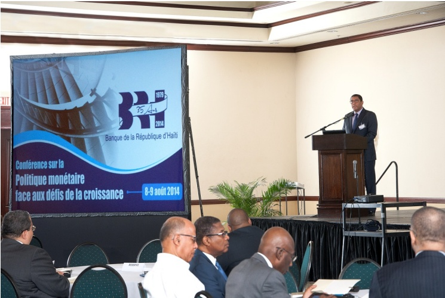

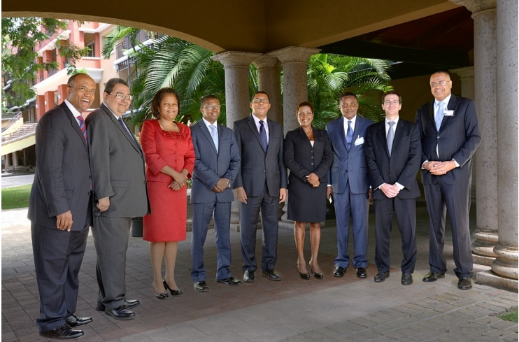

<!-- page 117 -->

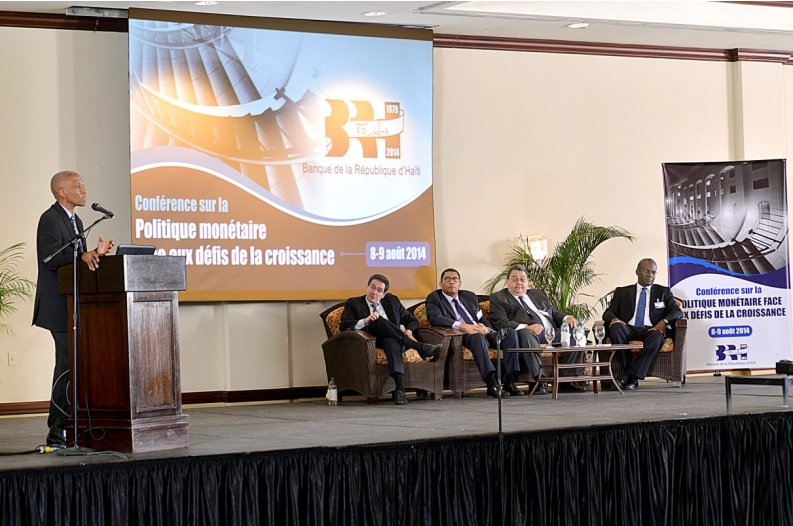

<!-- page 118 -->

Atelier inclusion financière - 30 septembre 2014 - Karibe.

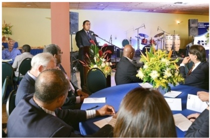

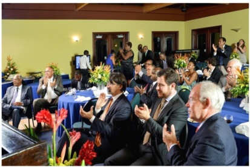

Monsieur le Président de la République,

Monsieur le Premier Ministre,

Honorables Parlementaires,

Mesdames, Messieurs les Ministres,

Mesdames, Messieurs les représentants des Institutions Financières Internationales,

Distingués invités,

Mesdames, Messieurs les membres de la communauté financière,

Nous nous félicitons de pouvoir soumettre ce projet de stratégie d'inclusion financière à l'examen minutieux de ses différents acteurs et détenteurs d'enjeux, vous-mêmes sans qui il est condamné à rester dans les tiroirs comme un bel exercice à blanc, vous-mêmes qui aurez une contribution essentielle à son implémentation et son succès.

Cette conférence-débat que nous inaugurons ce soir sous le haut patronage du Président de la République se veut un atelier de restitution-appropriation. Vos commentaires et remarques éclairés enrichiront le document dans le sens de l'adaptation de nos moyens à nos objectifs compte tenu de nos contraintes et de nos atouts.

<!-- page 119 -->

C'est l'occasion pour nous du Conseil de la BRH de remercier le Président de la République, le Premier Ministre et le Ministre de l'Économie et des Finances pour leur engagement et leur support tout au long de l'élaboration de ce document stratégique. Relativement à votre croisade en faveur du crédit aux métiers et aux petits entrepreneurs, soyez assuré que la banque centrale s'emploie à supporter les politiques sectorielles visant une distribution plus inclusive du crédit sous la contrainte de la stabilité monétaire et financière. Nous tenons à exprimer notre appréciation du support dévoué de l'équipe de la Banque Mondiale, en particulier Juan Buchenau et Yoko Doi, de même que la compétence et le professionnalisme de nos jeunes cadres de la banque centrale. Cette collaboration est un bel exemple de coopération entre la Banque Mondiale et une institution haïtienne.

L'inclusion financière consiste à offrir des services bancaires de base (épargne et crédit) aux couches défavorisées de la population. Les politiques tendant vers l'inclusion financière découlent certes d'un idéal de justice sociale, mais s'imposent aussi de par la nécessité d'un modèle adéquat de croissance forte et soutenable qui ne risque pas d'être fâcheusement et brutalement rompue par l'instabilité du cadre macro-économique.

Quelle a été l'expérience des quatre dernières années au niveau de la monnaie, du crédit et du cadre macro-économique? Grâce à une bonne discipline fiscale, la Banque Centrale a pu mener une politique de taux d'intérêt bas favorisant une augmentation de 29% à 42% du ratio prêts sur dépôts totaux et une expansion d'environ 80% du crédit privé sur 3 ans, une croissance jusqu'à la inégalée. Mais vu que nous importons beaucoup de biens que nous consommons et que le crédit est fortement concentré sur le commerce et la consommation, cette masse monétaire créée est allée acquérir des biens de consommation importés, aggravant ainsi notre déficit commercial et induisant des pressions sur le change, l'inflation et les réserves internationales. Pour sauvegarder la stabilité du cadre macro-économique, la banque centrale a dû resserrer les conditions monétaires.

Cet arbitrage entre croissance du crédit et stabilité n'est pas incontourable moyennant que le crédit soit alloué avec un parti-pris délibéré pour la production et l'emploi, orientés vers l'exportation ou la substitution aux importations. Dans ce sens, des efforts importants ont été consentis au niveau du tourisme, de l'éducation tant classique que professionnelle, de l'augmentation de la production agricole, du renforcement des organes et mécanismes d'identification des citoyens. Il s'agit d'avancées importantes au bénéfice des secteurs productifs.

<!-- page 120 -->

Par ailleurs, des progrès significatifs ont été réalisés ces dernières années au niveau du microcrédit qui représente environ 15% du crédit du système financier grâce à la dynamisation des institutions de micro-finance non bancaires et au renforcement du réseau de proximité des coopératives d'épargne et de crédit. Les développementations technologiques ont également permis l'offre de services bancaires soit à travers le téléphone mobile comme « Tchotcho mobil » ou « Lajan pa m », soit à travers un agent de proximité et une carte de débit comme « Unibank tout kote ».

Cependant, pour encourageants qu'ils soient, ces acquis sont encore en-deçà de notre potentiel productif, et nos taux de croissance (entre 3 et 5% l'an) sont encore en-deçà des niveaux requis (au moins 9% compte tenu du taux de croissance de la population) pour au moins doubler notre PIB per capita en 10 ans. L'atteinte de ce potentiel exige une systématisation des efforts d'harmonisation et de synergie entre les différents acteurs tant publics que privés. Cela pourra faciliter l'identification et la levée des freins principaux à la libération de nos capacités productives. Par exemple, l'Office National d'Identification et le secteur financier peuvent exploiter ensemble une base de données avec des caractéristiques d'identification unique des citoyens, particulièrement avec le Bureau d'Information sur le Crédit (BIC) dont les opérations ont commencé depuis quatre mois. Cela faciliterait grandement l'accès aux services bancaires. De même, les micro-parcs industriels peuvent contribuer à réduire les risques, les coûts de monitoring des créanciers et les taux d'intérêt pour les micro-entreprises. Un programme d'assurance-récolte et d'assurance-crédit pourra réduire les risques et adoucir les termes et conditions de prêts dans le secteur agricole. Les primes pour ces assurances peuvent baisser dans un contexte de meilleure sécurité rurale où les récoltes sont protégées des extorsions de prédateurs. Les risques baissent aussi quand la politique commerciale nationale est connue de tous et effectivement implémentée par le renforcement des administrations douanières et frontalières. La formation professionnelle, en augmentant le savoir-faire et la productivité de nos jeunes, améliore leurs profils de risque et leur permet d'accéder à de meilleurs revenus et de meilleurs crédits. La sécurité foncière vient autoriser, entre autres, des développementations immobiliers, touristiques et agricoles à l'abri de conflits terriens souvent aussi fantaisistes que dommageables.

Ce n'étaient là que des exemples pour illustrer l'interdépendance entre les actions publiques et privées.

Par conséquent, il est nécessaire de systématiser la communication et la coordination entre les

différentes entités pour une meilleure cohérence des politiques publiques avec un parti-pris délibéré

pour l'inclusion financière, la croissance inclusive, la production et l'emploi sous la contrainte de la

<!-- page 121 -->

stabilité macro-économique, condition nécessaire à une croissance soutenable. Pour ce faire, il est impératif que la croissance monétaire qui résulte de l'augmentation du crédit à l'économie corresponde à une augmentation de la production pour que, comme on dit dans le jargon de l'économie monétaire, "trop de monnaie ne demande pas trop peu de biens".

C'est dans le cadre de la poursuite de cette croissance inclusive et forte dans la stabilité à long terme que ce débat sur la stratégie d'inclusion financière est lancé.

Nous vous souhaitons une participation fructueuse pour que nous aboutissions à un document-référence connu, compris et suivi de tous.

Merci.

<!-- page 122 -->

## LANCEMENT DU BUREAU D'INFORMATION SUR LE CREDIT (BIC) - 21 octobre 2014 - Karibe

L'intérêt suscité par le lancement récent de la Stratégie Nationale d'Inclusion Financière indique qu'un consensus national se dégage progressivement sur l'urgente nécessité de lever les obstacles structurels au crédit afin de faciliter le financement d'activités à forte valeur ajoutée. A la banque centrale, nous sommes encouragés par de telles avancées, convaincus que nous sommes, du poids de ces contraintes sur la croissance du crédit et de l'investissement productifs.

L'expérience a montré que la stabilité macro-économique n'est qu'une condition nécessaire, loin d'être suffisante, à la croissance du produit national. Le produit national pourra croître fortement et durablement par le développement des activités productives, créatrices d'emplois et de revenus pour la population, porteuses d'opportunités de réduire les déficits externe et fiscal. La croissance sans job ou la reprise sans job est l'un des spectres hideux qui guettent toutes les économies du monde, pour preuve plusieurs pays avancés se sont plaints ou se plaignent encore d'une reprise non associée à une réduction du chômage, où la croissance n'est pas tirée par la production et l'emploi et reste donc sans grand effet sur les malaises économiques et sociaux. Chez nous, la croissance démographique élevée complique et exacerbe ces malaises. Nous ne pouvons donc pas nous payer le luxe des croissances nulles ou négatives, ni des croissances qui, même positives, n'induisent pas une forte création d'emplois.

Ce qui est recherché dans le cadre des initiatives de facilitation du crédit et de l'investissement productifs, comme les parcs industriels, les micro-parcs, la promotion des projets touristiques, le fonds de garantie partielle du crédit, la stimulation du secteur agricole y compris de la production animale, le soutien aux métiers et les écoles professionnelles, c'est justement le développement d'activités porteuses pour une croissance avec job en utilisant l'investissement public comme levier de l'investissement privé local et étranger, par l'entreprise micro, petite ou grande.

<!-- page 123 -->

Le Bureau d'Information sur le Crédit (BIC) est justement établi en vue du renforcement de ce cadre de facilitation du crédit et de l'investissement privés. Son rôle est de collecter et de partager des informations fiables sur l'endettement, la solidité et le sérieux des débiteurs pour la minimisation des risques de défaut de paiement de ces derniers et de leurs impacts néfastes sur les institutions créancières. Il en résultera la réduction des incertitudes sur les demandeurs de crédit, favorisant non seulement la progression des volumes de crédit octroyés, mais aussi des termes et conditions plus propices à la profitabilité des emprunteurs, producteurs et entrepreneurs. Les cavaliers immédiats du BIC dans cet objectif de promotion du crédit sont le fonds de garantie partielle du crédit (surtout pour les tout nouveaux débiteurs sans histoire de crédit), les mécanismes de sureté comme le gage sans dépossession et le leasing.

Le Conseil d'Administration de la BRH tient à remercier et féliciter les cadres qui ont travaillé à la réussite de ce projet.

Nous ne saurions omettre non plus le rôle déterminant joué par la Banque Mondiale à travers sa filiale, la IFC, dans la mise en œuvre de ce projet de bureau de crédit. Leurs conseils avisés, de même que les études comparées facilitées par leur réseau d'entités de même type à travers le monde ont permis à nos cadres de calibrer notre Bureau d'Information sur le crédit au mieux de nos circonstances nationales sans déperdition pour autant au plan de l'efficacité. La BID, de son côté, nous a encouragés dès le départ du projet, et sa contribution financière a été appréciée à la BRH au-delà de sa valeur monétaire, comme un indicateur de la souscription de ce partenaire important d'Haïti à l'opportunité de l'établissement d'une telle entité.

Déjà opérationnel, le BIC collecte des informations communiquées par les banques sur l'endettement, la solidité et le sérieux de débiteurs. Ces informations constitueront une base de données qui pourra être consultée, conformément à la loi du 14 mai 2012 portant organisation des banques et autres institutions financières. Cette loi autorise également la BRH à étendre la diffusion de ces informations à des institutions non financières dans le souci de cerner les paramètres susmentionnés dans leur globalité.

<!-- page 124 -->

Mesdames et messieurs, cette initiative va de pair avec le cadre de politiques publiques mis en place par le gouvernement Martelly-Lamothe en vue de rendre le climat d'affaires plus favorable à l'investissement, au crédit et à la production, dans le souci de sortir du cercle vicieux de dépendance des transferts privés et publics et de vulnérabilités aux chocs externes.

A terme, le BIC devrait donc contribuer à une amélioration du bien-être de la population par ses effets sur la croissance économique, celle des exportations, de la production, de l'emploi et de l'assiette fiscale.

Merci.

<!-- page 125 -->

Compilation des discours du Gouverneur Charles Castel 2007-2015

Fête de Fin d'année 2014 - Banque Centrale -

<!-- page 126 -->

2015

Sommet financier du Groupe Croissance -

<!-- page 127 -->

## Discours d'aurevoir - Centre de convention

Me voici arrivé au terme de mes fonctions à la banque centrale après environ 14 mois de la fin de mon mandat, et plus de 16 mois après que j'eux notifié au Président de la République ainsi qu'au Premier Ministre Lamothe, que je ne voulais absolument pas briguer un troisième mandat de Gouverneur.

Je vis mon départ dans un mélange de satisfaction, de regret et de mélancolie. Satisfaction du devoir accompli, avec un leadership empreint de conviction, sagacité, ténacité et créativité pour sauvegarder, dans toute la mesure du possible, la stabilité financière et monétaire. Regret de n'avoir pas terminé certains projets qui me tenaient à cœur, notamment le processeur national des paiements (PRONAP). Je ne doute cependant pas que le PRONAP sera continué et réalisé par le nouveau Gouverneur. J'exhorte les banques commerciales à s'engager et coopérer davantage pour la pleine réussite de ce projet si important pour l'efficience de notre système de paiements.

Comment ne pas être mélancolique en laissant une institution à laquelle on a appartenu pendant 22 ans, dont on connait chaque visage et chaque mur? C'est l'occasion pour moi de remercier mes collègues du Conseil d'Administration de leur support et collaboration, les membres de la haute direction dont les conseils avisés, prodigués parfois avec fougue et insistance dans une atmosphère de famille et de confiance, ont été souvent déterminants dans la conduite des affaires de la banque. Je leur en sais gré et les invite à garder les mêmes dispositions au bénéfice du nouveau Conseil. Je joins dans le même témoignage de gratitude tout le personnel de la banque et l'exhorte à redoubler d'efforts et de rigueur dans leurs taches. Permettez néanmoins que j'aie un mot spécial pour Fritz Duroseau, collègue du Conseil sortant, homme d'une haute stature intellectuelle, professionnelle et morale que j'ai la chance d'avoir comme collègue et ami. Fritz, je m'en voudrais de ne pas t'exprimer aujourd'hui toute mon appréciation et toute ma reconnaissance. Je ne saurais faire non plus le professionnalisme et le dévouement de mes assistantes au long de ma carrière à la banque, Anya Comeau, Betty Saint-Vil, Dorothy Duchatelier, Geneviève Roc et Marcelle B. Jean. Merci encore, vous savez l'estime et l'affection que je vous porte.

Je souhaite du succès au nouveau Conseil dont 3 des 5 membres sont des collègues du Conseil sortant.

Ce qui est ressurant parce qu'ils ont une bonne connaissance des défis, objectifs, moyens et limites de l'Institution dans tous ses métiers.

<!-- page 128 -->

Je leur souhaite du succès pour le bien de l'institution qui doit continuer à se renforcer, et pour le bien du pays. Dans un contexte constitutionnel, légal, économique et fiscal difficile, où il faut arbitrer en permanence entre le change et les réserves internationales, avec des acteurs qui, minimisant ou occultant ce dilemme, veulent le beurre et le prix du beurre, vous reprenez la barre sachant les difficultés de la tache. Je salue votre courage et vous souhaite d'être inspirés pour aider à conserver notre stabilité macroéconomique bien menacée aujourd'hui. Vous seriez hautement aidés par une amélioration de la discipline fiscale sans laquelle, comme je l'ai rappelé à satiété, la stabilité monétaire est illusoire.

Mon expérience de 22 ans à la banque centrale et de 11 ans à son Conseil d'administration m'a permis d'observer une tendance aussi déplorable que constante à occulter les racines de notre mal, mal d'Etat fragile (ainsi classé par tous les organismes internationaux), d'Etat faible qui manque de moyens pour contrôler pleinement son territoire et sa population, donc forcément comme corolaire manque de capacité d'exécuter les politiques publiques (dans quelque soit le domaine), des défaillances énormes au niveau de la production et de l'emploi se traduisant en un déficit commercial de 3 milliards de dollars, une dépendance chronique de l'international pour combler les déficits fiscaux et de la balance courante. C'est cela les racines de notre mal, et notre modèle politique et socio-économique est en panne. Occulter cette vérité, pourtant d'une clarté aveuglante, conduit à recourir à des succédanés imparfaits et de court terme, à différer sine die les réformes difficiles certes, néanmoins incontournables si nous devons sortir du cercle vicieux de stagnation économique, de démographie galopante, de dépendance, d'instabilité, et d'approfondissement de la pauvreté.

Nous ne pouvons pas persister à rester rebelle aux postures et initiatives qui s'imposent. Pour rappel, et c'est loin d'être anodin, à chaque mandat présidentiel, nous produisons environ 1 million de personnes. C'est ça notre réalité. De grâce, arrêtons de nous massacrer. Recherchons dans la vérité et la cohésion les ressorts nécessaires pour remettre notre pays sur ses pieds.

Nos compatriotes le méritent bien.

Merci.

<!-- page 129 -->

Photos Divers

Basquiats - Décembre 2009 - Quisqueya

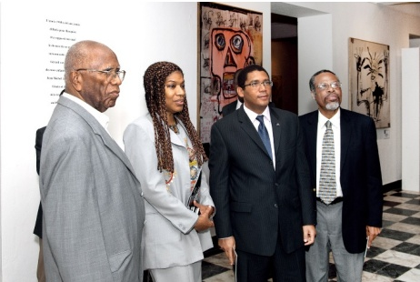

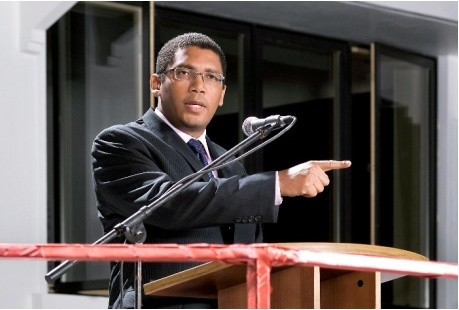

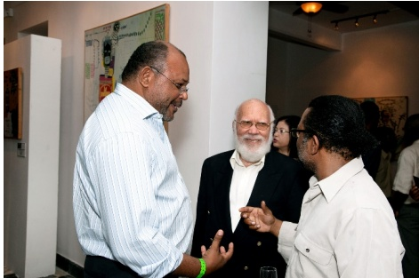

<!-- page 130 -->

Signature du contrat du Centre de convention

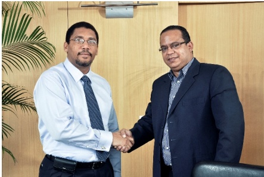

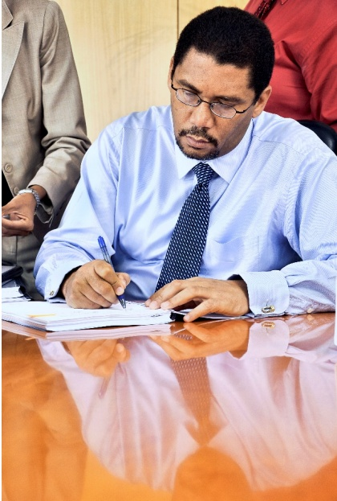

<!-- page 131 -->

## Diner

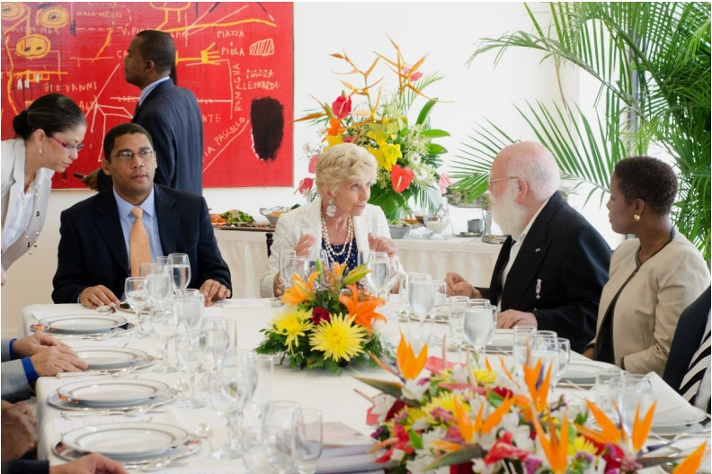

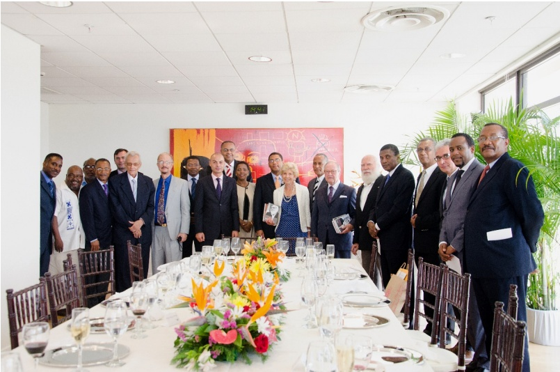

<!-- page 132 -->

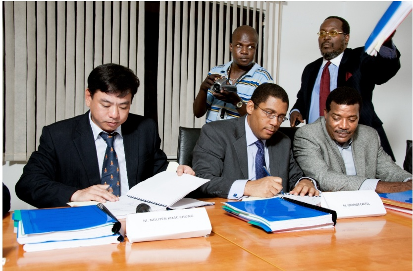

<!-- page 133 -->

<!-- page 134 -->

Retour du « Serment des ancêtres »

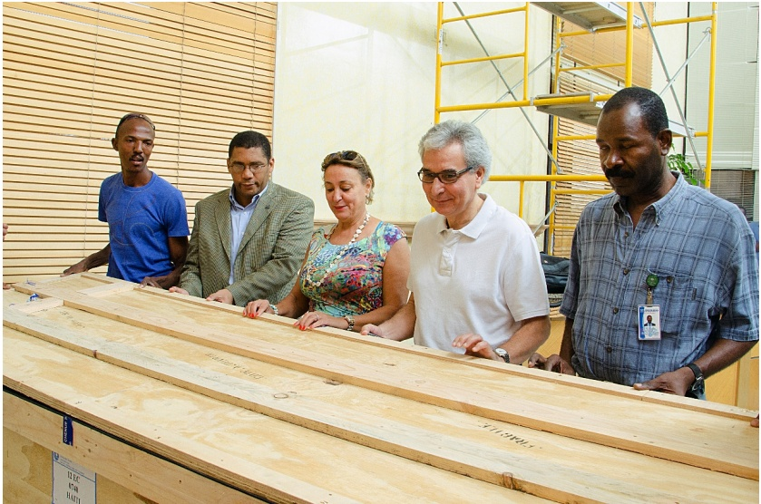

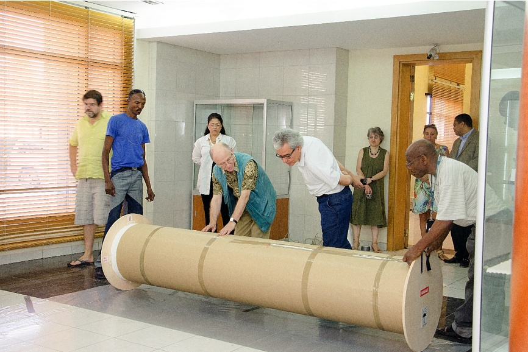

<!-- page 135 -->

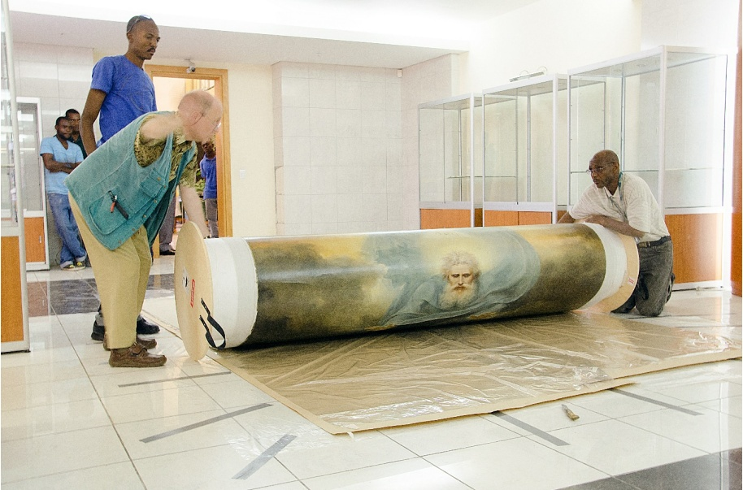

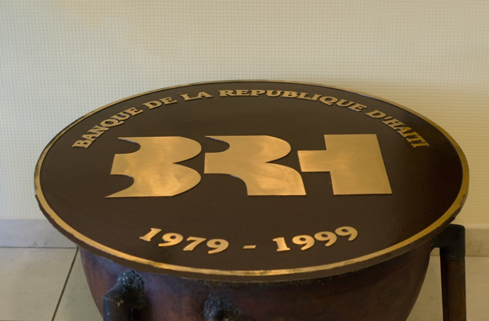
