<!-- page 1 -->

REVUE DÉVELOPPEMENT DE CONNAISSANCES & COMPÉTENCES FINANCIÈRES

## DYNAMIQUE DE LA DETTE ET GESTION DES RISQUES DE SURENDETTEMENT

RDCCF-VOL.V

<!-- page 2 -->

<!-- page 3 -->

# REVUE DÉVELOPPEMENT DE CONNAISSANCES & COMPÉTENCES FINANCIÈRES

## Dynamique de la dette et gestion des risques de surendettlement

JUIN 2026

RDCCF-VOL. V

<!-- page 4 -->

<!-- page 5 -->

## SOMMAIRE

01 VUE D'ENSEMBLE Page 13
02 DES INSTRUMENTS D'ENDETTEMENT : CLASSER POUR DIVERSIFIER Page 14
03 DE LA NATION AUX OPÉRATEURS ÉCONOMIQUES PRIVÉS : DES DONNÉES FINANCIÈRES QUI INSPIRENT Page 15
04 DANS L'ANALYSE D'ENDETTEMENT : DES INDICATEURS FINANCIERS QUI COMPTENT Page 16
05 LA DETTE PUBLIQUE : UNE DYNAMIQUE À ANALYSER, MESURER ET ENREGISTRER Page 17
06 LE SURENDETTEMENT : QUOI COMPRENDRE? Page 19
07 LE SURENDETTEMENT : UN PHENOMÈNE RISQUÉ Page 20
08 SURENDETTEMENT: VERS UN DÉCROCHAGE FINANCIER Page 21
09 SURENDETTEMENT ACTIF OU PASSIF : QUELLES TENDANCES EN HAITI? Page 22
10 QUAND LA BRH PRÉCONISE DES SOLUTIONS PRÉVENTIVES Page 23
11 BRH : DES DISPOSITIFS AUX MESURES PRÉVENTIVES Page 24
12 BRH : UNE STRUCTURE INFORMATIONNELLE SUR LE CRÉDIT RENFORCÉE EST MISE EN PLACE Page 27
13 BIC : UN PILIER DE SYMÉTRIE ET D'INCLUSION FINANCIÈRE Page 28

<!-- page 6 -->

## SOMMAIRE

14 LE BIC: DES INDICATEURS QUI COMPTENT Page 29
15 LES INDICATEURS D'UNE GESTION PRUDENTIELLE DES RISQUES DE SURENDETTEMENT Page 33
16 LA MISE SUR L'ÉDUCATION FINANCIÈRE Page 36
17 RENDEZ-VOUS DÉCISIONNEL : L'EXPÉRIENCE DE RESTRUCTURATION DE CRÉDIT AVEC PÉDRO Page 38
18 RENDEZ-VOUS DÉCISIONNEL : STRATÉGIES DE PRÉVENTION CONTRE LE SURENDETTEMENT AVEC PÉDRO Page 39
19 RENDEZ-VOUS DÉCISIONNEL AVEC BÉATRICE : QUAND L'INCLUSION FINANCIÈRE SE CONFOND AVEC LA SURINCLUSION Page 41
20 RENDEZ-VOUS DÉCISIONNEL : BÉATRICE FACE À LA SURINCLUSION Page 42
21 RENDEZ-VOUS DÉCISIONNEL : AU-DELÀ DES APPARENCES Page 44
22 CONCLUSION Page 45
23 ANNEXE Page 49

<!-- page 7 -->

## FIGURES

FIGURE 1 : QUELQUES INSTRUMENTS RÉPERTORIÉS SUR LE MARCHÉ..... Page 14
FIGURE 2 : CADRE COMPARATIF DE LA DISTRIBUTION DES RESSOURCES FINANCIÈRES..... Page 15
FIGURE 3 : INDICATEURS DE SOLVABILITÉ FINANCIÈRE..... Page 16
FIGURE 4 : FACTEURS COMPORTEMENTAUX ET SOCIAUX INFLUENÇANT LE SURENDETTEMENT..... Page 20
FIGURE 5 : TYPE DE SURENDETTEMENT..... Page 21
FIGURE 6 : FACTEURS STRUCTURELS AMPLIFIANT LE SURENDETTEMENT..... Page 22
FIGURE 7 : LES MISSIONS DU BUREAU D'INFORMATION SUR LE CRÉDIT (BIC)..... Page 27
FIGURE 8 : ORGANIGRAMME DU BIC..... Page 28
FIGURE 9 : STRATÉGIES D'ACCOMPAGNEMENT FINANCIER..... Page 38
FIGURE 10 : STRATÉGIES DE PREVENTION CONTRE LE SURENDETTEMENT..... Page 39
FIGURE 11 : LE CHEMIN DE LA RÉHABILITATION FINANCIÈRE..... Page 40
FIGURE 12 : COMPRENDRE LE COMPORTEMENT DE BÉATRICE..... Page 41
FIGURE 13 : LE DÉSENCHANTEMENT DE BÉATRICE..... Page 42
FIGURE 14 : LEÇONS APPRISES DE BÉATRICE ET DE PÉDRO..... Page 44

<!-- page 8 -->

## GRAPHES

01 GRAPHE 1 : HAITI: DONNÉES ÉVOLUTIVES DE LA DETTE PUBLIQUE (2004-2024) Page 17
02 GRAPHE 2 : RÉPARTITION GÉOGRAPHIQUE DES CRÉDITS EN GOURDES AU 30 SEPTEMBRE 2022 Page 29
03 GRAPHE 3 : RÉPARTITION GÉOGRAPHIQUE DES CRÉDITS EN USD Page 30
04 GRAPHE 4 : RÉPARTITION DES CRÉDITS PAR GENRE DU 30 SEPTEMBRE 2022 - 30 SEPTEMBRE 2024 EN HTG Page 31
05 GRAPHE 5 : RÉPARTITION DES CRÉDITS PAR GENRE DU 30 SEPTEMBRE 2022 - 30 SEPTEMBRE 2024 EN USD Page 32
06 GRAPHE 6 : RÉPARTITION DES CRÉDITS PAR CATÉGORIE DE PAIEMENT EN DOLLARS AU 30 SEPTEMBRE 2022 Page 33
07 GRAPHE 7 : RÉPARTITION DES CRÉDITS PAR CATÉGORIE DE PAIEMENT EN GOURDES AU 30 SEPTEMBRE 2023 Page 34
08 RÉPARTITION DES CRÉDITS PAR CATÉGORIE DE PAIEMENT EN GOURDES AU 30 SEPTEMBRE 2024 Page 35

<!-- page 9 -->

## TABLEAU

TABLEAU 1 - BRH : des mesures préventives..... Page

<!-- page 10 -->

## SIGLES ET ABRÉVIATIONS

| AFI | ALLIANCE POUR L'INCLUSION FINANCIÈRE |
| --- | --- |
| AVD | ANALYSE DE VIABILITÉ DE LA DETTE |
| BCAH | BUREAU DE LA COORDINATION DES AFFAIRES HUMANITAIRES DES NATIONS-UNIES |
| BRH | BANQUE DE LA RÉPUBLIQUE D'HAÎTI |
| BRI | BANQUE DES RÈGLEMENTS INTERNATIONAUX |
| BIC | BUREAU DE L'INFORMATION SUR LE CRÉDIT |
| CNUCED | CONFÉRENCE DES NATIONS-UNIES SUR LE COMMERCE ET LE DÉVELOPPEMENT |
| FMI | FONDS MONÉTAIRE INTERNATIONAL |
| IADM | INITIATIVE D'ALLÈGEMENT DE LA DETTE MULTILATÉRALE |
| IFBC | INSTITUTION DE FORMATION DE LA BANQUE CENTRALE |
| MPME | MICROS PETITES ET MOYENNES ENTREPRISES |
| PIB | PRODUIT INTÉRIEUR BRUT |
| PNEF | PLAN NATIONAL D'ÉDUCATION FINANCIÈRE |
| PPTE | PAYS PAUVRES TRÈS ENDETTÉS |
| PRFI | PAYS À REVENUS FORT ET INTERMÉDIAIRE |
| PSG | PLAN STRATÉGIQUE GLOBAL |
| RDCCF | REVUE DE DÉVELOPPEMENT DE COMPÉTENCE ET DE CONNAISSANCE FINANCIÈRE |

<!-- page 11 -->

<!-- page 12 -->

<!-- page 13 -->

## VUE D'ENSEMBLE

Dans le cadre du Plan National d'Éducation Financière (PNEF), la Banque de la République d'Haïti (BRH) poursuit sa démarche proactive destinée à renforcer les compétences et les connaissances financières de la population. Cette orientation s'illustre notamment par la publication de ce cinquième volume de la Revue Développement des Compétences et Connaissances Financières (RDCCF).

Ce numéro est dédié à l'analyse approfondie des problématiques relatives au surendettemment. Il vise à informer les parties prenantes sur les mécanismes d'endettement, leur gestion appropriée ainsi que sur les interactions entre les dettes des ménages et celles du secteur public. En outre, il entend sensibiliser les utilisateurs financiers à une gestion prudente des ressources dont ils disposent, qu'elles émanent du secteur public ou privé, tout en assurant une utilisation rationnelle, une amélioration de la capacité d'épargne et d'investissement, et le respect durable des engagements financiers à court et à long terme.

En 2025, la Banque mondiale rapporte que la dette extérieure totale des pays à faible revenu et intermédiaire (PRFI) a plus que doublé depuis 2010, pour atteindre environ 8 900 milliards de dollars américains. De ce montant, près de 415 milliards de dollars représentent exclusivement le paiement des intérêts.

Par ailleurs, selon la Banque des règlements internationaux (BRI, 2017), des difficultés de paiement peuvent se présenter lorsque le service de la dette devient trop important. L'augmentation du coût total du service de la dette, en particulier des intérêts, expose ainsi ces pays à un risque accru d'instabilité financière et pourrait compromettre leur capacité à honorer leurs engagements internationaux.

En Haïti, au tout début de la crise multidimensionnelle, l'étude FinScope 2018 des menages a révélé que plus de 44 % des foyers interrogés ne maîtrisaient pas efficacement leurs dépenses, tandis que 37 % ont exprimé le souhait de recevoir une formation en gestion budgétaire. En outre, d'après une analyse d'impact de la crise sécuritaire menée par la Banque de la République d'Haïti (BRH), au dernier trimestre 2024, 250 entreprises se trouvent en situation de détresse financière. En effet, les incertitudes découlant de perturbations climatiques, d'événements aléatoires ou de périodes de crises prolongées, à l'instar de celles que traverse actuellement le pays, exercent une influence défavorable sur les habitudes financières des ménages et la situation des entreprises.

Par ailleurs, l'instantanéité des transactions financières numériques, la disponibilité continue des plateformes et la facilité des procédures d'achat en ligne sont susceptibles d'inciter les utilisateurs de produits et services financiers non avertis à des comportements d'achat impulsifs. Sur le long terme, si la maîtrise de soi et la gestion budgétaire ne sont pas suffisamment assurées, ces comportements peuvent compromettre la santé financière de ces utilisateurs et augmenter leur risque de surendettement.

Ces situations suggèrent la mise en place de politiques publiques adaptées, accompagnées de campagnes d'éducation financière ciblées pour soutenir les ménages et les entreprises dans la gestion de leurs finances, mais aussi pour renforcer la protection des consommateurs financiers contre les risques inhérents à la surinclusion et ceux liés à l'endettement.

<!-- page 14 -->

# DES INSTRUMENTS D'ENDETTEMENT : COMPRENDRE, CLASSER POUR DIVERSIFIER

On distingue généralement deux grandes catégories d'instruments d'endettement : les crédits destinés à financer des activités productives et ceux orientés vers la consommation. Ces instruments peuvent en outre être différenciés selon la durée du prêt, la nature du prêteur et de l'emprunteur, ainsi que selon le niveau de risque et le coût associé. Le tableau ci-dessous présente de manière synthétique certains instruments d'emprunt répertoriés.

## QUELQUES INSTRUMENTS RÉPERTORIÉS SUR LE MARCHÉ

## Pour un Pays

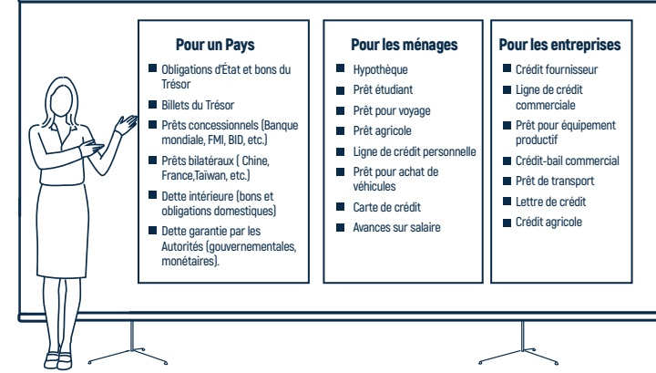

## Pour les ménages

## Pour les entreprises

Source: CNUCED-MEF-BRH, 2025

D'après la Banque mondiale (2003), "la dette publique représente l'ensemble des emprunts contractés par un État pour financer ses besoins de financement, lorsque ses recettes fiscales et autres revenus ne suffisent pas à couvrir ses dépenses".

Par ailleurs, le rapport de la Conférence des Nations-Unies sur le Commerce et le Développement (CNUCED, 2002), relatif au rôle, à l'organisation d'un bureau de la dette, mentionne que, "les négociations concernant les emprunts nationaux sont souvent coordonnées par une équipe qui représente à la fois le Ministère des finances et la Banque centrale".

## Le Saviez Vous?

## ”

En 2025, la Banque mondiale mentionne que le financement par emprunt peut devenir un puissant levier de développement, à condition qu'il s'inscrive dans une véritable stratégie de croissance.

Cette logique ne concerne pas seulement l'État : elle demeure tout aussi valable pour les entreprises et les ménages. Lorsqu'il est bien encadré et maîtrisé, l'endettement peut soutenir leurs projets, renforcer leur capacité financière et favoriser une croissance durable.

<!-- page 15 -->

# DE LA NATION AUX OPÉRATEURS ÉCONOMIQUES PRIVÉS : DES DONNÉES FINANCIÈRES QUI INSPIRENT!

Le schéma présenté ci-après constitue un cadre comparatif de l'allocation des ressources financières au niveau national, ainsi qu'au sein des ménages et des entreprises. Il met en exergue la relation entre les flux entrants et sortants de fonds à chaque échelon. Indépendamment du niveau d'analyse, les acteurs économiques appliquent des principes fondamentaux similaires en matière de gestion financière.

1 Le pays vit surtout des impôts, des taxes, des contributions non soumis à l'imposition, d'aide international, bénéfices sur les prises de participation dans les sociétés et des revenus d'exportation. Les ménages et les entreprises disposent de salaires, de revenus formel/informel ainsi que des transferts sans contrepartie.

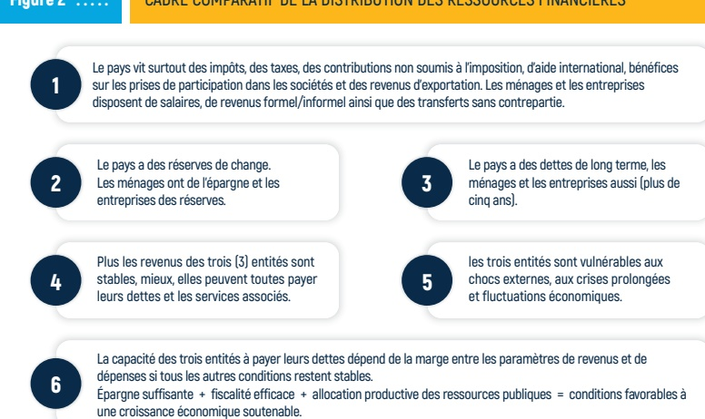

2 Le pays a des réserves de change. Les ménages ont de l'épargne et les entreprises des réserves.

3 Le pays a des dettes de long terme, les ménages et les entreprises aussi (plus de cinq ans).

Plus les revenus des trois (3) entités sont stables, mieux, elles peuvent toutes payer leurs dettes et les services associés.

les trois entités sont vulnérables aux chocs externes, aux crises prolongées et fluctuations économiques.

La capacité des trois entités à payer leurs dettes dépend de la marge entre les paramètres de revenus et de dépenses si tous les autres conditions restent stables.

Épargne suffisante + fiscalité efficace + allocation productive des ressources publiques = conditions favorables à une croissance économique soutenable.

Source: Combinaison de rapports CNUCED-MEF-BRH, 2025

Par ailleurs, la figure 2 ci-dessus présente certains indicateurs macroéconomiques nationaux, associés aux dynamiques propres aux ménages et aux entreprises. Cette démarche vise à offrir à chaque catégorie d'acteur économique un accès approprié et pertinent aux données financières de base, couvrant tant les comptes publics que ceux des opérateurs privés.

Cet exercice a pour objectif de consolider les connaissances des utilisateurs concernant les interactions entre les activités des différentes catégorie d'agents économiques, ainsi que la compréhension des principaux indicateurs relatifs aux politiques fiscales et monétaires. En articulant les enjeux nationaux avec les réalités des parties prenantes privées, il facilite une analyse succincte du circuit économique et financier ainsi que de ses impacts potentiels sur les ménages, dans une démarche de renforcement des capacités financières pour une maîtrise de leur dette.

<!-- page 16 -->

# DANS L'ANALYSE D'ENDETTEMENT : DES INDICATEURS FINANCIERS QUI COMPTENT

Dans le secteur financier, qu'il s'agisse des finances publiques ou personnelles, il est impératif d'analyser rigoureusement la solvabilité lors de l'évaluation des demandes de crédit afin d'assurer la capacité de remboursement des emprunteurs et de maîtriser les risques inhérents.

Figure 3 ::::::

## INDICATEURS DE SOLVABILITÉ FINANCIÈRE

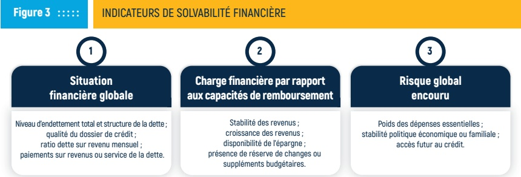

Situation financière globale

Niveau d'endettement total et structure de la dette ;

qualité du dossier de crédit ;

ratio dette sur revenu mensuel ;

paiements sur revenus ou service de la dette.

Charge financière par rapport

aux capacités de remboursement

Stabilité des revenus ;

croissance des revenus ;

disponibilité de l'épargne ;

présence de réserve de changes ou

suppléments budgétaires.

Source: Kaplan, 2022

Poids des dépenses essentielles ;

stabilité politique économique ou familiale ;

accès futur au crédit.

Conformément à la figure 3, l'appréciation de la solvabilité ainsi que du risque potentiel de surendettlement repose sur une analyse rigoureuse des paramètres considérés.

Selon la BRI (2017), l'omission de cette étape est susceptible d'augmenter le risque de surentetlement et de provoquer des tensions financières systémiques. Dans cette perspective, une surestimation des capacités financières dans l'analyse de la solvabilité des agents privés peut entraîner la création de dossiers de crédit erronés.

Cette situation peut avoir des conséquences graves, telles que la faillite personnelle, qui à son tour favorise l'apparition de problèmes de surentetlement, d'insolvabilité ou encore de désengagement financier. Inévitablement, cela conduit à l'exclusion des agents du marché financier (Kaplan, 2022).

Pour les pays, négliger l'examen approfondi des finances publiques, notamment la viabilité de la dette, la composition des recettes, l'efficiency des dépenses, et l'évaluation des risques macroéconomiques, peut conduire à des défauts de paiement, une dégradation de la confiance des marchés et à des crises de financement. Comme le souligne Coulibaly et Ndiaye (2026), professeurs de l'Université de New York, la révélation des passifs publics dissimulés peut entraîner une revalorisation soudaine du risque souverain.

Selon la BRH (2025), l'évaluation du service de la dette, laquelle inclut les paiements annuels d'intérêts ainsi que le remboursement du capital par l'État sur les emprunts publics, constitue un indicateur essentiel pour apprécier la viabilité à court terme de la dette. Par ailleurs, la CNUCED précise que "le contrôle des paiements incombe au bureau de la dette, au bureau du budget, au Trésor, au bureau du trésorier payeur général et/ou à la Banque centrale".

<!-- page 17 -->

# LA DETTE PUBLIQUE : UNE DYNAMIQUE À ANALYSER, MESURER ET ENREGISTRER

Aujourd'hui, la dette publique mondiale s'élève à 346 000 milliards de dollars américains. Ce chiffre représente près de 310 % du produit intérieur brut (PIB) mondial, selon le ratio dette/PIB. Cette valeur exprime le rapport entre la dette publique et la richesse annuelle générée par les pays (IFC, 2025).

Par ailleurs, le rapport pays du Fonds monétaire international (FMI, 2025), consacré à Haïti pour l'année 2025, examine en détail la situation de la dette publique du pays. Comme indiqué sur le graphe 1, le niveau de la dette s'élève à 12,4 % du Produit Intérieur Brut (PIB).

Graphe 1 ::::::

HAITI: DONNÉES ÉVOLUTIVES DE LA DETTE PUBLIQUE (2004-2024)

| Year | Dette publique (% du PIB) |
| --- | --- |
| 2004 | 38.00% |
| 2005 | 35.50% |
| 2006 | 34.00% |
| 2007 | 30.00% |
| 2008 | 29.00% |
| 2009 | 27.50% |
| 2010 | 27.00% |

| Year | Percentage (%) |
| --- | --- |
| 2011 | 24.00% |
| 2012 | 22.50% |
| 2013 | 20.50% |
| 2014 | 22.00% |
| 2015 | 23.50% |
| 2016 | 24.50% |
| 2017 | 25.50% |
| 2018 | 26.50% |
| 2019 | 27.50% |
| 2020 | 27.80% |
| 2021 | 27.00% |
| 2022 | 27.50% |
| 2023 | 28.00% |
| 2024 | 14.00% |

Source : Banque mondiale, 2025

L'analyse des données concernant la dynamique de la dette publique externe plus haut met en évidence une diminution progressive du niveau d'endettement du pays au cours des vingt dernières années. Il convient de souligner que d'après la Banque mondiale (2003), plusieurs initiatives internationales d'allégement de la dette, telles que l'Initiative PPTE (Pays Pauvres Très Endettés) et l'IADM (Initiative d'Allégement de la Dette Multilatérale), ont permis de réduire la dette extérieure haïtienne. Après le séisme de 2010, 828 millions de dollars ÉU de dettes envers des institutions financières internationales ont également été annulés (OCHA-Nations Unies, 2011).

<!-- page 18 -->

L'analyse de la viabilité de la dette (AVD), réalisée en 2022 par le FMI (2023), souligne la dynamique favorable du niveau d'endettement d'Haïti. Cependant, l'AVD indique que le risque global de détresse de la dette demeure élevé, en raison de certaines faiblesses économiques, politiques et institutionnelles, ainsi qu'une forte vulnérabilité aux catastrophes naturelles et à l'insuffisance de fiabilité des données concernant la dette estimée. Cette position du FMI met en évidence certaines vulnérabilités structurelles du pays susceptibles de déclencher une crise de dette en cas de révision brutale des anticipations.

Par ailleurs, il est à noter que la courbe décroissante, résultante de la situation d'endettement public portée sur les graphiques # 1 et # 2, engendre une certaine marge budgétaire, qui peut être interprétée comme une opportunité stratégique pour Haïti.

Selon la Banque mondiale (2003), en libérant des ressources qui peuvent être réaffectées à des secteurs prioritaires, la réduction de l'endettement, en particulier du service de la dette, constitue un moyen important pour renforcer les comptes nationaux.

La dette publique, les dépenses d'importations et les recettes d'exportations forment un système interconnecté influençant la balance de paiement comme notées dans la rubrique le Saviez-vous ci-dessous. Le FMI, suite à la revue effectuée en 2024 sur la situation économique de la République d'Haïti, dans son rapport, indique que les recettes d'exportations nationales vers l'international se sont élevées à 767 millions de dollars américains, tandis que les importations ont atteint un montant de 4 240 millions de dollars américains (BRH, 2025).

Une dynamique positive entre ces trois variables des comptes de la balance de paiements peut jouer un rôle préventif en limitant les risques associés au surendettlement pour le pays avec des influences sur les cycles économiques. Ainsi, une adéquation soutenue de la dynamique ou de l'évolution comparative de ces trois (3) variables constitue un enjeu important dans la stabilité macro-économique, notamment dans une économie peu résiliente comme celle d'Haïti.

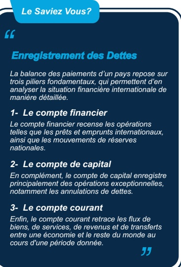

<!-- page 19 -->

# LE SURENDETTEMENT : QUOI COMPRENDRE?

Frison-Roche (2010), dans ses travaux relatifs à la régulation et à la protection des consommateurs définit le surendettlement comme l'ensemble des engagements financiers dépassant la capacité effective de remboursement d'un emprunteur, qu'il s'agisse d'un ménage, d'une entreprise ou d'une nation.

Selon Gathergood (2011), les retards de paiement, le taux de délinquance et le taux de radiation constituent les principaux indicateurs de surentettemment d'un portefeuille de prêts. Le surentettemment s'agrave lorsque le montant des dettes ou encore des passifs accumulés excèdent les revenus dits actifs du débiteur concerné. Il constitue une problématique d'envergure internationale, impactant tant les États que les ménages.

La Banque mondiale, au premier trimestre 2025, a attiré l'attention des États sur les impacts de la dette publique. Elle affirme “qu’entre 2022 et 2024, les économies émergentes ont versé, au titre du service de la dette et des intérêts, 741 milliards de dollars ÉU de plus qu'elles n'ont perçus sous forme de nouveaux financements” (Banque mondiale, 2025).

En effet, dans les “22 pays les plus endettés, la moitié de la population ne bénéficie pas d'un apport alimentaire quotidien suffisant pour garantir sa santé sur le long terme. Ainsi, les impacts sociaux et sanitaires du surendetlement restent significatifs et persistants” (Banque mondiale, 2025).

Ce constat est corroboré par la Conférence des Nations-Unies sur le Commerce et le Développement (CNUCED, 2023), dans un de ses rapports publiés en 2023. Elle confirme que “le risque de surendettement devient significatif lorsque l'État n'est plus en mesure d'honorer ses engagements financiers ou d'assurer le service de sa dette. Le surendettement représente un facteur majeur de crise pour le développement et contribue à creuser les inégalités”.

## Le Saviez Vous?

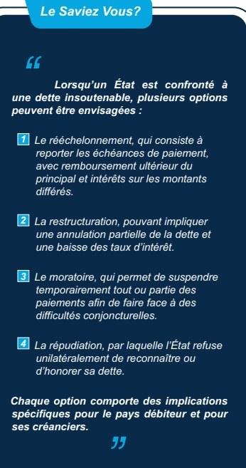

Lorsqu'un État est confronté à une dette insoutenable, plusieurs options peuvent être envisagées :

1 Le rééchelonnement, qui consiste à reporter les échéances de paiement, avec remboursement ultérieur du principal et intérêts sur les montants différés.

2 La restructuration, pouvant impliquer une annulation partielle de la dette et une baisse des taux d'intérêt.

3 Le moratoire, qui permet de suspendre temporairement tout ou partie des paiements afin de faire face à des difficultés conjonctuelles.

4 La répudiation, par laquelle l'État refuse unilatéralement de reconnaître ou d'honorer sa dette.

Chaque option comporte des implications spécifiques pour le pays débiteur et pour ses créanciers.

Selon la Banque de France, en 2023, 121 617 dossiers de surendetlement ont été déposés, marquant une augmentation de 8 % par rapport à l'année précédente. Bien que ce phénomène soit moins développementé dans les pays en développement comme Haïti, il demeure préoccupant, notamment parmi ceux ayant un accès facil au crédit, qui se retrouvent souvent en situation de surendetlement.

<!-- page 20 -->

## LE SURENDETTEMENT : UN PHENOMÈNE RISQUÉ

Les enquêtes conduites, en finance comportementale, par Gathergood, (2011), suggèrent que le surendettlement et le décrochage financier doivent être considérés comme des phénomènes complexes, résultant de l'interaction de plusieurs facteurs psychologiques.

Plutôt que de les réduire à de simples problématiques financières ou structurelles, cette approche met en avant l'importance des variables émotionnelles comme la maîtrise de soi, les biais comportementaux ainsi que le manque d'éducation financière dans les prises de décisions financières déficientes.

D'autres déterminants du surentement sont présentés dans le schéma ci-après.

## Le Saviez Vous?

## ”

La maîtrise de soi est étroitement liée au surendettlement. Les individus présentant une faible capacité d'autocontrole ont tendance à recourir à l'endettement pour répondre à de nouvelles dépenses.

Leur niveau d'endettement s'avère généralement supérieur à la moyenne. En outre, les difficultés de gestion de soi favorisent un usage intensif du crédit à la consommation, facilitant ainsi les achats impulsifs (Gathergood, 2011).

## Figure 4 ::::::

## FACTEURS COMPORTEMENTAUX ET SOCIAUX INFLUENÇANT LE SURENDETTEMENT

## Faiblesse d'éducation financière

■ Mauvaise perception du coût du crédit

■ Frais et pénalités associés

■ Asymétrie d'information

## Surinclusion

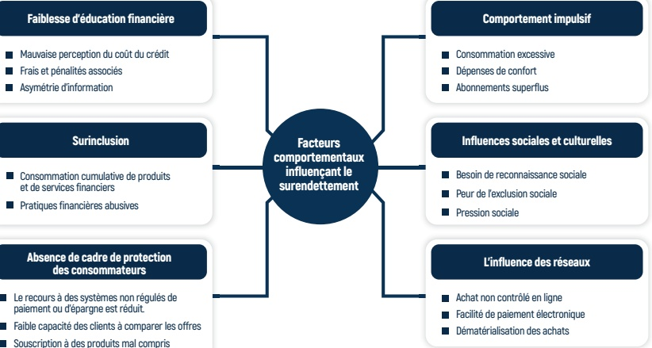

## Comportement impulsif

■ Consommation cumulative de produits et de services financiers

■ Pratiques financières abusives

## Absence de cadre de protection des consommateurs

Le recours à des systèmes non régulés de paiement ou d'épargne est réduit.

Faible capacité des clients à comparer les offres

Souscription à des produits mal compris

Source: Kahneman, 2011

En rapprochant divers faits, Blandine Lemaire et Florence Marc (2019) démontrent que le surendettement provient fréquemment d'une combinaison de facteurs socio-économiques, notamment des chocs de vie (maladie, séparation, perte d'emploi) ainsi que de comportements à risque, comme une utilisation inadaptée du crédit.

<!-- page 21 -->

## SURENDETTEMENT : VERS UN DÉCROCHAGE FINANCIER

Selon l'Alliance pour l'Inclusion Financière (AFI), l'exclusion financière constitue un processus progressif par lequel un individu ou un ménage se retire du système financier formel (AFI, 2020).

Dans cette perspective, Nicolas Gloukoviezoff (2010) précise que la question dépasse celle de l'insolvabilité, s'assimilant à un processus d'exclusion financière. Dans ce cadre, les ménages concernés voient leurs capacités de gestion budgétaire se dégrader graduallyment, en particulier en raison de l'insuffisance d'outils, de compétences ou de dispositifs d'accompagnement adaptés.

Le caractère multidimensionnel du surendettement et du décrochage financier est également abordé dans les travaux de Jean-Michel Servet (2006) et met en lumière une compréhension élargie des difficultés économiques des ménages. Cette perspective souligne la nécessité de prendre en compte l'environnement économique, les conditions d'accès aux services financiers, ainsi que la stabilité des revenus, afin de mieux comprendre et prévenir les situations de surendettement et de décrochage financier.

Ainsi, le surendettlement peut être analysé sous deux angles majeurs : le surendettlement actif et le surendettlement passif. Cette distinction, largement utilisée dans la littérature, permet de mieux comprendre les facteurs qui conduisent les ménages à perdre le contrôle de leur situation financière.

Figure 5

TYPE DE SURENDETTEMENT

## Le surendettement passif

Le surendettement passif est associé à des facteurs exogènes, c'est-à-dire à des événements qui ne sont pas directement causés par l'emprunteur. Il peut s'agir, par exemple, d'un déplacement forcé dû à la situation sécuritéaire entraînant la location d'un nouveau logement dans une autre zone, d'une perte d'emploi liée à un rationnement économique, d'une invalidité provoquée par une maladie, du décès du conjoint, ou encore d'un changement défavorable de la conjoncture économique.

## Le surendettement actif

Le surendettement actif est lié à des facteurs endogènes, Il s'agit d'un processus décisionnel mis en place par le ménage lui-même, mais qui peut créer par la suite un dysfonctionnement financier. Il est souvent provoqué par une accumulation excessive de crédits sans tenir compte d'une capacité réelle de remboursement.

## Source: Gathergood, 2012

Ce phénomène, qu'il soit volontaire ou involontaire, trouve principalement son origine dans les obstacles rencontrés dans l'accessibilité aux établissements financiers, la difficulté d'élaborer une planification financière adaptée, de gérer efficacement ses dettes ou d'honorer ses engagements financiers de manière constante, ainsi que dans la capacité à épargner en raison des situations de crise. L'accumulation de ces effets peut conduire à une exclusion progressive, entraînant un risque de surentement, d'insolvabilité et de décrochage financier.

<!-- page 22 -->

## SURENDETTEMENT ACTIF OU PASSIF : QUELLES TENDANCES EN HAITI ?

Tout au début de la crise, les données de l'Enquête FinScope 2018 des consommateurs ont montré que 33 % des ménages haïtiens rencontraient déjà régulièrement des difficultés dans la maîtrise de leurs finances.

Selon l'enquête FinScope, MPME 2023, 89 % des 660 000 MPME (s) recensées opèrent dans le secteur informel, 83 % n'empruntent pas dans le secteur formel et 97 % d'entre elles n'utilisent aucun produit d'assurance. Leur forte informalité combinée à une prédominance des transactions en espèces, non seulement, restreint considérablement leur accès au crédit institutionnel, mais aussi complique la mesure exacte du surendettlement actif de ces entreprises. L'absence d'historique de données sur les opérations financières traditionnelles entrave toute tentative de quantification exhaustive des risques financiers et de solvabilité pour les 89 % des MPME haïtiennes.

L'évaluation conduite en mars 2025 relative à la Circulaire 115-6 portant sur l'application des moratoires et des dispositifs de restructuration de certains prêts par la BRH fournit des indicateurs pertinents concernant les relations entre les facteurs exogènes et les tendances de remboursement observées au niveau du secteur financier. En Haïti, le surendettlement passif est alimenté par des vulnérabilités structurelles profondes dont certaines sont énumérées ci-dessous.

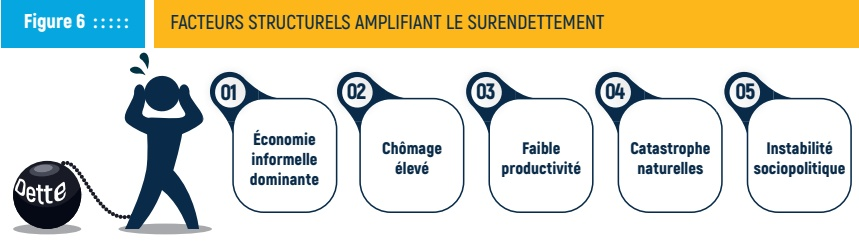

Source: BRH, 2025

Aux vulnérabilités structurelles peuvent s'ajouter des comportements à risque, tels que l'utilisation non planifiée de crédit ou encore la sous-estimation des coûts réels de remboursement cachés par l'informalité. Comme le souligne Servet (2006), la combinaison de fragilités économiques et de décisions financières mal informées crée un terreau fertile pour le surendettlement.

L'activation des deux mécanismes de la circulaire 115-6 illustre la mise en œuvre concrète de dispositifs de contrôle et de gestion du surendettemement préventifs, visant à réduire la pression financière immédiate sur les ménages et les entreprises évoluant dans un contexte particulièrement marqué par une faible capacité de résilience. Ainsi, le surendettemement en Haïti ne résulte pas uniquement de certains choix individuels non maîtrés mais aussi de certaines contraintes structurelles.

<!-- page 23 -->

# QUAND LA BRH PRÉCONISE DES SOLUTIONS PRÉVENTIVES

Selon la Banque des Règlements Internationaux (2009, 2017, 2021), la crise des subprimes de 2008 met en évidence que l'endettement des ménages ne se limite pas à un phénomène microéconomique. En effet, un niveau élevé d'endettement peut ralentir la demande globale, entraînant un effet négatif sur l'offre globale avec des effets remanents sur la croissance. Cette interaction souligne l'importance d'une surveillance accrue et d'une gestion prudente de l'endettement des ménages pour préserver la stabilité macroéconomique.

Dans plusieurs pays, comme la France par exemple, des institutions spécialisées telles que les commissions de surendetlement accompagnent les ménages en difficulté financière. Dans ce cadre, des conseillers financiers et des experts en gestion budgétaire offrent un accompagnement continu aux clients afin de les aider à surmonter leurs difficultés économiques. En fonction de la situation du débiteur, celui-ci peut être amené à effectuer un dépôt de dossier de surendetlement (Banque de France, 2023).

Dans une démarche préventive, la BRH adopte une posture macroprudentielle en prenant tout un ensemble de dispositifs et de mesures visant tous à favo-

## Le Saviez Vous?

## “

Les dettes publiques sont généralement établies dans le cadre d'un accord tenant compte de plusieurs paramètres :

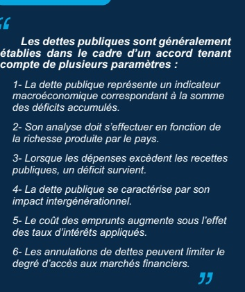

1- La dette publique représente un indicateur macroéconomique correspondant à la somme des déficits accumulés.

2- Son analyse doit s'effectuer en fonction de la richesse produite par le pays.

3- Lorsque les dépenses excèdent les recettes publiques, un déficit survient.

4- La dette publique se caractérise par son impact intergénérationnel.

5- Le coût des emprunts augmente sous l'effet des taux d'intérêts appliqués.

6- Les annulations de dettes peuvent limiter le

degré d'accès aux marchés financiers.

riser la crédibilité macroéconomique, préserver l'intégrité et la stabilité du système financier. Certaines de ces mesures sont résumées ci-dessous.

## Tableau 1 : : : :

## BRH : des solutions préventives

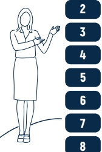

Mise en place d'un protocole d'accord sur la gestion de trésorerie de l'État (Cash management) entre la BRH et le MEF.

Maintien des réserves nationales à un niveau suffisant et adoption d'une régulation préventive rigoureuse.

Imposition et application strictes des instruments macro-prudentiels.

Vulgarisation de certains instruments financiers (encadrement du crédit pro-croissance, bons BRH, etc.).

Offre de solutions de restructuration et de moratoires.

Gestion de la surliquidité dans le système financier.

Mise en place d'une structure informationnelle sur le crédit.

Promotion de l'éducation financière.

Source : Rapports internes de la BRH, dossiers du FMI

<!-- page 24 -->

# BRH : DES DISPOSITIFS AUX MESURES PRÉVENTIVES

Dans un souci de transparence, pour renforcer la confiance des ménages et réduire l'incertitude, la BRH publie des mesures macro-prudentielles et des informations sur les réserves nationales. Cette démarche vise à prévenir le surendettlement et à préserver la résilience financière des ménages.

## 1 Adoption d'un cadre de gestion du numéraire (Cash Management) entre la Banque Centrale et l'État haïtien

L'adoption du cadre de gestion de la trésorerie vise à assurer une gestion plus efficiente des ressources publiques ainsi que la dette à court terme. Ce dispositif favorise la transparence et la reddition de comptes dans la gestion des finances publiques. Il permet d'améliorer la coordination des flux financiers de l'État, de renforcer la gestion des de la trésorerie publique et d'optimiser l'utilisation des ressources publiques ainsi budgétaires (BRH,2017).

## 2 Maintenir les réserves nationales à un taux conséquent et adopter une régulation préventive stricte

Au mois de juillet 2025, les réserves de change brutes détenues par la Banque de la République d'Haïti (BRH) dépassaient 3,1 milliards de dollars américains. Ce niveau de réserves témoigne de la solidité du système financier national et de la capacité de la BRH à préserver la stabilité monétaire du pays, même dans un contexte économique marqué par des défis importants (FMI, 2025).

## 3 Imposition et application stricte des instruments macro-prudentiels

Les exigences minimales en matière de fonds propres sont stipulées par la circulaire 88-1. Cette réglementation impose le maintien d'un niveau de capital adapté à la nature des activités exercées et au niveau de risque associé et à absorber d'éventuelles pertes.

Les règles relatives au contrôle interne, telles que précisées dans la circulaire 89-3, ainsi que la surveillance consolidée instituée par la circulaire 92-1. Ces circulaires facilitent l'identification rapide des vulnérabilités et assurent le respect des exigences réglementaires.

La gestion du risque de change et la concentration des risques de crédit sont régies par la circulaire 81-6 et la circulaire 83-5. Ces dispositifs réglementaires visent à limiter l'exposition des établissements aux variations monétaires ainsi qu'aux risques découlant d'une concentration excessive des crédits octroyés.

La classification des prêts est gérée à travers la Circulaire 87. Les normes de transmission des états financiers sont présentées dans la circulaire 93 et la divulgation des taux dans la circulaire 109-1.

<!-- page 25 -->

## 4 Mise en place de mécanismes financiers innovants (Obligations BRH)

Les obligations de la Banque de la République d'Haïti (BRH) sont des instruments financiers émis par la Banque centrale afin de réguler la liquidité dans le système financier, de maîtriser l'inflation et d'orienter la politique monétaire.

Elles permettent également d'offrir aux institutions financières et aux investisseurs un placement sûr, à rendement fixe, avec un taux d'intérêt annuel de 7 %, tout en contribuant au maintien de la stabilité du système financier national.

Outre les dispositions mentionnées précédemment, la Banque se réserve la possibilité de mettre en œuvre, selon l'évolution de la situation économique, des instruments supplémentaires de politique monétaire destinés à préserver l'intégrité et la stabilité du système. Les mesures correspondantes sont détaillées ci-après.

## 5 Offre de solutions de restructuration et de Moratoires

D’après le rapport émis par la Direction de la Supervision des Banques et des Institutions Financières concernant la répartition des moratoires accordés, 43 % des moratoires consentis portent sur une période comprise entre 9 et 12 mois, représentant ainsi la proportion la plus importante. Par ailleurs, 31 % concernent des durées de 3 à 5 mois, tandis que 26 % couvrent une période de 6 à 8 mois, au deuxième trimestre 2025.

En outre, des dispositifs complémentaires ont été instaurés afin d'offrir aux clients la possibilité de renégocier la restructuration de leurs prêts auprès des institutions financières. Ces mesures visent à fournir un accompagnement adapté aux emprunteurs en difficulté et à leur permettre d'ajuster les modalités de remboursement en fonction de leur situation financière.

L'obligation est faite aux institutions financières d'accorder un moratoire à tout débiteur du système qui souhaite en bénéficier, tant pour les prêts accordés aux particuliers que pour ceux octroyés aux entreprises (circulaire, 115-6).

## 6 Mise en place des gardes-fous macroprudentiels

Lorsque vous avez une dette sur une carte de crédit, vous êtes généralement tenu de payer l'équivalent de 1/24 du montant total dû, ce que l'on appelle généralement le "Minimum à payer". Cependant, des intérêts seront ajoutés sur le montant restant. Le taux d'intérêt des cartes de crédit peut varier entre 40 % et 58 % par an, selon la carte et la société émettrice.

En plus de cela, des frais supplémentaires peuvent être appliqués, tels que des frais de retard, des frais de dépassement de limite autorisée, etc. Il est donc important de bien comprendre les conditions de votre carte pour prévenir l'accumulation de frais pouvant être évités.

<!-- page 26 -->

## La gestion de la surliquidité financière dans le système financier

L'excès de liquidité dans le système financier peut engendrer des retombées négatives sur l'économie, telles que l'inflation, la dépréciation de la monnaie nationale et la baisse soudaine des taux d'intérêt. Une gestion réaliste de la liquidité dans le système rend les banques plus sélectives dans l'octroi de crédits, restreignant les prêts oisifs aux entreprises et aux ménages.

Comme indiqué ci-dessus, les mesures préventives peuvent se présenter sous différentes formes. Les obligations définies ci-après constituent une partie intégrante de l'offre. Toute omission, exécution partielle ou non-respect des circulaires émises est considérée comme une infraction à la réglementation. De telles infractions peuvent entraîner l'application de sanctions administratives ou disciplinaires, conformément aux dispositions prévues par la réglementation assurée par la BRH.

## 8 Offre de produits financiers alternatifs (Obligations)

Dans le contexte des efforts des autorités visant à préserver la valeur interne et externe de la monnaie nationale, il est essentiel de proposer une solution financière alternative visant à permettre aux agents économiques de se proteger contre la dépréciation de la gourde, tout en encourageant les institutions financières à diversifier leur portefeuille de produits financiers.

Les Obligations BRH sont un produit financier offert par la Banque de la République d'Haïti (BRH), accessible à tout particulier. Ces obligations peuvent être acquisés par les particuliers à travers les banques commerciales, certaines sociétés d'investissement, et les caisses populaires.

## Caractéristiques des Obligations BRH

Taux d'intérêt : 7 % l'an, fixe, augmenté de la variation du taux moyen d'acquisition bancaire (TMA) de la date d'émission à la date d'échéance (en cas de hausse du taux de change).

Maturité : 91 jours calendaires.

Montant minimal de l'émission : 50 000,00 gourdes. Possibilité de renouvellement.

Dans ce même objectif préventif, dans les pays occidentaux, plusieurs bureaux de crédit privés comme Equifax, Experian et TransUnion recueillent et gèrent des informations financières sur les entreprises et les particuliers. Ils établissent des scores basés sur l'historique des paiements, la fréquence des demandes de crédit, le taux d'utilisation du crédit, ainsi que l'historique des paiements de loyers, entre autres critères, afin de limiter le surendettement. Ces scores servent non seulement aux institutions financières pour sélectionner leurs clients, mais sont également utilisés par certains employeurs dans le cadre de leur processus de recrutement. (CPF, 2024).

<!-- page 27 -->

# BRH : UNE STRUCTURE INFORMATIONNELLE SUR LE CRÉDIT RENFORCÉE EST MISE EN PLACE

En 2018, la Banque continue d'innover, dans le pays, en renforçant sa structure informationnelle, à travers la mise en place du Bureau d'Information sur le Crédit (BIC), destiné aux institutions financières. Ce dispositif a pour objectif principal de réduire l'asymétrie informationnelle dans le secteur financier et faciliter une supervision plus proactive du régulateur fondée sur des données pertinentes.

En effet, “la disponibilité en information favorise une meilleure transparence, réduit les risques d'octroi excessif de crédit, encourage une discipline financière durable et permet aux emprunteurs responsables d'accéder à de meilleures conditions de financement” (BRH, 2018).

Le schéma présenté ci-dessous résume les principaux éléments constitutifs de la mission du BIC.

## LES MISSIONS DU BUREAU D'INFORMATION SUR LE CRÉDIT (BIC)

## Figure 7 : : : : :

## Fournir une vision exhaustive de l'endettement et de l'historique de remboursement

Il s'agit d'établir un diagnostic financier complet en analysant :

l'ensemble des dettes (montants, taux d'intérêt, échéances);

le comportement de remboursement passé (retards, incidents).

## 2

## Lutter efficacement contre le surenbetement

Mise en place d'une stratégie intégrée de lutte contre le surendettement qui combine la prévention et l'intervention précoce :

Mécanismes d'alerte sur les clients qui ont un historique de crédit douteux.

## 3

## Favoriser la transparence et une meilleure relation avec les institutions financières

Stimuler l'accroissement du portefeuille de crédit.

Eliminer l'asymétrie d'informations sur les clients.

■ Faciliter le développement de nouveaux produits et services financiers.

## Participer à l'intégrité et la stabilité du système financier

## 4

Faciliter une gestion proactive des informations.

Favoriser une prise de décision plus prudente.

■ Limiter les comportements à risque et réduire les probabilités de surendettlement massif dans le système.

<!-- page 28 -->

## LE BIC : UN PILIER DE SYMÉTRIE ET D'INCLUSION FINANCIÈRE

L'organigramme ci-dessous expose de façon structurée les trois services principaux du BIC, ainsi que leurs responsabilités associées. Ce modèle a été conçu pour optimiser la compréhension des différentes finalités du BIC, ainsi que les relations organisationnelles entre chacune de ses fonctions.

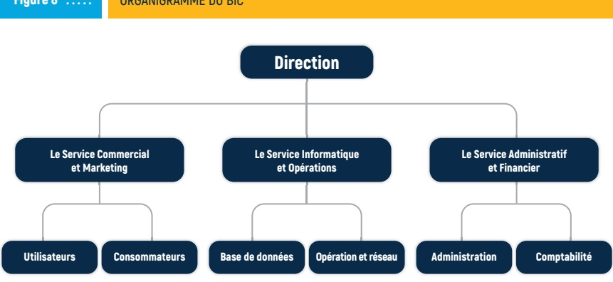

Source: BRH - BIC, 2025

Afin de faciliter une bonne circulation des informations, chaque service occupe un rôle spécifique dans la collecte, le contrôle, le traitement, le chargement et la transmission des données, ainsi que dans l'appui aux institutions. À ce titre, ils contribuent pleinement au double objectif de la BRH dans le domaine :

1- D'une part, d'accompagnement des institutions financières dans l'élaboration et l'évaluation des profils d'emprunteurs, la conception de nouveaux produits et services financiers, ainsi que dans la mise en œuvre d'initiatives visant à limiter la surinclusion.

2- D'autre part, la facilitation offerte aux emprunteurs pour se constituer un historique de crédit fiable contribue à leur permettre de bénéficier de conditions d'emprunt plus adaptées, tout en les protégeant contre le risque de surendettlement.

À travers ce dispositif, la Banque de la République d'Haïti (BRH), en assurant la qualité, la disponibilité et l'accessibilité des informations, contribue pleinement à la réduction de l'asymétrie d'information entre prêteurs et emprunteurs. La disponibilité et la gestion de l'information constitue un élément essentiel au bon fonctionnement du marché du crédit.

<!-- page 29 -->

# LE BIC : DES INDICATEURS QUI COMPTENT

En raison de certaines contraintes techniques, le BIC collecte exclusivement les données financières issues des institutions bancaires et des établissements de microfinance. Après consolidation, ces informations sont accessibles aux institutions sous la forme de rapports de crédit. Selon la BRH, “ces outils offrent aux institutions une meilleure capacité d'analyse des risques liés à l'octroi de crédits et à l'accumulation successive de dettes à partir de données fiables”.

Selon les rapports internes de la Direction de la Supervision des Banques et des Institutions Financières de la BRH, les prêts nets accordés par le système bancaire ont affiché une tendance à la baisse lorsqu'ils sont rapportés au pourcentage des dépôts. En 2022, ce ratio était de 30,77 % ; il a ensuite chuté à 26,06 % en 2023, puis à 21,64 % en 2024 et a atteint 19,80 % en 2025. Cette diminution progressive traduit un recul de la proportion des prêts nets par rapport à l'ensemble des dépôts au fil des cinq dernières années.

Le graphique ci-dessous résume la répartition territoriale des activités de crédit pour les trois (3) dernières années, selon les données du BIC.

Graphe 2 :……:

RÉPARTITION GÉOGRAPHIQUE DES CRÉDITS EN GOURDES AU 30 SEPTEMBRE 2022

Nombre de personnes morales 30 septembre 2022

|   | Value |
| --- | --- |
| Artibonite | 50 |
| Centre | 25 |
| Grand-Anse | 25 |
| Nippes | 25 |
| Nord | 50 |
| Nord-Est | 25 |
| Nord-Ouest | 25 |
| Ouest | 250 |
| Sud | 50 |
| Sud-Est | 25 |

Nombre de personnes physiques 30 septembre 2022

|   | Value |
| --- | --- |
| Artibonite | 5000 |
| Centre | 2500 |
| Grand-Anse | 1500 |
| Nippes | 1000 |
| Nord | 7000 |
| Nord-Est | 2000 |
| Nord-Ouest | 500 |
| Ouest | 75000 |
| Sud | 2500 |
| Sud-Est | 1500 |

Source: BRH-BIC, 2025

<!-- page 30 -->

Les prêts bancaires totalisent 114,87 Md de gourdes en septembre 2025 et représentent 16,3 % de l'actif total, en hausse de 0,3 % par rapport à septembre 2024. Cependant, la part de crédits accordés aux entreprises productives reste très faible par rapport au total des crédits octroyés. Au cours de ces trois dernières années, des mécanismes de restructuration, tels que les moratoires, ont été déclenchés afin de permettre à plus de 250 entreprises débitrices du système de garder la tête hors de l'eau (BRH 2025).

Pour ce qui est de la région du Grand Nord, qui comprend trois départements (Nord, Nord-Est et Nord-Ouest), les données montrent une participation croissante mais encore limitée au marché du crédit. Les parts de crédit en 2022 s'élèvent à 10,87 % en nombre et 4,16 % en volume. En 2023, elles étaient respectivement de 9,61 % et 4,20 %.

Malgré le mouvement progressif de décentralisation vers le Nord, la distribution du crédit se fait de manière prudente. En 2024, l'ensemble des trois départements du Nord ne représente encore que 9,13 % des crédits en nombre et 4,09 % en volume, indiquant un déséquilibre régional graduel, ne considèrent que ces deux grands départements.

Graphe 3 ::::::

RÉPARTITION GÉOGRAPHIQUE DES CRÉDITS EN USD

| Month | Nombre de personnes morales |
| --- | --- |
| Artibonite | 10 |
| Centre | 5 |
| Grand-Anse | 3 |
| Nippes | 2 |
| Nord | 20 |
| Nord-Est | 5 |
| Nord-Ouest | 3 |
| Ouest | 690 |
| Sud | 5 |
| Sud-Est | 3 |

Nombre de personnes physiques au 30 septembre 2024

|   | Value |
| --- | --- |
| Artibonite | 5 |
| Centre | 6 |
| Grand-Anse | 5 |
| Nippes | 7 |
| Nord | 10 |
| Nord-Est | 5 |
| Nord-Ouest | 0 |
| Ouest | 450 |
| Sud | 5 |
| Sud-Est | 5 |

Source: BRH-BIC, 2025

Considérant l'inclusion financière des entreprises, dans le département du Nord, la part des entreprises atteignait 17 % par rapport à celles touchées dans le département de l'Ouest, mais elles ne représentaient que 2,43 % du volume total des crédits. Pour l'ensemble de manière isolée, la proportion en nombre s'établissait à 7,37 %.

<!-- page 31 -->

Selon les enquêtes FinScope MPME 2023, 89 % des MPME (s), dont 48 % dirigées par des femmes, opèrent dans l'informalité et peinent à obtenir une reconnaissance financière faute d'historique de crédit traditionnel. De plus, certaines pratiques internationales, telles que la culture du dépôt de bilan, ne sont pas intégrées dans les usages commerciaux haïtiens.

Des études conduites par la Banque mondiale (2021, 2024), dans certains pays confirment que l'intégration de données alternatives éthiques dans les systèmes d'évaluation du risque de crédit constitue une opportunité favorable pour élargir l'inclusion financière, tout en réduisant le risque de surendettement passif. Parmi celles-ci, les données de réception de transferts internationaux, les reçus de paiement des factures d'eau, d'électricité, de loyers ou encore les paiements de services de télécommunication, les transactions numériques ou les activités informelles, entre autres, sont utilisées pour alimenter un score de solvabilité alternatif. Actuellement, des pratiques exemplaires en matière d'évaluation de la solvabilité des emprunteurs sont mises en œuvre en Afrique et en Amérique latine, notamment au Kenya, au Guatemala et au Brésil.

À côté de la dimension territoriale, l'intégration de l'aspect genre dans l'analyse du crédit constitue un autre moyen pour mieux appréhender les dynamiques d'accès au financement et mieux comprendre les comportements de remboursement entre les femmes et les hommes dans le système financier.

La présentation de l'accès au crédit selon le genre pour les trois dernières années est illustrée dans les graphiques ci-dessous et les tableaux annexés.

| % du nombre de crédit par genre en gourdes | 2022 | 2023 | 2024 |
| --- | --- | --- | --- |
| Homme | 59% | 56% | 56% |
| Femme | 32% | 29% | 29% |

|   | 2022 | 2023 | 2024 |
| --- | --- | --- | --- |
| Homme | 64% | 64% | 64% |
| Femme | 33% | 33% | 33% |

Source: BRH-BIC, 2025

<!-- page 32 -->

Issues de la base de données du Bureau d'Information sur le Crédit (BIC, 2025), les chiffres du graphique 4 mettent en évidence une évolution lente de la structure du marché du crédit au cours de la période 2022-2024. Sur ces trois années, la part des femmes dans l'accès au crédit enregistre d'abord une légère baisse entre 2022 et 2023, avant de connaître une remontée modérée en 2024. Pour cette dernière année, les hommes représentent 65,03 % des emprunteurs, contre 34,97 % pour les femmes, soit un ratio avoisinant deux hommes pour une femme.

RÉPARTITION DES CRÉDITS PAR GENRE DU 30 SEPTEMBRE 2022 - 30 SEPTEMBRE 2024 EN DOLLARS AMÉRICAINS

% du nombre de crédits par genre en dollars américains

| Year | Homme (%) | Femme (%) |
| --- | --- | --- |
| 2022 | 55 | 26 |
| 2023 | 54 | 27 |
| 2024 | 53 | 29 |

% du montant total accordé en dollars américains

|   | 2022 | 2023 | 2024 |
| --- | --- | --- | --- |
| Homme | 64% | 63% | 64% |
| Femme | 19% | 20% | 19% |

Source: BRH-BIC, 2025

Les tendances genrées restent similaires quand on considère les deux monnaies (gourde, dollar). En effet, l'analyse des graphiques ci-dessus indique une segmentation de genre marquée dans l'accès au crédit dans les deux cas.

Bien que l'on observe une légère progression de la part des femmes en 2024, sur le graphique 5, celles-ci ne constituent encore qu'environ un tiers (1/3) des emprunteurs soit 35,73% seulement pour les prêts en dollars. Cette proportion met en évidence la prédominance masculine sur le marché du crédit et souligne la persistance d'énormes contraintes qui freinent l'inclusion financière des femmes. Elle suggère une opportunité pour la définition de nouveaux produits financiers en faveur de ce groupe cible transversal de la SNIF et du PNEF.

<!-- page 33 -->

# LES INDICATEURS D'UNE GESTION PRUDENTIELLE DES RISQUES DE SURENDETTEMENT

L'analyse des données consolidées par le BIC relatives aux paiements permet de toucher plusieurs aspects relatifs au processus de crédit, notamment l'analyse de solvabilité ou des comportements de remboursement des emprunteurs, les différentes étapes liées aux procédures de suivi du crédit ainsi que l'évaluation des risques pour les institutions financières.

L'examen des prêts en retard de 30, 60 et 90 jours présenté dans les graphiques ci-dessous constitue un indicateur pertinent de la qualité du portefeuille de crédit, du niveau de solvabilité des emprunteurs et de la stabilité du système financier à la date indiquée.

Graphe 6 ::::::

RÉPARTITION DES CRÉDITS PAR CATÉGORIE DE PAIEMENT EN DOLLARS AU 30 SEPTEMBRE 2022

Nombre de Comptes

| Category | Value |
| --- | --- |
| A temps | 1000 |
| En retard de 1 a 30 jrs | 150 |
| En retard de 31 a 60 jrs | 20 |
| En retard de 61 a 90 jrs | 30 |
| Plus de 90 jrs | 150 |
| Total | 1450 |

|   | % du nombre de comptes | % du montant accordé |
| --- | --- | --- |
| À temps | 70.00% | 77.00% |
| En retard de 1 a 30 jrs | 12.00% | 10.00% |
| En retard de 31 a 60 jrs | 2.00% | 1.50% |
| En retard de 61 a 90 jrs | 2.00% | 1.50% |
| Plus de 90 jrs | 13.00% | 9.00% |
| Total | 100.00% | 100.00% |

Nombre de comptes en gourdes

| Period | Value |
| --- | --- |
| 30 septembre 2022 | 68000 |
| 30 septembre 2023 | 58000 |
| 30 septembre 2024 | 50000 |

Nombre de comptes en dollars américains

| Period | Value |
| --- | --- |
| 30 septembre 2022 | 1030 |
| 30 septembre 2023 | 1010 |
| 30 septembre 2024 | 860 |

Source: BRH-BIC, 2025

<!-- page 34 -->

Selon les graphiques, l'évolution des indicateurs de remboursement met en évidence des dynamiques contrastées de solvabilité selon les segments de prêts et l'année considérée.

Ils indiquent qu'en 2022, environ 76,80 % des crédits en dollars étaient remboursés à temps. Ce taux s'est amélioré pour atteindre 82,47 % en 2023, malgré une baisse du nombre total de prêts accordés, ce qui traduit une hausse notable du niveau de solvabilité des emprunteurs.

En 2024, le taux se situe à 76,46 %, indiquant un léger repli après la progression observée en 2023, tout en restant cohérent avec la tendance générale de ralentissement des activités économiques et des capacités financières des ménages.

Pour les prêts libellés en gourdes, les performances demeurent globalement stables avec des taux oscillant autour de 66 % pour les trois années. Il est constaté que 66,28 % de remboursements ponctuels en 2022, 67,03 % en 2023, puis 66,16 % en 2024.

Cette constance reflète un segment de clientèle dont la solvabilité évolue plus lentement, possiblement liée à des revenus plus réguliers ou à des critères d'octroi plus rigoureux en raison du contexte de crise.

Graphe 7 ……

RÉPARTITION DES CRÉDITS PAR CATÉGORIE DE PAIEMENT EN GOURDES AU 30 SEPTEMBRE 2023

Nombre de Comptes

| Category | Value |
| --- | --- |
| Á temps | 59000 |
| En retard de 1 a 30 jrs | 22000 |
| En retard de 31 a 60 jrs | 1000 |
| En retard de 61 a 90 jrs | 0 |
| Plus de 90 jrs | 6000 |
| Total | 94000 |

|   | % du nombre de comptes | % du montant accordé |
| --- | --- | --- |
| À temps | 62.00% | 65.00% |
| En retard de 1 à 30 jrs | 23.00% | 17.00% |
| En retard de 31 à 60 jrs | 1.00% | 1.50% |
| En retard de 61 à 90 jrs | 0.20% | 0.30% |
| Plus de 90 jrs | 8.00% | 11.00% |
| Total | 98.00% | 100.00% |

Source: BRH-BIC, 2025

Toutefois, les retards de paiement de plus de 90 jours affichent une tendance à la hausse. Pour les prêts en gourdes, ils passent de 13,80 % en 2022 à 15,24 % en 2024, tandis que pour les prêts en dollars ÉU, ils augmentent de 8,92 % à 13,94 % sur la même période, selon les graphiques ci-dessus.

<!-- page 35 -->

Les données relatives aux emprunteurs en gourdes indiquent une solvabilité nettement plus faible, ainsi qu'une vulnérabilité économique accrue en raison des défis peut-être inhérents à leurs secteurs d'activité. La hausse des retards de 13,80 % à 15,24 % confirme cette tendance et suggère un risque accru de glissement vers le surendettlement.

Graphe 8 ……

RÉPARTITION DES CRÉDITS PAR CATÉGORIE DE PAIEMENT EN GOURDES AU 30 SEPTEMBRE 2024

Nombre de comptes

| Category | Value |
| --- | --- |
| A temps | 50000 |
| En retard de 1 à 30 jours | 21000 |
| En retard de 31 à 60 jours | 1000 |
| En retard de 61 à 90 jours | 500 |
| Plus de 90 jours | 7000 |
| Total | 78000 |

|   | Dark Blue Bar | Light Blue Bar |
| --- | --- | --- |
| Á temps | 62.00% | 65.00% |
| En retard de 1 à 30 jours | 25.00% | 13.00% |
| En retard de 31 à 60 jours | 1.00% | 2.00% |
| En retard de 61 à 90 jours | 0.50% | 2.50% |
| Plus de 90 jours | 9.00% | 15.00% |
| Total | 100.00% | 100.00% |

% du nombre de comptes % du montant accordé

Source: BRH-BIC, 2025

Ces ratios de retard, mentionnés plus haut, sont en cohérence avec les résultats des enquêtes FinScope MPME Haïti 2023, qui avaient déjà mis en évidence une dégradation progressive des ressources financières au niveau de certaines entreprises, détérioration qui, dans certains cas, conduit à l'accumulation d'un surendetlement passif.

En effet, les données de l'étude indiquent que 53 % des activités des micro, petites et moyennes entreprises ont été principalement affectées par l'insécurité. De plus, cette situation a fait l'objet d'une analyse stricte dans le diagnostic sur l'impact de la crise sur le secteur financier réalisé par la BRH à la fin de l'année 2024 ainsi qu'un diagnostic sur la situation des "Madan Saras". Ils révèlent que leur santé financière a été particulièrement modifiée en raison des dépenses imprévues et/ou de l'instabilité marquée des revenus liées à la crise.

Toutefois, conformément à l'esprit de Bâle III, la tendance observée avec les retards de 90 jours invite à adopter une stratégie de gestion renforcée des risques, une transparence accrue et une supervision proactive afin de réduire l'exposition des ménages et de l'économie au risque de surendettement. En cette période de "stagflation", la posture de politique monétaire à la fois de "règle" et "discrétionnaire" adoptée par la BRH vise à limiter ces risques, à favoriser le redressement de la situation et à maintenir la résilience du secteur financier (BRI, 2021).

<!-- page 36 -->

# LA MISE SUR L'ÉDUCATION FINANCIÈRE

Selon les enquêtes FinScope MPME Haïti 2023, plus de 92 % des petites et moyennes entreprises (PME) fonctionnent sans recourir à un système comptable formel. Cette réalité limite la transparence des opérations et complique l'accès à des mécanismes de financement adaptés.

En matière d'exclusion financière, Haïti présente un taux de 46 %. Ce chiffre indique un retard relatif en matière d'inclusion financière, par rapport aux autres pays voisins.

Dans un tel contexte, renforcer la capacité des ménages à mieux s'approprier des concepts financiers, anticiper et gérer leurs engagements financiers devient un enjeu important.

Pour minimiser ces défis, la BRH s'appuie sur l'éducation financière en la positionnant comme un pilier de taille dans le plan d'action de son Plan Stratégique Global (PSG), une nouvelle fois, pour les 3 prochaines années. À côté des mesures macroprudentielles préventives, l'éducation financière s'avère importante pour prévenir les risques d'endettement excessif, en dotant la population haïtienne des connaissances nécessaires pour réagir de manière proactive face aux aléas économiques et à l'utilisation excessive des innovations digitales.

De plus, des actions intégrées et un cadre de coordination ont été mis en place afin de renforcer les connaissances financières et de promouvoir une gestion responsable des ressources.

## DES ACTIONS INTÉGRÉES POUR RENFORCER LES CAPACITÉS FINANCIÈRES

Dans ce contexte, la Banque a lancé plusieurs initiatives visant à soutenir l'éducation financière des ménages. Parmi celles-ci figure une série de capsules thématiques accessibles au public, ayant pour objectif de favoriser l'utilisation des paiements numériques, d'expliquer les concepts financiers fondamentaux, de présenter les obligations BRH ainsi que de diffuser des informations relatives aux différents types d'institutions financières.

Ces actions s'inscrivent dans une stratégie visant à améliorer la santé financière des groupes concernés et à développer un écosystème financier plus résilient. Une population bénéficiant d'une solide éducation économique et financière favorise la solvabilité de la demande, permet une gestion efficace des crédits et contribue à l'amélioration globale de la santé financière (Lusardi, 2008).

Le bulletin trimestriel relatif à la politique monétaire et à la conjoncture économique publié par la Banque offre une source d'informations exhaustive sur l'état des activités macroéconomiques nationales, contribuant de manière significative à éclairer les anticipations des acteurs économiques.

<!-- page 37 -->

# UNE COORDINATION STRUCTURÉE POUR LIMITER LES RISQUES D'ENDETTEMENT

Depuis 2020, la Banque coordonne la mise en œuvre d'un Plan national d'éducation financière (PNEF, 2020), offrant ainsi un cadre d'action structuré à l'ensemble des opérateurs impliqués dans l'éducation financière. Parmi les projets phares figurent notamment, la formation en économie et en finance destinée aux journalistes, déployée à travers son Institut de Formation de la Banque Centrale (IFBC). La confirmation d'une deuxième cohorte, le vendredi 5 décembre 2025, témoigne de la poursuite de cette initiative.

Par ailleurs, les programmes de renforcement des capacités, de gouvernance et d'inclusion financière destinés aux jeunes, et plus particulièrement aux femmes, tels que le programme Booster PME, témoignent de l'engagement de la Banque à soutenir le développement humain et économique de ces groupes cibles

En encourageant le développement des compétences et le renforcement des capacités financières des bénéficiaires, ces initiatives favorisent l'adoption de meilleures pratiques de gestion budgétaire, l'instauration d'une vie financière plus responsable et une protection adéquate des consommateurs financiers.

Par ailleurs, la banque a établi des partenariats avec divers acteurs de l'écosystème afin de former un nombre significatif de jeunes dans le domaine de la digitalisation, ce qui contribue à renforcer les activités financières numériques. Une attention particulière est

## ”

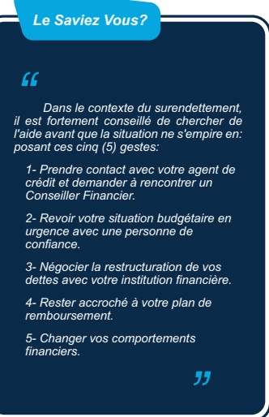

Dans le contexte du surendettlement, il est fortement conseillé de chercher de l'aide avant que la situation ne s'empire en: posant ces cinq (5) gestes:

1- Prendre contact avec votre agent de crédit et demander à rencontrer un Conseiller Financier.

2- Revoir votre situation budgétaire en urgence avec une personne de confiance.

3- Négocier la restructuration de vos dettes avec votre institution financière.

4- Rester accroché à votre plan de remboursement.

5- Changer vos comportements financiers.

accordée à la cybersécurité, considérée comme un enjeu majeur pour optimiser le potentiel de l'inclusion financière digitale.

La mise en œuvre de la Revue RDCCF sur des thématiques spécifiques, ainsi que la publication de la brochure BRH-Infos à la loupe, viennent compléter ces efforts. Ensemble, ces mesures visent à limiter les vulnérabilités financières des groupes cibles en réponse aux fluctuations économiques et à l'évolution des nouvelles pratiques de paiement numérique, tout en agissant comme un complément direct aux mesures de supervision et de régulation de la Banque.

<!-- page 38 -->

# RENDEZ-VOUS DÉCISIONNEL : L'EXPÉRIENCE DE RESTRUCTURATION DE CRÉDIT AVEC PÉDRO

L'entreprise agricole de Pédro poursuit ses activités de production malgré la crise. Dans le but de diversifier ses sources de revenus, il a souscrit, en complément de son crédit agricole et de ses dettes liées à ses cartes de crédit, un prêt de transport auprès d'une institution financière collaborant au programme Pro-Croissance, afin de faciliter l'approvisionnement de certains clients.

Cépendant, en raison de minesிறة, il se trouve dans l'incapacité de livrer ses bananes aux hôtels de la côte des Arcadins. Dans un premier temps, Pédro utilise ses autres sources de revenus et son épargne pour compenser, mais sa situation financière se détériore progressivement, entraînant des retards de paiement. Les intérêts s'accumulent, générant une dette passive qui devient rapidement difficile à gérer.

Face à cette situation, Pédro éprouve des réticences à se rendre à la banque et évite les appels des agents de crédit. Il perd confiance et constate que plusieurs agriculteurs de son entourage ont connu des difficultés similaires. Lors du forum, du 4 octobre 2025 sur la digitalisation des paiements et équité de genre organisé par la BRH, il prend connaissance du programme de restructuration de dettes et des moratoires mis en place pour atténuer les conséquences de l'insécurité. Après réflexion, Pédro décide de rencontrer son institution de crédit.

L'équipe analyse sa situation, étudie ses revenus réels ainsi que son potentiel de production, et conclut qu'il est surendetté, mais demeure solvable sous réserve d'un accompagnement adapté. Pour le soulager, les solutions suivantes lui ont été proposées :

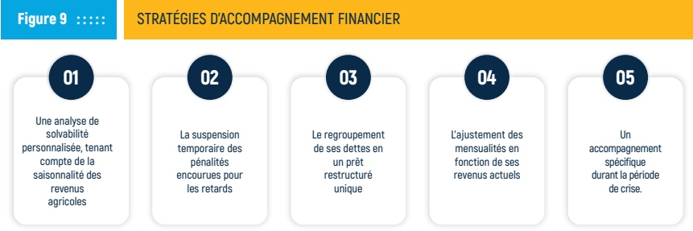

Source: BRH, 2025

Pédro valide les conditions et procède à la signature des documents afférents. Ayant ainsi renforcé son autonomie financière, il envisage l'établissement de nouveaux objectifs, tant financiers que non financiers.

<!-- page 39 -->

## RENDEZ-VOUS DÉCISIONNEL : STRATÉGIES DE PRÉVENTION CONTRE LE SURENDETTEMENT AVEC PÉDRO

Deux mois après son expérience, Pédro a choisi de sensibiliser les entrepreneurs agricoles à l'importance de collaborer avec leurs institutions financières. Il s'est engagé dans l'éducation financière pour accompagner ses pairs, conformément à la stratégie développementée ci-dessous. Selon Pédro, le parcours ci-après offre des solutions adaptables aux besoins spécifiques et aux contextes individuels.

Figure 10 ::::::

## STRATÉGIES DE PRÉVENTION CONTRE LE SURENDETTEMENT

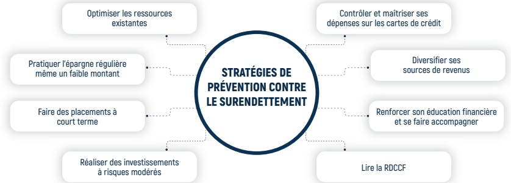

Source: BRH, 2025

## Optimiser les ressources existantes :

Faire un budget mensuel clair, identifier les dépenses essentielles et supprimer les dépenses inutiles ou répétitives. Comparer les prix avant tout achat important. Utiliser les biens et services déjà disponibles avant d'en acheter de nouveaux.

## Pratiquer de l'épargne régulière même un faible montant :

## Limiter l'utilisation les cartes de crédit :

Mettre de côté au moins 5 % du revenu, ou même de petites sommes (2000 à 5000 HTG par mois). Utiliser les Fintechs de Paiements ou les IF(s) agréés de manière disciplinée pour épargner

Se limiter à une seule carte, avec une limite raisonnable. Payer la carte en totalité chaque mois pour éviter les intérêts. Ne pas utiliser la carte pour financer un « train de vie », mais seulement pour des dépenses planifiées.

## Éviter les crédits à taux élevés :

Éviter d'emprunter chez les usuriers (kout ponya) et de contracter des crédits cumulatifs non productifs. Toujours demander le taux réel, les frais cachés et le coût total du crédit. Comparer plusieurs offres avant de s'engager.

<!-- page 40 -->

## Faire des placements à court terme :

Une fois un certain montant atteint (50 000 gourdes), placer l'épargne dans des outils sûrs : obligations, dépôts à terme, etc.

## Renforcer son éducation financière et se faire accompagner :

Consulter les capsules d'éducation financière proposées par la BRH, les CEC, les banques, les IMF et les organisations locales, etc. Consulter le BIC pour suivre son historique de crédit. Chercher un accompagnement avant que la situation ne devienne critique.

## Réaliser des investissements à moyen risque :

Investir uniquement dans des activités génératrices de revenus (artisanat, services, activités secondaires). Éviter les investissements spéculatifs ou non maîtrisés (notamment les systèmes de Ponzi). Toujours vérifier sa capacité avant d'emprunter pour investir.

## Lire régulièrement la RDCCF :

Chaque volume propose un ensemble d'outils conçus pour mieux identifier certains pièges financiers, corriger des biais émotionnels et adopter des pratiques recommandées. Il est conseillé de transmettre les connaissances acquises au sein du cercle familial afin d'éviter la répétition des erreurs et de favoriser un environnement d'utilisateurs avertis.

Compte tenu de l'augmentation des risques d'endettement passif, il est essentiel de mettre en œuvre des stratégies de prévention adaptées afin d'aider les ménages et les entreprises à adopter une gestion financière plus rigoureuse et mieux anticiper leurs engagements.

L'histoire de Pédro montre que le surendettlement n'est pas toujours le résultat d'une mauvaise gestion et ne constitue pas une fin en soi. Avec des mécanismes adaptés tels que la prise en charge, la restructuration de crédit, les moratoires, l'éducation financière, etc. un ménage ou une entreprise en détresse financière, peut retrouver la solvabilité, renforcer sa santé financière et contribuer à l'économie.

Pour une réhabilitation rapide, Pédro propose à ses pairs de célébrer l'année des coopératives en devenant membre d'une CEC avec un plan de sauvetage en 4 étapes :

## LE CHEMIN DE LA RÉHABILITATION FINANCIÈRE

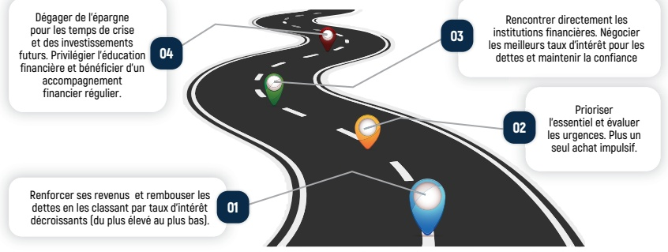

Source: BRH, 2025

<!-- page 41 -->

# RENDEZ-VOUS DÉCISIONNEL AVEC BÉATRICE : QUAND L'INCLUSION FINANCIÈRE SE CONFOND AVEC LA SURINCLUSION

Béatrice a toujours été considérée comme une femme forte. Jeune professionnelle du secteur de la santé avec un historique de crédit confortablement créé. Comme beaucoup de femmes haïtiennes, elle portait seule une grande partie des responsabilités domestiques et financières.

Pendant des années, elle avait réussi à maintenir l'équilibre grâce à son salaire et ses rentes provenant de sa résidence acquise dans le cadre du programme de logement

10-10-20 de la BRH. Mais un jour, cet équilibre commence à faiblir non pas à cause d'un mauvais investissement, mais d'une succession de choix guidés par la pression sociale et le désir d'offrir le meilleur à ses deux (2) enfants.

Comme plusieurs d'entre nous, Béatrice se laisse séduire par l'accessibilité des produits financiers. Elle va se retrouver avec deux (2) cartes de crédit obtenues facilement grâce à ses antécédents de crédit, deux (2) prêts de consommation contractés dans deux (2) institutions financières pour faire face à certaines urgences, un (1) loyer élevé dans un quartier huppé, choisi en raison de la proximité avec ses amies. De plus, elle doit consentir des frais scolaires importants pour offrir à ses enfants une éducation privée comme ses nouveaux voisins le font pour les leurs. Les restaurants deviennent tout à coup son lieu de prédilection après le travail. Son plafond de dettes va sauter avec les cadeaux des fêtes de fin d'année. La figure ci-dessous résume les mécanismes de surendettemen de Béatrice.

Figure 12 : : : : :

COMPRENDRE LE COMPORTEMENT DE BÉATRICE

## La pression sociale comme moteur de décision

Béatrice agit moins pour répondre à des besoins réels que pour éviter le jugement social. Le manque d'éducation financière, la disponibilité accrue des produits financiers, certains biais émotionnels et une pression sociale forte sur les femmes pour qu'elles « assurent » coûte que coûte deviennent un déclencheur de surendettlement.

Source: BRH - BIC, 2025

## La consommation ostentatoire comme stratégie d'acceptation

Ses choix majeurs, déménager dans un quartier huppé, inscrire ses enfants dans une école internationale, acheter une voiture «de standing», relèvent d'une logique de statut : paraître aux yeux des autres pour « appartenir » au "bon groupe social". Le manque de maîtrise de soi qui pousse à vivre au-dessus de ses moyens favorise le décrochage financier.

## Le biais de confirmation

Béatrice se persuade qu'elle doit vivre comme ses collègues, ignorant les signaux d'alerte : retards en cascade sur le paiement des cartes de crédit, multiples lettres de rappel des institutions de microcrédits, salaire déjà hypothéquéel. Elle ne retient que les informations qui confortent l'illusion d'un train de vie soutenable.

Béatrice, à l'instar de nombreuses femmes, a tendance à conserver ses difficultés personnelles. Cette attitude a eu des répercussions significatives sur sa performance professionnelle et sa gestion du stress émotionnel. Par crainte d'être jugée par son entourage, elle éprouve un sentiment de honte et se trouve progressivement en difficulté.

<!-- page 42 -->

# RENDEZ-VOUS DÉCISIONNEL : BÉATRICE FACE À LA SURINCLUSION

Le taux d'inflation de 23 % a fait exploser son budget. Les remboursements commencent à s'accumuler, des retards sur ses cartes de crédit deviennent fréquents, des frais de pénalité font grossir sa dette. Elle reçoit des rappels de paiements émanant des institutions financières, parfois à caractère contraignant.

Après des lettres de rappel, la réalité que Béatrice repoussait depuis des mois s'impose avec violence.

Figure 13 .....

LE DÉSENCHANTEMENT DE BÉATRICE

## Le réveil fut brutal lorsqu'elle reçoit

## Les dettes sont généralement conclues dans le cadre d'un accord précisant plusieurs éléments :

La durée, qui définit l'échéance à laquelle le montant de la dette doit être remboursé ;

L'échéancier de remboursement, les prêts pouvant être amortis de différentes manières, par exemple selon un capital constant avec intérêts ou autres modalités ;

La devise exprimant la monnaie dans laquelle la dette est contractée ;

Le taux d'intérêt, généralement exprimé en pourcentage du montant emprunté ;

5 Les frais annexes et charges de services, tels que les frais d'étude de dossier ;

Les conditions applicables en cas de litige ou de défaut de paiement, ainsi que la signature des deux parties concernées.

Un avis d'expulsion pour

loyer impayé

Source: BRH, 2025

Une convocation du directeur d'école pour arriérés

Une lettre de ses institutions financières pour surendettement avéré

En effet, dans ce contexte, un facteur de l'équilibre financier de Béatrice restait constant : ses sources de revenus demeuraient inchangées malgré l'inflation, la hausse des dépenses et la pression sociale liée à l'apparence. Elle avait négligé le fait que sa capacité financière était limitée, ses ressources étant principalement dédiées aux besoins essentiels, toute fluctuation était susceptible d'affecter son équilibre budgétaire.

<!-- page 43 -->

Sa réhabilitation financière s'amorce enfin, lors d'une séance de sensibilisation contre le diabète, elle fait la connaissance de Pédro qui lui parle de son programme d'éducation financière en gestion du surendettemement destiné aux entrepreneurs du secteur agricole ainsi que la possibilité de restructurer ses dettes avec l'aide de son institution financière. Elle comprend alors que son problème n'était pas individuel, mais systémique.

Elle accepte de se faire accompagner par ses institutions financières. Ce qui lui permet de mettre fin progressivement à ses deux (2) cartes de crédit, de restructurer ses prêts, de reprendre son budget réaliste, de se reloger chez sa maman et de réinscrire ses enfants dans leur ancienne école plus adaptée à ses moyens en attendant de remonter la pente et reprendre ses habitudes d'épargne.

Selon les études menées par la BRI (2017, 2021) sur l'endettement des ménages, il est important de souligner que la surinclusion financière peut comporter des risques aussi significatifs que l'exclusion. En effet, une expansion trop rapide ou excessive du crédit aux ménages accroît la probabilité de défauts de paiement généralisés. Dans ce contexte, les dispositifs de régulation du crédit ciblant spécifiquement les ménages apparaissent tout aussi pertinents et préventifs que les mesures de contrôle appliquées à l'ensemble du système de crédit.

<!-- page 44 -->

# RENDEZ-VOUS DÉCISIONNEL : AU-DELÀ DES APPARENCES !

## MESSAGE DE BÉATRICE ET DE PÉDRO AUX LECTEURS :

Une dette fait partie d'une histoire de vie. Productive et utilisée judicieusement, elle permet d'investir, de se former, de développer une entreprise ou d'acquérir des actifs. Toutefois, une compréhension insuffisante des indicateurs du service de la dette (taux d'intérêt composés, pénalités ou coûts réels du crédit) peut nuire à la fois à la santé financière et à l'équilibre émotionnel de l'emprunteur.

Les expériences de réhabilitation financière de Pedro et de Béatrice permettent de tirer plusieurs enseignements, dont certains sont exposés ci-après.

Figure 14 ::::::

## LEÇONS APPRISES DE BÉATRICE ET DE PÉDRO

## 01

## Les leçons apprises

Le surendettement ne se limite pas à une problématique financière. Il comporte aussi une dimension émotionnelle

## 02

Parallèlement au

remboursement d'une dette, il

faut s'efforcer à épargner.

Choisir des placements sûrs

tels que des obligations BRH,

des CDD, etc.

## 03

Ne jamais négliger les petits montants.

La richesse se construit dans la rigueur, la discipline et la régularité

Source: BRH, 2025

Une gestion financière efficace exige que le traitement de la dette dépasse le simple remboursement des engagements. Il s'agit d'instaurer une discipline rigoureuse et constante, essentielle pour gagner la confiance et atteindre l'indépendance financière.

Béatrice témoigne : “Auparavant, mes dépenses étaient principalement orientées vers l'apparence de riches-se. Désormais, je privilégie une épargne régulière, même modeste, ce qui me procure davantage de liberté financière que les dépenses axées sur l'image”.

<!-- page 45 -->

## CONCLUSION

Le présent volume V de la RDCCF, publié en juin 2026, recense certains instruments d'endettement ainsi que leurs mécanismes associés. Il rappelle les principales étapes dans la gestion de la dette et contribue à l'élaboration de certaines bonnes pratiques adaptées aux enjeux structurels, ainsi qu'à la diversité des situations observées.

Les études élaborées par la Banque mondiale et le FMI offrent un éclairage sur la réalité contrastée de l'endettement national. Grâce à ces travaux, il a été possible d'identifier les spécificités du contexte haïtien et de mieux comprendre les dynamiques qui sous-tendent notre situation. Par ailleurs, le cadre théorique développé par Servet (2006) insiste sur l'importance d'une information financière adéquate, en soulignant que la qualité et la disponibilité de l'information constituent des facteurs clés pour limiter les risques de surendettemen, en particulier au sein des populations économiquement vulnérables comme la nôtre.

L'analyse des données fournies par le BIC, relative au credit en Haiti, met en évidence le rôle crucial de la réduction de l'asymétrie de l'information à la fois dans l'évaluation de la solvabilité des emprunteurs et dans le suivi des opérations de crédit. Cette réduction de l'asymétrie contribue à une meilleure gestion des risques et à l'amélioration des processus d'octroi et de suivi du crédit. Toutefois, l'interaction entre des facteurs structurels tels que l'instabilité socio-économique, l'accès limité au crédit formel ainsi que des comportements individuels expose de nombreux ménages à une précarité financière passive, caractérisée par des cycles d'endettement jusqu'là maîtrisables grâce aux mécanismes de contrôle existants.

Les expériences concrètes de Pedro et Béatrice illustrent de manière explicite le processus par lequel la combinaison de variables macroéconomiques et de comportements personnels peut engendrer des situations financières complexes. Ces cas mettent en lumière les mécanismes qui conduisent certains ménages à s'enliser dans des spirales d'endettement, soulignant ainsi la nécessité d'une compréhension approfondie des facteurs à l'origine de ces difficultés pour un accompagnement adéquat au moment opportun.

Les différentes mesures préventives mises en avant par la BRH, fondées sur le développement de l'éducation financière, la réduction de l'asymétrie de l'information financière, la mise en place d'une régulation adaptée et le renforcement de l'accès aux outils formels de crédit, représentent le moyen le plus efficace pour améliorer durablement la santé financière des populations vulnérables. Cette démarche vise également à favoriser la construction d'un écosystème économique résilient et inclusif en Haïti, capable de répondre aux défis posés par la vulnérabilité économique et le surendettement.

Selon la BRI, la prévention et le traitement du surendettement requièrent une approche intégrée visant à instaurer un écosystème financier solide. Dans ce cadre, il convient d'assurer la solvabilité, l'information et la protection des emprunteurs face aux risques liés au surendettemment. Par ailleurs, un dispositif efficace de protection des consommateurs financiers doit garantir la sécurité des utilisateurs contre la surinclusion, encourager l'intégration de données alternatives éthiques dans l'évaluation de la solvabilité, et lutter contre la fraude découlant de l'essor de l'inclusion financière numérique.

<!-- page 46 -->

## BIBLIOGRAPHIE

AFI. (2020). Consumer Protection and Responsible Lending.

Amon, J. (2010). L'éducation financière : Une innovation sociale en plein développement. Futuribles, (361).

Banque de France. (2023). Les grandes lignes du surendettlement en 2023.

Banque de la République d'Haïti. (1997). Circulaire n°87 : Aux banques commerciales et banques d'épargne et de logement.

Banque de la République d'Haïti. (2022). Brochure d'information : Obligations BRH. Banque de la République d'Haïti. (2023). Circulaire 101-4 : Politiques de prévention du surendettement.

Banque des Règlements Internationaux (BRI/BIS). (2009). Household Debt: Implications for Monetary Policy and Financial Stability.

Banque des Règlements Internationaux (BRI/BIS). (2017). Household debt: recent developments and challenges. BIS Quarterly Review.

Banque des Règlements Internationaux (BRI/BIS). (2017). Working Papers No 607 – The real effects of household debt in the short and long run.

Banque des Règlements Internationaux (BRI/BIS). (2021). Household Debt: Implications for Financial Stability and Economic Growth.

Banque Mondiale. (2003). Précis 230 – Initiative PPTE : Accomplissement et perspectives. Banque Mondiale. (2024). The Use of Alternative Data in Credit Risk Assessment: Opportunities, Risks, and Challenges.

Basel Committee on Banking Supervision (BCBS). (2017). Basel III: A global regulatory framework for more resilient banks and banking systems.

Banca d'Italia. (2022). Alternative Data for Creditworthiness Assessment: Benefits and Regulatory Challenges.

Betti, G., Dourmashkin, N., Rossi, M., & Yin, Y. P. (2007). Financial fragility and credit demand in low-income households. Journal of Economic Surveys, 21(5), 710–730.

Claessens, S., et al. (2014). Macroprudential policies to mitigate financial system vulnerabilities. Journal of International Money and Finance.

Conférence des Nations-Unies sur le Commerce et le Développement (CNUCED). (2002). Rapport relatif au rôle et à l'organisation d'un bureau de la dette. Genève.

<!-- page 47 -->

Consumer Financial Protection Bureau (CFPB). (2024). Credit report and score. Consulté le 12 décembre 2025 sur www.consumerfinance.gov.

Coopératives d'Épargne et de Crédit. (2024). Guides pratiques sur la gestion de la dette et l'épargne. CRESP. (2021). Débiteurs marocains en période de la COVID-19 : Analyse comportementale.

Coulibaly, B. S., & Ndiaye, A. N. (2026). Debt sustainability in Senegal: Challenges and policy options.

Diaz, L., & Ledesma, J. (2011). Microfinance and over-indebtedness in developing economies. World Development Report.

Dujardin, P., & Kiehl, J.-L. (2023). Surendettlement : il est temps de démystifier la procédure. France. Farre-Mensa, J. (2014). Entrepreneurial Finance Lab: Scaling an Innovative Start-up Financing Venture. Harvard Business School Teaching Note 815-064.

Fatoki, O. (2015). Determinants of personal loan default in South Africa. Journal of Social Sciences, 45(2), 85–92.

FinScope Haïti. (2018). Enquête sur l'inclusion financière des ménages haïtiens.

Fonds Monétaire International (FMI). (2022). Global Financial Stability Report: Household Debt and Vulnerability.

Fonds Monétaire International (FMI). (2023). Request for Disbursement under the Rapid Credit Facility – Debt Sustainability Analysis.

Fraselle, N. (1998). Crédit, endettement et surendettlement des ménages. Courrier hebdomadaire du CRISP, 1610(25).

Frison-Roche, M.-A. (2010). Droit de la régulation bancaire et financière. Presses de Sciences Po. Gathergood, J. (2012). Self-control, financial literacy and consumer over-indebtedness. Journal of Economic Psychology, 33(3), 590–602.

Gloukoviezoff, N. (2010). Comprendre l'exclusion bancaire. La Découverte. Kahneman, D. (2011). Thinking, fast and slow. Farrar, Straus and Giroux.

Kaplan, G., & Violante, G. (2022). Micro and Macro Implications of Household Heterogeneity in Macroeconomics. Journal of Economic Perspectives.

Kerrar, F. (2015). Le surendettement des ménages : Causes et solutions. Revue d'économie financière, 118, 223–240.

Lemaire, B., & Marc, F. (2019). Le surendettement des ménages : Enjeux sociaux et économiques. La Découverte.

<!-- page 48 -->

Lusardi, A., & Tufano, P. (2009). Debt literacy, financial experiences, and over-indebtedness. NBER Working Paper No. 14808.

Mian, A., & Sufi, A. (2014). House of Debt. University of Chicago Press.

Organisation Internationale du Travail. (2021). Surendettlement : Les facteurs qui fragilisent les ménages.

Schicks, J., & Rosenberg, R. (2011). The growth of microfinance lending and overindebtedness in developing countries. CGAP Focus Note.

Servet, J.-M. (2006). Banquiers aux pieds nus : La microfinance. Odile Jacob. Stratégie Nationale d'Inclusion Financière. (2014).

Thaler, R. H. (2015). Misbehaving: The making of behavioral economics. W. W. Norton.

Thaler, R. H., & Sunstein, C. R. (2008). Nudge: Improving decisions about health, wealth, and happiness. Yale University Press.

World Bank. (2014). Global Financial Development Report: Financial Inclusion.

World Bank. (2021). Alternative Data Transforming Credit Scoring: A World Bank/IFC Report.

<!-- page 49 -->

## ANNEXE

## % du nombre de crédits par genre en gourde

| Année | Hommes | Femmes |
| --- | --- | --- |
| 2022 | 68,71 % | 38,34 % |
| 2023 | 65,21 % | 34,79 % |
| 2024 | 65,03 % | 34,97 % |

## % du montant total accordé gourde

| Année | Hommes | Femmes |
| --- | --- | --- |
| 2022 | 64,98 % | 35,02 % |
| 2023 | 64,62 % | 35,38 % |
| 2024 | 64,24 % | 35,76 % |

## % du nombre de crédit par genre en dollar américain

| Année | Hommes | Femmes |
| --- | --- | --- |
| 2022 | 66,79 % | 33,21 % |
| 2023 | 65,71 % | 34,29 % |
| 2024 | 64,27 % | 35,73 % |

## % du Montant total accordé en dollar américain

| Année | Hommes | Femmes |
| --- | --- | --- |
| 2022 | 76,24 % | 23,76 % |
| 2023 | 75,02 % | 24,98 % |
| 2024 | 76,55 % | 23,45 % |

## Répartition géographique des crédits en gourde au 30 septembre 2022 : Nombre de personnes morales

| Région | Nombre de personne morale - 30 septembre 2022 |
| --- | --- |
| Artibonite | 37,00 |
| Centre | 15,00 |
| Grand-Anse | 5,00 |
| Nippes | 9,00 |
| Nord | 44,00 |
| Nord-Est | 9,00 |
| Nord-Ouest | 7,00 |
| Ouest | 2521,00 |
| Sud | 30,00 |
| Sud-Est | 22,00 |

## Répartition géographique des crédits en gourde au 30 septembre 2022 : Nombre de personnes physiques

| Région | Nombre de personnes physiques - 30 septembre 2022 |
| --- | --- |
| Artibonite | 6335,00 |
| Centre | 3293,00 |
| Grand-Anse | 1822,00 |
| Nippes | 1891,00 |
| Nord | 8046,00 |
| Nord-Est | 2528,00 |
| Nord-Ouest | 1300,00 |
| Ouest | 76125,00 |
| Sud | 3296,00 |
| Sud-Est | 2382,00 |

<!-- page 50 -->

Répartition géographique des crédits en gourde au 30 septembre 2024 : Nombre de personnes morales.

| Région | Nombre de personne morale - 30 septembre 2024 |
| --- | --- |
| Artibonite | 11,00 |
| Centre | 2,00 |
| Grand-Anse | 0,00 |
| Nippes | 0,00 |
| Nord | 19,00 |
| Nord-Est | 4,00 |
| Nord-Ouest | 1,00 |
| Ouest | 692,00 |
| Sud | 6,00 |
| Sud-Est | 4,00 |

## Répartition géographique des crédits en gourde au 30 septembre 2024 : Nombre de personnes physiques

| Région | Nombre de personnes physiques - 30 septembre 2024 |
| --- | --- |
| Artibonite | 1,00 |
| Centre | 3,00 |
| Grand-Anse | 0,00 |
| Nippes | 0,00 |
| Nord | 9,00 |
| Nord-Est | 1,00 |
| Nord-Ouest | 0,00 |
| Ouest | 455,00 |
| Sud | 3,00 |
| Sud-Est | 1,00 |

RÉPARTITION DES CRÉDITS PAR CATÉGORIE DE PAIEMENT EN DOLLAR AMÉRICAIN AU 30 SEPTEMBRE 2022

| Categorie de paiement | Nombre de compte dollar | % du nombre de compte | % du montant accordé |
| --- | --- | --- | --- |
| À temps | 1039,00 | 70,68 % | 76 % |
| En retard de 1 à 30 jrs | 185,00 | 12,59 % | 12,59 % |
| En retard de 31 à 60 jrs | 31,00 | 2,11 % | 2,11 % |
| En retard de 61 à 90 jrs | 26,00 | 1,77 % | 1,77 % |
| Plus de 90 jrs | 189,00 | 12,86 % | 12,86 % |
| Total | 1470,00 | 100,00 % | 100,00 % |

| Période | Nombre de compte en gourde | Nombre de compte en dollar américain |
| --- | --- | --- |
| 30 septembre 2022 | 68550,00 | 1039,00 |
| 30 septembre 2023 | 61625,00 | 1016,00 |
| 30 septembre 2024 | 50532,00 | 871,00 |

<!-- page 51 -->

## RÉPARTITION DES CRÉDITS PAR CATÉGORIE DE PAIEMENT EN GOURDES AU 30 SEPTEMBRE 2023

| Categorie de paiement | Nombre de compte | % du nombre de compte | % du montant accordé |
| --- | --- | --- | --- |
| À temps | 61625,00 | 64,10 % | 67,03 % |
| En retard de 1 à 30 jrs | 23936,00 | 24,90 % | 18,87 % |
| En retard de 31 à 60 jrs | 1281,00 | 1,33 % | 1,13 % |
| En retard de 61 à 90 jrs | 275,00 | 0,29 % | 0,45 % |
| Plus de 90 jrs | 9018,00 | 9,38 % | 12,52 % |
| Total | 96135,00 | 100,00 % | 100,00 % |

## RÉPARTITION DES CRÉDITS PAR CATÉGORIE DE PAIEMENT EN GOURDES AU 30 SEPTEMBRE 2024

| Categorie de paiement | Nombre de compte | % du nombre de compte | % du montant accorde |
| --- | --- | --- | --- |
| À temps | 50532,00 | 63,25 % | 66,16 % |
| En retard de 1 à 30 jrs | 20775,00 | 26,00 % | 14,07 % |
| En retard de 31 à 60 jrs | 613,00 | 0,77 % | 2,14 % |
| En retard de 61 à 90 jrs | 140,00 | 0,18 % | 2,39 % |
| Plus de 90 jrs | 7832,00 | 9,80 % | 15,24 % |
| Total | 79892,00 | 100,00 % | 100,00 % |

<!-- page 52 -->

<!-- page 53 -->

<!-- page 54 -->

DYNAMIQUE DE LA DETTE ET GESTION DES RISQUES DE SURENDETTEMENT

RDCCF-VOL.V
