<!-- page 1 -->

## FinScøpe

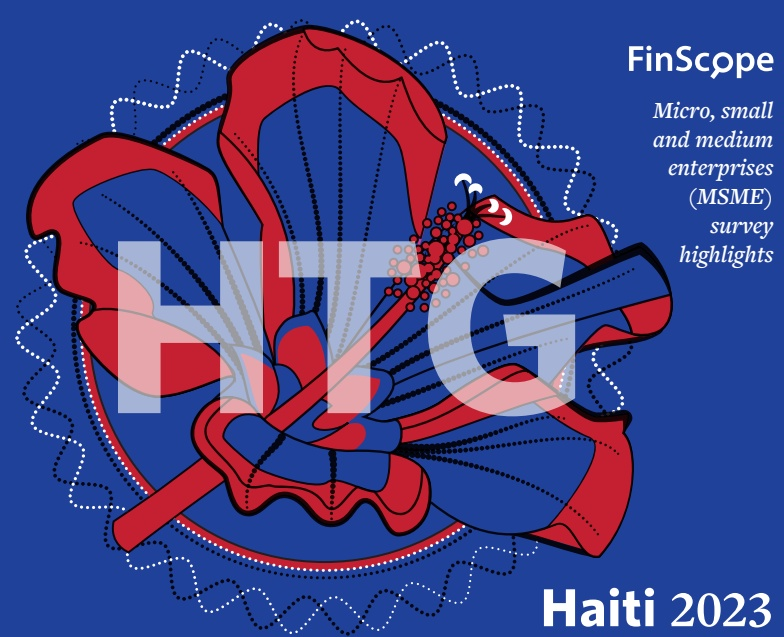

Micro, small and medium enterprises (MSME) survey highlights

Haiti 2023

<!-- page 2 -->

## OVERVIEW

## Partnering for MSME development

FinScope MSME Haiti was designed to involve a range of stakeholders engaging in a comprehensive consultation process. This enriches the survey and ensures appropriateness and stakeholder buy-in. The Bank of the Republic of Haiti chaired the reference group (RG) which comprised of Mennonite Economic Development Associates (MEDA) and Diagnostic & Development Group SA (DDG) with expert technical assistance and project management from FinMark Trust (FMT). The survey was funded by the Bank of the Republic of Haiti and United States Agency for International Development (USAID) through the ATTEINDRE project implemented by MEDA.

## The cover symbol

Through the evidence-based FinScope Survey, we hope to effect real change at country level and see the impact of financial inclusion on broader

national growth and development.

The cover graphic features a flower synonymous to Haiti. The flower symbolizes growth and development while the circle represents inclusive growth. Each flower is an example of the successful growth in a unique environment.

By combining the flower with the currency symbol of Haiti we represent the characteristics of the country, linking financial inclusion with successful growth.

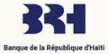

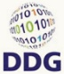

<!-- page 3 -->

## MINISTRY OF ECONOMY AND FINANCE AND BANK OF REPUBLIC OF HAITI – INTRODUCTORY WORDS

The Ministry of Economy and Finance (MEF) and the Bank of the Republic of Haiti (BRH) are delighted to announce the publication of the national survey report on Micro, Small, and Medium Enterprises (MSMEs) titled FinScope MSME Haiti 2023. This essential work was conducted under the direction of the Coordination and Monitoring Committee for the National Financial Inclusion Strategy (CSSNIF).

This initiative was co-financed by the United States Agency for International Development (USAID) and the Government of Haiti. It was spearheaded by the Central Bank of Haiti (BRH) and Mennonite Economic Development Associates (MEDA), the implementor of the USAID-funded ATTEINDRE project. The study was conducted by FinMark Trust, an international firm, in partnership with Diagnostic & Development Group (DDG), a Haitian firm.

We would like to emphasize that this project results from a dynamic collaboration among various national actors brought together in a steering committee that includes representatives from key ministries and public and private institutions, such as the Ministry of Commerce and Industry (MCI) through the Investment Facilitation Center (CFI), the Ministry of Economy and Finance through the General Directorate of Taxes (DGI), the Haitian Institute of Statistics and Informatics (IHSI), the Bank of the Republic of Haiti, the U.S. Agency for International Development (USAID), Mennonite Economic Development Associates (MEDA), Quisqueya University, the Center for Applied Planning and Economics Techniques (CTPEA), the Industrial Development Fund (FDI), Alternative Insurance Company (AIC), Digicel, the Haitian Alliance for Inclusive Finance (AHFI), Groupe Croissance, the Chamber of Commerce and Industry of Haiti (CCIH), and the American Chamber of Commerce in Haiti (AMCHAM Haiti).

The FinScope MSME study provides an in-depth analysis of the profile and situation of Micro, Small, and Medium Enterprises (MSMEs) in Haiti. Through quantitative and qualitative data collected from over 5,000 formal and informal businesses, it is sheds light on recent dynamics, challenges to overcome, and opportunities to seize. These findings aim to inform development strategies, guide investment decisions, and strengthen the framework for supporting MSMEs.

In most developing countries or globally, micro, small, and medium enterprises (MSMEs) represent a significant share of employment. In both developed and developing countries, these enterprises contribute two-thirds of total employment (World Bank, 2019).

In developing countries in particular, small businesses can be a crucial driver of social inclusion, notably by enabling women to participate in economic activities.

<!-- page 4 -->

## MINISTRY OF ECONOMY AND FINANCE AND BANK OF REPUBLIC OF HAITI – INTRODUCTORY WORDS

The vast majority of micro, small, and medium enterprises share certain characteristics, the main ones being labor-intensive production methods and the small size of the business in terms of turnover and employee numbers.

In most countries, small and medium enterprises (SMEs) refer to companies employing between ten (10) and 250 people. Businesses employing fewer than ten people are generally called "micro-enterprises" (WTO, 2016).

In Haiti, although no official definition is adopted, most micro-enterprises are usually considered part of the informal sector. In 1998, the informal sector accounted for 90% of Haiti's labor force (Lumarque, 1998). In 2023, it represented over 70% (Bernardin, 2023), showing its overwhelming dominance in the country's economic landscape.

Furthermore, private employment in Haiti is mainly informal, with more than 90% of the workforce engaged in jobs outside the formal sector's regulatory oversight. In May 1999, it comprised over 85% of all non-agricultural jobs according to a publication by the Haitian Institute of Statistics and Informatics (IHSI), Economic Establishments by Sector – May 1999. In March 2008, the Professional Association of Banks (APB) defined SMEs in Haiti as businesses with between ten (10) and 100 employees, an annual turnover between five (5) and 50 million HTG, and assets of up to a maximum of 50 million HTG.

Given the informal sector's significance in the Haitian economy, certain criteria should be included in an MSME definition:

The company's workforce, indicating the number of jobs created

• The company's assets

• The turnover

## Specific Definitions:

• A micro-enterprise is a formal or informal business that employs up to five (5) people and has an annual turnover not exceeding 2.5 million gourdes.

- A small enterprise is a formal or informal business that employs between five (5) and 20 people, with a turnover or balance exceeding 2.5 million gourdes but not exceeding 20 million gourdes.

• A medium enterprise is a formal business employing between 20 and 100 people with a turnover not exceeding 50 million gourdes.

<!-- page 5 -->

## MINISTRY OF ECONOMY AND FINANCE AND BANK OF REPUBLIC OF HAITI - INTRODUCTORY WORDS

| Business Category | Annual Turnover (HTG) | Number of Employees |
| --- | --- | --- |
| Micro enterprise | Less than 2.5 million | 1 to 5 |
| Small enterprise | 2.5 to 20 million | 5 to 20 |
| Medium enterprise | 20 to 50 million | 20 to 100 |

General Definition: A business is considered an MSME if it meets the following two criteria: a workforce between 1 and 100 employees and an annual turnover of less than 50 million gourdes.

MSMEs, often a source of innovation and diversity in our country, are a fundamental pillar of our economy. They represent a significant share of employment and gross domestic product (GDP). Thanks to their agility, they can quickly respond to fluctuations in our context.

However, MSMEs face significant challenges such as governance issues, access to financing, limitations in financial education, increased competition, and the need for digital transformation. Moreover, it is crucial to consider gender disparities that affect women entrepreneurs' access to resources and opportunities. In this context, data collection is essential to foster financial inclusion, ensuring that businesses led by both women and men have equitable access to the necessary tools for success. We firmly believe that supporting this sector is crucial for strategic decision-making to stimulate economic growth, encourage innovation, and promote socio-economic inclusion. By implementing suitable policies and creating an enabling environment, we can allow MSMEs to innovate and thrive, thus contributing to building a more resilient and inclusive economy.

We believe that this report will serve as a reference tool for policymakers, financial sector actors, technical institutions, and all national economic agents. May its findings inspire and strengthen your commitment to MSMEs, the true engines of our economy. Together, let us build a prosperous future where these businesses thrive and energize our economy!

<!-- page 6 -->

M. Alfred Fils Metellus

Minister of Economy and

Finance (MEF)

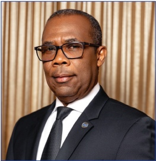

M. Ronald Gabriel

Governor of the Bank of the

Republic of Haiti (BRH)

Port-au-Prince, October 7, 2024

<!-- page 7 -->

## Introduction

The MSME sector is recognized as a significant contributor to economic growth, development and mass employment. With this knowledge, the crucial role of MSMEs in the national economy anchors on the roles of government, the business community and the public at large to harness and optimize the sector's development. The lack of recent, holistic and reliable information about the MSME sector was identified to be a significant barrier from past consumer surveys. It is in this pursuit that the Bank of the Republic of Haiti initiated the first FinScope survey to set a baseline of both sector developments and financial inclusion.

## Methodology

The FinScope MSME Survey Haiti 2022 was conducted with a sample of 5310 adult business owners who were selected from their businesses and at household level across the country. The sampling frame and data weighting was done by a sampling expert in consultation with FMT and had the following characteristics:

Business owners are 15 years or older

Business owners consider themselves to be business owners/generating an income through small business activities

## Survey objectives

Businesses employ less than 251 employees

• National, regional and urban/rural representative sample

To assess the size and scope of micro, small, and medium enterprises (MSMEs) in Haiti

To describe the levels and landscape of access to financial products and services (both formal and informal)

- To identify the most binding constraints to MSMEs development and growth with a focus on access to markets

To support evidence-based policy and provide reliable baseline for monitoring and evaluation of initiatives and contribution to critical studies on the sector

- To set a baseline of both sector developments and financial inclusion in Haiti using the FinScope MSME Haiti 2023 as a benchmark and to provide an assessment of changes and factors in the future (including possible impacts of future interventions)

To segment the MSME sector into market segments and identify the needs of different segments to stimulate related product innovation

<!-- page 8 -->

## DEPARTMENTS OF HAITI

## Distribution of MSMEs by departments

Artists.

## Artibonite

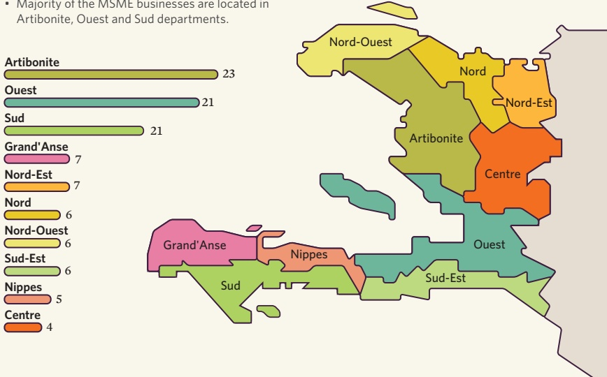

<!-- page 9 -->

Note exchange rate used was as of June 2023 1HTG = 0.0077$

660 845 MSME owners

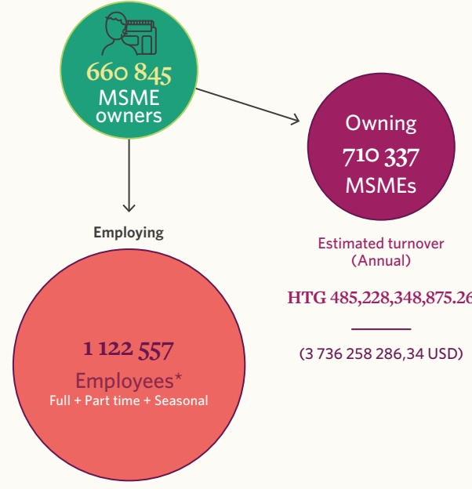

Owning 710 337 MSMEs

1 122 557

Employees $ ^{*} $

Full + Part time + Seasonal

Estimated turnover

(Annual)

HTG 485,228,348,875.26

(3 736 258 286,34 USD)

<!-- page 10 -->

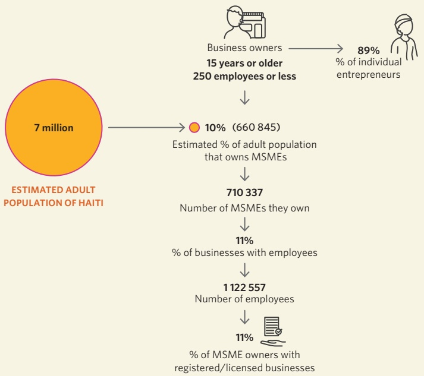

ESTIMATED ADULT POPULATION OF HAITI

% of MSME owners with registered/licensed businesses

<!-- page 11 -->

Turnover less than 0.5 M HTG

MICRO-ENTERPRISE

SMALL ENTERPRISE

Turnover between 0.5 - 2 M HTG

MEDIUM ENTERPRISE

Turnover more than 2 M HTG

71.15%

Micro business

No. of businesses: 505 405

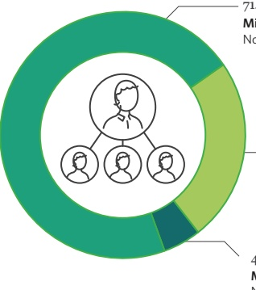

23.90%

Small business

No. of businesses: 169 771

4.95% Medium business

No. of businesses: 35 162

Business definition by the number of employees

Other definitions of MSMEs

Using number of employees

MCI

Using turnover

MCI

DGI

Development and Microfinance Agency

It should be noted that a definition based on the number of employees (micro-enterprise: 1 employee, small enterprise: 2-4 employees, and medium-sized enterprise: more than 4 employees) would give a similar distribution of MSMEs.

<!-- page 12 -->

## BUSINESS SECTOR VIEW

MSMEs operate predominantly in the trade and agriculture sector.

wholesale retail, accommodation, real estate activities.

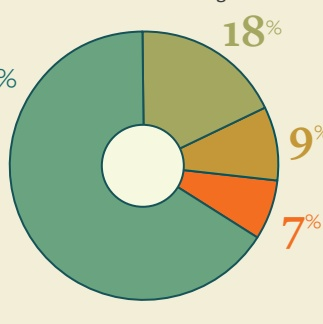

mining, manufacturing, construction, gas supply, agricultural processing.

BUSINESS SECTOR SPLIT (%)

## Service

personal services, education, financial and insurance, professional services.

<!-- page 13 -->

| Sector | Category | Percentage |
| --- | --- | --- |
| Agricultural | FEMALE | 16% |
| Service | FEMALE | 30% |
| Trade | FEMALE | 50% |
| Industrial | FEMALE | 4% |
| Industrial | About 7% of women-owned businesses are formal, majority of these are in the trade sector. | 13% |

|   | 15-24 YEARS | 25-35 YEARS |
| --- | --- | --- |
| Agricultural | 11% | 13% |
| Service | 26% | 34% |
| Trade | 52% | 46% |
| Industrial | 11% | 7% |

<!-- page 14 -->

## SIZE AND SCOPE OF THE MSME SECTOR

## Business life cycle by business age (years)

• Segmenting MSMEs by age is the simplest way to differentiate businesses that are in the process of establishing and formalizing their processes.

• Age is another dimension that can be used as a requirement for funding and business support especially businesses that have survived beyond the 3 years of existence.

BUSINESS AGE

LESS THAN A YEAR

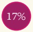

START UP

0 - 2 years

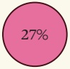

GROWTH 3 - 5 years

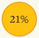

ESTABLISHED

6 - 10 years

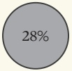

MATURE >10 years

Almost half (49%) of MSMEs in Haiti are established or mature ranging from six years or older.

<!-- page 15 -->

| Category | Value |
| --- | --- |
| 1 | 24% |
| 2 | 11% |

LESS THAN A YEAR

| Category | Value |
| --- | --- |
| STARTUP | 30% |
| PRODUZING | 26% |

START UP

0 - 2 years

| Category | Value |
| --- | --- |
| 1 | 28% |
| 2 | 28% |

GROWTH 3 - 5 years

The proportion of youth business owners tends to decline as the firm ages.

More youth owners in start ups.

| Category | Value |
| --- | --- |
| 1 | 12% |
| 2 | 21% |

ESTABLISHED 6 - 10 years

| Category | Value |
| --- | --- |
| 1 | 6% |
| 2 | 14% |

MATURE >10 years

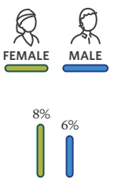

LESS THAN A YEAR

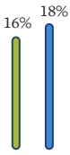

START UP

0 - 2 years

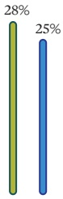

GROWTH 3 - 5 years

| Category | Value |
| --- | --- |
| 1 | 19% |
| 2 | 24% |

ESTABLISHED

6 - 10 years

| Category | Value |
| --- | --- |
| 1 | 29% |
| 2 | 26% |
| 3 | 26% |

MATURE >10 years

<!-- page 16 -->

<!-- page 17 -->

SIZE AND SCOPE OF THE MSME SECTOR

| Category | Percentage (%) |
| --- | --- |
| Red | 60 |
| Grey | 40 |

Majority have secondary education and above

| Category | Percentage |
| --- | --- |
| Degree (under/postgrad) | 12% |
| Diploma | 24% |
| High school | 24% |
| Primary school | 37% |
| No schooling | 3% |

LEVEL OF EDUCATION (%)

Young business owners

(below 35 years)

| Age (%) | Percentage |
| --- | --- |
| 15 - 24 years | 5% |
| 25 - 35 years | 30% |
| 36 - 45 years | 29% |
| 46 - 60 years | 26% |
| 61 years and older | 10% |

Earn less than HTG 30,000 per month from their businesses

| Category | Value | Percentage |
| --- | --- | --- |
| HTG 1-9,999 | 29% |   |
| 10,000-19,999 | 19% |   |
| 20,000-29,999 | 11% |   |
| 30,000-39,999 | 7% |   |
| 40,000-49,999 | 4% |   |
| 50,000-59,999 | 4% |   |
| 60,000-69,999 | 2% |   |
| 70,000-99,999 | 5% |   |
| 100,000-239,000 | 5% |   |
| 240,000 or more | 4% |   |

<!-- page 18 -->

GDP contribution USD 4.2 billion

Formal MSME sector (125 027 businesses)

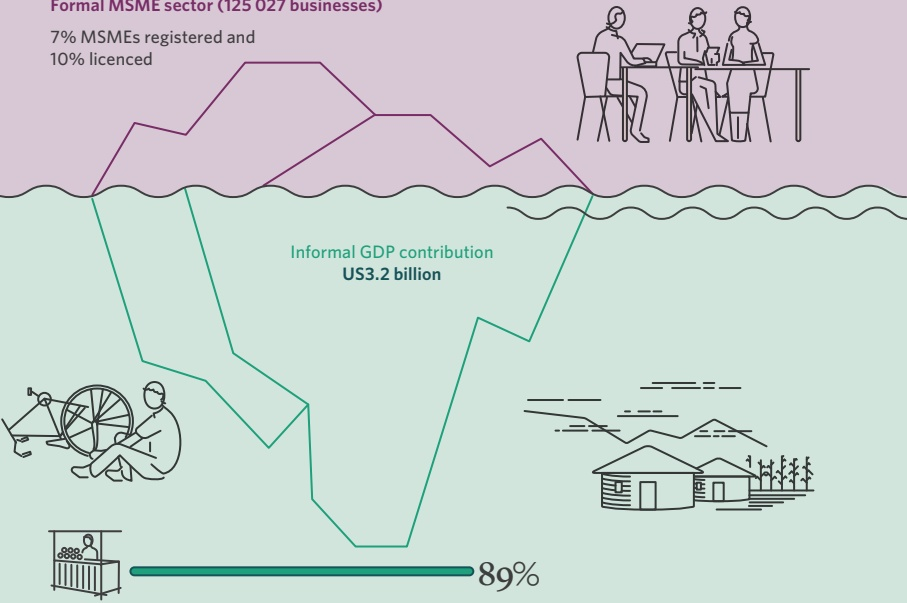

Informal MSME sector (1 016 641 businesses)

<!-- page 19 -->

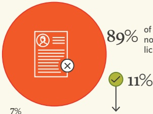

As low as 11% of businesses are formally registered, the majority being informal.

| Company | COMPLIANT WITH: (%) |
| --- | --- |
| CITY HALL | 100.0 |
| MCI | 4.0 |
| DGI | 3.0 |
| MAST | 1.0 |
| MSPP | 1.0 |
| CFI | 0.41 |
| MJSP | 0.39 |
| MPCE | 0.28 |

| Category | Percentage | Business (%) |
| --- | --- | --- |
| Don't know | 42% | 7% |
| Complying with the law | 39% | 7% |
| No benefits | 5% | 2% |
| Access to finance | 3% | 2% |
| Avoid harassment from authorities | 3% | 1% |
| Access to government assistance | 2% | 1% |
| Avoid fines | 1% | 1% |
| Other | 1% | 1% |

| Category | Percentage (%) |
| --- | --- |
| MALE | 17 |
| FEMALE | 7 |
| 15-24 YEARS | 9 |
| 25-35 YEARS | 11 |
| BUSINESS REGISTRATION (%) |   |

| Category | Percentage |
| --- | --- |
| Business is too small | 24% |
| Do not know | 18% |
| Do not have money to register | 16% |
| Too complicated | 13% |
| Do not know how | 9% |
| No benefit | 6% |
| Do not have time | 5% |
| Registration is being processed | 4% |
| Refused to answer | 3% |
| Tried but did not succeed | 2% |
| Avoiding tax | 1% |

## REASONS FOR NOT BEING REGISTERED (%)

- It is clear that MSME owners do not see or understand the benefits of formalizing their businesses.

<!-- page 20 -->

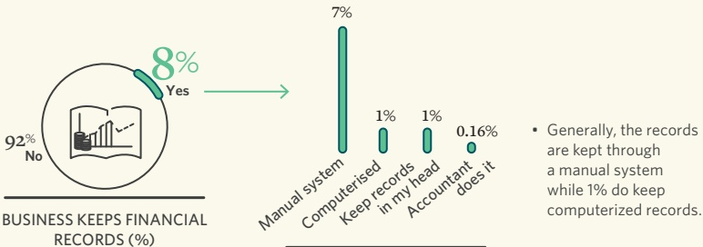

BUSINESS KEEPS FINANCIAL RECORDS (%)

- Generally, the records are kept through a manual system while 1% do keep computerized records.

METHOD OF KEEPING FINANCIAL RECORDS (%)

Business records kept by MSMEs

| Category | Percentage (%) |
| --- | --- |
| Total sales made | 5 |
| Expenses | 5 |
| Income after expenses | 4 |
| Revenue/sales before expenses | 4 |
| Cost of sales | 3 |
| Stock | 3 |
| Debts/debtors | 3 |
| Number of customers | 2 |

<!-- page 21 -->

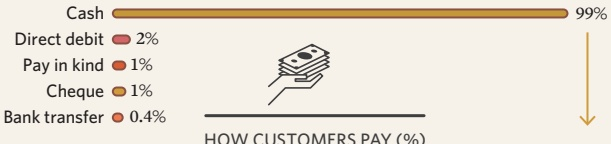

Cash is king!!

Considering the MSME sector is predominantly informal, cash is still the preferred medium of transactions.

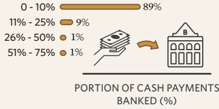

Shareholding and ownership

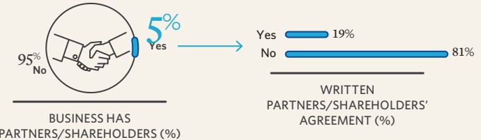

<!-- page 22 -->

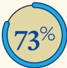

are aware of an organization giving assistance or advice to MSMEs

## AWARENESS OF SUPPORT ORGANISATIONS

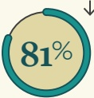

of those aware of an organization giving business support used their service

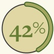

## USAGE OF SUPPORT ORGANIZATIONS IS HIGH

reported that they need skills

## MSMES THAT NEED EMPLOYEES WITH SKILL AND EDUCATION

Therefore, such support is required to transform these MSMEs to realize their potential

| Category | Value (%) |
| --- | --- |
| Loan funding | 46 |
| Business management | 24 |
| Training on business promotion | 8 |
| Budget and forecasting | 8 |
| Productivity improvement | 6 |
| Debt management | 6 |
| Business start-up | 6 |
| Customer relations | 5 |
| Technical training (services, merchandises) | 4 |
| Legislation | 3 |
| Computer training | 2 |
| Digital operations training | 1 |
| Preparing business plan | 1 |

<!-- page 23 -->

| Category | Sourcing money | Cash flow | Financial records. Address informality becomes an urgent priority. |
| --- | --- | --- | --- |
| **Being owed money/debtors** | **2%** | **4%** | **-** |
| Not enough customers | 1% |   |   |
| Finding business premises/space | 1% |   |   |
| Natural disasters | 1% |   |   |
| **A relative from to business** | **7%** | **36%** | **-** |
| Savings | 36% | 12% | Owners generally rely on their savings and informal savings to start the business, mostly needed less than HTG 50,000 to start their businesses. |
| Informal saving group |   | 12% |   |
| Family and friends |   | 7% |   |
| Money from other business | 4% | 3% | Owners generally rely on their savings and informal savings to start the business, mostly needed less than HTG 50,000 to start their businesses. |
| Personal loan | 3% | 3% |   |
| Other money | 3% | 2% |   |
| A relative from diaspora |   | 2% |   |
| Sold assets |   | 2% |   |
| Inheritance | 1% |   |   |
| **SOURCES OF FUNDING TO START A BUSINESS (%)** | **65** | **13** | **65** |

<!-- page 24 -->

## ACCESS TO MARKETS

Who do MSMEs conduct trade with?

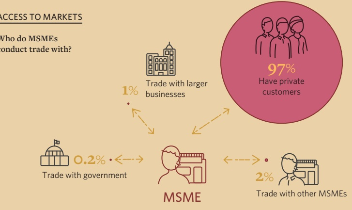

97% Have private customers

Where MSMEs trade from

| Category | Percentage |
| --- | --- |
| Street/pavement | 33% |
| Residential premises | 31% |
| Shopping/trading mall | 9% |
| Farm/small holding | 7% |
| Business park/premises | 6% |
| Stall/table in a designated area | 4% |
| Door to door/visits customers | 3% |
| Office block/park | 1% |

• Most MSMEs are running their operations from the street / pavement while others from residential premises.

<!-- page 25 -->

| Category | Percentage |
| --- | --- |
| Electricity | 8% |
| Toilets outside | 7% |
| Well water | 7% |
| Toilets inside | 4% |
| Storeroom/storage facility | 3% |
| Running water from outside | 1% |
| Running water from inside | 1% |
| Waste storage space | 0.2% |

BUSINESS HAS ACCESS TO THESE AMENITIES (%)

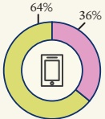

CELL PHONE

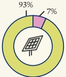

SOLAR PANEL

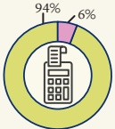

CALCULATOR

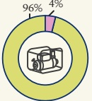

GENERATOR

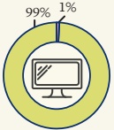

COMPUTER/

LAPTOP

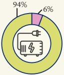

INVERTER

## USE OF COMMUNICATION AND OTHER DEVICES (%)

Use

Do not Use

<!-- page 26 -->

| Category | Percentage (%) |
| --- | --- |
| Significant losses | 14 |
| Some small losses | 46 |
| Not affected | 8 |
| Might close down | 3 |
| GENERAL IMPACT OF COVID-19 (%) |   |
| Reduced | 53 |
| Same as before | 27 |
| Stopped operations | 5 |
| Increased | 2 |

of MSMEs have had losses

attributed to Covid-19, as 53% of

owners reported that the revenue

of their businesses declined.

<!-- page 27 -->

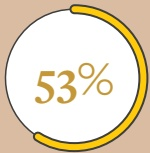

of MSMEs have had losses attributed to the socio-political unrest, and business owners identified threats towards their businesses and personal safety.

| Category | Value |
| --- | --- |
| Significant losses | 15% |
| Some small losses | 38% |
| Not affected | 5% |
| Might close down | 2% |
| Only time will tell | 31% |

IMPACT OF SOCIO-POLITICAL INSECURITY (%)

| Category | Threat level on business | Threat level on owner |
| --- | --- | --- |
| Very high threat | 7% | 4% |
| High threat | 36% | 33% |
| Moderate threat | 19% | 21% |
| Low threat | 15% | 18% |
| Very low threat | 18% | 20% |
| Don't know | 5% | 4% |

THREAT LEVEL ON BUSINESS VS. OWNER (%)

<!-- page 28 -->

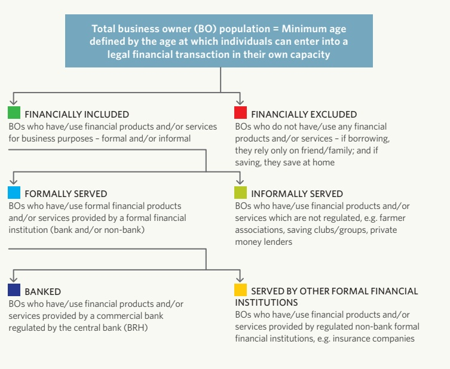

<!-- page 29 -->

Financial inclusion - Haiti MSME owners

| Business Owner | Population | Total Business Owner (BO) | Percentage |
| --- | --- | --- | --- |
| FINANCIALLY INCLUDED | FINANCIALLY EXCLUDED | 70% (464 998) | 70% |
| FORMALLY SERVED | INFORMALLY SERVED | 25% (167 660) | 25% |
| BANKED | SERVED BY OTHER FORMAL (NON-BANK) FINANCIAL INSTITUTIONS | 14% (90 214) | 14% |

'Formal' is a category classifying products or services as regulated or supervised by a formal institution or any other formal regulator/agency. This is also synonymous to 'other formal' or 'other formal (non-bank)' to differentiate it from the banked which are mostly commercial and development banks.

<!-- page 30 -->

## FINANCIAL INCLUSION

Overall levels of financial inclusion, overlaps and MSME Access Strand

Overalls with overlaps

| Category | Percentage |
| --- | --- |
| Formally served | 25% |
| Banked | 14% |
| Other formal (non-bank) | 15% |
| Informal | 58% |
| Excluded | 30% |

• >70% of business owners are financially included.

• Half of the business owners use formal financial products or services—one in four business owners (24%) have/use commercial bank products/services and 47% use other formal (non-bank) products/services.

• High uptake (58%) of informal financial products among business owners.

- 30% of business owners do not use any formal or informal financial products though they may borrow from family and friends or save at home.

Access Strand

| Category | Banked | Other formal (non-bank) | Informal only | Excluded |
| --- | --- | --- | --- | --- |
| 2023 | 14% | 11% | 45% | 30% |

<!-- page 31 -->

Overlaps

| Category | Value (%) |
| --- | --- |
| Banked Only | 5.6 |
| Non Excluded Only | 29.6 |
| Excluded Only | 0 |
| Total Excluded | 4.7 |
| Non Excluded and Excluded | 1.5 |
| Total Non Excluded and Excluded | 1.8 |
| Total Excluded and Excluded | 6.6 |
| Total | 5.1 |
| Non Excluded and Excluded + Excluded | 6.6 |

"Business owners generally use a combination of financial products and services to meet their financial needs"

Only 6% of business owners rely exclusively on banking services.

- Around 14% use a combination of formal and informal mechanisms to manage their financial needs, thus indicating that their needs are not fully met by the formal sector alone.

- 45% of the small business owners ONLY rely on informal mechanisms such as savings groups and loan sharks.

<!-- page 32 -->

## ACCESS STRANDS

Financial inclusion by Department

|   | 1% | 14% | 36% | 49% |
| --- | --- | --- | --- | --- |
| Nord | 18% | 9% | 45% | 28% |
| Centre | 17% | 9% | 33% | 41% |
| Nord-Ouest | 17% | 13% | 47% | 23% |
| Grand'Anse | 16% | 19% | 46% | 19% |
| Ouest | 16% | 11% | 46% | 27% |
| Artibonite | 13% | 14% | 50% | 23% |
| Nord-Est | 13% | 5% | 56% | 26% |
| Sud | 13% | 9% | 33% | 45% |
| Sud-Est | 7% | 14% | 55% | 24% |

Financial inclusion by area

|   | Banked | Other formal (non-bank) | Informal only | Excluded |
| --- | --- | --- | --- | --- |
| Urban | 24% | 9% | 45% | 22% |
| Rural | 8% | 13% | 46% | 33% |

<!-- page 33 -->

Financial inclusion by MSME owner's gender

| Category | Male | Female |
| --- | --- | --- |
| 1 | 22 | 12 |
| 2 | 38 | 28 |
| 3 | 10 | 12 |
| 4 | 48 | 30 |

Financial inclusion by MSME owner's age (focus on the youth)

|   | Other formal (non-bank) | Informal only | Excluded |
| --- | --- | --- | --- |
| 15-24 years | 8% | 10% | 44% |
| 25-35 years | 16% | 12% | 26% |
| 36-45 years | 17% | 13% | 23% |
| 46-60 years | 11% | 11% | 29% |
| 61 and older | 6% | 10% | 51% |

<!-- page 34 -->

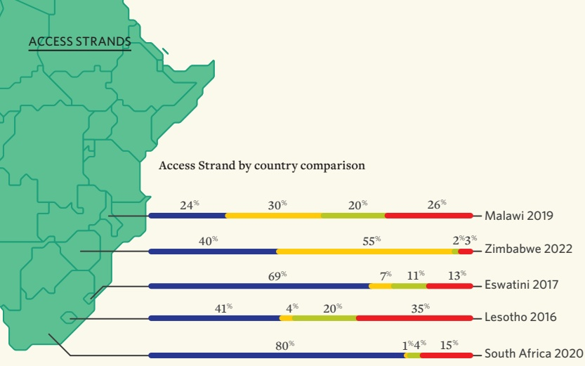

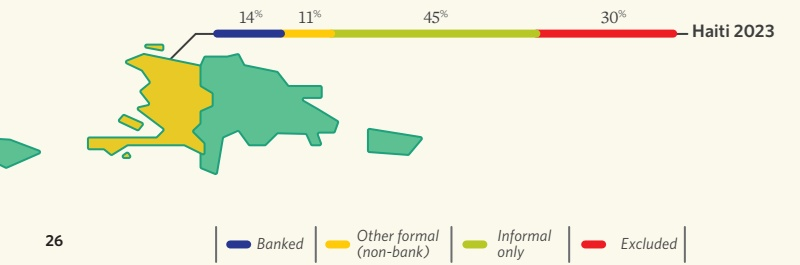

<!-- page 35 -->

Financial inclusion by business life cycle

| Less than a year | 13% | 5% | 47% | 35% |
| --- | --- | --- | --- | --- |
| 1 - 2 years | 15% | 11% | 44% | 30% |
| 3 - 5 years | 14% | 14% | 46% | 26% |
| 6 - 10 years | 14% | 11% | 47% | 28% |
| More than 10 years | 13% | 13% | 43% | 31% |

Financial inclusion by sector

| Sector | Red Segment (%) | Teal Segment (%) |
| --- | --- | --- |
| Industry | 27 | 35 |
| Service | 18 | 28 |
| Trade | 12 | 48 |
| Agriculture | 5 | 41 |

<!-- page 36 -->

Savings Strand

| Category | Percentage |
| --- | --- |
| Savings at bank other formal (non-bank) | 8% |
| Savings in informal sector | 55% |
| Not saving | 36% |

Savings are largely driven by savings group.

• About 63% of business owners are saving.

Only 6% of business owners have/use formal savings products from commercial banks and 8% have savings from other formal non-bank institutions.

• Majority of the business owners save informally (57%), largely driven by savings group.

• 37% of business owners do not save.

<!-- page 37 -->

Savings by gender

| Category | Category Percentage (%) | Male (%) | Female (%) | Savings by age groups (youth) (%) |
| --- | --- | --- | --- | --- |
| Savings at bank (non-bank) | 12 | 25 | 75 | 3-19 years |
| Savings at bank (informal sector) | 8 | 15 | 60 | 25-35 years |
| Savings at bank (other formal) | 8 | 10 | 50 | 35-49 years |
| Savings at bank (informal sector) | 57 | 20 | 45 | 40-49 years |
| Savings at bank (other formal) | 37 | 15 | 35 | 50 years and older |
| Savings in other formal (non-bank) | 3 |   | 10 | 25-35 years |
| Savings in informal sector | 8 | 5 | 15 | 30-44 years |
| Savings in informal sector | 56 | 10 | 20 | 45 years and older |
| Savings in Savings sector | 7 | 3 | 5 | 25-35 years |
| Savings in Savings sector | 48 | 2 | 8 | 30-44 years |
| Savings in Savings sector | 33 | 1 | 4 | 35-44 years |

<!-- page 38 -->

## LANDSCAPE PRODUCTS

Savings Strand by business life cycle

|   | Light Blue | Dark Blue | Yellow | Orange |
| --- | --- | --- | --- | --- |
| Less than a year | 4% | 48% | 44% | 0% |
| 1 - 2 years | 8% | 7% | 52% | 33% |
| 3 - 5 years | 6% | 9% | 51% | 34% |
| 6 - 10 years | 7% | 6% | 51% | 36% |
| More than 10 years | 5% | 10% | 49% | 36% |

Savings Strand by sector

|   | Light Blue | Dark Blue | Yellow |
| --- | --- | --- | --- |
| Industry | 11% | 8% | 47% |
| Service | 9% | 7% | 51% |
| Trade | 4% | 9% | 53% |
| Agriculture | 3% | 8% | 43% |

Savings Strand by region

| Category | Savings at bank (%) | Savings at other formal (non-bank) (%) | Savings at informal sector (%) | Not saving (%) |
| --- | --- | --- | --- | --- |
| Urban | 10 | 8 | 51 | 31 |
| Rural | 4 | 8 | 49 | 39 |

<!-- page 39 -->

Saving Strand drivers to saving and digitized informal savings

| Category | Percentage |
| --- | --- |
| Business expansion | 29% |
| Day-to-day business needs | 29% |
| For the future | 25% |
| Mitigation of natural disaster risks | 24% |
| Acquisition of more businesses | 6% |
| Family education | 4% |
| Mitigation of socio-political crisis | 1% |

DRIVERS FOR SAVING (%)

<!-- page 40 -->

## LANDSCAPE PRODUCTS

The proportion of business owners who have loans from formal institutions is similar for both banking institutions and other formal non-bank institutions at 5%.

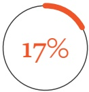

Only 17% of business owners have borrowed in the past 12 months.

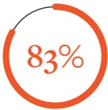

of MSMEs are currently not borrowing with the main barriers being lack of qualification, fear of debt and having no need to borrow.

| Category | Percentage |
| --- | --- |
| Credit from bank | 4% |
| Credit from other formal (non-bank) | 7% |
| Credit from other formal (non-bank) | 4% |
| Credit from other formal (non-bank) | 7% |
| Credit from informal sources | 10% |
| Not borrowing | 88% |

<!-- page 41 -->

Credit Strand by sector

|   | Credit at bank | Credit at other formal (non-bank) | Credit at informal mechanisms | Do not borrow |
| --- | --- | --- | --- | --- |
| Trade | 6% | 14% | 80% | 0% |
| Service | 5% | 10% | 85% | 0% |
| Agriculture | 4% | 11% | 85% | 0% |
| Industry | 4% | 7% | 0% | 89% |

MSMEs in the trade sector are more able to access credit than other sectors even though this is informal credit.

| Reason | Value (%) |
| --- | --- |
| Growing my business | 20 |
| Day-to-day business needs | 9 |
| Start my business | 2 |
| To buy machinery | 1 |
| Personal reasons | 1 |
| I am scared | 18 |
| Do not need to | 17 |
| Business is slow so I am afraid to borrow | 13 |
| I do not believe in borrowing money | 9 |
| Borrowed in the past and paid back | 6 |
| I do not qualify | 3 |
| My earnings change from month to month | 2 |
| I tried but was turned down | 2 |
| I do not have collateral/security | 2 |
| BARRIERS TO CREDIT (%) | DRIVERS FOR USING CREDIT (%) |

<!-- page 42 -->

Insurance and risk management

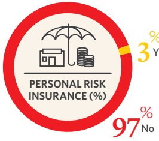

3% Yes

• A lowly 3% of MSMEs have insurance but its mostly covering the owner and not business risks per se!

## TYPES OF PERSONAL INSURANCE (%)

| Category | Percentage |
| --- | --- |
| Personal Risk | 1.4% |
| Health | 1% |
| Portable Risk | 0.62% |
| Other | 0.27% |
| Business | 0.25% |

Insurance uptake by sector

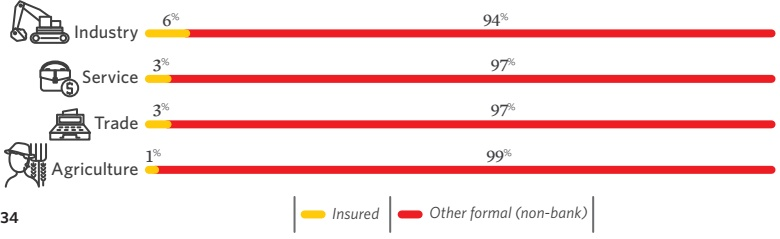

<!-- page 43 -->

Of those borrowing money (17%), saving money (64%), mostly rely on informal savings groups/sabotaj.

Only 3% have insurance

—mostly covering personal risks.

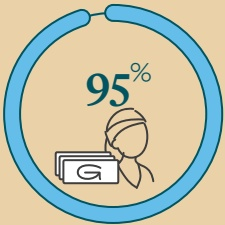

Personal Accounts

= 95% of the

banked businesses.

Opportunity to convert personal accounts to business accounts - to clearly differentiate the two entities.

<!-- page 44 -->

Total MSME sector estimated at 660 thousand businesses employing 1,122 million people:

MSMEs contribute an estimated HTG485 billion to GDP.

• Artibonite (23%) and Ouest (21%) departments respectively have significant number of MSMEs.

• 67% are women-owned businesses.

• 35% are youth-owned businesses (15 - 35 years).

Business formalization—only 11% of the MSMEs are formal, informal MSMEs are devoid of opportunities from government and financial sector.

Covid-19 affected 60% of MSMEs—reported losses due to Covid-19.

Surviving Socio-Political unrests—about 53% of MSMEs reported losses due to the civil unrests.

• Exacerbated due to MSMEs relying on walk-in clients (97%) for business.

Inability to utilize digital platforms also a limitation.

## Financial Inclusion related:

• 14% of the MSMEs are banked.

• 15% are formally served by other formal (non-bank) institutions.

58% are utilizing informal mechanisms.

• 30% are financially excluded.

Majority are cash-dependent (99%)—with some pockets of opportunities as 89% of MSMEs bank portions of cash payments (0-10% of all cash payments received).

Credit and Savings are mostly from the informal savings groups.

• Informal credit is accessed by 13% of MSMEs.

• Informal savings are accessed by 55% of MSMEs.

Insurance is almost non-existent with 3% of MSMEs insured.

Differentiation between personal and business accounts—95% of banked accounts are in name of owner.

<!-- page 45 -->

### 1. Formalization of MSMEs is critical—

1. Formulation of MSMEs is critical—is not just about the fiscus, but about understanding the size of the sector for appropriate government support (e.g. Covid-19 support), proper documentation to access services and financial support, close the information asymmetry.

2. Digitization of payments towards a cash-lite economy—cash has its vulnerabilities, concerted efforts to create a digital ecosystem would assist MSMEs to benefit from its efficiencies and advantages thus enabling them to scale and grow.

3. Access and usage of financial services—access to formal financial services is a clear limitation in Haitian MSME sector, simultaneously understanding which informal mechanisms MSMEs rely on is invaluable.

4. Enhancing business resilience post Covid-19 and Socio-Political Unrest—beyond prevailing challenges, MSMEs will need support and training to develop their entities.

### 5. MSME definition and categorization

is important—setting a common standard to what MSMEs are is an

6. Value proposition for financial service providers via data analytics—with the wealth of data on MSMEs, financial service providers should be incentivized to serve the MSME sector by highlighting the value-proposition for them.

7. Differentiation between personal and business accounts—efforts to transform, differentiate legal and personal entities are key to present data showcasing business transactions, documents and performance.

<!-- page 46 -->

<!-- page 47 -->

<!-- page 48 -->

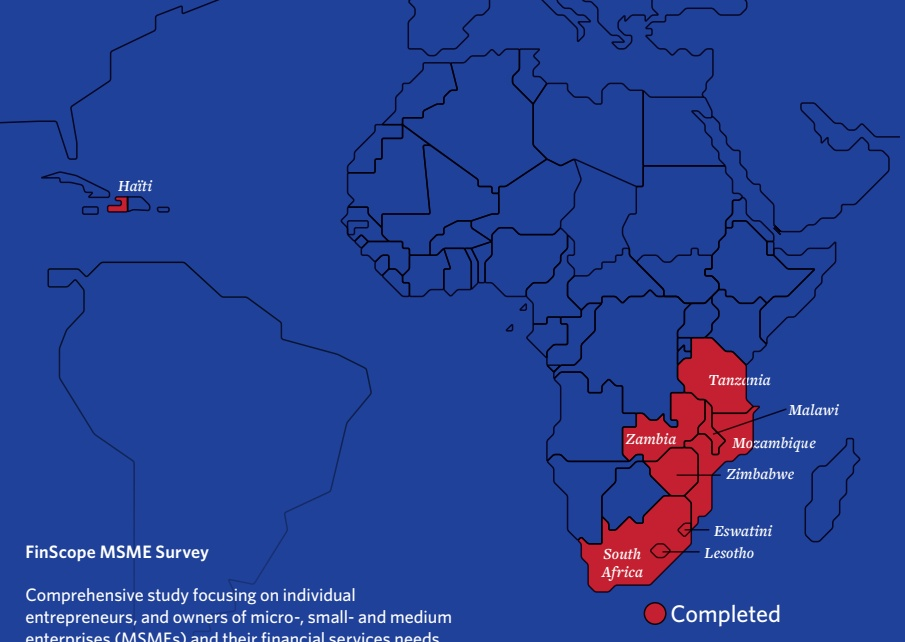

## FinScope MSME Survey

Comprehensive study focusing on individual entrepreneurs, and owners of micro-, small- and medium enterprises (MSMEs) and their financial services needs.

Banque de la Republique

d'Haiti (BRH)

Address: Angle des rues

Pavée et du Quai

Port-au-Prince, Haiti

Tel: +509 2290 0777

/+509 2290 0012

info@brh.ht

www.brh.ht

Ministère du Commerce

et de l'Industrie (MCI)

Address: 64, Rue

Legitime

Port-au-Prince, Haiti

Tel: +509 29 43 4488

www.mci.gouv.ht

Ministère de l'Économie

et des Finances (MEF)

Address: 5, Ave Charles

Summer

Port-au-Prince, Haiti

Tel: +509 25 58 665

www.mef.gouv.ht

USAID Atteindre

(Attain) Project

Implemented by MEDA

atteindre@meda.org

Tel: +509.2940.7070

Dr Kingstone Mutsonziwa

Finmak.org.za

Tel: +27 67 594 9291

kingstonem@finmark.org.za

www.finmark.org.za

Mr Abel Motsomi

Finmak.org.za

Tel: +27 67 594 9291

abelm@finmark.org.za

www.finmark.org.za

Tel: +27 67 594 9291

www.finmark.org.za
