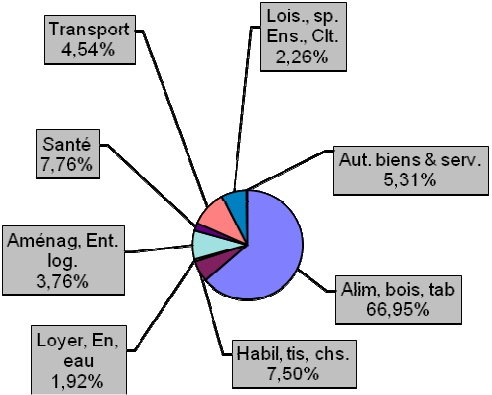

<!-- page 1 -->

Banque de la République d'Haïti

Note mensuelle d'inflation

Avril 2014

<!-- page 2 -->

## Table des matières

Introduction.....2

II.- Principales caractéristiques de l'inflation en avril 2014.....2
1. Evolution de l'inflation courante.....2
2. Evolution des principales contributions des fonctions de consommation à l'inflation.....3
3. Evolution de l'inflation selon l'origine des produits.....4
4. Evolution de l'inflation sous-jacente.....5

III. Facteurs explicatifs de la stagnation de l'inflation en avril .....5

IV.- Prévisions d'inflation .....6

<!-- page 3 -->

### I. - Introduction

Cette note analyse l'évolution des prix à la consommation (IPC) en Haïti au cours du mois d'avril 2014. Elle apporte quelques éléments explicatifs permettant de comprendre les facteurs qui influencent l'évolution de l'inflation ainsi que les prévisions pour les trois prochains mois.

### II. - Principales caractéristiques de l'inflation

L’inflation mensuelle a évolué au même rythme que le mois précédent (0,6%) alors que l’inflation en glissement annuel a crû de 30 points de base à 3,5%. Le poste de consommation « Alimentation, boissons et tabac » a apporté la plus importante contribution à l’inflation tant en variation mensuelle qu’annuelle, soit 66,95 % et 38,9% respectivement. Le taux de croissance de l’Indice des Prix à la Consommation des produits locaux a été identique à celui de l’inflation courante (0,6 % en mars et avril 2014) tandis que l’inflation des produits importés est en hausse de 10 points de base à 0,5 %. Le différentiel d’inflation est défavorable pour le pays comparé à ses principaux partenaires commerciaux (+13 et +30 points de base par rapport à la République Dominicaine et les États-Unis respectivement).

### 1. - Evolution de l'inflation courante

En avril 2014, l'inflation mesurée par la variation de l'indice des prix à la consommation s'est établie à 3,5% en glissement annuel et à 0,6 % en rythme mensuel. En glissement annuel, ce niveau d'inflation marque une hausse des pressions inflationnistes après une stagnation de la variation du niveau général des prix au cours des deux mois précédents (3,2%). En variation mensuelle, l'inflation a stagné à 0,6% en avril 2014 comparativement au mois de février où elle s'est inscrite à 0,3%.

Graphique No. 1 Evolution de l'inflation mensuelle (en %)

| Date | Value |
| --- | --- |
| Apr-13 | 0.3 |
| May-13 | 0.5 |
| Jun-13 | 0.1 |
| Jul-13 | 0.1 |
| Aug-13 | 0.3 |
| Sep-13 | 0.1 |
| Oct-13 | 0.2 |
| Nov-13 | 0.1 |
| Dec-13 | 0.4 |
| Jan-14 | 0.2 |
| Feb-14 | 0.3 |
| Mar-14 | 0.6 |
| Apr-14 | 0.6 |

<!-- page 4 -->

Graphique No. 2 (en %) Evolution de l'inflation annuelle

| Date | Value |
| --- | --- |
| Apr-13 | 7.3 |
| May-13 | 7.3 |
| Jun-13 | 6.5 |
| Jul-13 | 6.2 |
| Aug-13 | 5.5 |
| Sep-13 | 4.5 |
| Oct-13 | 4.2 |
| Nov-13 | 3.4 |
| Dec-13 | 3.4 |
| Jan-14 | 3.4 |
| Feb-14 | 3.2 |
| Mar-14 | 3.2 |
| Apr-14 | 3.5 |

### 2. - Evolution des principales contributions des fonctions de consommation à l'inflation

Les postes ayant le plus contribué à la hausse mensuelle de l'indice des prix à la consommation sont : « Alimentation, boissons et tabac » et « Santé ». Avec une hausse de 10 points de base à 0,8%, la variation mensuelle de l'indice des prix de la fonction de consommation « Alimentation, boissons et tabac », dont le poids est de 50,4% dans le panier de consommation, a contribué à hauteur de 66,95% aux pressions inflationnistes. Pour sa part, l'indice des prix du groupe « Santé », dont la variation mensuelle a enregistré une hausse de 1,1 point de pourcentage à 1,5%, a contribué à l'inflation mensuelle à hauteur de 7,76%, soit la deuxième contribution la plus importante.

En glissement annuel, la contribution du poste de consommation « Alimentation, boissons et tabac » est la plus importante tant par son niveau que par son évolution annuelle à la hausse. Après s'être portée à 2,7 % en avril contre 2,4% le mois précédent, l'inflation alimentaire a contribué à hauteur de 38,9% à l'inflation annuelle, soit une hausse de 1,04 point de pourcentage par rapport à mars 2014.

<!-- page 5 -->

Graphique No. 3 Contribution en % des différents postes de dépenses à l'inflation mensuelle d'Avril 2014

### 3. - Evolution de l'inflation selon l'origine des produits

En rythme mensuel, l'inflation des produits importés a légèrement augmenté de 10 points de base à 0,5% tandis que celle des produits locaux a crû au même rythme que le mois précédent (0,6%). En glissement annuel, l'inflation des produits locaux et celle des produits importés ont été de 3,1% et 3,5% contre 3% et 3,3% en mars 2014.

Graphique No. 4

Evolution de l'inflation des produits locaux et importés (en %)

| Date | Blue Line | Red Line |
| --- | --- | --- |
| Sep-12 | 0.85 | 1.15 |
| Oct-12 | 0.38 | 1.00 |
| Nov-12 | 0.58 | 0.98 |
| Dec-12 | 0.08 | 0.35 |
| Jan-13 | 0.18 | 0.20 |
| Feb-13 | 0.32 | 0.80 |
| Mar-13 | 0.15 | 0.65 |
| Apr-13 | 0.38 | 0.50 |
| May-13 | 0.40 | 0.45 |
| Jun-13 | 0.08 | -0.05 |
| Jul-13 | 0.18 | 0.18 |
| Aug-13 | 0.10 | 0.12 |
| Sep-13 | 0.25 | 0.10 |
| Oct-13 | 0.28 | 0.18 |
| Nov-13 | 0.15 | 0.08 |
| Dec-13 | 0.35 | 0.48 |
| Jan-14 | 0.20 | 0.35 |
| Feb-14 | 0.25 | 0.30 |
| Mar-14 | 0.40 | 0.60 |
| Apr-14 | 0.45 | 0.65 |

Taux de croissance Prix Produits Locaux

Taux de croissance Prix Produits Importés

<!-- page 6 -->

### 4. - Évolution de l'inflation sous-jacente

En variation mensuelle, l'inflation sous-jacente, indicateur important pour la politique monétaire, s'est établie à 0,37 % en avril contre 0,48 % un mois auparavant. En glissement annuel, elle s'est inscrite à 3,82%, soit 35 points de base de plus par rapport à l'inflation courante. En Évoluant à un niveau supérieur à l'inflation globale (3,5 %), cela laisse entrevoir que, des facteurs, autre que ceux conjoncturels, expliquent la variation de l'IPC en avril 2014.

### III. - Facteurs explicatifs de la hausse mensuelle de l'IPC en avril 2014

En avril 2014, l'Indice général des Prix à la Consommation (IPC) a crû de 0,6% mais toutefois sa croissance a été similaire à celle de mars 2014. L'un des facteurs susceptibles d'expliquer la variation de l'IPC en avril est celle de l'Indice des prix du poste « Alimentation, boisson et tabac ». Du côté de l'offre, la disponibilité moindre de l'offre alimentaire, notamment de la récolte de riz, a exercé une pression sur l'indice des prix du poste de consommation « Alimentation, boisson et tabac » ayant la plus forte contribution à l'inflation en avril 2014.

La disponibilité réduite de l'offre alimentaire explique la hausse de l'indice des prix de la fonction de consommation « Alimentation, boissons et tabac » dont le poids représente 50,4% du panier de consommation en Haïti. En effet, la disponibilité moins importante des produits alimentaires trouve son origine dans plusieurs facteurs dont la mauvaise performance de la saison agricole de printemps qui compte pour 25% de la production agricole annuelle.

Le taux de change de la gourde par rapport au dollar, est passé de 44,70 gourdes en mars à 44,99 gourdes en avril 2014 contre 44,35 gourdes en mars 2014. Il en a résulté une baisse du rythme de dépréciation de la valeur de la gourde par rapport au dollar américain à 0.63% en avril 2014 contre 0.81% en mars 2014.

Graphique No. 5 Evolution du taux de change moyen mensuel

| Date | Value |
| --- | --- |
| Apr-13 | 43.34 |
| May-13 | 43.65 |
| Jun-13 | 43.80 |
| Jul-13 | 43.75 |
| Aug-13 | 43.75 |
| Sep-13 | 43.75 |
| Oct-13 | 43.80 |
| Nov-13 | 43.85 |
| Dec-13 | 43.90 |
| Jan-14 | 44.00 |
| Feb-14 | 44.30 |
| Mar-14 | 44.60 |
| Apr-14 | 44.99 |

<!-- page 7 -->

### IV. Prévisions d'inflation

Pour les trois prochains mois de l'exercice 2013-2014, les prévisions d'inflation de la MAE augurent une légère décélération de l'inflation tant en variation mensuelle qu'en glissement annuel. En effet, en variation mensuelle, les prévisions tablent sur des taux de 0,5% en mai, de 0,0% en juin et de 0,1% en juillet. En variation annuelle, l'inflation devrait se chiffrer à 3,3 % en mai 2014, pour augmenter à 3,4 % en juin et en juillet 2014. Ces prévisions d'inflation $ ^{1} $ annuelle demeurent en dessous des taux annuel d'inflation de 5% et de 4,5% programmés pour la fin de l'exercice fiscal 2014.

Il est important de noter que ces prévisions ne prennent pas en compte certains facteurs qui sont susceptibles d'influencer le comportement de l'inflation tels que : l'augmentation des salaires des enseignements et policiers ; l'augmentation imminente des prix des produits pétroliers sur le marché local, l'approche de la saison cyclonique et la performance de la saison agricole de printemps.

<!-- page 8 -->

Tableau No 1 Indice des Prix à la Consommation (IPC) par postes de dépenses Variation et Contribution à l'inflation mensuelle et annuelle En Avril 2014

<table><tr><td></td><td>Indice des Prix à la Consommation (IPC)</td><td>Variation IPC (en %)</td><td>Contribution à l'inflation (en %)</td></tr><tr><td>Mensuelle</td><td>Annuelle</td><td>Mensuelle</td><td>Annuelle</td></tr><tr><td>Poste</td><td>Pondération (en %)</td><td>Mars 14</td><td>Avril 13</td><td>Avril 14</td><td>Avril 14</td><td>Avril 14</td><td>Avril 14</td><td>Avril 14</td></tr><tr><td>Indice Général</td><td>213.5</td><td>207.5</td><td>214.7</td><td>0.6</td><td>3.5</td><td>100</td><td>100</td></tr><tr><td>Alimentation, boisson et tabac</td><td>50.35</td><td>222.3</td><td>218.2</td><td>224</td><td>0.8</td><td>2.7</td><td>66.95</td><td>38.9</td></tr><tr><td>Habillement, tissus et chaus.</td><td>6.86</td><td>206.7</td><td>195.8</td><td>208</td><td>0.6</td><td>6.7</td><td>7.50</td><td>12.4</td></tr><tr><td>Loyer, énergie et eau</td><td>11.05</td><td>251</td><td>239.7</td><td>251.1</td><td>0.1</td><td>4.8</td><td>1.92</td><td>15.3</td></tr><tr><td>Aménag. et entret. du logem</td><td>4.7</td><td>217.1</td><td>210.2</td><td>218.1</td><td>0.5</td><td>3.8</td><td>3.76</td><td>5.1</td></tr><tr><td>Santé</td><td>2.9</td><td>221</td><td>210.9</td><td>224.4</td><td>1.5</td><td>6.4</td><td>7.76</td><td>5.4</td></tr><tr><td>Transport</td><td>13.74</td><td>158</td><td>155.3</td><td>158.3</td><td>0.2</td><td>1.9</td><td>4.54</td><td>7.7</td></tr><tr><td>Lois., sp. Ens., Clt.</td><td>5.84</td><td>224.2</td><td>215.4</td><td>224.7</td><td>0.2</td><td>4.3</td><td>2.26</td><td>7.3</td></tr><tr><td>Aut. biens & serv.</td><td>4.56</td><td>179.3</td><td>170.4</td><td>180.5</td><td>0.7</td><td>5.9</td><td>5.31</td><td>7.9</td></tr></table>

Sources : IHSI et calculs du Service de la Macrééconomie et Analyse de Conjoncture de la MAE

<!-- page 9 -->

## Glossaire

<table><tr><td>Variation mensuelle : Variation par rapport au mois précédent.</td></tr><tr><td>Glissement annuel</td><td>: Variation par rapport au même mois de l'année antérieure.</td></tr><tr><td>Inflation</td><td>: Mouvement persistant à la hausse du niveau général des prix.</td></tr><tr><td>Désinflation</td><td>: Ralentissement de la croissance des prix.</td></tr><tr><td>Déflation</td><td>: Baisse du niveau général des prix associée à une contraction de la masse monétaire et du crédit.</td></tr><tr><td>Inflation sous-jacente : Tendance de long terme des prix, tout en excluant la volatilité, les mouvements saisonniers, conjoncturels, et les chocs qui affectent les composantes du panier considéré.</td></tr><tr><td>Région Nord</td><td>: Elle couvre les départementes du Nord, Nord-Est et Nord-Ouest.</td></tr><tr><td>Région Sud</td><td>: Elle comprend les départementes du Sud de la Grand'Anse et des Nippes.</td></tr><tr><td>Région Reste Ouest : Y sont inclus les départementes du Sud'Est et de l'Ouest à l'exception de l'aire métropolitaine.</td></tr><tr><td>Région Transversale : Elle regroupe les départementes du Centre et de l'Artibonite.</td></tr></table>

Aire Métropolitaine : Elle contient les villes de Port-au-Prince, de Delmas, de Pétion-Ville, de Carrefour et de Croix des Bouquets.
