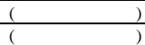

<!-- page 1 -->

# CIRCULAIRE AUX MAISONS DE TRANSFERT

La Banque de la République d'Haïti présente ses compliments aux Maisons de Transfert et a l'avantage de leur faire parvenir un modèle du nouveau rapport qu'elles auront à lui soumettre hebdomadairement, comme il est requis dans la Circulaire BRH/CIR/94 # 37.

La Direction de la Supervision des Banques et Institutions Financières se tiendra à leur disposition pour tout renseignement supplémentaire relatif à ce formulaire.

Port-au-Prince, le 7 septembre 1994

Bonivert Claude

Gouverneur

<!-- page 2 -->

# Banque de la République d'Haïti CIRCULAIRE N° 98

# AUX BANQUES COMMERCIALES, AUX BANQUES D'EPARGNE ET DE LOGEMENT ET AUX MAISONS DE TRANSFERTS

Dans le cadre de ses efforts pour maintenir l'efficience, l'intégrité, la fiabilité des informations et la sécurité du système de paiements aussi bien que pour promouvoir l'inclusion financière, la BRH a décidé d'initier une réforme qui vise à :

• élargir la gamme des instruments et services de paiement ;

• accélérer la dématérialisation de la monnaie et l'inclusion financière ;

promouvoir la décentralisation et la vulgarisation des points de paiement ;

• améliorer les coûts d'exploitation et d'utilisation des liquidités ainsi que l'accès à ces moyens de paiement ;

• renforcer l'interopérabilité des infrastructures bancaires et de paiement ;

mettre en œuvre un régime de surveillance et de réglementation plus appropriée ; et

accroître l'efficiency et la stabilité des services de paiement.

Conformément aux dispositions de la loi du 17 août 1979 créant la Banque de la République d'Haïti, du décret du 14 novembre 1980 règlementant les activités bancaires et du décret du 6 juillet 1989 sur les maisons de transfert, la présente circulaire détermine les conditions d'exécution des transferts de fonds internationaux sur Haïti (entrants et sortants).

### 1. Déclaration de transferts internationaux

Les banques commerciales, les banques d'épargne et de logement et les maisons de transfert sont tenues de communiquer chaque lundi à la BRH, sur support papier, le nombre et le montant total des transferts expédiés à l'étranger et reçus de l'étranger, quelle que soit la forme dans laquelle le bénéficiaire reçoit le transfert (espèces ou nature), conformément au formulaire de déclaration en annexe. Ces institutions sont tenues également de faire parvenir mensuellement à la BRH la copie certifiée conforme des montants déclarés aux régulateurs des territoires sur lesquels elles exercent leurs activités de transfert de fonds.

<!-- page 3 -->

En cas de non respect de la présente section, l'institution concernée s'expose aux pénalités suivantes :

## - Fiabilité de l'information

En tout temps, les montants déclarés dans le formulaire prévu en annexe doivent être ceux apparaissant dans les livres de l'institution ainsi que les déclarations aux régulateurs susvisés. Si les montants ne concordent pas, la BRH peut, après enquête sur les circonstances et la nature de la violation, imposer une pénalité de 50% de la différence entre les montants déclarés et les montants apparaissant dans les livres, sans préjudice des frais d'utilisation dus par l'institution.

En cas de récidive, la BRH appliquera des sanctions pouvant aller jusqu'au retrait de l'autorisation de fonctionnement.

## - Retard dans la soumission des rapports

En cas de retard dans la soumission du formulaire, les institutions concernées encourent une pénalité de dix mille gourdes (HTG 10,000.00) par jour d'infraction. La période de pénalité s'étend du jour où le formulaire aurait dû être transmis à la BRH au jour où celle-ci le reçoit.

Au-delà de huit (8) jours de retard, le montant de la pénalité sera doublé. Au-delà d'un (1) mois de retard, la BRH peut prendre des sanctions pouvant aller jusqu'au retrait de l'autorisation de fonctionnement.

## - Paiement des pénalités

La BRH fera parvenir, par avis avec accusé de réception, aux institutions concernées le montant des pénalités. Les pénalités doivent être réglées par chèque de direction à l'ordre de la Banque de la République d'Haïti dans un délai de huit (8) jours à compter de la date de réception de l'avis.

## - Inspection

Des inspections peuvent avoir lieu à tout moment dans le cadre de la mise en œuvre des présentes.

### 2. Utilisation et frais d'utilisation de la plateforme de paiement de la BRH

Les banques commerciales, les banques d'épargne et de logement et les maisons de transfert sont tenues d'utiliser la plateforme de paiement de la BRH pour le traitement de tous les transferts de fonds internationaux sur Haiti (entrants et sortants). Elles sont tenues également d'offrir à leur clientèle l'option de recevoir les transferts par des instruments de paiement électroniques universellement acceptés.

###### P.O. Box 1570, Port-au-Prince, Haïti. Téléphone: 2299-1244. Fax 2299-1191

<!-- page 4 -->

Les mécanismes d'échange de données, d'exécution, de compensation et de règlement de la plateforme de paiement pour le traitement des transferts internationaux sur Haiti (entrants et sortants) seront édictés par la BRH.

Des frais de test, de certification, d'utilisation et d'inspection de 1.50 USD seront appliqués par transaction pour les services de paiement et d'accès en différents points à travers le pays. Ces frais seront facturés mensuellement et devront être payés avant le 10 de chaque mois par chèque de direction.

Par ailleurs, lesdits frais ne seront pas applicables sur les transferts effectués par les banques pour leur propre compte. Autrement dit, les transferts pour les entreprises et les particuliers sont donc visés par ces frais.

### 3. Interfaces avec la plateforme de la BRH

La BRH fixera par voie de dispositions réglementaires la date limite pour la mise en place des interfaces avec la plateforme de paiement.

La présente circulaire entre en vigueur le 1 $ ^{er} $ juin 2011.

Port-au-Prince, le 20 mai 2011

Charles Castel

Gouverneur

ANNEXE – Formulaire de déclaration

P.O. Box 1570, Port-au-Prince, Haiti. Téléphone: 2299-1244. Fax 2299-1191

<!-- page 5 -->

## ANNEXE

NOM DE L'INSTITUTION : ___

Pour la période du_____ au _____

Transferts en espèces

| TRANCHE | NOMBRE DE TRANSFERTS | MONTANT PAR TRANCHE | FRAIS PAR TRANCHE |
| --- | --- | --- | --- |
| < 50 |   |   |   |
| 50 > 100 |   |   |   |
| 100 > 500 |   |   |   |
| 500 > 1000 |   |   |   |
| 1000 et plus |   |   |   |
| TOTAL |   |   |   |

Transferts en nature

| TRANCHE | NOMBRE DE TRANSFERTS | MONTANT PAR TRANCHE | FRAIS PAR TRANCHE |
| --- | --- | --- | --- |
| < 50 |   |   |   |
| 50 > 100 |   |   |   |
| 100 > 500 |   |   |   |
| 500 > 1000 |   |   |   |
| 1000 et plus |   |   |   |
| TOTAL |   |   |   |

Date : _____

Nom : ___

Signature autorisée: ___

Titre/Fonction : _____

Nom : _____

Signature autorisée: ___

Titre/Fonction : _____

<!-- page 6 -->

LETTRE-CIRCULAIRE #07

## LETTRE-CIRCULAIRE AUX BANQUES COMMERCIALES, AUX BANQUES D'EPARGNE ET DE LOGEMENT ET AUX MAISONS DE TRANSFERTS

Faisant suite à la circulaire 98 sur les conditions d'exécution des transferts internationaux sur Haïti (entrants et sortants) et aux réunions des vendredi 27 mai 2011 et mardi 31 mai 2011, la Banque de la République d'Haïti (BRH) a l'avantage de confirmer aux banques commerciales, aux banques d'épargne et de logement et aux maisons de transferts ce qui suit:

### 1. Utilisation et frais d'utilisation de la plateforme de paiement de la BRH

Les frais de test, de certification, d'utilisation et d'inspection de USD 1.50 doivent être prélevés conformément aux règles en usage actuellement dans les institutions visées par la présente. Les frais seront donc perçus à la source que ce soit sur les transferts expédiés à l'étranger ou sur les transferts reçus (espèces ou nature) de l'étranger.

Ces frais ne doivent pas être pris en compte lors des calculs relatifs à la taxe sur le chiffre d'affaires (TCA).

### 2. Date d'entrée en vigueur

A compter du 15 juin 2011, la circulaire 98 s'applique à tous les transferts internationaux (entrants et sortants, en espèces ou nature) effectués sur les zones géographiques suivantes :

1. Etats-Unis d'Amérique du Nord;

2. Canada;

3. Iles Turks et Caicos;

4. Bahamas.

A compter du  $ 1^{er} $ juillet 2011, les banques commerciales, les banques d'épargne et de logement et les maisons de transfert sont tenues de déclarer tous les transferts internationaux sur Haiti (entrants et sortants) quelle que soit la forme dans laquelle le bénéficiaire reçoit le transfert (espèces ou nature).

Port-au-Prince, le 31 mai 2011

Pastel

Charles Castel

P.O. BOX 1570, Port-au-Prince, Haiti. Téléphone: 2940-2009/2998-2024/2998-2025

<!-- page 7 -->

LETTRE-CIRCULAIRE #08

## AUX BANQUES COMMERCIALES, AUX BANQUES D'EPARGNE ET DE LOGEMENT ET AUX MAISONS DE TRANSFERT

La Banque de la République d'Haïti (BRH) a l'avantage d'aviser les banques commerciales, les banques d'épargne et de logement et les maisons de transferts qu'à compter du 15 juin 2011, elles peuvent payer, en gourdes au taux du marché, les transferts reçus de l'étranger, toutes les fois que ce taux est accepté par le bénéficiaire. Au cas où celui-ci exige le paiement en devises, l'institution payeuse devra satisfaire à cette exigence. Les taux de change du jour doivent être affichés dans tous les lieux de paiement des transferts.

Port-au-Prince, le 9 juin 2011

PastCharles Castel

<!-- page 8 -->

# Banque de la République d'Haïti

## RELEVE HEBDOMADAIRE DES OPERATIONS DE TRANSFERTS

| Nom de la Maison de Transfert | Adresse | Pour la semaine du..... au..... |
| --- | --- | --- |

| Bureau | Pays | Numérotation | Montant en US $ |
| --- | --- | --- | --- |
|   |   | de à |   |
|   |   | de à |   |
|   |   | de à |   |
|   |   | de à |   |
|   |   | de à |   |
|   |   | de à |   |
|   |   | de à |   |
|   |   | de à |   |
|   |   | de à |   |

- Transferts payés pr la période

Nouvelle Balance

|   | Lundi | Mardi | Mercredi | Jeudi | Vendredi |
| --- | --- | --- | --- | --- | --- |
| Montant en US vendu |   |   |   |   |   |
| Banque Négociatrice |   |   |   |   |   |
| Taux de Référence - BRH |   |   |   |   |   |
| Taux de la Vente |   |   |   |   |   |

Nom du Responsable de la

Maison de Transfert

Date ___/___/___

Signature du Responsable

<!-- page 9 -->
