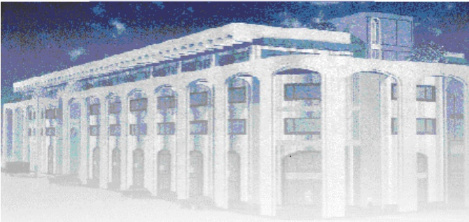

<!-- page 1 -->

Banque de la République d'Haïti

Note mensuelle d'inflation

Juin 2014

<!-- page 2 -->

## Introduction

Cette note analyse l'évolution de l'indice des prix à la consommation (IPC) en Haïti au cours du mois de juin 2014. Elle apporte quelques éléments explicatifs permettant de comprendre les facteurs qui influencent l'évolution de l'inflation ainsi que les prévisions pour les trois prochains mois.

### I. - Évolution de l'inflation globale

Au cours du mois de juin 2014, les taux de croissance de l'IPC enregistrés tant en variation mensuelle qu'en glissement annuel ont augmenté pour se porter à 0,7% et 4,2% respectivement, contre 0,6 % et 3,5 % le mois précédent.

Le comportement de l'inflation mensuelle au cours des six derniers mois reflète le renforcement des tensions inflationnistes dans l'économie haïtienne. En effet, de 0,2 % en janvier, elle est passée à 0,3 % en février, puis à 0,6 % entre mars et mai 2014 pour atteindre 0,7 % en juin 2014 (une hausse de 50 points de base entre janvier 2014 et juin 2014). Ce taux est nettement supérieur à la moyenne calculée pour les neuf premiers mois de l'exercice soit 0,40 % et est le plus élevé depuis novembre 2012 (0,8 %) suite au passage du cyclone Sandy à la fin d'octobre 2012.

Quant à l'inflation en glissement annuel, sa hausse de 70 points de base en juin 2014 est la plus forte depuis novembre 2013, puisqu'elle a évolué entre 3,2 % et 3,5 % entre novembre 2013 et mai 2014.

Graphique No. 1 Evolution de l'inflation annuelle (en %)

| Month | Value |
| --- | --- |
| Sep-12 | 6.5 |
| Oct-12 | 7.0 |
| Nov-12 | 7.5 |
| Dec-12 | 7.6 |
| Jan-13 | 7.2 |
| Feb-13 | 7.4 |
| Mar-13 | 7.7 |
| Apr-13 | 7.7 |
| May-13 | 7.3 |
| Jun-13 | 6.5 |
| Jul-13 | 6.0 |
| Aug-13 | 5.5 |
| Sep-13 | 4.5 |
| Oct-13 | 4.2 |
| Nov-13 | 3.4 |
| Dec-13 | 3.4 |
| Jan-14 | 3.4 |
| Feb-14 | 3.2 |
| Mar-14 | 3.4 |
| Apr-14 | 3.5 |
| May-14 | 3.5 |
| Jun-14 | 4.2 |

<!-- page 3 -->

Cette progression de l'inflation est imputable à celle des prix de tous les postes de dépenses, à l'exception du Transport pour lequel l'indice est resté relativement inchangé depuis le mois d'avril 2014. Les fonctions qui ont le plus contribué à la hausse mensuelle de l'indice des prix à la consommation au mois de juin 2014 sont : « Alimentation, boissons et tabac» (42,6 %), «Habillement, tissus et chaussures» (14,4 %) et « Santé » (13%), portant leur contribution totale à 70,1 % contre 57,2 % en mai 2014.

Graphique No. 2 Evolution de l'inflation mensuelle (en %)

| Date | Value |
| --- | --- |
| May-13 | 0.5 |
| Jun-13 | 0.1 |
| Jul-13 | 0.1 |
| Aug-13 | 0.3 |
| Sep-13 | 0.1 |
| Oct-13 | 0.2 |
| Nov-13 | 0.1 |
| Dec-13 | 0.4 |
| Jan-14 | 0.2 |
| Feb-14 | 0.3 |
| Mar-14 | 0.6 |
| Apr-14 | 0.55 |
| May-14 | 0.56 |
| Jun-14 | 0.7 |

Graphique No. 3

Contribution en % des différents postes de dépenses à l'inflation annuelle

| Category | Value |
| --- | --- |
| Alim, bois, tab | 39.3 |
| Habil, tis, chs. | 13.6 |
| Loyer, En, eau | 16.1 |
| Aménag, Ent. log. | 4.8 |
| Santé | 6.6 |
| Transport | 4.1 |
| Lois., sp. Ens., Clt. | 6.7 |
| Aut. biens & serv. | 8.8 |

<!-- page 4 -->

Graphique No. 4 Contribution en % des différents postes de dépenses à l'inflation mensuelle

| Category | Value |
| --- | --- |
| Alim, bois, tab | 42.6 |
| Habil, tis, chs. | 14.4 |
| Loyer, En, eau | 7.6 |
| Aménag, Ent. log. | 7.5 |
| Santé | 13.1 |
| Transport | 2.9 |
| Lois., sp. Ens., Clt. | 0.0 |
| Aut. biens & serv. | 11.9 |

### 2. - Évolution de l'inflation selon l'origine des produits

Se basant sur l'origine, l'inflation des produits locaux a suivi globalement la même tendance que celle de l'indice général. En variation mensuelle, elle a progressé de 20 points de base à 0,6 %, et en glissement annuel de 70 points de base à 4,1 %. Si, en glissement annuel, la tendance de l'IPC des produits locaux a été la même que celle des produits importés, en rythme mensuel, ils ont évolué en sens contraire. Ainsi, du côté des produits importés, la variation de l'indice des produits importés a légèrement reculé de 10 points de base à 0,6 % par rapport au mois précédent, mais s'est accru de 50 points de base en glissement annuel.

### 3. - Évolution de l'inflation sous-jacente

L'inflation sous-jacente, l'indicateur permettant de dégager la tendance de long terme de l'inflation courante, a suivi la tendance de l'inflation globale en enregistrant une hausse de 70 points de base à 4,4 % en juin 2014 contre 3,77 % le mois d'avant. En variation mensuelle, le rythme de progression de l'indice sous-jacent à également augmenté à 0,72 %, soit 11 points de base de plus que le mois passé. Pour le deuxième mois consécutif, l'inflation sous-jacente, en rythme mensuel, a évolué au-dessus du taux de croissance de l'indice global des prix à la consommation. Ainsi, le mouvement des prix observé au cours de ces deux derniers mois n'est pas imputable à l'évolution des prix des produits volatils du panier de consommation.

<!-- page 5 -->

### II. Facteurs explicatifs de la hausse de l'inflation en Juin 2014

L'évolution du niveau général des prix au mois de juin 2014 a été influencée par une pression de la demande provenant de la hausse des dépenses publiques et de l'augmentation des transferts privés sans contrepartie. Les effets d'annonce relatifs à l'augmentation éventuelle des prix des produits pétroliers à la pompe ont également contribué à la progression des prix.

### II. 1- Hausse des dépenses publiques

En juin 2014, les dépenses publiques ont enregistré des hausses de 28 % et 26 % en variation mensuelle et annuelle respectivement. Cette augmentation s'est reflétée au niveau de toutes les catégories de dépenses : 55 % pour les dépenses de salaires $ ^{1} $, 3 % pour le fonctionnement et de 262 % pour les investissements. Cette hausse des dépenses est également imputable aux activités de construction des bâtiments publics qui ont fortement progressé au cours du mois sous revue. Parallèlement, la monnaie en circulation a crûe de 2,74 % pour se chiffrer à 22 710 MG, sa plus forte progression mensuelle depuis décembre 2013.

### II. 2- Effets d'annonce relatifs à la montée des prix des produits pétroliers à la pompe

Au début du mois de juin, différentes annonces ont été faites concernant la hausse des prix des produits pétroliers à la pompe, visant à éliminer le système de subvention de ces produits. De ce fait, les principaux commerçants ont ajusté leurs prix, en tenant compte de l'effet que la hausse des prix des produits pétroliers aura à exercer sur les autres prix des biens et services.

### II. 3- Augmentation des transferts privés sans contrepartie

Les transferts privés cumulés au 31 mai 2014 ont augmenté de 11 % par rapport à l'exercice dernier, contre 9,8 % au 31 mai 2013 et 1 % en 2012. Cette croissance a pour implication celle du pouvoir d'achat des ménages. Par conséquent, cette hausse des transferts a entraîné une augmentation de la demande de biens et services, et donc une augmentation des prix à la consommation.

<!-- page 6 -->

### IV. Prévisions d'inflation

Les prévisions d'inflation augurent une évolution à la hausse du rythme de progression de l'inflation pour les trois prochains mois. En effet, ces dernières tablent sur des taux de croissance respectifs de 4,5 % ; 4,7 % et 4,8 % en glissement annuel en juillet, août et septembre. EN variation mensuelle, le taux d'inflation devrait atteindre un même taux de 0,4 % en juillet et en août, et une variation de 0,2 % en septembre 2014. Il convient de souligner que le taux d'inflation projeté pour septembre 2014 dans le cadre du programme financier est de 4.8 %.

<!-- page 7 -->

Tableau no. 1 Indice des Prix à la Consommation (IPC) par postes de dépenses Variation et Contribution à l'inflation mensuelle et annuelle En Juin 2014

<table><tr><td></td><td>Indice des Prix à la Consommation (IPC)</td><td>Variation IPC (en %)</td><td>Contribution à l'inflation (en %)</td></tr><tr><td>Mensuelle</td><td>Annuelle</td><td>Mensuelle</td><td>Annuelle</td></tr><tr><td>Poste</td><td>Pondération (en %)</td><td>juin 13</td><td>mai 14</td><td>juin 14</td><td>juin 14</td><td>juin 14</td><td>juin 14</td><td>juin 14</td></tr><tr><td>Indice Général</td><td>208.61</td><td>215.90</td><td>217.31</td><td>0.7</td><td>4.2</td><td>100</td><td>100.00</td></tr><tr><td>Alimentation, boissons et tabac</td><td>50.35</td><td>219.10</td><td>224.90</td><td>226.10</td><td>0.5</td><td>3.2</td><td>42.6</td><td>39.3</td></tr><tr><td>Habillement, tissus et chaus.</td><td>6.86</td><td>197.90</td><td>211.20</td><td>214.00</td><td>1.3</td><td>8.1</td><td>14.4</td><td>13.6</td></tr><tr><td>Loyer, énergie et eau</td><td>11.05</td><td>240.60</td><td>253.80</td><td>254.90</td><td>0.4</td><td>5.9</td><td>7.6</td><td>16.1</td></tr><tr><td>Aménag. et entret. du logem</td><td>4.7</td><td>212.30</td><td>218.90</td><td>221.10</td><td>1.0</td><td>4.1</td><td>7.5</td><td>4.8</td></tr><tr><td>Santé</td><td>2.9</td><td>211.90</td><td>225.20</td><td>231.60</td><td>2.8</td><td>9.3</td><td>13.1</td><td>6.6</td></tr><tr><td>Transport</td><td>13.74</td><td>156.90</td><td>158.80</td><td>158.80</td><td>0.0</td><td>1.2</td><td>0.0</td><td>4.1</td></tr><tr><td>Lois., sp. Ens., Clt.</td><td>5.84</td><td>215.80</td><td>225.20</td><td>225.90</td><td>0.3</td><td>4.7</td><td>2.9</td><td>6.7</td></tr><tr><td>Aut. biens & serv.</td><td>4.56</td><td>171.70</td><td>182.30</td><td>185.30</td><td>1.6</td><td>7.9</td><td>11.9</td><td>8.8</td></tr></table>

Sources : IHSI et calculs du Service de la Macrééconomie et Analyse de Conjoncture de la MAE

<!-- page 8 -->

## Glossaire

<table><tr><td>Glossaire</td></tr><tr><td>Variation mensuelle</td><td>: Variation par rapport au mois précédent.</td></tr><tr><td>Glissement annuel</td><td>: Variation par rapport au même mois de l'année antérieure.</td></tr><tr><td>Inflation</td><td>: Mouvement persistant à la hausse du niveau général des prix.</td></tr><tr><td>Désinflation</td><td>: Ralentissement de la croissance des prix.</td></tr><tr><td>Déflation</td><td>: Baisse du niveau général des prix associée à une contraction de la masse monétaire et du crédit.</td></tr><tr><td>Inflation sous-jacente</td><td>: Tendance de long terme des prix, tout en excluant la volatilité, les mouvements saisonniers, conjoncturels, et les chocs qui affectent les composantes du panier considéré.</td></tr><tr><td>Région Nord</td><td>: Elle couvre les départementes du Nord, Nord-Est et Nord-Ouest.</td></tr><tr><td>Région Sud</td><td>: Elle comprend les départementes du Sud de la Grand'Anse et des Nippes.</td></tr><tr><td>Région Reste Ouest</td><td>: Y sont inclus les départementes du Sud'Est et de l'Ouest à l'exception de l'aire métropolitaine</td></tr><tr><td>Région Transversale</td><td>: Elle regroupe les départementes du Centre et de l'Artibonite.</td></tr><tr><td>Aire Métropolitaine</td><td>: Elle contient les villes de Port-au-Prince, de Delmas, de Pétion-Ville, de</td></tr></table>

Aire Métropolitaine : Elle contient les villes de Port-au-Prince, de Delmas, de Pétion-Ville, de Carrefour et de Croix des Bouquets.
