<!-- page 1 -->

## FinScope

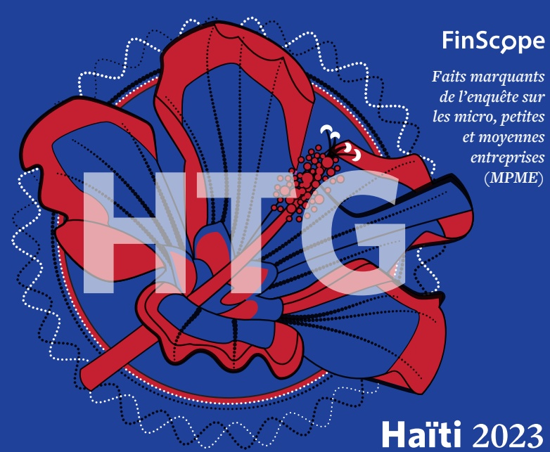

Faits marquants de l'enquête sur les micro, petites et moyennes entreprises (MPME)

Haïti 2023

<!-- page 2 -->

## Partenariat pour le développement des MPME

Le FinScope MPME Haïti, 2023 a été conçu selon une approche participative impliquant un large éventail d'acteurs à travers un processus de consultation globale. Cette démarche a permis d'enrichir l'enquête, tout en assurant sa pertinence et l'adhésion des parties prenantes. La Banque de la République d'Haïti (BRH) a présidé le Groupe de Référence (GR), composé de Mennonite Economic Development Associates (MEDA) et de Diagnostic & Development Group SA (DDG), avec le soutien technique et la gestion de projet assurés par FinMark Trust (FMT). L'enquête a été financée conjointement par la BRH et l'Agence des États-Unis pour le Développement International (USAID), dans le cadre du projet ATTEINDRE mis en œuvre par MEDA.

## Le symbole de la couverture

À travers cette enquête factuelle

FinScope menée sur le secteur

des MPME, nous aspirons à

générer un changement réel en

matière d'inclusion financière,

contribuant ainsi à la croissance

et au développement à plus grande échelle au niveau national.

L'image de la couverture met en valeur une fleur emblématique d'Haïti. La fleur symbolise la croissance et le développement, tandis que le cercle évoque l'idée d'une croissance inclusive. Chaque fleur représente un exemple de prospérité dans un environnement unique.

En associant cette fleur au symbole monétaire d'Haïti, l'illustration incarne les spécificités du pays et traduit le lien entre inclusion financière et prospérité.

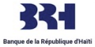

<!-- page 3 -->

Le Ministère de l'Économie et des Finances (MEF) et la Banque de la République d'Haïti (BRH) se réjouissent de la publication du rapport de l'enquête nationale sur les Micros, Petites et Moyennes Entreprises (MPME), intitulé FinScope MPME, Haïti 2023. Ce travail essentiel a été mené sous la direction du Comité de Coordination et de Suivi de la Stratégie Nationale d'Inclusion Financière (CSSNIF).

Cette initiative a été cofinancée par l'Agence Américaine de Développement International (USAID) et le Gouvernement d'Haïti. Elle a été portée par la BRH et le Mennonite Economic Development Associates (MEDA), l'opérateur du projet ATTEINDRE financé par l'USAID. L'étude a été réalisée par FinMark Trust, une firme internationale, en partenariat avec le Diagnostic & Développement Groupe (DDG), une firme haïtienne.

Nous tenons à souligner que ce projet résulte d'une collaboration dynamique entre divers acteurs nationaux, réunis au sein d'un comité de pilotage incluant des représentants de ministères clés et d'institutions publiques et privées telles que le Ministère du Commerce et de l'Industrie (MCI) à travers le Centre de Facilitation des Investissements (CFI), le Ministère de l'Économie et des Finances à travers la Direction Générale des Impôts (DGI), l'Institut Haïtien de Statistique et d'Informatique (IHSI), la Banque de la République d'Haïti, l'Agence Américaine de Développement International (USAID), Mennonite Economic Development Associates (MEDA), l'Université Quisqueya, le Centre Technique de Planification et d'Économie Appliquée (CTPEA), le Fonds de Développement Industriel (FDI), l'Alternative Insurance Company (AIC), la Digicel, l'Alliance Haïtienne pour la Finance Inclusive (AHFI), le Groupe Croissance, et la Chambre de Commerce et d'Industrie d'Haïti (CCIH), ainsi que la Chambre de Commerce Américaine en Haïti (AMCHAM Haïti).

L'étude Finscope MPME offre une analyse approfondie du profil et de la situation des Micros, Petites et Moyennes Entreprises (MPME) en Haiti. À travers des données quantitative et qualitatives collectées auprès de plus de 5000 entreprises, tant formelles qu'informelles, elle met en lumière les dynamiques récentes, les obstacles à surmonter et les opportunités à saisir. Ces résultats visent à éclairer les stratégies de développement, à orienter les décisions d'investissement et à renforcer le cadre d'accompagnement des MPME.

Dans la plupart des pays en développement ou à travers le monde, les micros, petites et moyennes entreprises (MPME) représentent une part importante de l'emploi. Dans les pays développés et en développement, la contribution de ces entreprises s'élève à deux tiers de l'emploi total (Banque Mondiale, 2019).

<!-- page 4 -->

## MINISTÈRE DE L'ÉCONOMIE ET DES FINANCES ET BANQUE DE LA RÉPUBLIQUE D'HAÎTI - MOTS D'INTRODUCTION

Dans les pays en développement en particulier, les petites entreprises peuvent être un vecteur essentiel d'inclusion sociale, notamment en permettant aux femmes de participer à des activités économiques.

La grande majorité des micros, petites et moyennes entreprises partagent un certain nombre de caractéristiques, les principales étant le mode de production basé essentiellement sur la main-d'œuvre ainsi que la petite taille de l'entreprise tant au niveau des chiffres d'affaires que du nombre de ses employés.

Dans la plupart des pays, on entend par petites et moyennes entreprises (PME) les entreprises employant entre dix (10) et 250 personnes. Les entreprises employant moins de dix personnes sont généralement appelées "microentreprises". (OMC, 2016)

En Haïti, bien qu'aucune définition ne soit officiellement adoptée, la grande majorité des microentreprises est habituellement considérée comme faisant partie du secteur informel. En 1998, le secteur informel représentait 90% de la population active haïtienne (Lumarque, 1998). En 2023, il représentait plus de 70% (Bernardin, 2023), d'où sa domination écrasante dans le paysage économique du pays.

De plus, l'emploi privé en Haïti est majoritairement

III

informel, avec plus de 90 pour cent de la main-

d'œuvre engagée dans des emplois dépourvus de

la surveillance réglementaire du secteur formel. En

mai 1999, il regroupait plus de 85 % de l'ensemble

des emplois non agricoles selon une publication de

l'Institut Haïtien de Statistique et d'Informatique

(IHSI), « Établissements économiques par branche

d'activités - Mai 1999 ». En mars 2008, l'Association

Professionnelle des Banques (APB) a défini les PMEs

en Haïti comme des entreprises comptant entre dix

(10) à 100 employés, un chiffre d'affaires annuel

entre cinq (5) et 50 millions HTG et des actifs jusqu'à

un maximum de 50 millions HTG.

Vu l'importance du secteur informel dans l'économie haïtienne, certains critères devraient figurer dans une définition des MPME. Ce sont :

- L'effectif de l'entreprise qui informe sur le nombre d'emplois créés

L'actif de l'entreprise

Le chiffre d'affaires

## Définition spécifique :

• Une microentreprise est une entreprise formelle ou informelle qui emploie au plus cinq (5) personnes et que son chiffre d'affaires annuel n'excède pas 2.5 millions de gourdes

· La petite entreprise est une entreprise

<!-- page 5 -->

| Catégorie d'entreprises | Chiffre d'affaires généré sur l'exercice (HTG) | Nombre d'employés |
| --- | --- | --- |
| Microentreprise | Moins de 2,5 millions | 1 à 5 |
| Petite entreprise | 2,5 à 20 millions | 5 à 20 |
| Moyenne entreprise | 20 à 50 millions | 20 à 100 |

formelle ou informelle qui emploie entre cinq (5) à 20 personnes et que son chiffre d'affaires ou son bilan, tout en étant supérieur à 2,5 millions de gourdes, n'excède pas 20 millions de gourdes

La moyenne entreprise est une entreprise formelle qui emploie entre 20 à 100 personnes et son chiffre d'affaires n'excède pas 50 millions de gourdes.

Définition générale : Une entreprise est considérée comme une MPME si elle remplit les deux critères suivants : un effectif compris entre 1 et 100 salariés et un chiffre d'affaires annuel inférieur à 50 millions de gourdes.

Les MPME (micros, petites et moyennes entreprises), souvent à l'origine de l'innovation et de la diversité dans notre pays, sont un pilier fondamentale de notre économie. Elles représentent une part significative de l'emploi et du produit intérieur brut (PIB). Grâce à leur agilité, elles répondent rapidement aux fluctuations de notre contexte.

Cependant, les MPME rencontrent des défis importants, tels que des problèmes de bonne gouvernance, l'accès au financement, des limitations en matière d'éducation financière, une concurrence accrue et la nécessité de se digitaliser. De plus, il est essentiel de prendre en compte les disparités de genre qui affectent l'accès des femmes entrepreneurs aux ressources et aux opportunités. Dans ce contexte, la collecte de données est cruciale pour favoriser l'inclusion financière, en veillant à ce que les entreprises dirigées par des femmes comme par des hommes aient un accès équitable aux outils nécessaires pour leur réussite.

Nous croyons fermement que soutenir ce secteur est crucial, tant pour la prise de décisions stratégiques visant à stimuler la croissance économique que pour encourager l'innovation et l'inclusion socio-économique. En mettant en œuvre des politiques

<!-- page 6 -->

## MINISTÈRE DE L'ÉCONOMIE ET DES FINANCES ET BANQUE DE LA RÉPUBLIQUE D'HAÎTI - MOTS D'INTRODUCTION

adaptées et en créant un environnement propice, nous pouvons permettre aux MPME d'innover et de prospérer, contribuant ainsi à la construction d'une économie plus résiliente et inclusive.

Nous pensons que ce rapport sera un outil de référence pour les décideurs politiques, les acteurs du secteur financier, les institutions techniques et tous les agents économiques nationaux. Que ses résultats inspirent et renforcent votre engagement envers les MPME, véritables moteurs de notre économie. Ensemble, construisons un avenir serein où ces entreprises prospèrent et dynamisent notre économie !

Monsieur Alfred Fils Metellus

Ministre de l'Économie et des Finances (MEF)

Monsieur Ronald Gabriel

Gouverneur de la Banque de la République d'Haïti (BRH)

<!-- page 7 -->

## Introduction

Le secteur des MPME est reconnu comme un contributeur important à la croissance économique, du développement et de la création d'emplois à grande échelle. Cela dit, le rôle stratégique des MPME dans l'économie nationale dépend fortement des actions concertées du gouvernement, de la communauté entrepreneuriale et de l'ensemble de la population, afin de favoriser et d'optimiser le développement du secteur.

Le manque de données récentes, holistiques et fiables sur le secteur des MPME avait été identifié comme un obstacle majeur lors d'une enquête précédente axée sur les consommateurs. C'est dans cette perspective que la Banque de la République d'Haïti a lancé la première enquête FinScope MPME, dans le but d'établir une base de référence pour soutenir le développement du secteur et promouvoir l'inclusion financière.

## Méthodologie

L'enquête FinScope MPME Haïti 2023 a été réalisée auprès d'un échantillon de 5 310 propriétaires d'entreprises adultes, sélectionnés à la fois au niveau de leur entreprise et de leur ménage, à travers l'ensemble du territoire national. Le processus d'échantillonnage et de pondération des données a été conduit par un expert en échantillonnage, en collaboration avec FinMark Trust (FMT), et présente les caractéristiques suivantes :

• Les propriétaires d'entreprises sont âgés de 15 ans ou plus

• Les propriétaires se considèrent comme étant dirigeants d'entreprises ou générant des revenus à travers des activités de petites entreprises

L'entreprise compte moins de 251 employés

• Un Échantillon représentatif au niveau national, régional urbain/rural

## Objectifs de l'enquête

• Évaluer la taille et la portée du secteur des micro, petites et moyennes entreprises (MPME) en Haïti.

- Décrire les niveaux d'accès et le paysage global des produits et services financiers, qu'ils soient formels ou informels.

• Identifier les principaux obstacles à la croissance et au développement des MPME, en mettant l'accent sur les contraintes liées à l'accès aux marchés.

• Soutenir l'élaboration de politiques fondées sur des données probantes et offrir une base de référence fiable pour le suivi, l'évaluation des initiatives, et la contribution aux recherches stratégiques sur le secteur.

• Segmenter le secteur des MPME en groupes de marché et identifier les besoins spécifiques de chaque segment afin de stimuler l'innovation dans les produits et services adaptés.

• Établir une base de référence pour le

développement du secteur et l'inclusion financière

en Haïti à travers l'enquête FinScope MPME

Haïti 2023, tout en permettant l'évaluation des

évolutions et des facteurs de transformation à

long terme, y compris les impacts potentiels des

interventions futures.

<!-- page 8 -->

## DÉPARTEMENTS D'HAÏTI

## Répartition des MPME par département

La majorité des MPME se situe dans les départementes de l'Artibonite, de l'Ouest et du Sud.

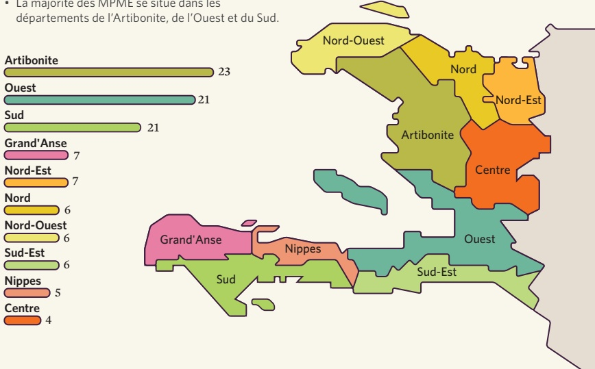

<!-- page 9 -->

Note: le taux de change appliqué en juin 2023 était de 1Gde = $0.0077S

660 845 Propriétaires MPME

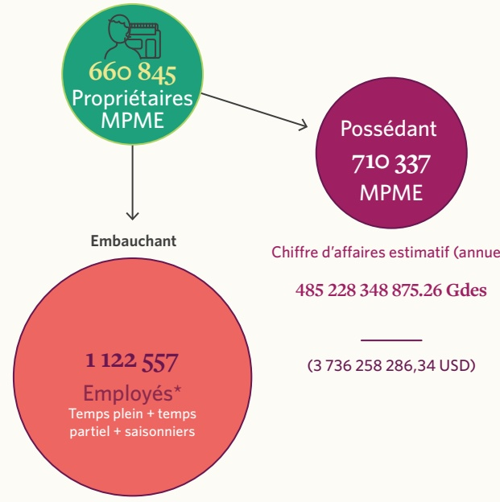

Possédant

710 337

MPME

1 122 557

Employés*

Temps plein + temps partiel + saisonniers

Chiffre d'affaires estimatif (annuel)

485 228 348 875.26 Gdes

(3 736 258 286,34 USD)

<!-- page 10 -->

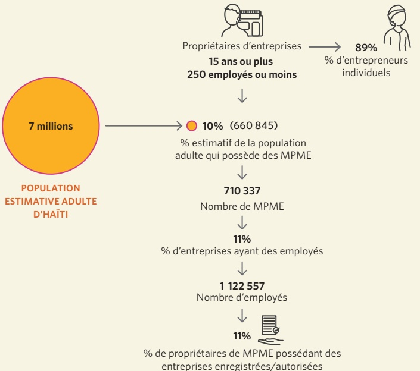

POPULATION ESTIMATIVE ADULTE D'HAÎTI

% de propriétaires de MPME possédant des entreprises enregistrées/autorisées

<!-- page 11 -->

MICROENTREPRISE

Moins de 0.5 M HTG

PETITE ENTREPRISE

0.5 - 2 M HTG

MOYENNE ENTREPRISE

Plus de 2 M HTG

71.15%

Microentreprises

Nombre d'entreprises : 505 405

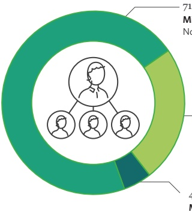

23.90%

Petite entreprise

Nombre d'entreprises : 169 771

4.95%

Moyenne entreprise

Nombre d'entreprises : 35 162

Définition du type d'entreprise en fonction du chiffre d'affaires

Autres définitions des MPME

En fonction du nombre

d'employés

MCI

A noter qu'une définition sur la base du nombre d'employés (microentreprise : 1 employé, petite entreprise : 2 - 4 employés, et moyenne entreprise : plus de 4 employés) donnerait une distribution similaire des MPME.

<!-- page 12 -->

- Les MPME opèrent majoritairement dans le secteur du commerce et de l'agriculture.

Agriculture

66%

Commerce

Activités de vente en gros

et en détail,

d'hébergement et

d'immobiliers.

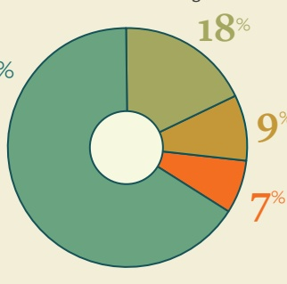

Exploitation minière,

fabrication, construction,

approvisionnement gazière,

transformation agricole.

## Service

RÉPARTITION DU SECTEUR

ÉCONOMIQUE (%)

Services personnels, éducation,

services financiers et

d'assurance professionnels.

<!-- page 13 -->

| Sector | Environ 7% des entreprises possédées par des femmes sont formelles, et la majorité de celles-ci sont dans le secteur du commerce. |
| --- | --- |
| Agriculture | 4% |
| Service | 30% |
| Commerce | 50% |
| Industrie | 13% |

| Category | Percentage |
| --- | --- |
| Agriculture | 11% |
| Service | 26% |
| Commerce | 52% |
| Industrie | 11% |
| 7% | 7% |

<!-- page 14 -->

## TAILLE ET PORTÉE DU SECTEUR DES MPME

## Cycle de vie des entreprises selon leur âge (en années)

• Répartir les MPME par âge est le moyen le plus simple de différencier les entreprises qui sont en phase d'établissement et de formalisation de leurs processus.

L'âge peut également servir de critère pour l'octroi de financements et de soutien commercial, notamment pour les entreprises ayant dépassé 3 ans d'existence.

AGE DES ENTREPRISES

MOINS D'UN AN

17%

START UP

0 - 2 ans

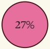

27%

CROISSANCE

3 - 5 ans

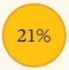

21%

ÉTABLIE 6 - 10 ans

MATURE >10 ans

Près de la moitié (49%) des MPME en Haïti sont établies et matures, c'est-à-dire âgées de six ans ou plus.

<!-- page 15 -->

| Category | Value |
| --- | --- |
| 1 | 24% |
| 2 | 11% |

MOINS D'UN AN

| Category | Value |
| --- | --- |
| 1 | 30% |
| 2 | 26% |
| 3 | 26% |

START UP

0 - 2 ans

| Category | Value |
| --- | --- |
| Red | 28% |
| Grey | 28% |

CROISSANCE

3 - 5 ans

- La proportion de jeunes propriétaires d'entreprises diminue à mesure que l'entreprise vieillit.

- Les startups comptent davantage de jeunes propriétaires.

| Category | Value |
| --- | --- |
| 1 | 12% |
| 2 | 21% |

ÉTABLIE 6 - 10 ans

| Category | Value |
| --- | --- |
| 1 | 6% |
| 2 | 14% |

MATURE >10 ans

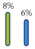

MOINS D'UN AN

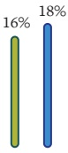

START UP

0 - 2 ans

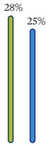

CROISSANCE

3 - 5 ans

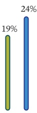

ÉTABLIE

6 - 10 ans

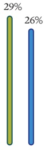

MATURE >10 ans

<!-- page 16 -->

<!-- page 17 -->

TAILLE ET PORTÉE DU SECTEUR DES MPME

La majorité a atteint un niveau d'éducation secondaire ou supérieur

| Category | Value |
| --- | --- |
| Diplôme (étudiant/troisième cycle) | 12% |
| Diplôme (Secondaire) | 24% |
| Primaire | 37% |
| Aucune scolarisation | 3% |

NIVEAU D'ÉTUDE (%)

Jeunes propriétaires

d'entreprises (moins de

35 ans)

| Category | Percentage |
| --- | --- |
| 15 - 24 ans | 5% |
| 25 - 35 ans | 30% |
| 36 - 45 ans | 29% |
| 46 - 60 ans | 26% |
| 61 ans et plus | 10% |

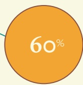

Gagnent moins de 30,000 Gdes par mois à partir de leurs entreprises

| Category | Value | Percentage |
| --- | --- | --- |
| 1–9,999 (Gdes) | 29% |   |
| 10,000–19,999 | 19% |   |
| 20,000–29,999 | 11% |   |
| 30,000–39,999 | 7% |   |
| 40,000–49,999 | 4% |   |
| 50,000–59,999 | 4% |   |
| 60,000–69,999 | 2% |   |
| 70,000–99,999 | 5% | PERSONNEL DES PROPRIÉTAIRES D'ENTREPRISES |
| 100,000–239,000 | 5% |   |
| 240,000 ou plus | 4% |   |

<!-- page 18 -->

Contribution des MPME formelles au PIB: 4,2 milliards US

Secteur MPME formel (125 027 entreprises)

7% de MPME enregistrés et

10% ont une autorisation

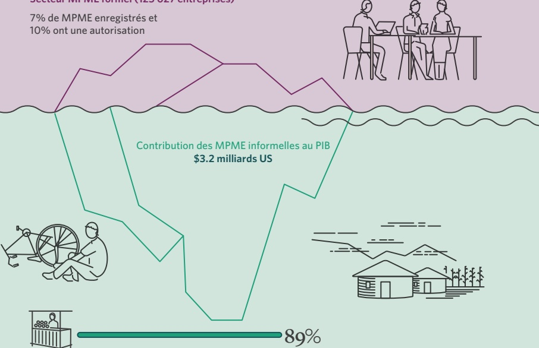

Secteur informel des MPME (1 016 641 entreprises)

<!-- page 19 -->

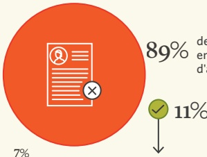

des entreprises ne sont pas enregistrées/n'ont pas d'autorisation de fonctionnement.

Seulement 11% des entreprises sont formellement enregistrées, la majorité étant informelle.

| Category | Conformes AUX: (%) |
| --- | --- |
| MAIRIE | 59 |
| MCI | 4 |
| DGI | 3 |
| MAST | 1 |
| MSPP | 1 |
| CFI | 0.41 |
| MJSP | 0.39 |
| MPCE | 0.28 |

| Category | Percentage |
| --- | --- |
| Ne savent pas | 42% |
| En conformité avec la loi | 39% |
| Pas de profit | 7% |
| Accès au financement | 5% |
| Évitent le harcèlement | 3% |
| des autorités | 2% |
| Accès à l'aide gouvernementale | 2% |
| Évitent les amendes | 1% |
| Autres | 1% |

| Category | Value (%) |
| --- | --- |
| L'entreprise est trop petite | 24 |
| Ne savent pas | 18 |
| N'ont pas d'argent pour s'enregistrer | 16 |
| Trop compliqué | 13 |
| Ne savent pas comment | 9 |
| Pas de profit | 6 |
| N'ont pas le temps | 5 |
| L'enregistrement | 4 |
| est en cours | 3 |
| Ont refusé de répondre | 2 |
| ont essayé mais n'ont pas réussi | 1 |

| Category | Percentage (%) |
| --- | --- |
| HOMMES | 17 |
| FEMMES | 7 |
| 15-24 ANS | 9 |
| 25-35 ANS | 11 |

## RAISONS DE N'ÊTRE PAS ENREGISTRÉES (%)

- Les propriétaires de MPME ne perçoivent pas les avantages de la formalisation.

<!-- page 20 -->

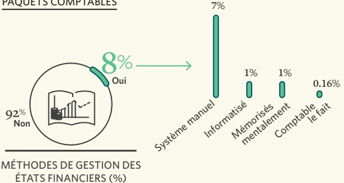

MÉTHODES DE GESTION DES ÉTATS FINANCIERS (%)

MÉTHODES DE TENUE D'ÉTATS FINANCIERS (%)

- La majorité des données sont enregistrées manuellement, tandis que seulement 1 % des entreprises utilisent des systèmes informatisés.

Les registres commerciaux tenus par les MPME

| Category | Value (%) |
| --- | --- |
| Ventes totales réalisées | 5 |
| Dépenses | 5 |
| Revenu après dépenses | 4 |
| Revenu/ventes avant dépenses | 4 |
| Coût des ventes | 3 |
| Stock | 3 |
| Dettes/débiteurs | 3 |
| Nombre de clients | 2 |

<!-- page 21 -->

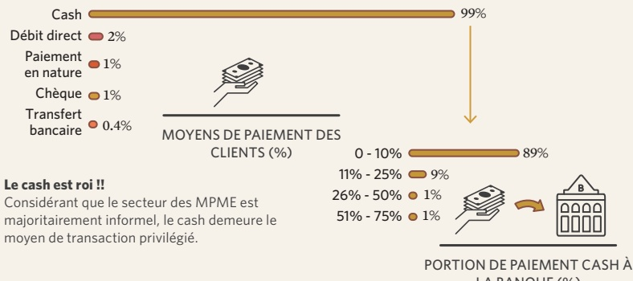

## Le cash est roi!!

Considérant que le secteur des MPME est majoritairement informel, le cash demeure le moyen de transaction privilégié.

PORTION DE PAIEMENT CASH À LA BANQUE (%)

Actions et propriété

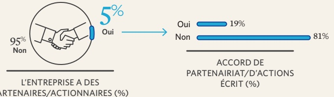

L'ENTREPRISE A DES PARTENAIRES/ACTIONNAIRES (%)

<!-- page 22 -->

connaissance une

organisation offrant de

l'assistance ou des

conseils aux MPME

CONNAISSANCE D'ORGANISATIONS

OFFRANT DU SUPPORT

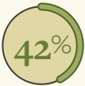

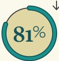

Parmi celles qui connaissent une telle organisation, beaucoup utilisent ses services

ont rapporté avoir

besoin de

compétences

## LES MPME CHERCHANT DES EMPLOYÉS COMPÉTENTS ET FORMÉS

- Un tel soutien est essentiel pour aider les MPME à réaliser leur potentiel.

## L'UTILISATION D'ORGANISATIONS OFFRANT DU SUPPORT EST ÉLEVÉE

| Category | BESOIN DE SUPPORT NÉCESSAIRE (%) |
| --- | --- |
| Financement de prêts | 46% |
| Gestion d'entreprise | 24% |
| Formation et promotion de l'entreprise | 8% |
| Budget et prévision | 8% |
| Amélioration de la productivité | 6% |
| Gestion de dettes | 6% |
| Démarrage d'entreprise | 6% |
| Relations avec les clients | 5% |
| Formation technique (services, marchandises) | 4% |
| Législation | 3% |
| Formation en informatique | 2% |
| Formation en opérations digitales | 1% |
| Préparation de plan d'affaires | 1% |

<!-- page 23 -->

<table>
  <thead><tr><th>Recherche</th><th>Percentage (%)</th></tr></thead>
  <tbody>
    <tr><td>Recherche de fonds</td><td>43%</td></tr>
    <tr><td>Fonds en espèces</td><td>4%</td></tr>
    <tr><td>Dettes et créances</td><td>2%</td></tr>
    <tr><td>États financiers</td><td>2%</td></tr>
    <tr><td>Manque de clientèle</td><td>1%</td></tr>
    <tr><td>Trouver un local ou un espace pour l'entreprise</td><td>1%</td></tr>
    <tr><td>Catastrophes neutres</td><td>1%</td></tr>
    <tr><td>Épargne</td><td>36%</td></tr>
    <tr><td>Groupe d'épargne informel</td><td>12%</td></tr>
    <tr><td>Famille et amis</td><td>7%</td></tr>
    <tr><td>Fonds d'une autre entreprise</td><td>4%</td></tr>
    <tr><td>Prêt personnel</td><td>3%</td></tr>
    <tr><td>Autres sources de financement</td><td>3%</td></tr>
    <tr><td>Transferts de fonds de la diaspora</td><td>2%</td></tr>
    <tr><td>Actifs disponibles</td><td>2%</td></tr>
    <tr><td>Héritage</td><td>1%</td></tr>
    <tr><td>SOURCES DE FINANCEMENT POUR DÉMARRER UNE ENTREPRISE (%)</td><td>65%</td></tr>
    <tr><td>Moins de 50,000 Gdes</td><td>5%</td></tr>
    <tr><td>50,000 - 99,999 Gdes</td><td>13%</td></tr>
    <tr><td>100,000 - 149,999 Gdes</td><td>5%</td></tr>
    <tr><td>150,000 - 199,999 Gdes</td><td>2%</td></tr>
    <tr><td>200,000 - 249,999 Gdes</td><td>2%</td></tr>
    <tr><td>250,000 - 299,999 Gdes</td><td>1%</td></tr>
    <tr><td>300,000 Gdes ou plus</td><td>3%</td></tr>
    <tr><td>MONTANT</td><td>NÉCESSAIRE POUR DÉMARRER (%)</td></tr>
    <tr><td>Les propriétaires financent généralement leur seizière grâce à leurs économies personnelles et à épargnes informelles, avec un besoin moyen de 50 000 Gdes pour démarrer.</td></tr>
  </tbody>
</table>

<!-- page 24 -->

## ACCÈS AUX MARCHÉS

Avec qui les MPME traitent-elles?

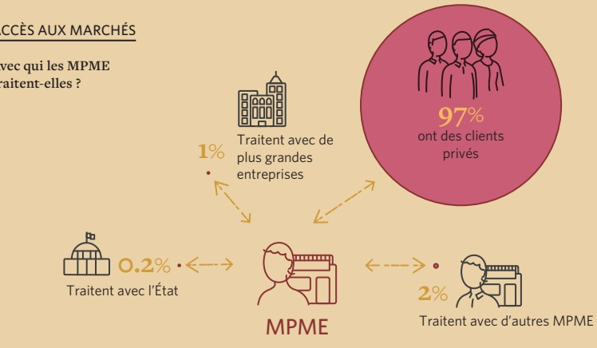

Traitent avec de plus grandes entreprises

97% ont des clients privés

Où les MPME fonctionnent

| Category | Value (%) |
| --- | --- |
| La rue/chaussée | 33 |
| Propriétés résidentielles | 31 |
| Centre commercial | 9 |
| Fermé/petite propriété | 7 |
| Parc commercial/locaux commercialeux | 6 |
| Étal/table dans un endroit attribué | 4 |
| Porte à porte/visite chez les clients | 3 |
| Immeuble/parc de bureaux | 1 |
| LIEUX DES OPERATIONS COMMERCIALES (%) | 1 |

- La plupart des MPME opèrent dans la rue ou sur la chaussée, tandis que d'autres utilisent des propriétés résidentielles.

<!-- page 25 -->

| Category | Value |
| --- | --- |
| Électricité | 8% |
| Toilettes externes | 7% |
| Eau de puits | 7% |
| Toilettes internes | 4% |
| Dépôt/installation de stockage | 3% |
| Eau courante de l'extérieur | 1% |
| Eau courante de l'intérieur | 1% |
| Espace de stockage des déchets | 0.2% |

ACCÈS DES ENTREPRISES À CES SERVICES (%)

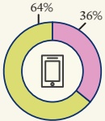

TÉLÉPHONE PORTABLE

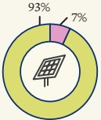

PANNEAUX

SOLAIRES

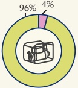

GROUPE ÉLECTROGÈNE

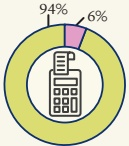

CALCULATRICE

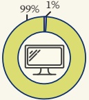

ORDINATEUR /LAPTOP

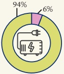

INVERTER

## UTILISATION DES OUTILS DE COMMUNICATION ET AUTRES APPAREILS

Utilisent

N'utilisent pas

<!-- page 26 -->

des MPME ont enregistré des pertes attribuées au Covid-19, alors que 53% des propriétaires ont rapporté que le revenu de leurs entreprises a chuté.

| Category | Value (%) |
| --- | --- |
| Pertes importantes | 14 |
| Petites pertes | 46 |
| Pas affectées | 8 |
| Pourraient fermer leurs portes | 3 |
| IMPACT GLOBAL DU COVID-19(%) |   |
| Réduites | 53 |
| Pareilles qu'avant | 27 |
| Ont arrêté les opérations | 5 |
| Augmentées | 2 |

<!-- page 27 -->

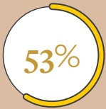

des MPME ont enregistré des pertes

attribuées aux troubles sociopolitiques et les

propriétaires d'entreprises ont identifié des

menaces à l'endroit de leurs entreprises et contre

leur sécurité personnelle.

| Category | Value |
| --- | --- |
| Pertes importantes | 15% |
| Quelques petites pertes | 38% |
| Pas affectées | 5% |
| Pourraient fermer leurs portes | 2% |
| L'impact à long terme reste incertain | 31% |

IMPACT DE L'INSÉCURITÉ SOCIOPOLITIQUE (%)

| Ménace | Niveau de menace contre l'entreprise | Niveau de menace contre le propriétaire |
| --- | --- | --- |
| Menace tèles élevée | 7% | 4% |
| Menace élevée | 36% | 33% |
| Menace modérée | 19% | 21% |
| Faible menace | 15% | 18% |
| Très faible menace | 18% | 20% |
| Ne savent pas | 5% | 4% |

NIVEAU DE MENACE CONTRE L'ENTREPRISE VS.

NIVEAU DE MENACE CONTRE LE PROPRIÉTAIRE (%)

<!-- page 28 -->

## Inclusion financière - Cadre

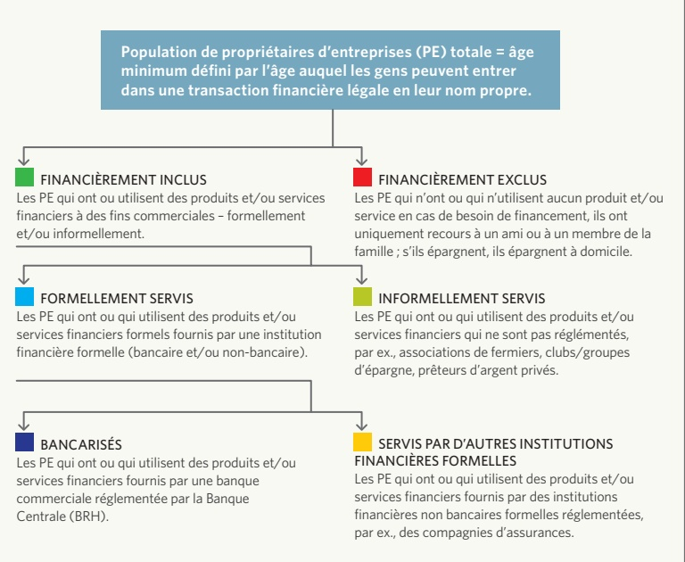

<!-- page 29 -->

## Inclusion financière -Les propriétaires de MPME d'Haïti

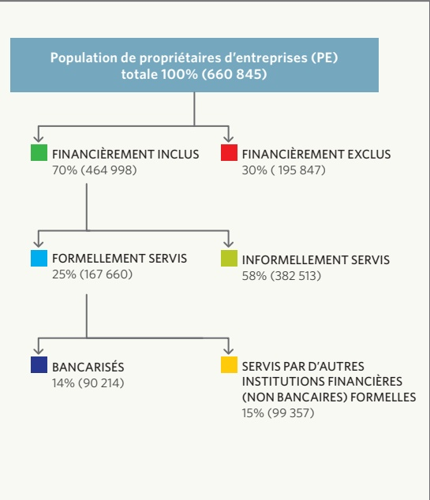

La catégorie « Formelle » regroupe les produits ou services réglementés ou supervisés par une institution formelle, un régulateur ou une agence officielle.

Cette catégorie est également appelée « autre formelle » ou « autre formelle (non bancaire) » pour la distinguer des services bancaires, qui incluent principalement les banques commerciales et les banques de développement.

<!-- page 30 -->

## INCLUSION FINANCIÈRE

Niveau général d'inclusion financière,

chevauchement et filière d'accès des MPME

Niveau général avec chevauchements

| Category | Value |
| --- | --- |
| Formellement servis | 25% |
| Bancarisés | 14% |
| Autre formelle (non bancaire) | 15% |
| Informelle | 58% |
| Exclus | 30% |

• >70% des propriétaires d'entreprises sont financièrement inclus.

- La moitié des propriétaires d'entreprises utilise des produits et services financiers formels—Parmi eux, un sur cinq (24 %) utilise des services de banques commerciales, tandis que 47 % ont recours à d'autres services formels non bancaires.

Un recours élevé (58 %) aux produits financiers informels est observé parmi les propriétaires d'entreprises.

30% des propriétaires d'entreprises n'utilisent aucun produit financier formel ou informel, bien qu'ils puissent emprunter auprès de leur famille ou de leurs amis, ou épargner à domicile.

Filières d'accès

| Year | Bancaire | Autrefiernelle (non-bancaire) | Informelle seulement | Exclus |
| --- | --- | --- | --- | --- |
| 2023 | 14% | 11% | 45% | 30% |

<!-- page 31 -->

Chevauchements

| Category | Value |
| --- | --- |
| Bancaire | 5.6% |
| Autre informelle (non bacaire) | 5.1% |
| Informelles seulement | 4.7% |
| Exclus | 4.5% |
| Informelles seulement & Exclus | 29.6% |
| Bancaire & Informelle | 1.8% |
| Autre informelle & Exclus | 1.5% |
| Bancaire, Informelle, & Exclus | 6.6% |

« Les propriétaires d'entreprises utilisent généralement une combinaison de produits et de services financiers pour répondre à leurs besoins financiers. »

• Seulement 6% des propriétaires

d'entreprises ont recours

exclusivement aux services bancaires.

• Environ 14% utilisent une combinaison de mécanismes formels et informels pour gérer leurs besoins financiers, indiquant ainsi que leurs besoins ne sont pas complètement satisfaits par le secteur formel à lui seul.

• 45% des propriétaires de petites entreprises ont UNIQUEMENT recours aux mécanismes informels tels que les groupes d'épargne et les usuriers.

<!-- page 32 -->

## FILIÈRES D'ACCÈS

Inclusion financière par département

|   | 1% | 14% | 36% | 49% |
| --- | --- | --- | --- | --- |
| Nord | 18% | 9% | 45% | 28% |
| Centre | 17% | 9% | 33% | 41% |
| Nord-Ouest | 17% | 13% | 47% | 23% |
| Grand'Anse | 16% | 19% | 46% | 19% |
| Ouest | 16% | 11% | 46% | 27% |
| Artibonite | 13% | 14% | 50% | 23% |
| Nord-Est | 13% | 5% | 56% | 26% |
| Sud | 13% | 9% | 33% | 45% |
| Sud-Est | 7% | 14% | 55% | 24% |

Inclusion financière par zone

|   | Bancaire | Autre formelle (non-bancaire) | Informelle seulement | Exclus |
| --- | --- | --- | --- | --- |
| Urbaine | 24% | 9% | 45% | 22% |
| Rurale | 8% | 13% | 46% | 33% |

<!-- page 33 -->

Inclusion financière selon le genre des propriétaires de MPME

| Category | 22% | 12% | 38% | 28% |
| --- | --- | --- | --- | --- |
| Homme | 10% | 12% | 48% | 30% |

Inclusion financière selon l'âge des propriétaires de MPME (accent sur la jeunesse)

|   | 8% | 10% | 38% | 44% |
| --- | --- | --- | --- | --- |
| 15-24 ans | 16% | 12% | 46% | 26% |
| 25-35 ans | 17% | 13% | 47% | 23% |
| 36-45 ans | 11% | 11% | 49% | 29% |
| 46-60 ans | 6% | 10% | 33% | 51% |
| 61 et plus |   |   |   |   |

| Category | Value |
| --- | --- |
| Bancaire |   |
| Autre formelle (non-bancaire) |   |
| Informelle seulement |   |
| Exclus |   |

<!-- page 34 -->

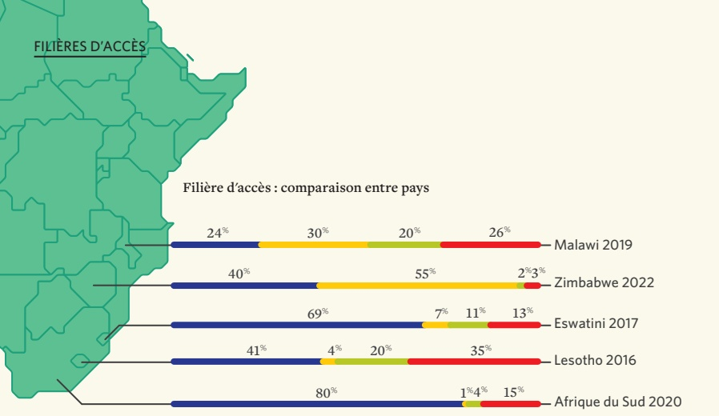

| Category | Haiti 2023 |
| --- | --- |
| Bancaire | 14% |
| Autre formelle (non-bancaire) | 11% |
| Informelle (seulement) | 45% |
| Exclus | 30% |

<!-- page 35 -->

Inclusion financière par cycle de vie des entreprises

| Moins d'un an | 13% | 5% | 47% | 35% |
| --- | --- | --- | --- | --- |
| 1 - 2 ans | 15% | 11% | 44% | 30% |
| 3 - 5 ans | 14% | 14% | 46% | 26% |
| 6 - 10 ans | 14% | 11% | 47% | 28% |
| Plus de 10 ans | 13% | 13% | 43% | 31% |

| Sector | Bancaire | Autre formelle (non-bancaire) | Informelle seulement | Exclus |
| --- | --- | --- | --- | --- |
| Industrie | 27 | 13 | 35 | 25 |
| Service | 18 | 9 | 45 | 28 |
| Commerce | 12 | 13 | 48 | 27 |
| Agriculture | 5 | 11 | 43 | 41 |

<!-- page 36 -->

Filière d'épargne

| Épargne | banaques (%) | Épargne dans les banaques (%) |
| --- | --- | --- |
| autre formel (non bancaire) | 6 | 8 |
| Épargne dans le secteur informel | 55 | 36 |

• Environ 63% des propriétaires d'entreprises épargnent.

L'épargne est largement

stimulée par les groupes

d'épargne.

• 37% des propriétaires d'entreprises n'épargnent pas.

• Seulement 6% des propriétaires d'entreprises ont ou utilisent des produits d'épargne formelle des banques commerciales et 8 % ont recours à des produits d'épargne dans d'autres institutions formelles non bancaires.

La plupart des propriétaires d'entreprises épargnent informellement (57%), largement stimulés par les groupes d'épargne.

<!-- page 37 -->

Épargne selon le genre

| Épargne dans les banques | 12% | 3% | 57% |
| --- | --- | --- | --- |
| Épargne dans autre formel (non bancaire) | 8% | 8% | 50% |
| Épargne dans le secteur informel | 57% | 37% | 35% |
| Aucune épargne | 37% | 37% | 33% |

Épargne par groupes d'âge (accent sur la jeunesse)

<!-- page 38 -->

## PAYSAGE DES PRODUITS

Filière d'épargne en fonction du cycle de vie des entreprises

|   | Blue | Orange | Yellow |
| --- | --- | --- | --- |
| Moins d'un an | 4% | 48% | 44% |
| 1 - 2 ans | 8% | 7% | 33% |
| 3 - 5 ans | 6% | 9% | 34% |
| 6 - 10 ans | 7% | 6% | 36% |
| Plus de 10 ans | 5% | 10% | 36% |

Filière d'épargne par secteur

|   | Light Blue | Dark Blue | Yellow |
| --- | --- | --- | --- |
| Industrie | 11% | 8% | 47% |
| Service | 9% | 7% | 51% |
| Commerce | 4% | 9% | 53% |
| Agriculture | 3% | 8% | 43% |

Filière d'épargne par région

|   | Épargne à la banque | Épargne dans autre formelle (non bancaire) | Épargne dans le secteur informel | Pas d'épargne |
| --- | --- | --- | --- | --- |
| Urbaine | 10% | 8% | 51% | 31% |
| Rurale | 4% | 8% | 49% | 39% |

<!-- page 39 -->

Facteurs d'épargne et de numérisation de l'épargne informelle

| Category | Percentage |
| --- | --- |
| Expansion de l'entreprise | 29% |
| Besoins quotidiens de l'entreprise | 29% |
| Pour l'avenir | 25% |
| Mitigation des risques de catastrophes naturelles | 24% |
| Acquisition de plus d'entreprises | 6% |
| Éducation familiale | 4% |
| Mitigation de la crise sociopolitique | 1% |

FACTEURS D'ÉPARGNE (%)

<!-- page 40 -->

## PAYSAGE DES PRODUITS

• La proportion de propriétaires d'entreprises ayant des prêts auprès d'institutions formelles est similaire et pour institutions bancaires et pour autres institutions formelles non bancaires à 5%.

• Environ 13% des propriétaires d'entreprises ont emprunté auprès de mécanismes de crédit informels.

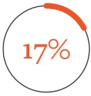

Seulement 17% des propriétaires

d'entreprises ont emprunté au cours des 12 derniers mois.

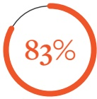

des MPME n'empruntent

pas présentement en raison de

plusieurs barrières, notamment

le manque de qualification, la

peur de s'endetter et l'absence

de besoin de prêts.

| Crédit de source | 15-24 ans (%) | 25-35 ans (%) | 35+ ans (%) |
| --- | --- | --- | --- |
| Aucun emprunt | 88 | 78 | 16 |
| Crédit de Autre formelle (non-bancaire) | 4 | 7 | 10 |

<!-- page 41 -->

Filière de crédit par secteur

|   | Crédit bancaire (%) | Crédit d'Autre formelle (non bancaire) (%) | Crédit de mécanismes informels (%) | Aucun emprunt (%) |
| --- | --- | --- | --- | --- |
| Commerce | 6 | 14 | 80 |   |
| Service | 5 | 10 | 85 |   |
| Agriculture | 4 | 11 | 85 |   |
| Industrie | 4 | 7 | 89 |   |

• Les MPME du secteur du commerce ont plus facilement accès au crédit, même informel, que celles des autres secteurs.

| Category | FACTEURS D'UTILISATION DU CRÉDIT (%) | OBSTACLES AU CRÉDIT (%) |
| --- | --- | --- |
| Développer mon entreprise | 20% | 9% |
| Besoins quotidiens de l'entreprise | 9% | 2% |
| Démarrer mon entreprise | 1% | 1% |
| Acheter des machines | 1% | 1% |
| Raisons personnelles | 1% | 1% |
| J'ai peur de m'endetter | 18% | 17% |
| Je n'ai pas besoin d'emprunter | 17% | 13% |
| L'entreprise est en baisse, j'ai donc peur d'emprunter de l'argent | 13% | 9% |
| Je ne crois pas à l'emprunt d'argent | 9% | 6% |
| J'ai emprunté par le passé et j'ai remboursé je ne suis pas éligible | 6% | 3% |
| Mon revenu change d'un mois à l'autre | 2% | 2% |
| J'ai essayé mais on m'a refusé | 2% | 2% |
| Je n'ai pas de garantie/sécurité | 2% | 2% |

<!-- page 42 -->

## PAYSAGE DES PRODUITS

Assurance de risques et gestion de risques

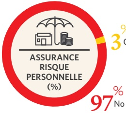

3% Oui

• Seulement 3 % des MPME ont une assurance, mais celle-ci couvre principalement le propriétaire plutôt que les risques de l'entreprise elle-même.

TYPES D'ASSURANCE PERSONNELLE (%)

| Category | Percentage |
| --- | --- |
| Risque personnel | 1.4% |
| Santé | 1% |
| Risque portable | 0.62% |
| Autre | 0.27% |
| Commercial | 0.25% |

Recours à l'assurance selon le secteur

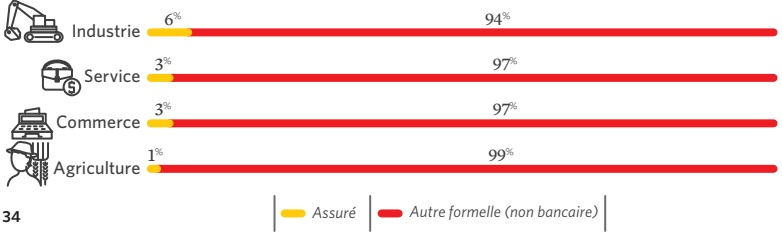

<!-- page 43 -->

Parmi ceux qui empruntent de l'argent (17%), qui épargnent de l'argent (64%), la plupart ont recours aux groupes d'épargne informels/sabota.

Seulement 3% ont une assurance —couvrant surtout les risques personnels.

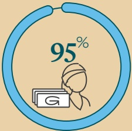

Compte personnel

= 95% des entreprises

bancarisées.

Opportunité de convertir les comptes personnels en comptes d'entreprise- afin de clairement différencier les deux entités.

<!-- page 44 -->

Le secteur des MPME est estimé à 660 000 entreprises, employant 1,122 million de personnes.

- Les MPME contribuent à hauteur de 485 milliards de gourdes au PIB.

• Les départements de l'Artibonite (23%) et de l'Ouest (21%) comptent respectivement un nombre considérable de MPME.

• 67% des entreprises sont détenues par des femmes.

- 35 % des entreprises sont détenues par des jeunes (15 - 35 ans).

Formalisation des entreprises—seulement 11 % des MPME sont formelles. Les MPME informelles n'ont pas accès aux opportunités offertes par l'État et le secteur financier.

Le Covid-19 a affecté 60% des MPME—Des pertes

dues au Covid-19 ont été rapportées.

Survivant aux troubles sociopolitiques — environ 53% des MPME ont rapporté des pertes dues aux agitations civiles.

- Cette situation est exacerbée par le fait que 97 % des MPME dépendent d'une clientèle de passage pour leurs activités.

## Relativement à l'inclusion financière :

L'incapacité à utiliser des plateformes numériques constitue également une limite.

14% des MPME sont bancarisées.

from

58% utilisent des mécanismes informels.

30% sont financièrement exclus.

La plupart dépendent de l'argent cash (99%) — Parmi elles, 89 % effectuent des paiements en liquide via des banques, représentant 0 à 10 % de leurs transactions totales.

Le crédit et l'épargne proviennent principalement de groupes d'épargne informels.

13% des MPME ont accès au crédit informel.

55% des MPME ont accès à des mécanismes d'épargne informels.

L'assurance est quasiment inexistante, avec seulement 3 % des MPME assurées.

Différenciation entre comptes personnels et comptes d'entreprise—95% des comptes bancaires sont au nom du propriétaire.

<!-- page 45 -->

1. La formalisation des MPME est cruciale—il ne s'agit pas seulement de fiscalité, mais aussi de comprendre la taille du secteur pour le support gouvernemental approprié (par ex. support Covid-19), de fournir une documentation adéquate pour accéder aux services financiers, et de réduire l'asymétrie informationnelle.

### 2. La numérisation de paiements vers une économie de marché—L'argent liquide présente des vulnérabilités, et

des efforts concertés pour créer un écosystème numérique aideraient les MPME à profiter de ses efficiencies et avantages leur permettant ainsi de prendre de l'envergure et de grandir.

3. Accès et utilisation des services financiers—l'accès aux services financiers formels est une limite majeure pour les MPME haïtiennes, comprendre simultanément à quels mécanismes informels les MPME ont recours est important.

### 4. Améliorer la résilience des entreprises après le Covid-19 et les troubles sociopolitiques—au-delà des

défis prédominants, les MPME auront besoin de support et de formation pour développer leurs entités.

5. La définition et la catégorisation des MPME sont importantes — Établir une norme commune pour définir ce que PME est une tâche essentielle.

### 6. Valoriser la proposition pour les fournisseurs de services financiers à travers l'analyse des données—avec

le luxe de données sur les MPME, les fournisseurs de services financiers devraient être encouragés à servir ce secteur en mettant en avant la valeur ajoutée.

### 7. La différenciation entre les comptes personnels et les comptes d'entreprise

—Les efforts pour distinguer les entités légales et personnelles sont cruciaux pour obtenir des données précises sur les transactions, les documents et la performance de l'entreprise.

<!-- page 46 -->

<!-- page 47 -->

<!-- page 48 -->

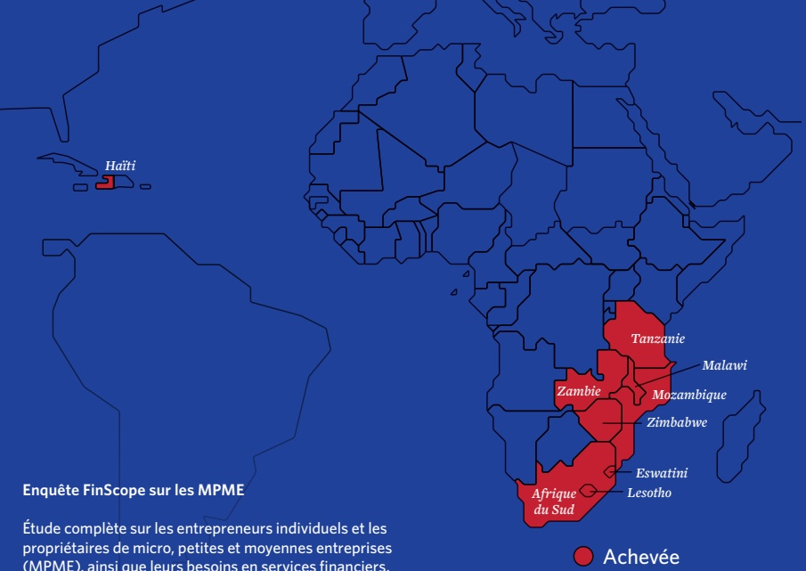

## Enquête FinScope sur les MPME

Étude complète sur les entrepreneurs individuels et les propriétaires de micro, petites et moyennes entreprises (MPME), ainsi que leurs besoins en services financiers.

Banque de la République

d'Haiti (BRH)

Adresse: Angle des rues

Pavée et du Quai

Port-au-Prince, Haiti

Tel: +509 2290 0777

/+509 2290 0012

info@brh.ht

www.brh.ht

Ministère du Commerce

et de l'Industrie (MCI)

Adresse: 64, Rue

Légitime

Port-au-Prince, Haiti

Tel: +509 29 43 4488

www.mci.gouv.ht

Ministère de l'Économie

et des Finances (MEF)

Adresse: 5, Ave Charles

Summer

Port-au-Prince, Haiti

Tel: +509 25 58 665

www.mef.gouv.ht

USAID Atteindre

(Attain) Project

Implemented by MEDA

atteindre@meda.org

Tel: +509.2940.7070

Dr Kingstone Mutsonziwa

Finmak.org.za

Tel: +27 67 594 9291

kingstonem@finmark.org.za

www.finmark.org.za

Mr Abel Motsomi

Finmak.org.za

Tel: +27 67 594 9291

abelm@finmark.org.za

www.finmark.org.za

Tel: +27 67 594 9291

www.finmark.org.za
