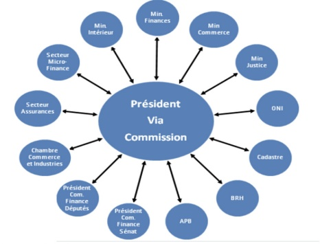
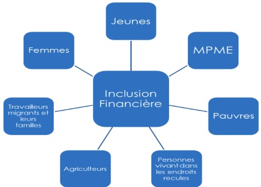
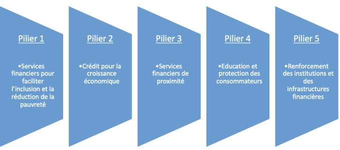

<!-- page 1 -->

BANQUE DE LA RÉPUBLIQUE D'HAÎTI

## DOCUMENT D'INFORMATION

Stratégie Nationale d'Inclusion Financière: Les différents piliers et les avancées

<!-- page 2 -->

<!-- page 3 -->

## INTRODUCTION

Au cours de ces dernières années, l'inclusion financière est devenue un pilier essentiel du développement socio-économique. Ainsi, elle se place parmi les principaux enjeux de politique publique.

En effet, elle a permis l'insertion de nouveaux agents économiques dans le circuit formel en facilitant l'accès à un ensemble de services et de produits financiers à un faible coût auprès des institutions règlementées et crédibles. Par ailleurs, l'exclusion financière limite les opportunités d'investissement ainsi que le potentiel de développement des micros, petites et moyennes entreprises (MPME) considérées comme le moteur de la croissance économique et de la création d'emplois. Sub-séquemment, une plus large réponse aux besoins financiers des ménages et des entreprises concourt, à réduire les inégalités sociales, à diminuer le taux de chômage et à impulser une croissance économique inclusive.

Ces nombreux effets bénéfiques justifient le renforcement du dialogue entre les Autorités haitiennes autour des politiques à mettre œuvre pour lutter contre l'exclusion financière dans le pays. A l'instar des autres pays à faible revenu, l'accès aux services financiers formels demeure faible en Haiti en dépit des efforts réalisés en termes de modernisation du système de paiement notamment avec l'émergence des banques à distance et des services de paiement mobile. D'après le rapport FINDEX 2011 publié par la Banque mondiale, 27,5 % de la population haitienne possédaient un compte financier en 2017 contre 29 % et 45 % respectivement dans les autres pays à faible revenu et, en Amérique latine et dans les Caraïbes¹. Par ailleurs, l'Enquête FinScope menée auprès des consommateurs en Haiti en 2018 a conclu que seulement 54 % des haitiens âgés de 15 ans et plus sont inclus financièrement. Le faible niveau d'instruction de la population et l'insuffisance d'infrastructures financières demeurent les principales difficultés liées au développement de l'inclusion financière en Haiti. Comme autres barrières auxquelles font face les ménages haitiens, peuvent être cités les problèmes liés au marché de l'emploi. En effet, de l'échantillon considéré par l'enquête susmentionnée, 34 % font face au chômage, 28 % n'ont pas de revenus réguliers tandis que pour 19 % d'entre eux, la faiblesse de leur revenu ne leur permette pas de constituer des épargnes. S'ensuivent avec un poids moins prépondérant d'autres éléments tels la confiance dans les institutions financières et le manque de proximité des points de services financiers.

<!-- page 4 -->

Ainsi, en vue de réduire les obstacles à l'amélioration de l'inclusion financière en Haïti, la BRH en collaboration avec la Banque Mondiale a lancé en 2014, « la Stratégie Nationale d'Inclusion Financière (SNIF) ».

## STRATÉGIE NATIONALE D'INCLUSION FINANCIÈRE DÉFINITION

La Stratégie nationale d'inclusion financière (SNIF) se définit comme l'ensemble des actions prévues et les différentes étapes à franchir par les acteurs de l'écosystème financier afin d'attendre les objectifs d'inclusion financière. La SNIF s'est renforcée en Haiti suite aux résultats de l'enquête Finscope de 2018 dont l'objectif était de décrire les niveaux d'inclusion financière, le paysage d'accès, et d'identifier les moteurs et les obstacles liés à l'inclusion financière. Des résultats de l'enquête, il est ressorti que près de 11 % des adultes ont recours aux services bancaires tandis que 26 % dépendent d'autres services formels non bancaires, alors que seulement 4 % de l'échantillon considéré ont révélé avoir accès au crédit.

Résultat Enquête Finscope

| Category | Value |
| --- | --- |
| Formellement servi | 44 |
| Bancarisé | 11 |
| Autre Formel (non-bancaire) | 42 |
| Informel | 19 |
| Exclus | 46 |

Source : Enquête FinScope auprès des consommateurs Haïti 2018, 24 avril 2019

## CADRE DE GOUVERNANCE DE LA SNIF

La SNIF est une initiative dont l'efficacité de la mise en œuvre suppose la participation de toutes les entités sociales, économiques et politiques du pays, puisqu'elle englobe toutes les couches de la population sur toute l'étendue du territoire national. Ainsi, le cadre de gouvernance de cette dernière regroupe :

a Les régulateurs du secteur financier (BRH et MEF). Au niveau de la BRH, l'Unité d'Inclusion Financière sert de secrétariat technique pour l'opérationnalisation de la SNIF. Elle a pour tâche d'évaluer et de collecter toutes

<!-- page 5 -->

les données relatives à l'accès et à l'utilisation des informations financières et non financières, ainsi que les données relatives à la qualité des services financiers et leurs effets dans l'amélioration des conditions de vie de la population en Haiti².

b Les autres ministères (notamment le Ministère de l'Éducation, le Ministère de la Santé, le Ministère de l'Agriculture, le Ministère des Affaires Sociales et le Ministère de la Justice) ;

c Le Parliament :

d L'industrie des services financiers :

e Et les autres parties prenantes (Associations de consommateurs, de la société civile.).

Cadre de gouvernance de la SNIF

Source : Unité d'inclusion financière, BRH

## OBJECTIF DE LA SNIF (MISSION ET VISION)

La SNIF a pour objectif de favoriser les stratégies de développement économique, de faciliter l'accès aux services financiers, de développer des produits adaptés aux besoins de la clientèle, de promouvoir l'éducation/financière ainsi que l'utilisation des nouvelles technologies de l'information et de la communication pour la prestation de services financiers et de favoriser l'émergence d'un cadre formel de protection du consommateur financier $ ^{3} $.

<!-- page 6 -->

## POPULATIONS CIBLES

Les populations ciblées par la stratégie d'inclusion financière sont celles qui sont les plus touchées par les contraintes à l'accès et à l'utilisation des services financiers. Parmi les groupes visés peuvent être cités : les pauvres, les Micros, Petites et Moyennes Entreprises (MPME), les jeunes, les agriculteurs, les femmes, les personnes vivant dans des zones reculées et les travailleurs migrants et leurs familles. L'implémentation de la SNIF devra impliquer l'ensemble du secteur financier. Il est à noter que le système financier en Haïti est dominé par les banques, suivies des Coopératives d'épargne et de crédit, des Institutions de microfinance (IMF), des Sociétés financières de développement (SFD) et des institutions financières spécialisées (les compagnies d'assurances).

Populations cibles

Source : Unité d'inclusion financière, BRH

## DIFFÉRENTS PILIERS DE LA STRATÉGIE NATIONALE DE L'INCLUSION FINANCIÈRE ET LES AVANCÉES $ ^{4} $

L'implémentation des activités de la SNIF tournent autour de cinq piliers. Pour chacun des piliers constitués, un ensemble d'actions qui concourent à l'atteinte des objectifs visés ont déjà été menées.

## Pilier 1- Services financiers pour faciliter l'inclusion et la réduction de la pauvreté

Cette démarche s'inscrit dans l'élargissement des possibilités d'accès aux services financiers destinés aux ménages à faibles revenus y compris des produits d'épargne et de crédit, des paiements du gouvernement aux particuliers, des transferts, des

<!-- page 7 -->

micro-assurances et des micro-pensions. Elle implique en premier lieu la révision des critères d'ouverture de compte d'épargne après consultation auprès des différents acteurs du marché. Pour cela, les différentes parties prenantes ont procédé au :

• Support du décret portant sur la signature électronique (édition du Moniteur du 29 janvier 2016) ;

• Développement du Processeur National de Paiement (PRONAP) afin d'assurer l'interopérabilité entre les différents types de paiement et les différents acteurs financiers ;

• Admission de la Fédération des Coopératives d'Épargne et de Crédit (CEC) à la chambre de compensation en vue de faciliter les transactions financières de ces institutions ;

Dépôt du projet de loi relatif au crédit-bail ;

• Dépôt du projet de loi relative à la microfinance.

## Pilier 2- Crédit pour la croissance économique

Ce pilier vise à développer le microcrédit en proposant des outils de financement aux Micro, Petites et Moyennes Entreprises (MPME) des secteurs agricole et du logement, ainsi que des instruments d'assurance pour aider à gérer les risques. Les actions déjà entreprises au niveau de ce pilier comprennent entre autres :

L'Enquête Finscope auprès des consommateurs en 2018 ;

La collaboration avec des institutions bancaires et non bancaires pour le développement de produits financiers en faveur de plusieurs filières agricoles ;

Le développement de partenariat entre la BRH et certaines institutions financières pour le lancement de produits de crédit adaptés aux groupes cibles ;

- Le support pour le développement des produits de crédit de bail et de crédit leasing ;

- L'amélioration des incitations existantes pour les prêts hypothécaires (Kay Pam etc...);

L'enquête Finscope sur les MPME en cours.

<!-- page 8 -->

## Pilier 3- Services financiers de proximité

Ce volet consiste à étudier les options pour l'opération des agents non bancaires en Haïti et établir le cadre règlementaire devant régir le fonctionnement de ces agents. Ce point porte aussi sur le développement de la monnaie électronique et l'encouragement des innovations autour de nouveaux produits financiers. Ci-contre les étapes qui ont déjà été franchies :

• Intensification des inspections des caisses populaires notamment dans les départementes du Nord et du Sud ;

• Support aux agents bancaires et non bancaires sur le développement de la monnaie électronique (Ex : BNC et Haitipay (Lajan Cash) ; Digicel et ScotiaBank (Tchotcho mobile / Mon Cash) ;

Publication de la Circulaire # 121 relatif aux services financiers des fournisseurs de services de paiement électronique ;

## Pilier 4- Éducation financière et Protection des consommateurs

Encouragement des innovations autour de nouveaux produits financiers (Ex : Natcom / Nat Cash, BRH/ Bitkòb - Gourde digitale).

Il s'agit dans ce pilier de renforcer la connaissance financière plus particulièrement des catégories ciblées par l'inclusion financière via un plan d'actions sur l'éducation financière. Ceci leur permettra de prendre de meilleures décisions d'investissement tout en réduisant le niveau de risque. Il est donc nécessaire de développer le cadre légal et réglementaire à cet effet. Ainsi ont été menées les démarches telles :

Le lancement du programme d'éducation financière (PENF) dans plusieurs écoles de l'aire métropolitaine en 2020 ;

Le dépôt du projet de loi sur le Bureau d'Information sur le Crédit ;

La création du Bureau d'information sur le Crédit (BIC);

Le dépôt du projet de loi sur le gage sans dépossession.

## Pilier 5- Renforcement des institutions et des infrastructures financières

Le renforcement de l'infrastructure financière et la consolidation des coopératives d'épargne et de crédit et des institutions de microfinance non mutualiste, l'implémentation du cadre juridique pour le secteur de l'assurance, y compris l'identification biométrique ainsi que la titrisation des terres en milieu urbain et rural sont entre autres les actions clé de ce pilier. Ainsi, ont été déjà réalisés :

<!-- page 9 -->

Le dépôt de plusieurs projets de loi au parlement pour mieux gérer les institutions de microfinance non mutualiste ;

Le renforcement des inspections des caisses populaires afin d'assurer la stabilité financière dans le secteur de la Microfinance et d'avoir un meilleur contrôle sur les avoir des sociétaires ;

• La mise en place du Bureau d'Information sur le Crédit $ ^{5} $.

Les différents piliers de la SNIF

• Education et protection des consommateurs

## CONCLUSION

Le plan d'actions de la Stratégie d'inclusion financière répond donc à la nécessité d'élargir l'accès aux produits financiers aux entreprises et aux ménages sur toute l'étendue du territoire national, tout en encourageant le secteur financier à offrir des services adaptés à la demande de toutes les couches de la société. Ainsi, afin de desservir les régions les plus reculées du pays où les infrastructures financières sont peu développées, la promotion autour des innovations technologiques notamment de la monnaie électronique est fondamentale. Dans cette même veine, la Banque centrale étudie la possibilité d'émettre une monnaie numérique nationale et réfléchit sur les mécanismes qui permettront d'en étendre les effets bénéfiques à tous les segments de la population haïtienne. L'atteinte de ces objectifs passe par le renforcement de l'éducation financière, en vue d'inciter les agents économiques à rejoindre le circuit financier formel, à comprendre l'utilité et l'importance des différents services et produits financiers tout en les aidant à mieux orienter leur choix.

<!-- page 10 -->

Parallèlement, les Autorités monétaires continuent d'œuvrer dans le sens d'un cadre réglementaire mieux adapté aux nouveaux acteurs de l'écosystème financier en vue de favoriser leur développement et de garantir la protection des consommateurs. Elles poursuivent les actions visant l'intégration dans le système financier formel d'un nombre plus important de particuliers et d'entreprises particulièrement des PME en vue de parvenir à une croissance économique soutenue, inclusive et plus résiliente.

<!-- page 11 -->

<!-- page 12 -->

Banque de la République D'Haiti

www.brh.ht

Direction Monnaie et Analyse Economique

Angle rues Pavée et du Quai / Port-au-Prince, Haïti W.I.

Boite Postale 1570

Téléphone: (509) 22.99.11.64

Fax: (509)22.99.11.92
