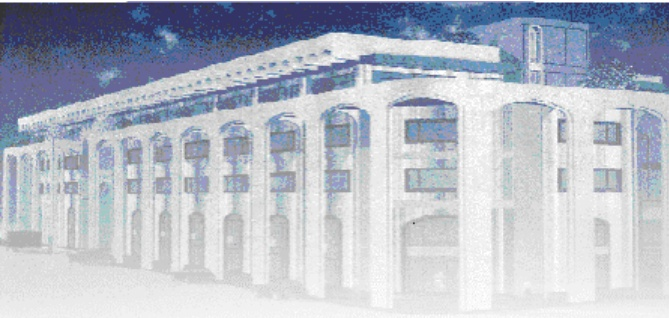

<!-- page 1 -->

Banque de la République d'Haïti

Note mensuelle d'inflation

Juillet 2014

<!-- page 2 -->

## Introduction

Cette note analyse l'évolution de l'Indice des Prix à la Consommation (IPC) en Haïti au cours du mois de juillet 2014. Elle apporte quelques éléments explicatifs permettant de comprendre les facteurs qui influencent l'évolution de l'inflation ainsi que les prévisions pour les trois prochains mois.

### I. - Évolution de l'inflation globale

En juillet 2014, l'inflation a augmenté de 4,8 % en glissement annuel et de 0,7 % en variation mensuelle. La tension inflationniste est relativement plus prononcée au cours de cet exercice comparativement à l'exercice précédent. En effet, l'inflation cumulée a atteint 4,4 % durant les dix premiers mois de l'exercice 2013-2014 contre 4,1 % au cours de la même période de l'exercice précédent.

Graphique No. 1 Evolution de l'inflation annuelle en juillet 2014 (en %)

| Date | Value |
| --- | --- |
| Jul-12 | 5.3 |
| Aug-12 | 6.5 |
| Sep-12 | 6.8 |
| Oct-12 | 7.5 |
| Nov-12 | 6.8 |
| Dec-12 | 7.5 |
| Jan-13 | 7.2 |
| Feb-13 | 7.4 |
| Mar-13 | 7.4 |
| Apr-13 | 7.3 |
| May-13 | 7.3 |
| Jun-13 | 6.5 |
| Jul-13 | 6.2 |
| Aug-13 | 5.5 |
| Sep-13 | 4.5 |
| Oct-13 | 4.5 |
| Nov-13 | 3.4 |
| Dec-13 | 3.4 |
| Jan-14 | 3.4 |
| Feb-14 | 3.2 |
| Mar-14 | 3.2 |
| Apr-14 | 3.5 |
| May-14 | 3.5 |
| Jun-14 | 4.2 |
| Jul-14 | 4.8 |

<!-- page 3 -->

Graphique No. 2 Evolution de l'inflation mensuelle en juillet 2014 (en %)

| Date | Value |
| --- | --- |
| April-13 | 0.3 |
| May-13 | 0.5 |
| June-13 | 0.1 |
| July-13 | 0.1 |
| August-13 | 0.3 |
| September-13 | 0.1 |
| October-13 | 0.2 |
| November-13 | 0.1 |
| December-13 | 0.4 |
| January-14 | 0.2 |
| February-14 | 0.3 |
| March-14 | 0.6 |
| April-14 | 0.6 |
| May-14 | 0.6 |
| June-14 | 0.7 |
| July-14 | 0.7 |

Cette progression de l'inflation mensuelle en juillet 2014 est imputable à l'augmentation de l'indice des prix de toutes les fonctions notamment: « Habillement, tissus et chaussures » (1,7 %), « Autres biens et services » et « Santé » (1,6 %), « Loyer du logement, Énergie et Eau » (0,8 %), « Aménagement et entretien du logement » (0,6 %). Les postes de dépenses ayant le plus contribué à l'inflation mensuelle sont « Alimentation, boisson et tabac » bien que sa contribution ait légèrement diminué de 2,80 points de pourcentage d'un mois à l'autre (44,60 % en juillet 2014 contre 47,41 %), « Habillement, tissus et chaussures » (16,5 %) et « Loyer du logement, Énergie et Eau » (13 %).

### 2. - Évolution de l'inflation selon l'origine des produits

En variation mensuelle, l'inflation des produits locaux est passée à 0,7 % au cours du mois sous étude contre 0,5 % en juin dernier, tandis que celle des produits importés a gardé le même niveau qu'en juin 2014, soit 0,7 %. En glissement annuel, les prix des produits locaux et importés ont enregistré le même taux de croissance (4,6 %) au mois de juillet 2014.

### 3. - Évolution de l'inflation sous-jacente

L'inflation sous-jacente, permettant de dégager la tendance de long terme de l'inflation globale, a suivi la même tendance que l'inflation courante, en enregistrant une hausse de 73 points de base à 5,16 % en juillet 2014 contre 4,43 % le mois d'avant. En variation mensuelle, le rythme

<!-- page 4 -->

de progression de l'indice sous-jacent a également augmenté à 0,93 %, soit 21 points de base de plus que le mois précédent. Évoluant au-dessus du taux de croissance de l'indice global des prix à la consommation pour le troisième mois consécutif, l'inflation sous-jacente, démontre que la hausse de l'inflation est plutôt liée à l'évolution des agrégats monétaires qu'à celle des prix des produits volatils du panier de la ménagère.

Graphique No. 3 Contribution en % des différents postes de dépenses à l'inflation annuelle (juillet 2014)

| Category | Percentage (%) |
| --- | --- |
| Alim, bois, tab | 43 |
| Habil, tis, chs. | 14 |
| Loyer, En, eau | 14 |
| Aménag, Ent. | 4 |
| Transport | 6 |
| Santé | 6 |
| Lois., sp. | 6 |
| Aut. biens & serv. | 9 |

Graphique No. 4 Contribution en % des différents postes de dépenses à l'inflation mensuelle (juillet 2014)

| Category | Percentage (%) |
| --- | --- |
| Alim, bois, tab | 45 |
| Habil, tis, chs. | 16 |
| Lois., sp. Ens., Clt. | 1 |
| Transport | 4 |
| Aménag, Ent. log. | 4 |
| Sante | 6 |
| Aut. biens & serv. | 11 |

### II. Facteurs explicatifs de la hausse de l'inflation mensuelle en juillet 2014

L'évolution du niveau général des prix au mois de juillet 2014 a été influencée par un choc de demande provoqué par une augmentation de la monnaie en circulation dans l'économie.

### II. 1- Augmentation de la monnaie en circulation

Les dépenses relatives aux opérations de l'État ont entraîné une hausse du crédit net au Gouvernement Central de 0,18 %. Cette évolution du crédit dans l'économie a provoqué la hausse de la monnaie en circulation (1,76 %) pour le mois sous revue. La progression de cette dernière a, ainsi, favorisé la hausse des poussées inflationnistes en juillet 2014.

<!-- page 5 -->

### III-. Prévisions d'inflation

Selon les prévisions réalisées par la Banque de la République d'Haïti, l'inflation évoluera en dents de scie sur les trois mois à venir avec une tendance à la baisse. En effet, pris sur une base annuelle, l'IPC affichera un taux de 4,8 %, 4,9 % et 4,6 % pour les mois d'août, de septembre et d'octobre 2014. En variation mensuelle, les prévisions tablent sur des taux d'inflation de 0,2 %, 0,3 %, -0,1 % respectivement pour les trois prochains mois.

Graphique No. 5 Prévision de l'inflation annuelle (Août, septembre, octobre 2014)

| Date | inflation estimée (inf) | Inflation en glissement annuel | inflation estimée (sup) |
| --- | --- | --- | --- |
| Dec-10 |   |   | 6.2 |
| Jan-11 |   |   | 3.8 |
| Feb-11 |   |   | 6.4 |
| Mar-11 |   |   | 7.8 |
| Apr-11 |   |   | 8.5 |
| May-11 |   |   | 9.2 |
| Jun-11 |   |   | 9.5 |
| Jul-11 |   |   | 9.6 |
| Aug-11 |   |   | 9.8 |
| Sep-11 |   |   | 10.4 |
| Oct-11 |   |   | 10.4 |
| Nov-11 |   |   | 9.8 |
| Dec-11 |   |   | 8.2 |
| Jan-12 |   |   | 7.5 |
| Feb-12 |   |   | 6.2 |
| Mar-12 |   |   | 5.6 |
| Apr-12 |   |   | 5.2 |
| May-12 |   |   | 4.9 |
| Jun-12 |   |   | 5.0 |
| Jul-12 |   |   | 5.8 |
| Aug-12 |   |   | 6.2 |
| Sep-12 |   |   | 6.5 |
| Oct-12 |   |   | 6.8 |
| Nov-12 |   |   | 7.5 |
| Dec-12 |   |   | 7.6 |
| Jan-13 |   |   | 7.2 |
| Feb-13 |   |   | 7.8 |
| Mar-13 |   |   | 7.5 |
| Apr-13 |   |   | 7.2 |
| May-13 |   |   | 6.8 |
| Jun-13 |   |   | 6.2 |
| Jul-13 |   |   | 5.5 |
| Aug-13 |   |   | 4.5 |
| Sep-13 |   |   | 4.2 |
| Oct-13 |   |   | 3.4 |
| Nov-13 |   |   | 3.4 |
| Dec-13 |   |   | 3.3 |
| Jan-14 |   |   | 3.2 |
| Feb-14 |   |   | 3.2 |
| Mar-14 |   |   | 3.4 |
| Apr-14 |   |   | 3.4 |
| May-14 |   |   | 3.8 |
| Jun-14 |   |   | 4.3 |
| Jul-14 |   |   | 4.8 |
| Aug-14 |   | 4.5 | 5.2 |
| Sep-14 |   | 4.9 | 5.4 |
| Oct-14 |   | 4.6 | 5.0 |

<!-- page 6 -->

Tableau no. 1 Indice des Prix à la Consommation (IPC) par postes de dépenses ariation et Contribution à l'inflation mensuelle et annuelle

En Juillet 2014

<table><tr><td></td><td>Indice des Prix à la Consommation (IPC)</td><td>Variation IPC (en %)</td><td>Contribution à l'inflation (en %)</td></tr><tr><td>Mensuelle</td><td>Annuelle</td><td>Mensuelle</td><td>Annuelle</td></tr><tr><td>Poste</td><td>Pondération (en %)</td><td>Juillet 13</td><td>Juin 14</td><td>Juillet 14</td><td>Juillet 14</td><td>Juillet 14</td><td>Juillet 14</td><td>Juillet 14</td></tr><tr><td>Indice Général</td><td>208.8</td><td>217.31</td><td>218.90</td><td>0.7</td><td>4.8</td><td>100.00</td><td>100.00</td></tr><tr><td>Alimentation, boissons et tabac</td><td>50.35</td><td>219.90</td><td>226.30</td><td>227.70</td><td>0.6</td><td>4.0</td><td>44.60</td><td>42.8</td></tr><tr><td>Habillement, tissus et chaus.</td><td>6.86</td><td>198.70</td><td>213.90</td><td>217.50</td><td>1.7</td><td>9.5</td><td>16.53</td><td>13.7</td></tr><tr><td>Loyer, énergie et eau</td><td>11.05</td><td>242.70</td><td>254.80</td><td>256.90</td><td>0.8</td><td>5.9</td><td>13.04</td><td>13.7</td></tr><tr><td>Aménag. et entret. du logem</td><td>4.7</td><td>212.80</td><td>221.10</td><td>222.40</td><td>0.6</td><td>4.5</td><td>3.96</td><td>4.5</td></tr><tr><td>Santé</td><td>2.9</td><td>212.30</td><td>231.30</td><td>234.90</td><td>1.6</td><td>10.6</td><td>6.46</td><td>6.5</td></tr><tr><td>Transport</td><td>13.74</td><td>157.00</td><td>158.80</td><td>159.10</td><td>0.2</td><td>1.3</td><td>3.72</td><td>3.9</td></tr><tr><td>Lois., sp. Ens., Clt.</td><td>5.84</td><td>215.80</td><td>225.90</td><td>226.20</td><td>0.1</td><td>4.8</td><td>1.11</td><td>6.0</td></tr><tr><td>Aut. biens & serv.</td><td>4.56</td><td>172.270</td><td>185.30</td><td>185.20</td><td>1.6</td><td>9.3</td><td>10.58</td><td>9.0</td></tr></table>

Sources : IHSI et calculs du Service de la Macrééconomie et Analyse de Conjoncture de la MAE

<!-- page 7 -->

## Glossaire

<table><tr><td>Glossan e</td></tr><tr><td>Variation mensuelle</td><td>: Variation par rapport au mois précédent.</td></tr><tr><td>Glissement annuel</td><td>: Variation par rapport au même mois de l'année antérieure.</td></tr><tr><td>Inflation</td><td>: Mouvement persistant à la hausse du niveau général des prix.</td></tr><tr><td>Désinflation</td><td>: Ralentissement de la croissance des prix.</td></tr><tr><td>Déflation</td><td>: Baisse du niveau général des prix associée à une contraction de la masse monétaire et du crédit.</td></tr><tr><td>Inflation sous-jacente</td><td>: Tendance de long terme des prix, tout en excluant la volatilité, les mouvements saisonniers, conjoncturels, et les chocs qui affectent les composantes du panier considéré.</td></tr><tr><td>Région Nord</td><td>: Elle couvre les départementes du Nord, Nord-Est et Nord-Ouest.</td></tr><tr><td>Région Sud</td><td>: Elle comprend les départementes du Sud de la Grand'Anse et des Nippes.</td></tr><tr><td>Région Reste Ouest</td><td>: Y sont inclus les départementes du Sud'Est et de l'Ouest à l'exception de l'aire métropolitaine</td></tr><tr><td>Région Transversale</td><td>: Elle regroupe les départementes du Centre et de l'Artibonite.</td></tr><tr><td>Aire Métropolitaine</td><td>: Elle contient les villes de Port-au-Prince, de Delmas, de Pétion-Ville, de</td></tr></table>

Aire Métropolitaine : Elle contient les villes de Port-au-Prince, de Delmas, de Pétion-Ville, de Carrefour et de Croix des Bouquets.
