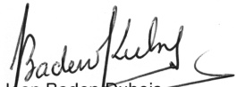

<!-- page 1 -->

## PROROGATION DÉLAI

## APPEL À MANIFESTATION D'INTÉRÊT POUR LA SÉLECTION D'UNE FIRME POUR LA VÉRIFICATION DES ÉTATS FINANCIERS

La Banque de la République d'Haïti (BRH), organisme public jouissant de la personnalité juridique et de l'autonomie financière, ayant son siège principal à Port-au-Prince, compte recruter une firme d'audit pour la vérification de ses états financiers (bilan, état des revenus et dépenses, état des mouvements de fonds, état de l'évolution du capital et des comptes de réserve, notes aux états financiers) et l'émission d'une lettre de gestion sur le contrôle interne, en vue d'avoir une opinion sur sa situation financière et sur ses résultats en conformité avec les principes comptables généralement reconnus et avec les normes internationales d'audit.

À cet effet, la Banque de la République d'Haïti invite les intéressés à soumettre leurs expressions d'intérêt conformément à la loi du 10 juin 2009 (article 35) fixant les Règles Générales Relatives aux Marchés Publics et aux Conventions de Concession d'Ouvrage de Service Public. Les firmes nationales et internationales doivent fournir toutes les informations qu'elles jugent utiles à l'établissement de leur qualification pour l'exécution de ces prestations, notamment :

- Leur présentation :

• Les pièces légales :

Pour les firmes étrangères, la copie de leurs statuts et de l'acte constitutif de l'entreprise dûment authentifiés;

Pour les firmes haïtiennes: le quitus fiscal de type C, le certificat de patente spécifique à l'objet du marché, la carte d'immatriculation fiscale ou matricule fiscal, la copie du moniteur de publication des statuts (pour les sociétés anonymes) ou l'avis de formation publié dans un journal à grand tirage du pays (pour les sociétés en noms collectifs), la copie de la carte d'identité professionnelle (pour les entreprises individuelles)

• Les trois derniers états financiers :

- Les références sur des missions similaires réalisées durant les cinq (5) dernières années ;

- La preuve qu'elles comptent au moins dix (10) années d'expérience continue en audit financier ;

• La preuve de leur expérience dans le secteur bancaire :

• Curriculum Vitae des principaux intervenants (Niveau de formation des principaux intervenants : cinq (5) ans d'expérience en audit financier, licence, minimum de 4 années d'études universitaires complétées avec succès. Les licences en Sciences-Comptables sont un atout majeur);

- Un mandat notarié autorisant le représentant légal à engager la firme dans le cadre du marché.

<!-- page 2 -->

Les critères de sélection des candidats sont déterminés de manière à juger de leur capacité à exécuter les prestations proposées et qui feront l'objet du marché. Ces critères sont les suivants :

## a) Expérience du consultant (40 points)

L'expérience du candidat est jugée sur la base de son nombre d'années d'expérience dans le domaine et du nombre de prestations similaires exécutées durant les 10 dernières années soit :

Nombre d'années d'expérience (n) (20 pts) :
n ≤ 5 ans          : 5 points
5 < n ≤ 10 ans     : 15 points
n > 10 ans +           : 20 points

## Et

Nombre de prestations (p) (20 pts) :
1 ≤ p ≤ 3 prestations : 5 points
3 < p ≤ 5 prestations : 10 points
5 < p ≤ 10 prestations : 15 points
p > 10 et plus prestations : 20 points

Le candidat devra fournir les preuves de son expérience en incluant dans son dossier des copies des certificats d'attestation.

## b) Expérience du personnel (40 points)

L'expérience du personnel du candidat est notée sur la base des qualifications et de l'expérience des principaux intervenants dans le domaine :

## Qualification

Aucun titre : 0 point
Diplôme universitaire ou licence : 10 points
Licence en sciences comptables : 12 points
Maitrise : 15 points
Doctorat : 20 points
Expérience (e)
Moins de 5 ans : 0 point
5 < e ≤ 10 ans : 10 points
10 < e ≤ 20 ans : 15 points
e > 20 ans + : 20 points

Chaque principal intervenant sera évalué séparément puis le calcul de la moyenne sera effectué en vue d'obtenir le score pour le critère. Les copies des diplômes des principaux intervenants seront incluses dans le dossier.

c) Conformité des documents légaux et administratifs (20 points)

<!-- page 3 -->

Pour tout document manquant le candidat perd 10 points.

Pour tout document dont la présentation ne serait pas conforme le candidat perd 5 points.

La firme sera engagée pour un mandat d'une (1) année, renouvelable deux fois afin de couvrir les trois (3) exercices (exercices fiscaux 2016-2017, 2017-2018, 2018-2019).

Toute firme, ayant vérifié les états financiers de la BRH durant les six dernières années préalables à cet appel à manifestation d'intérêt (exercices fiscaux 2010-2011 à 2015-2016), n'est pas habilitée à participer à cet appel à manifestation d'intérêt (AMI).

Les firmes intéressées sont invitées à faire parvenir ou à déposer leur dossier de candidature en trois exemplaires (un original et deux copies) sous enveloppe fermée et scellée portant la mention « Appel à manifestation d'intérêt pour la vérification des états financiers », au plus tard, le lundi 3 novembre 2016, à 10h am, à l'adresse suivante :

Banque de la République d'Haïti

c/o Commission Spécialisée des Marchés Publics

Angle des rues Pavée et du Quai,

Port-au-Prince, Haïti

Téléphone (509) 22 99 1210, (509) 22 99 1171, Fax (509) 22 99 1045

E-mail : csmp@brh.ht.

Les résultats de la pré-qualification seront publiés dans un délai ne dépassant pas les vingt (20) jours ouvrables suivant la séance d'ouverture des plis. Les dossiers incomplets seront rejetés. Seules les firmes ayant obtenu le score minimal de 70 points seront invitées à participer à la Demande de propositions.

Port-au-Prince, le 20 septembre 2016.

Jean Baden-Dubois
