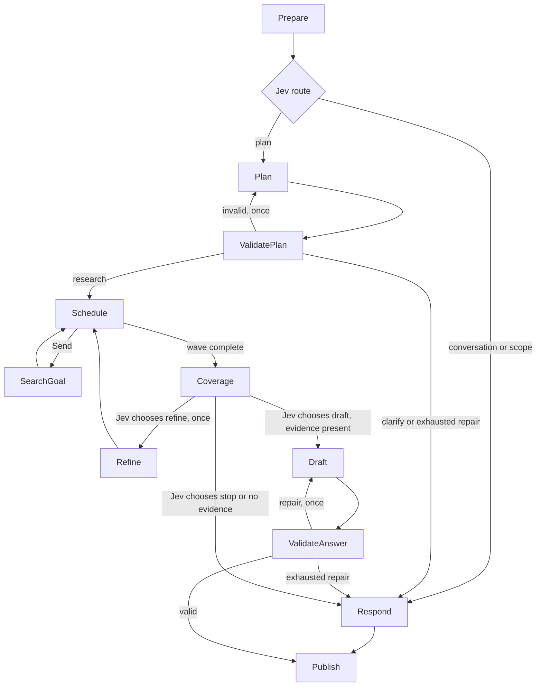

# Adaptive assistant runtime

Implemented under ADR-0017, ADR-0019 and ADR-0020. The workflow uses LangGraph `StateGraph`, `Send`
workers and checkpoints; the frontend uses `@langchain/langgraph-sdk/useStream`.
Context7's LangGraph documentation informed fan-out, reducer resets and streams.



## Models and configuration

- `BRH_CHAT_*`: Mistral/Ministral through OpenRouter's chat API. Produces
  structured plans, conversational replies, query refinements and answer
  paragraphs.
- `BRH_DECISION_*`: Jev through `/api/alpha/decisions`. Selects typed labels for
  route/plan fidelity, query refinement fidelity, goal coverage, next research
  action, claim support and generated response validity.
- `OPENROUTER_API_KEY`: shared agent credential. No implicit fallback to the
  embedding key. Existing extraction/embedding credentials remain unchanged.

`llm.py` constructs the configured LangChain model. `decisions.py` validates
typed choices and probability distributions. Authentication failures are not
retried; transient failures have bounded retries. No provider SDK appears in
graph nodes. Missing keys produce an unavailable outcome, not missing evidence.

## Execution and boundaries

At most four goals, two queries per goal, 16 distinct retrieval calls, 16 model
call slots, one plan repair, one query refinement and one answer repair.
Refinement and responses reserve two model slots (chat generation plus Jev review).
An elapsed-time deadline of 180 seconds is checked at node boundaries and before
publication; in-flight synchronous requests finish under their provider timeout
and retry policy. There is no forced termination of a running HTTP call.
The recursion ceiling is 80 supersteps, including dependent-goal waves.

Canonical reads go through `RetrievalService`. Workers return results keyed by
goal/query, merged idempotently. `prepare` clears these with `Overwrite` on every
new question. Evidence is deduplicated by chunk and distributed across goals,
with a 24-passage/48,000-character prompt budget. New refined evidence takes
priority within a goal. Recent conversation is limited to six messages and is
never accepted as source evidence. A model-input token budget of approximately
4,000 tokens trims recent human/assistant history without deleting checkpoints.
The chat input has one French system identity, typed history, and one ephemeral
task message. Internal task prompts never enter persisted conversation state.
Agent Server owns checkpointing; standalone tests explicitly inject a saver.
The SDK sends only a new human message to the selected server thread and restores
the thread on reload. Browser session storage holds IDs/titles, not conversation
content. This is thread-scoped short-term memory, with no cross-thread store.
Local `langgraph dev` uses development persistence, not a production durability
guarantee. No external search, extraction or arbitrary
code execution runs from chat.

Only the final `publish` node appends an AI message. Its
`additional_kwargs.brh` envelope contains version, turn ID, kind, validation
status and canonical citations. The frontend hides internal model messages and
renders citation markers next to their supporting paragraphs. The source rail
uses the selected answer rather than a conversation-wide source union.

One lazy process resource owner supplies both the graph and corpus HTTP routes;
the HTTP lifespan closes its owned clients/pool. Corpus resources initialize on
first read so a greeting does not require a database or vector service.

## Running and verification

### Streaming activity UI

Under ADR-0021 the SDK subscribes to `values` and `custom`. `activity.py` emits
`brh.activity` events at operation start and finish. Each has a turn ID, stable
operation ID, stage and status. Parallel retrieval emits actual query text,
passage counts and up to three title/page/excerpt previews. Planning emits its
public objectives; coverage emits a concise summary of the model's selected
next step. These events contain neither hidden reasoning nor unvalidated drafts.

`onCustomEvent` feeds a bounded client reducer and temporary shadcn activity
panel. Replayed starts cannot overwrite completion and other-turn events are
ignored. The panel distinguishes preparation, search, review, interruption and
transport failure, and disappears after publication. Candidate passages are
explicitly awaiting verification; final citations remain scoped to validated
answer messages. Activity stays outside thread memory and browser storage.

The composer uses the SDK's `submit`/`stop` lifecycle, and thread restoration
is distinct from an active run. Cancellation suppresses late activity updates.
No timer simulates agent work or claims a percentage of completion.

### Operator setup

Set `OPENROUTER_API_KEY` in the root `.env`, then run `make agent-dev` and
`make web-dev` in separate terminals. `langgraph dev` reads the root `.env`
through `services/agent/langgraph.json`. Web uses
`NEXT_PUBLIC_LANGGRAPH_URL` (default `http://localhost:2024`) and
`NEXT_PUBLIC_LANGGRAPH_ASSISTANT_ID` (default `agent`). These belong in the web
environment when overriding the defaults. No provider key goes into web env.

Agent tracing exports to Arize AX through OpenTelemetry and OpenInference:

```dotenv
ARIZE_API_KEY=...
ARIZE_SPACE_ID=...
ARIZE_PROJECT_NAME=brh-intelligence
```

`brh_agent.observability` installs the LangChain instrumentor once before graph
execution, batches exports and flushes them during application shutdown. It
enforces content redaction even if a deployment omits the template flags:
questions, prompts, answers, tool definitions, embeddings and retrieved
documents are not exported. Arize retains the execution hierarchy, timing,
errors, token usage and model metadata. With `BRH_TRACE_CONTENT=true` (ADR-0022),
new traces instead include graph inputs/outputs, chat messages and corpus
context, plus Jev decision inputs/outputs. Jev spans use the active LangChain
parent so these operations appear inside the same graph trace. Invocation
parameters, tool definitions, images and embeddings remain hidden; provider
authorization headers and settings are not span attributes.

Restart `langgraph dev` after changing the root `.env` because
`services/agent/langgraph.json` loads that file when the server starts.

The optional LangSmith Codex MCP remains independent of runtime trace export. It
can inspect historical LangSmith projects, but the application no longer emits
agent traces through LangSmith.

```bash
codex mcp get langsmith
codex mcp login langsmith  # only when Auth is not already OAuth-authenticated
```

The SDK owns messages and cancellation. The browser stores only thread metadata
in session storage; messages and citation envelopes reload from Agent Server.
Retries reuse the submitted human-message ID to avoid duplicating that message.
Provider-side unavailable responses are normal assistant outcomes; transport
failures show an inline retry action. Sessions and UUIDs are not authorization:
public multi-user deployment still needs server-side thread ownership and rate
limits. This work is suitable for the existing local workflow.

Tests use fake models/services and mock HTTP transports. Semantic support,
appropriate abstention and retrieval thresholds still require the reviewed
French evaluation set; passing workflow tests is not a quality benchmark.
