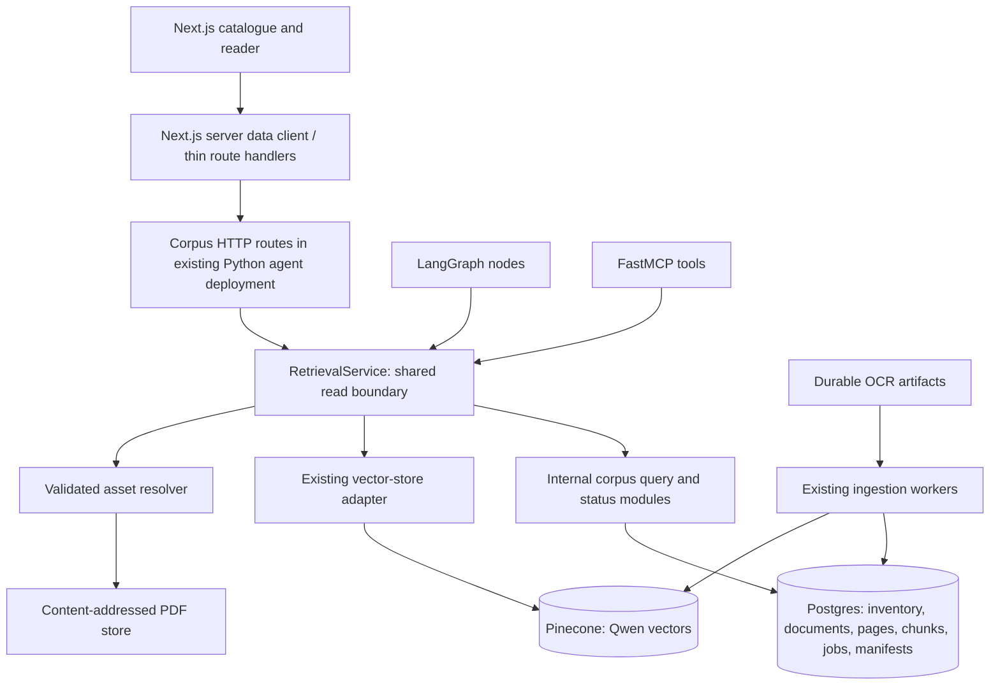

# BRH corpus page: product plan and architecture

Date: 2026-10-25; revised 2026-10-26. The initial proposal below is retained as
pre-work. The user subsequently approved a Markdown-first research catalogue
and progressive GraphRAG with inexpensive LLM extraction plus Jev validation,
stored in Postgres. Both clients reuse the existing OpenRouter token at the
user's request. V1 is implemented; model/threshold approval remains gated on
the reviewed evaluation, with no production graph backfill started.

Current implementation: [research corpus](../architecture/research-corpus.md).
Accepted architecture: [ADR-0014](../adr/0014-markdown-research-corpus.md).
The original PDF-viewer-first proposal below is superseded by the Markdown reader
with official PDF links. Latest LangGraph versions were checked through Context7
and the stable package registry during implementation.

## 1. Recommendation

Build `/brh-corpus` as a French-language research catalogue: find a publication,
inspect its source and availability, read a specific page, copy a reference,
and eventually ask the assistant about that document. Keep ingestion operations
in a separate protected surface. Assume researchers are the first audience;
this can be revised after user feedback.

The catalogue should work when the generation model or embedding provider is
unavailable. Metadata browsing, lexical search and reading are valuable on
their own. Document-scoped assistant questions come after the live agent works.

Three approaches were considered:

| Approach | Benefit | Trade-off | Recommendation |
| --- | --- | --- | --- |
| Research catalogue with document reader | Fits the existing source/citation experience; useful before agent generation | Needs a corpus read API and metadata cleanup | Build first |
| Combined catalogue and ingestion dashboard | Helps operators inspect progress | Mixes research tasks with infrastructure controls and requires access control | Separate admin view later |
| Assistant-only corpus explorer | Reuses the chat shell | Makes known-document lookup depend on model availability and incomplete indexing | Add contextual assistant actions after browsing |

## 2. What exists, and what is missing

| Area | Evidence in the repository | Consequence for the page |
| --- | --- | --- |
| Web | Next.js 16 / React 19; `/` and `/assistant`; no catalogue or PDF-serving route | `/brh-corpus` and the document reader are new work |
| Corpus promotion | `components/home/corpus-section.tsx`; navigation/footer link to `#corpus` | Turn publication-family entries into real catalogue links |
| Published figures | `lib/corpus-stats.ts` is dated 2026-10-20 and hardcodes 360 documents / 5,592 pages | Replace with shared measured stats and a timestamp |
| Assistant | `use-assistant-workspace.ts` uses demo answers; agent nodes/LLM/prompts remain stubs | Do not present document Q&A as live before integration |
| Inventory | `corpus.crawl_urls` records URLs before extraction; SHA-256 deduplicates downloaded bytes | Discovered source counts and unique document counts differ |
| Canonical content | Postgres stores documents, pages, structured chunks, jobs and index manifests | Read from the core service, with server-side filtering/pagination |
| Read boundary | `RetrievalService` implements semantic search, document lookup, all-document listing, page text and basic stats | Extend this boundary; current listing has no filters or pagination |
| Indexing | ADR-0013 selects Qwen/OpenRouter and raw Pinecone vectors; durable reconciliation is implemented | Reuse current pipeline; do not design another vector ingestion path |
| Dates | `_publication_date()` currently copies inventory `wp_date` | A WordPress upload date cannot establish publication or covered period |
| Taxonomy | Documents have title, volume, issue, language, publisher, date and arbitrary metadata | Family, reference number and covered period need explicit metadata work |
| Exports | `brh_core.catalog` exports a derived JSON file | Its internal paths and partial scope make it unsuitable as the public browsing API |

Observed on this checkout: `python3 scripts/verify_ocr.py` passed for **991
documents / 14,134 pages / 1,184 figures**. This check validates artifact presence,
page-marker consistency and referenced image files. It does not establish OCR
accuracy, semantic retrieval quality or current Pinecone coverage. The documented
1,169-PDF inventory is a historical discovery figure, not a freshly measured
unique-document denominator. Do not calculate an extraction percentage from
these two differently scoped snapshots.

Older overview/AGENTS passages still describe hosted E5 as production. The
implementation, ADR-0013 and the beginning of the ingestion runbook supersede
that description. Some architecture diagrams describe planned PDF routes and
MCP tools that are absent from the executable surfaces.

## 3. Main user journeys

1. **Find a known publication.** Search `circulaire 95-1A`, select the family,
   open its record and download/open the original PDF.
2. **Explore a period.** Select inflation notes and a covered period; order
   chronologically using dates supported by evidence, with unknown dates visible.
3. **Locate a passage.** Search extracted text, see a short page excerpt, and
   open `/documents/{slug}?page=N` at the exact physical PDF page.
4. **Check evidence.** Inspect the title, source URL, date basis and extraction
   availability; copy the document/page reference.
5. **Ask a scoped question.** Select a document or a small collection, then
   open the assistant with visible scope. Enable after live retrieval/generation.
6. **Understand gaps.** Recognise that a source is listed but its text or
   assistant search is unavailable, and still visit the official publication.

## 4. Feature priorities

P0 is the first useful release. P1 extends research once the contracts work.
P2 requires additional evidence, metadata, accounts or operational safeguards.

| Priority | Feature | Expected behaviour / reason |
| --- | --- | --- |
| P0 | Search titles and document references | French accent/case handling; preserve numbers, hyphens and suffixes such as `95-1A` |
| P0 | Search extracted page text | Show grounded snippets and physical page links; clearly state that unreadable sources are outside text search |
| P0 | Family, date and availability filters | Family + confirmed publication year or covered period + readable/search-ready; include `Non classé` and unknown dates |
| P0 | Stable sort and pagination | Title, supported date, recently added; server-side pages of 25 by default, at most 100 |
| P0 | Shareable URLs | Query, filters, sort and page in URL; Back/Forward restores the same research state |
| P0 | Useful result rows | Title, family, date with basis, known page count, availability and official-source action |
| P0 | Dedicated document record | Metadata, source aliases, physical page navigation, readable text, original PDF and provenance |
| P0 | Copy citation and page link | Reuse canonical document identity and 1-based physical page numbering |
| P0 | Measured coverage | Distinguish discovered URLs, unique known documents, readable documents/pages and current verified index coverage; timestamp every snapshot |
| P0 | Loading, empty, unavailable and error states | Preserve filters during retry; distinguish no results from provider failure; usable on mobile and keyboard |
| P0 | Safe rendering and public data contract | Sanitize OCR HTML, bound queries and redact internal paths/errors/credentials |
| P1 | Semantic discovery | Explicit `Recherche par sens`, grounded passages through `RetrievalService`, then grouped by document |
| P1 | Ask about this document | Assistant scope passed structurally, enforced in retrieval, visible during the conversation |
| P1 | Small document selection | Compare or question up to a bounded selection, initially five documents; no cross-document scope leakage |
| P1 | Collections and issue navigation | Browse inflation notes, circulars, reports and bulletin issues using reviewed family/series metadata |
| P1 | Download filtered metadata | Bounded CSV export with title, source, date basis, state and export timestamp; no implied right to bulk redistribute PDFs |
| P1 | Find within a document | Page-level matches, text highlight and page jump without downloading every page into the browser |
| P1 | Reader outline and extracted tables | Derive headings and existing table/series chunks; preserve page provenance and label extracted values |
| P1 | Related publications | Same reviewed series/period first; optional semantic relation with a stated basis |
| P2 | Personal bookmarks and saved searches | Browser-local first if needed; accounts/sync only with a separate identity requirement |
| P2 | New-publication alerts | Requires subscriptions and delivery infrastructure; not needed for catalogue launch |
| P2 | Publication revisions and regulatory relationships | Evidence-backed supersedes/amends links; never infer legal applicability from upload time |
| P2 | Quality reports and corrections | Specific page/field issue, review workflow and audited correction history; no invented confidence percentage |
| P2 | Indicator comparison and chart-ready datasets | Requires validated table schemas, units, periods and revision handling; OCR tables alone are insufficient |
| P2 | Protected operations dashboard | Queues, failure reasons, retries and indexing status; operational writes stay outside public browsing |

Do not make uploads, translations, subscriptions, automatic summaries, a bespoke
PDF engine or account creation prerequisites for the first release.

## 5. Page structure and integration

Desktop catalogue:

```text
BRH Intelligence             Assistant | Corpus | Theme
Corpus documentaire           Snapshot date / coverage details
[ Rechercher un titre, une référence ou un passage... ] [Search]
[ Titres et références | Texte des pages ]
Families / date /             Result count + active filters + sort
availability filters          Document title and family
                              Date basis · pages · availability
                              Matching excerpt and page, when relevant
                              [Consulter] [Source officielle]
                              Pagination
```

Keep coverage compact so it does not displace search/results. Start with a
readable list; a grid/list switch is optional. Use a shadcn `Sheet` for mobile
filters and a dedicated detail route for reading. A desktop preview panel can
come later without changing document URLs.

`/documents/{slug}?page=3` contains the document title, metadata, page selector,
text/PDF tabs and source/copy actions. Load page text on demand. Start with the
browser PDF viewer, a clear open/download fallback and text mode on devices
whose viewer does not support reliable embedded navigation. Physical page 3
can differ from printed page iii; display the distinction when known.

Keep Inter for controls, Montserrat for titles and `font-reading` / Source
Serif 4 at 15–16px with approximately 1.7 line height for extracted prose. Reuse
the assistant's flat surfaces and semantic colour tokens. Gold identifies
provenance; navy carries primary actions; azure carries links/focus. Use shadcn
primitives and lucide icons. No charts are required for launch; a later simple
coverage chart follows the repository's visx rule and carries its denominator,
date and provenance. New library APIs must be checked with Context7 at build time.

Add catalogue links to the landing corpus section, navigation, footer and
assistant rail. Family links resolve to `/brh-corpus?family=...`; landing-only
anchors become `/#pipeline`, etc., when reused off the homepage. Citation titles
can open the internal document record while `Voir le PDF` keeps its direct PDF
page link. Add catalogue/document metadata and sitemap entries; avoid indexing
every filter combination as a separate canonical page.

## 6. Proposed architecture



This diagram is proposed wiring. The new browsing HTTP routes, asset resolver
and web pages are not implemented; the agent nodes and MCP registration also
remain unfinished. Existing ingestion and core semantic retrieval are implemented.

Keep Postgres access in Python. Extend `RetrievalService` with bounded browsing
operations and delegate substantial query/status logic to internal core modules.
Keep existing `list_documents()` compatible for current callers. All public
read surfaces, including PDF asset resolution, use this boundary; Next.js never
queries Postgres/Pinecone or reads internal catalog paths itself.

Use a thin custom ASGI HTTP app in `services/agent`, mounted through the existing
Agent Server's `langgraph.json` `http.app` extension. This avoids a new retrieval
microservice and does not require a generation run for a document list. LangChain
documents this extension for custom HTTP routes. Verify compatibility with the
installed CLI/server versions during implementation and declare the chosen ASGI
framework as an explicit dependency. See the
[official custom-route guide](https://docs.langchain.com/langsmith/custom-routes).

Next.js server components call a shared server-only corpus client directly for
initial render. Route handlers provide the browser's same-origin interactive
API and PDF stream/redirect. Both paths use the same upstream Python contracts;
server components need not make a loopback request to their own Next.js API.
Agent chat continues to use the LangGraph SDK `useStream` under ADR-0008.

Public catalogue reads need a pool/repository but must initialize the vector
adapter only for semantic requests. The existing factory eagerly constructs
the vector store; refactor dependency construction so unavailable embedding
credentials do not prevent metadata/text browsing. Reuse bounded process-lifetime
pools, clean shutdown and injectable offline fakes.

### Suggested module boundaries

| Location | Responsibility |
| --- | --- |
| `packages/core/src/brh_core/corpus/models.py` | Frozen query, list/detail, facet and availability DTOs |
| `packages/core/src/brh_core/corpus/query.py` | Filter validation, catalogue composition and page-search orchestration |
| `packages/core/src/brh_core/corpus/status.py` | One shared calculation of content and index readiness |
| `packages/core/src/brh_core/db/corpus_browser.py` | Parameterized SQL, counts, facets, lexical ranking and bounded reads |
| `packages/core/src/brh_core/retrieval/service.py` | Public entry points delegating to corpus modules and canonical semantic retrieval |
| `packages/core/src/brh_core/assets.py` | Slug/identity lookup and validated PDF asset resolution |
| `services/agent/src/brh_agent/http/` | Thin versioned HTTP adapters; no SQL or business rules |
| `apps/web/lib/corpus/` | Server-only data client, query serialization and UI types |
| `apps/web/components/corpus/` | Search controls, result rows, facets, coverage and availability |
| `apps/web/components/documents/` | Metadata, page reader, provenance and source actions |
| `apps/web/app/brh-corpus/` | Catalogue route, loading and error boundaries |
| `apps/web/app/documents/[slug]/` | Canonical document route |

Start with the modules the first slice needs; these are responsibilities, not
a requirement to create every file before useful behaviour exists.

### HTTP contracts to implement

Python routes under `/corpus/v1`, proxied as appropriate under `/api/corpus`:

| Method / path | Contract |
| --- | --- |
| `GET /documents` | Query, mode, family, date basis/range, availability, sort, page and page size; returns items, exact lexical/browse count and applied filters |
| `GET /facets` | Counts under the same validated filters; each facet excludes its own selection when computing alternative counts |
| `GET /stats` | Separately named inventory/canonical/readable/indexed measures, snapshot time, denominator and measurement scope |
| `GET /documents/{slug}` | Public metadata, provenance, aliases and availability; no filesystem paths |
| `GET /documents/{slug}/pages/{number}` | Bounded physical page text with document identity and extraction basis |
| `GET /documents/{slug}/matches` | Paginated matches within one document |
| `GET /documents/{slug}/pdf` | Validated original bytes or approved source redirect |
| `POST /search` (P1) | Semantic query and validated scope; grounded passages/citations grouped for catalogue display |

For example, shareable catalogue state is
`/brh-corpus?q=inflation&mode=text&family=note-inflation&sort=title&page=1`.
Only offer relevance sort when there is a query; date sorts put unknown dates
last. Stable ordering always includes a unique identity as a tie-breaker.

Use a consistent bounded error envelope: validation failure, missing document,
invalid page and temporary upstream unavailability are different responses.
Never turn a failed database/provider request into `0 document`.

## 7. Data model and availability

### Identity and coverage

`documents.document_id` / SHA-256 identify canonical content. Multiple
`crawl_urls` aliases can point to it. Before download, a source has only URL
identity. In the first release, catalogue rows are canonical documents, including
documents whose index is unavailable; explicitly label this result scope.
Coverage reports discovered URLs separately. Do not create fictitious canonical
documents from unresolved URLs just to inflate the catalogue count.

A later `Sources recensées` view may list unresolved inventory entries with
`source:<hash-of-url>` IDs and official-source actions. They do not receive
document reader URLs or enter semantic results until canonical identity exists.
After resolution, aliases collapse into one document row. Unknown unique totals
remain unknown while source bytes are unresolved.

### Metadata additions

Add append-only migrations after a short ADR review; never modify applied SQL.
Promote fields required for filtering into typed fields/relations rather than
relying on arbitrary UI JSON:

- `document_family`: circular/notice, inflation note, economic bulletin,
  annual report/balance sheet, study, other, unknown; refine against real records.
- Document reference number and optional reviewed `series_id` / issue label.
- Publication date with evidence source and precision; separate covered-period
  start/end from publication and WordPress upload/modified dates.
- Original title plus curated display title, with origin and review state.
- Optional reviewed topics, metadata extraction method/version and evidence page.

The inventory includes non-research PDFs such as recruitment notices. Keep
classification/scope decisions explicit rather than silently treating every
attachment as an economic publication. Unknown classifications remain browsable.
Start deterministic rules plus review; an LLM classifier is optional later.
Do not interpret WordPress migration timestamps as the age of publications.

Preserve source/extraction metadata separately from editorial overrides so a
future ingestion upsert cannot erase reviewed titles, families or dates. Add
constraints for valid date ranges and family/reference lookup indexes.

### Availability is more than one status

Expose separate dimensions in the API:

- `source`: local copy available, official link only, or unavailable.
- `text`: absent, readable extraction, structurally incomplete, or awaiting text.
- `search`: not indexed, building, current verified index, stale, or failed.
- `review`: not reviewed or reviewed, with a specific review scope if applicable.

Compact public labels can be `PDF disponible`, `Texte disponible`,
`Disponible pour l’assistant`, and `Traitement en cours`. Operational errors and
retry counts belong in admin. A failed/stale vector rebuild must not remove
otherwise readable pages from the catalogue.

Derive readiness from current content/tokenizer/chunker identity, the active
embedding contract, index target and manifest verification. A successful old
manifest or raw Pinecone vector count is insufficient. Centralize this predicate
so status cards, filters, ingestion reporting and retrieval cannot disagree.
Count canonical readable pages separately from all completed OCR artifact pages.
Structural validation is not a semantic accuracy certification.

## 8. Search design

P0 has two explicit scopes: metadata/reference lookup and extracted-page text.
Use Postgres full-text search with a French configuration and accent normalization
for prose, with GIN indexes maintained transactionally on content changes.
PostgreSQL documents [GIN text-search indexes](https://www.postgresql.org/docs/16/textsearch-indexes.html)
and the [unaccent dictionary](https://www.postgresql.org/docs/16/unaccent.html).
Use a separately normalized exact-reference path for identifiers; prose stemming
must not merge distinct circular numbers. Exact quotation matching, if offered,
must use phrase-aware matching and be tested explicitly.

Rank by exact reference/title first for metadata mode; page mode groups results
by document, retains a bounded number of best page snippets and reports both
matching documents and pages with precise labels. Keep counts/facets based on
the same query, and never load the entire corpus into browser memory.

P1 semantic search calls existing `RetrievalService.search()`. Preserve its
stale-hit rejection, table context and canonical citations. Semantic results are
a bounded ranked candidate set, not an exhaustive document count; display
`Documents proposés` and candidate scope instead of reusing lexical totals.
Raw similarity is not a public confidence percentage. Hybrid rank fusion and
reranking require a reviewed evaluation before becoming default behaviour.

Current vector payloads include document identity, pages and chunk structure,
but not reviewed family/date fields. Do not advertise arbitrary semantic facets
that the vector layer cannot enforce. Small document selections can filter by
document IDs before retrieval. Broader family/date semantic filtering requires
a versioned metadata projection and controlled vector metadata refresh or
reindexing, followed by canonical validation; post-filtering a tiny top-k is
insufficient. Do not change embeddings or chunk sizes just to ship browsing.

For scoped assistant questions, extend both Python `AgentState` and the web
contract with structured `scope.document_ids`, validate IDs/counts on the server,
and enforce scope before retrieval and on expanded context. Query-string state
or a prompt instruction alone does not enforce scope. No-hit scoped queries
must not silently search the full corpus. Enable this journey only after live
agent nodes and acceptance tests pass.

## 9. How to build and maintain the corpus

Reuse the existing pipeline and add catalogue metadata/read projections:

1. **Discover.** Enumerate BRH PDF media through the existing inventory client,
   track URL aliases and timestamps, and record unresolved/failed/gone sources.
2. **Acquire and identify.** Download to content-addressed raw storage; SHA-256
   establishes content identity. Preserve original bytes and official source.
3. **Extract.** Consume completed PaddleOCR artifacts with validated metadata and
   contiguous 1-based page markers. Use the existing explicit PyMuPDF fallback
   where applicable and record the extraction basis. Keep artifacts backed up;
   runners remain caches.
4. **Persist readable content.** Transactionally store canonical document/pages.
   Preserve source and reviewed metadata across replacements. Blank/malformed
   artifacts need a visible text state, not false completion.
5. **Enrich catalogue metadata.** Classify family/reference/period using evidence,
   retain uncertainty and review important fields. Build lexical projections
   independently of vector indexing.
6. **Chunk.** Reuse current structure-aware chunking with page spans, table
   envelopes and provenance; ADR-0013 targets 768 / maximum 1,536 exact Qwen tokens.
7. **Embed and index.** Reuse Qwen/OpenRouter → 1,024-dimensional normalized
   vectors → Pinecone, with bounded batches, locks, checkpoints and stale cleanup.
8. **Verify and publish availability.** Current manifests gate assistant search;
   readable pages can publish sooner. Update shared stats with their timestamp.
9. **Maintain.** Continue incremental discovery/OCR arrivals and restart-safe
   reconciliation. Retain the last valid readable content through transient
   failures; an inaccessible source is not a reason to erase historical evidence.
10. **Evaluate.** Review French research queries, reference lookups, table/series
    retrieval and citations. Keep integrity/availability checks distinct from
    relevance and extraction accuracy measurements.

Changed source bytes are a new content identity, while revisions of a logical
publication are an additional reviewed relationship. Do not overwrite the old
document merely because a URL was reused. Source-alias history/version relations
need their own later persistence work; the current URL ledger alone is not a
complete publication revision model.

## 10. Serving, resilience and operational limits

- Local deployment can use the existing content-addressed PDF directory mounted
  read-only in Python. A separately hosted Next.js process must not assume that
  directory exists on its own filesystem. Production multi-host storage requires
  a shared durable asset store; keep the same canonical slug/page URLs.
- Asset resolution must map known IDs to allowed roots, reject traversal and
  verify an available file; never accept arbitrary filesystem paths or remote
  proxy URLs from a request. Stream PDFs with range support instead of buffering
  whole files; test `206` and invalid ranges. Preserve an official-link fallback
  if artifacts were ingested without local PDFs.
- OCR may contain HTML tables and images. Sanitize with an allowlist that retains
  safe table structure and resolves images only to validated assets. Exclude
  scripts, event handlers and unsafe link/image schemes. Return text/snippet data
  rather than trusting HTML produced by a database headline function.
- Enforce query/page/selection/export bounds and allowlist sort/filter fields.
  Public semantic requests need a separate rate budget from cheap browsing.
- Cache catalogue/facet/stats responses briefly with `as_of`; keep document text
  and asset cache identity tied to the content/extraction version. Do not cache
  provider errors as empty results. No Redis dependency is necessary initially.
- With Pinecone or embeddings unavailable, metadata, page text and source links
  remain usable. With Postgres unavailable, show a retryable service error and
  only use a previous snapshot if its age is explicit.
- Protected operations need authentication, authorization and audit before any
  browser action can retry, delete or rebuild work. Existing CLI operators can
  keep using the runbook; the public release adds no ingestion write endpoint.

## 11. Delivery order and acceptance criteria

| Slice | Deliverable | Acceptance evidence |
| --- | --- | --- |
| 1. Read contracts and metadata | Proposed ADR, frozen DTOs, shared availability predicate, date-basis rules, additive schema changes | Offline contract tests; repeat migrations on isolated Postgres; reviewed sample includes unknown dates/families |
| 2. Browse API and lexical search | Bounded repository reads, filters, facets, metadata/page search, HTTP adapters and lazy vector wiring | Strict fake contracts plus isolated SQL tests; reference IDs/accents; no duplicate aliases; accurate matching counts; no cloud dependency for browsing |
| 3. Catalogue UI | `/brh-corpus`, URL state, filters, result rows and coverage from one API | Typecheck; loading/error/empty/mobile/keyboard checks; Back/Forward restores state; stale landing constants removed |
| 4. Document reading | `/documents/{slug}`, page text, PDF open/download, citation copying | Round-trip query → document → physical PDF page; invalid slug/page/range; safe OCR markup; PDF-missing fallback |
| 5. Live assistant handoff | Agent nodes, stream connection, structured scope and source navigation | Selected documents remain enforced across follow-ups; no fallback to full corpus on no-hit; citations resolve |
| 6. Research extensions | Semantic mode, issue collections, bounded metadata exports | Reviewed query set and family-specific relevance; semantic candidate limits shown; exports preserve provenance |
| 7. Optional operations | Protected ingestion observability, followed by audited controls if required | Authorization checks and safe retry behaviour; public pages remain read-only |

Build the catalogue/read path before the scoped assistant integration. Agent
generation can proceed independently of slices 1–4. Semantic indexing remains
the current operational process; no reset, forced reindex or provider change
is part of this planning task.

Use `uv run pytest` with offline fakes by default, opt-in isolated Postgres tests
for actual SQL/full-text behaviour, and `bun` TypeScript checks for web changes.
When implementation reaches UI verification, use the repository's `agent-browser`
harness for responsive layout, keyboard/filter interaction and reader navigation.
No browser or live-service acceptance was run for this planning-only document.

Track useful outcomes: known-reference lookup success, query-to-source-open,
broken citation links, no-result rate, shared-query restoration and availability
accuracy. Agree latency targets after measuring a realistic catalogue query
and hosting topology; do not publish invented performance or accuracy claims.

## 12. Decisions still requiring review

- Confirm researcher-first scope and whether an admin surface is needed later.
- Review actual family taxonomy, economic-document inclusion and metadata/date
  evidence rules against a representative set of publications.
- Confirm deployment support for custom Agent Server routes and PDF storage.
- Choose how much text is needed for the initial reader: page-by-page first,
  with optional outline/tables after basic provenance works.

These do not prevent the product/architecture proposal from being reviewed.
The next implementation task should record accepted architecture changes in an
ADR and then implement slice 1, without altering experimental results/defaults.
