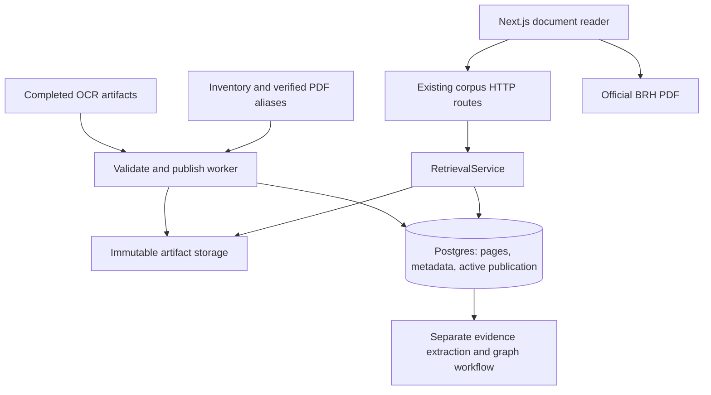

# Reliable publication of OCR documents

Date: 2026-10-26. Status: implemented; see ADR-0015 and the corpus runbook.
Scope: document availability in the research corpus, extending ADR-0014.

## Evidence and problem

The local catalogue and stats respond successfully. Recent Agent Server logs
show `IncompleteOcrArtifact` and HTTP 503 when opening document metadata or a
page. This was reproduced directly over HTTP, without browser automation.

`make agent-dev` starts in `services/agent`. `Settings._resolve_paths()` resolves
`./data/ocr` against that working directory, producing
`services/agent/data/ocr`, which does not exist. The completed artifacts are at
the repository root in `data/ocr` (currently approximately 122 MB).

There is also an architectural coupling: `ResearchCorpus.current_document()`
reopens local `meta.json` and `document.md` for each document read.
`ResearchCorpus.page()` then reparses the complete document for one page.
However, the importer already writes all page Markdown to
`corpus.research_pages` transactionally. The catalogue uses that database while
the reader requires the filesystem too. This explains why listing works but
opening a document fails.

Fixing paths addresses the observed local failure. It does not establish how a
deployed Agent Server obtains its artifacts; no production artifact publication
adapter or shared storage configuration was found in the repository.

## Options

| Option | Advantages | Constraints |
| --- | --- | --- |
| Correct paths and mount all OCR artifacts on each API instance | Smallest immediate repair; preserves live-file validation | Every replica needs the same files; deployment and availability remain coupled to filesystem distribution |
| Publish Markdown pages in Postgres, figures in immutable artifact storage | Reuses existing pages and search; separates serving from OCR workers; works across API replicas | Requires a publication manifest, storage adapter and explicit version semantics |
| Serve every Markdown page and figure from object storage | Immutable packages and independently cacheable text | Adds network reads and duplicates the existing database page-serving capability |

Recommend the second option, after the immediate path repair. Keep the first as
the local storage adapter, rather than creating a new service or graph database.
Choose the production object-storage provider when the deployment environment
is settled; this plan does not provision a vendor or assume an existing bucket.

## Ownership and locations

| Material | Authoring / ingestion location | Runtime publication |
| --- | --- | --- |
| OCR Markdown, completion metadata, extracted figures | `data/ocr/<pdf-sha256>/` | Validated, versioned publication; source artifacts remain retained |
| Current readable Markdown pages | Derived by the importer | Postgres `research_pages`, tied to the active publication |
| Document metadata, official URLs and current version | Inventory plus validated OCR metadata | Postgres `research_documents` and a publication manifest |
| Extracted raster figures and downloadable Markdown | Validated artifact bundle | Local immutable directory in development; durable object storage in deployment |
| Original PDF | Content-addressed inventory store | Official verified `https://www.brh.ht/...pdf#page=N` link first |
| Entity and relationship evidence | Separate extraction workflow | Postgres, qualified by the exact published Markdown hash |
| Embeddings | Existing indexing workflow | Existing Pinecone index; optional for reading |

Next.js must not read `data/ocr`, query Postgres, or know storage credentials.
Keep `RetrievalService` as the shared read boundary for web, agent and MCP.

## Publication contract

1. Read a completed OCR artifact and validate all page markers and referenced
   raster assets. Do not publish incomplete or blank artifacts as readable.
2. Compute the existing Markdown hash and a separate bundle hash covering
   metadata and assets. A PDF SHA identifies the original document; a Markdown
   hash identifies its extracted text; a bundle hash identifies a publication.
3. Upload to an immutable prefix such as
   `ocr/<pdf-sha256>/<bundle-hash>/`. Verify object lengths/checksums and the
   complete manifest before making the publication visible. Do not persist
   temporary signed URLs in Postgres.
4. In one database transaction, save the publication manifest, metadata, page
   rows and active-publication pointer. Existing search and graph invalidation
   remain transactional. Serialize concurrent publishers per document and
   recheck the source version before promotion.
5. A failed upload or database transaction leaves the previous publication
   active. Unreferenced uploaded objects may be cleaned later; never delete the
   previous bundle as part of promotion. Newer incomplete OCR work must not
   replace a valid publication.

Add an append-only migration for publication metadata; do not edit migration
0005. Use existing page tables for current reading/search rather than introducing
a second page-text database. Query document metadata and its page in one database
snapshot to avoid mixing versions. Retained asset bundles do not imply that
historical page-text reading is implemented; historical text URLs are a later
feature requiring explicit versioned page storage.

This deliberately changes the current live-file policy: a local edit becomes
public only after publication. Graph reads validate against the active published
Markdown hash, not an unpublished worker file. Changed text invalidates previous
mentions/assertions when the new publication is promoted. Asset-only changes
update the bundle version without falsely changing text evidence. Record this
policy in an ADR before implementation; never silently fall back between a
published page and a different local version.

## Read contract and user experience

- Keep `/brh-corpus` and `/documents/<slug>?page=N` as stable user-facing URLs.
  Preserve existing slugs and document identities.
- Keep existing `/corpus/v1/documents/...` JSON routes. Serve metadata and pages
  from a consistent published database snapshot. Add a bounded repository read
  for one page; do not load every page to render one.
- Resolve figures through a versioned route such as
  `/corpus/v1/documents/<slug>/versions/<publication-id>/assets/<name>` and the
  same-origin Next.js proxy. Validate that the asset belongs to that manifest;
  retain raster-only MIME, traversal and symlink protections.
- Add a Markdown download action backed by the published immutable bundle.
  Include provenance: title, PDF SHA, Markdown hash and publication timestamp.
- Keep the official PDF action when a verified inventory alias exists. Missing
  aliases show an explicit unavailable-PDF state while Markdown stays readable.
  A future hosted PDF fallback must be checksum-verified against the original
  document and labelled as a local copy.
- Metadata/current-page responses revalidate by publication; immutable asset
  URLs can have long-lived caching and checksums as ETags. Avoid caching a stable
  slug as immutable.
- A missing figure affects that figure, not the entire page. A document-specific
  unpublished/missing state must not claim the whole corpus is down. Preserve
  typed 400/404/409/503 errors and expose retryable backend outages separately.

## Implementation sequence and files

1. **Immediate local repair:** define a common data-root rule in
   `packages/core/src/brh_core/config.py`. Resolve relative paths against an
   explicit `BRH_DATA_ROOT`, otherwise the discovered root `.env` directory,
   otherwise the nearest workspace root, finally CWD for standalone use.
   Absolute paths remain absolute. Test starts from root and `services/agent`,
   environment overrides and absence of `.env`. Configure deployed paths
   explicitly. Restart the Agent Server and verify the failing document URL.
2. **Published reading:** add a bounded page query in `db/research_query.py` and
   publication-aware reads in `corpus/service.py`. Keep the public facade in
   `retrieval/service.py`. Add publication metadata through a new migration;
   register existing validated local artifacts before changing read policy.
3. **Artifact publication:** extend `corpus/sync.py` and `db/research_import.py`
   with a manifest and atomic promotion. Extend `corpus/artifacts.py` behind a
   narrow storage contract for immutable reads/publication; implement local
   storage first and an object-storage adapter for deployment. Workers publish;
   API processes only read. Keep credentials server-side.
4. **Routes and reader:** extend `services/agent/src/brh_agent/http.py`, the
   Next.js proxy, server client, Markdown renderer and document reader with
   publication IDs, versioned figure links, downloads and specific error states.
5. **Operations:** document durable storage, backup/restore, checksums, importer
   restart and orphan-object retention. Add readiness checks for database and
   published storage access, plus publication lag and per-document read errors.
   Reading readiness must not require LLM, Jev or Pinecone availability.

Keep the existing Agent Server custom app; a separate corpus deployment can use
the same ASGI app later if operational needs justify it. Add no per-request LLM,
embedding or graph-generation calls. Update ADR-0014 through a new superseding
decision and update the architecture runbook only after implementing it.

## Acceptance criteria

- The document that currently returns 503 opens from both supported launch
  directories, with identical content and official PDF provenance.
- After publication, metadata and page reading work on an API instance with no
  OCR working directory mounted; assets work through the configured storage.
- A missing image or PDF alias does not suppress readable Markdown.
- Interrupted publication leaves the old document readable; restart is
  idempotent. New text and graph evidence never mix versions.
- Concurrent publication and reading yield a consistent document/page pair;
  asset links remain pinned to their publication.
- Malicious Markdown and asset paths retain current sanitization protections;
  backend paths and credentials never appear in public errors.
- Reading remains available when vector and model providers are unavailable.
- Verify with offline fakes, isolated Postgres acceptance tests, type checking
  and direct HTTP requests. Do not use `agent-browser`, as requested.

## Current state

Implemented locally with migration 0006, immutable local publications and an
S3-compatible adapter. All 1,026 readable documents were published; the failing
reader now returns 200. No production bucket was provisioned. See
`docs/architecture/research-corpus.md` for configuration and operational limits.
