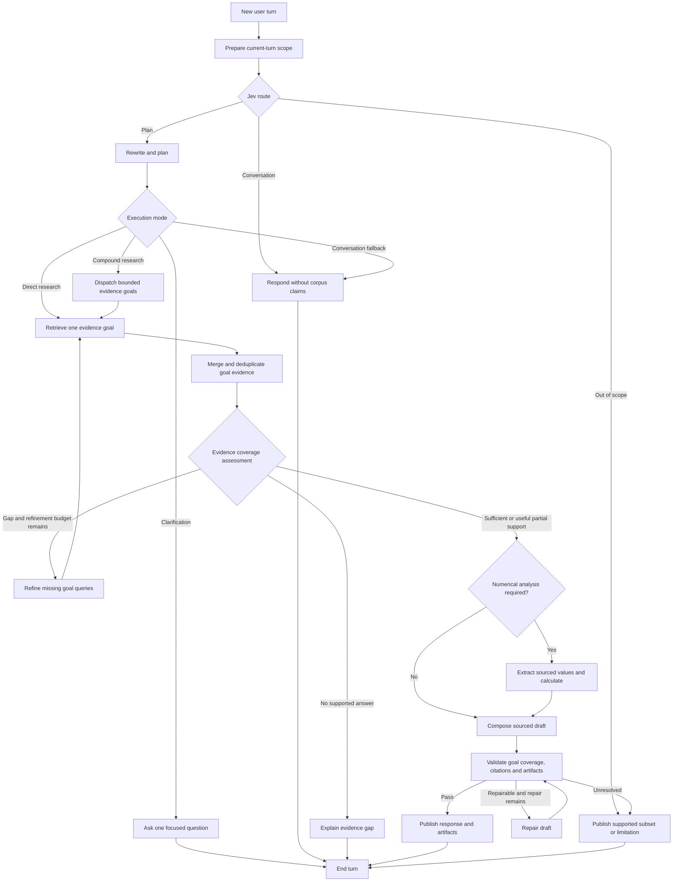

# BRH assistant roles and execution graph

Date: 2026-10-28
Status: Initial proposal; product scope and limits await discussion.
This document does not approve an architecture change or implement runtime code.

## Product role

Proposed primary role: a French-language research coordinator over BRH
publications. It determines the user's intent, resolves the current request from
conversation context, rewrites it into effective corpus queries and decides
whether it needs a direct lookup or a decomposed research plan. It then locates
evidence, explains passages, compares publications and periods, and produces
source-backed syntheses. Numerical analysis and relationship exploration are
conditional capabilities within the same conversation.

The interface presents one assistant. Specialist roles describe responsibilities;
they do not each require a separate model, deployment or always-running agent.
The assistant attributes statements to publications and distinguishes source
facts, calculations and interpretation. It does not speak on behalf of BRH.

First product question: prioritize research, numerical analysis, or both equally?
The proposal below assumes research first and remains open to that choice.

## Current implementation

- `services/agent/src/brh_agent/graph.py` compiles
  `retrieve -> generate/refuse`. Node bodies, model factory and prompts are stubs.
- `AgentState` contains messages, question, retrieved chunks, citations,
  grounded and answer. The only agent tests check graph compilation.
- `RetrievalService` supplies semantic search, canonical citations, document/page
  reads, catalogue queries, entity lookup and bounded graph/evidence reads.
- `search().grounded` currently means that at least one passage survived retrieval
  checks and the score threshold. It does not establish answer completeness or
  semantic support for a claim.
- The web assistant still uses a local response controller. The approved frontend
  boundary is LangGraph SDK `useStream`, not the Vercel AI SDK.
- Knowledge graph extraction is a separate pipeline. Accepted assertions are
  source-qualified; mention co-occurrence is not a relationship assertion.

## Architecture options

The user selected two LLM roles: a chat model writes plans, clarifications,
sourced answers and answer repairs; a decision model
handles structured intent detection, query rewriting, goal planning, refinement,
coverage and semantic answer review. Each has its own configuration and client.
Code owns retrieval, scheduling, budgets, calculations and citation resolution.
Actual provider/model IDs remain unselected. The detailed node assignments are
in `2026-10-28-agent-graph-design.md`.

| Option | Benefit | Cost or limitation |
| --- | --- | --- |
| Complete the fixed retrieval/answer graph | Smallest implementation; direct questions are easy to inspect | Weak fit for follow-ups, multi-document research and missing context |
| Bounded research agent within an explicit graph — recommended | Adaptive evidence gathering with visible control flow and limits | Requires typed research results, coverage assessment and repair handling |
| General supervisor with autonomous specialist agents | Supports broad task decomposition and isolated specialist context | More coordination, latency and evaluation work; defer until justified |

Keep LangGraph, the shared Python core, provider-independent model construction,
LangSmith tracing and the existing Agent Server. Expanding ADR-0002's fixed
workflow requires a follow-up ADR after design agreement.

## Responsibilities

| Role | Decisions and work | Output and boundary |
| --- | --- | --- |
| Conversational assistant / coordinator | Determine intent, resolve follow-ups, preserve user constraints, rewrite retrieval queries, split compound requests into evidence goals, request clarification where necessary, select the shortest valid execution path and compose the final response | Typed task plan and final answer; owns the user conversation |
| Research specialist | Choose search formulations, locate publications, read relevant pages, optionally resolve entities and inspect relationships | Evidence bundle with supported findings, gaps and source identifiers; bounded tool loop |
| Data analysis specialist, conditional | Structure sourced values and select a permitted comparison or calculation | Typed table and operation specification; deterministic code computes results |
| Evidence review stage | Check citation targets, source support, requested coverage, periods, units and unsupported conclusions | Structured issues and pass/partial/insufficient decision; explicit graph stage |
| Presentation stage | Validate table/chart/graph bindings and provenance | Native artifact schema; deterministic validation and table fallback |

Start with the conversational and research responsibilities. Data analysis can
initially be a constrained extraction/model step plus calculation tools. Evidence
review combines deterministic checks with model-assisted semantic assessment;
neither is a guarantee of truth. A separate autonomous reviewer is unnecessary.

## Proposed graph



Every valid message first reaches Jev for a typed `conversation`, `plan` or
`out_of_scope` route. A greeting becomes `conversation`; a greeting-prefixed
substantive query reaches the planner and can become `direct` or `decomposed`.
Conversation skips planning, retrieval and citations, then the chat model
responds naturally using the BRH assistant identity. A clarification ends the
turn; the next user reply continues the thread and resolves its scope.

The planner returns a typed execution mode, rewritten standalone question,
intent, preserved constraints and a list of evidence goals. A simple lookup has
one goal and one short path. A comparison, synthesis or multi-part question may
have several goals that run in parallel when independent. The synthesizer answers
the original user goal rather than presenting disconnected worker outputs.

Proposed initial ceilings, subject to evaluation: at most four evidence goals,
two initial retrieval queries per goal, one refinement round for missing goals,
one draft repair and one final answer per turn. Also enforce total elapsed-time,
context, retrieval and token budgets. Repeated or semantically equivalent queries
without new evidence stop the loop. Provider retries consume separate bounded
retry allowances within the same overall deadline.

### Intent and task-plan contract

The planner uses structured output rather than free-form hidden planning:

```text
TaskPlan
  original_question
  standalone_question
  intent
  execution_mode          conversation | clarify | direct | decomposed
  clarification_question
  constraints             entities, dates, periods, units, document scope
  expected_response       answer | comparison | synthesis | table | graph
  goals[]
    goal_id
    objective
    retrieval_queries[]
    required_evidence
    dependencies[]
```

Initial intent classes should cover factual lookup, explanation, comparison,
trend, synthesis, document discovery, relationship exploration, numerical
analysis, conversation and out-of-scope requests. These are routing labels, not
separate deployed agents.

Query rewriting is an evidence-retrieval operation. It may expand an acronym,
add known aliases or make an implicit subject explicit from recent conversation,
but it cannot change dates, polarity, units, requested entities or the meaning of
the question. The original question and every rewrite remain in trace/state so
evaluation can detect semantic drift. When the missing detail would materially
change the answer, the graph asks one clarification instead of guessing.

Goal splitting is used only when one retrieval result cannot establish the full
answer. Each goal states what evidence would satisfy it. Independent goals may
fan out through LangGraph workers with isolated goal state; dependent goals run
in order. All findings return canonical evidence IDs to the parent graph.

## Tools and evidence contract

Expose a small typed tool set backed exclusively by `RetrievalService`:

- Search passages with explicit document/period scope where supported.
- Find publications using catalogue metadata and declared filters.
- Read a bounded range of published pages, including surrounding table context.
- Resolve entities and retrieve bounded neighbourhoods and their page evidence.
- Perform allowlisted arithmetic over validated, sourced values.

These are proposed agent wrappers around existing service capabilities, not
claims that these tool interfaces are already implemented. Any missing filtering
or evidence-resolution capability belongs in the shared core. No direct database
queries, arbitrary SQL or generated-code execution in the assistant.

Every finding references canonical evidence IDs. Preserve document and page
identity, publication/artifact version where applicable, source text, and the
scope under which evidence was retrieved. Resolve these IDs into citations in
code; model-generated titles, page numbers or URLs are not authoritative.

Relationship traversal uses accepted, current assertions. Co-occurrence may help
find pages but cannot establish a relationship. Empty graph coverage falls back
to document research. Do not infer an institution's global identity from a
document-scoped entity or turn a source-qualified assertion into a universal fact.
Chat requests never launch extraction, ingestion or paid batch processing.

Numerical outputs retain source cells/pages, units, reporting periods, missing
values and operation lineage. Distinguish percentages from percentage-point
changes, fiscal from calendar periods, and publication/upload dates from the
period discussed. Unsupported calculations produce an explicit gap.

## State, persistence and frontend contract

- Persistent conversation: user/final assistant messages, stable thread identity
  and explicit research scope. Conversation history is context, not evidence.
- Per-turn state: typed task plan, intent, original/standalone/rewritten queries,
  goal status, evidence map, findings, unresolved gaps, typed data, draft, review
  issues, final citations/artifacts, counters and terminal status.
- Clear per-turn fields on each new question. Research workers receive only the
  task and evidence they need; their tool messages do not enter visible history.
- Configure checkpoint ownership explicitly: use the Agent Server's persistence
  when deployed there; injectable checkpointers support tests/local execution.
  Thread access must be isolated to the requesting user/session before shared
  deployment. Do not add global user memory in the first release.
- The existing `lib/agent.ts` SDK boundary drives submission, cancellation,
  reconnection and thread loading. Map graph outputs into existing message and
  artifact types rather than keeping a second local conversation store.
- Stream progress such as searching, reading and checking. Keep internal plans,
  tool reasoning and unvalidated drafts out of visible assistant messages.
  Publish only reviewed answer content; immediate draft token streaming would
  conflict with this gate and is deferred pending an explicit product decision.
- Cite each answer's own evidence, with stable citation IDs across thread reloads.
  Cancellation preserves the submitted question and completed safe state.

## Failure handling and evaluation

Distinguish answer, useful partial answer, clarification, insufficient evidence,
service failure and cancellation. A retrieval outage is not evidence that the
corpus lacks an answer. Treat retrieved text as source data, including any
instruction-like content. Failed charts fall back to validated tables.

Before implementation, encode agreed behavior with offline service/model fakes:
direct answer, intent routing, semantic-preserving query rewrites, ambiguous
follow-up, goal decomposition, independent fan-out, dependent goals,
cross-document comparison, missing period, conflicting sources, stale evidence,
malformed citation/artifact, tool outage, cancellation, loop exhaustion and state
isolation between turns/threads. Include numerical unit/period tests and ensure
unsupported drafts are never published.

Use a reviewed French evaluation set for semantic support, citation correctness,
answer completeness, appropriate abstention, numerical correctness, tool usage,
latency and cost. Model/prompt comparisons follow the notebook/sign-off process;
no model or support threshold is selected by this document. Production acceptance
targets and budgets still need agreement.

## Delivery sequence

1. Agree on product role, supported task types, evidence policy and budgets.
2. Record the graph extension in an ADR and define typed state/output contracts.
3. Implement and test intent detection, constrained query rewriting and both the
   direct and decomposed paths through retrieval, generation, validation and
   evidence-gap handling.
4. Connect the existing assistant UI through `useStream`; remove canned replies.
5. Add bounded missing-goal refinement and follow-up scope handling.
6. Add source-backed relationship and numerical analysis paths with native
   tables/charts/graphs. Add independent workers only where evaluation supports it.

## Reference material

- Existing decisions: ADR-0002, ADR-0006, ADR-0008, ADR-0010, ADR-0014 and ADR-0016.
- [LangChain custom workflows](https://docs.langchain.com/oss/python/langchain/multi-agent/custom-workflow): deterministic, model and agent nodes can share a graph.
- [Thinking in LangGraph](https://docs.langchain.com/oss/python/langgraph/thinking-in-langgraph): node boundaries, state and failure isolation.
- [LangGraph streaming](https://docs.langchain.com/oss/python/langgraph/streaming): separate message, state and custom progress streams.
