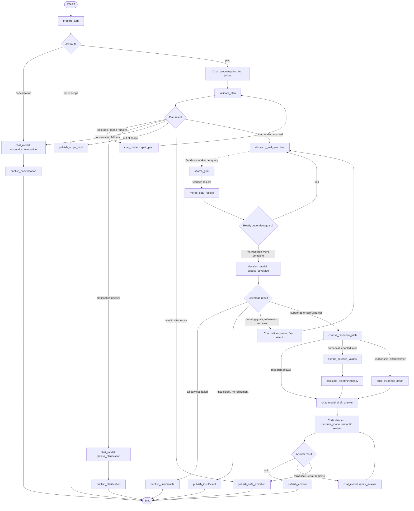
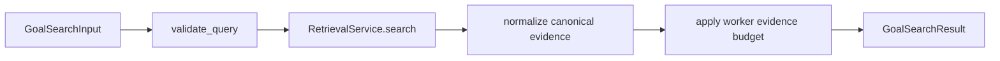

# Adaptive research agent graph

Date: 2026-10-28
Status: Proposed graph contract; no runtime code or architecture decision changed.

## Decision summary

Use one conversational coordinator and a bounded set of isolated research
workers. The coordinator rewrites the current request, determines intent,
chooses a direct or decomposed plan, dispatches only the required evidence
goals, evaluates coverage, and publishes a validated answer. This is an explicit
workflow, not an autonomous agent swarm and not an open-ended ReAct loop.

The same graph handles simple and complex requests:

- an obvious greeting or casual acknowledgement receives an immediate reply
  without planning, retrieval, evidence review or citations;
- a simple lookup produces one goal and one retrieval worker;
- a compound request produces at most four evidence goals, whose independent
  searches run concurrently;
- only missing goals may receive one targeted refinement;
- one invalid plan and one invalid answer may be repaired once;
- every route terminates in an answer, partial answer, clarification,
  insufficient-evidence result, temporary-unavailable result, or cancellation.

This graph expands the fixed workflow in ADR-0002. Agreement on this proposal
must be recorded in an ADR amendment before implementation.

## Two model roles

The user selected two separately configured LLM roles:

| Responsibility | Chat model | Decision model | Code |
| --- | --- | --- | --- |
| Conversational reply | Write a short natural reply | Validate route | Propose `conversation` mode |
| Intent, standalone question, query rewriting and goal splitting | Generate plan/queries | Select intent and judge proposed plan | Validate schema and limits |
| Plan repair and missing-goal query refinement | Generate corrected plan/queries | Judge or select candidates | Enforce repair and query budgets |
| Evidence coverage | — | Answer typed per-goal support questions | Resolve evidence IDs and derive gaps |
| Clarification | Identify and phrase the missing detail | Choose clarify/proceed | Publish and end turn |
| Research answer | Write from approved evidence | — | Bound context and output |
| Answer validation | — | Review semantic support and completeness | Check schema, IDs, citation bindings and length |
| Answer repair | Rewrite using review issues | Review repaired answer | Enforce one repair maximum |
| Retrieval, scheduling and calculations | — | — | Execute through permitted services/tools |

Selected environment defaults are OpenRouter `mistralai/ministral-8b-2512`
for chat and `typesafe/jev-1.14` for decisions. Jev uses typed decision questions
through `/api/alpha/decisions`; it cannot generate arbitrary text or a `TaskPlan`.
Text-producing planning and refinement steps therefore use the chat model,
with Jev choosing or judging defined candidates. This supersedes the earlier
generic assumption that the decision model could also write plans.
Keep separate clients, prompts, timeouts and trace tags for the two roles. Neither role may
silently fall back to the other when its configured service fails.

The decision model receives the context needed for each decision. The chat
model receives conversation context for natural replies, or the standalone
question, supported findings, evidence and limitations for research answers.
Neither receives secrets or authority to bypass graph limits.

## Top-level graph



The dashed fan-out and fan-in are LangGraph dynamic worker edges. Direct mode
still creates one `EvidenceGoal`; it does not maintain a second retrieval path.
This keeps direct and decomposed behavior under the same contracts and tests.

Phase 1 enables only the research-answer branch. Numerical and relationship
branches remain explicit extension points so they can reuse planning, evidence,
validation and publishing without complicating the first implementation.

## Coordinator responsibilities

### `prepare_turn`

- accept one non-empty human message and assign a stable `turn_id`;
- clear every prior per-turn value, including evidence, counters and drafts;
- retain only the bounded recent conversation needed to resolve follow-ups;
- enforce input-size and run-budget ceilings;
- set the first public progress phase to `preparing`.

Previous assistant prose is conversation context, never evidence. Clearing the
turn state is mandatory so a new answer cannot inherit sources from an earlier
answer.

### Conversational route

Every valid message first reaches a Jev typed decision selecting `conversation`,
`plan` or `out_of_scope`. Greetings, thanks, farewells and assistant-identity
questions use `conversation`; greeting-prefixed research uses `plan`. The
conversation route skips structured research planning, retrieval, progress and
citations, then the chat model responds naturally in the user's apparent
language using the general BRH assistant identity instruction.

### `understand_and_plan`

The chat model produces a structured `TaskPlan`; Jev classifies intent and
judges candidate plans through typed questions. The plan:

- resolves the current request into a standalone French question;
- classifies the intent;
- preserves explicit entities, dates, periods, units, polarity, requested
  documents and response shape;
- rewrites the request into effective corpus queries;
- selects `conversation`, `clarify`, `direct` or `decomposed` execution;
- creates the smallest sufficient set of evidence goals.

The model does not return or persist chain-of-thought. The graph stores the
typed plan, original question and rewrites for tracing and evaluation.

### `validate_plan`

Deterministic validation checks:

1. the structured schema is valid;
2. goal and query counts are within hard limits;
3. every goal contributes to the user's requested outcome;
4. explicit dates, numbers, named entities, negations and scope restrictions
   remain represented;
5. repeated or equivalent queries are removed;
6. goal dependencies reference existing goals and form an acyclic graph;
7. clarification has exactly one focused question and no research goals.

A structurally repairable plan gets one repair attempt. Meaningful ambiguity
routes to clarification rather than allowing the repair model to guess. A plan
that remains invalid publishes a safe limitation.

### `dispatch_goal_searches`

The dispatcher creates a `Send("search_goal", input)` for each eligible query.
Only goals whose dependencies are satisfied are eligible. Independent goals run
in parallel; dependent goals wait for the next dispatch wave.

Default proposed ceilings:

| Budget | Limit |
| --- | ---: |
| Evidence goals | 4 |
| Queries per goal | 2 |
| Missing-goal refinement rounds | 1 |
| Plan repairs | 1 |
| Answer repairs | 1 |

The implementation should also configure retrieval-call, model-call, context
token and wall-clock ceilings. These remain configuration values, but no
configuration may remove the hard termination routes.

### `merge_goal_results`

The fan-in node:

- groups results by goal and query;
- deduplicates passages by canonical chunk ID;
- deduplicates citations by canonical document/page identity;
- preserves the goal, query and refinement round that found each passage;
- records `ready`, `empty` or `error` independently for each goal;
- applies a deterministic global evidence/context budget.

One failed worker does not erase successful results. All-worker failure is a
service outcome, not an insufficient-evidence outcome.

After each merge, the scheduler checks whether newly satisfied dependencies
make another planned goal eligible. Those goals form another dispatch wave.
Coverage is assessed only when all runnable planned goals have completed. A goal
whose prerequisite failed is recorded as blocked/missing for coverage; it is not
silently skipped or sent with invented prerequisite evidence.

### `assess_coverage`

A structured assessment compares the question and each required evidence goal
with the merged bundle. Its output identifies supported points, gaps and the
specific missing goals eligible for refinement. It returns one of:

- `supported`: every material requested part has evidence;
- `partial`: some useful requested parts have evidence and the limitation can
  be stated clearly;
- `insufficient`: no safe useful answer can be made from eligible evidence.

Retrieval presence alone is not semantic support. The existing `grounded`
boolean must not make this decision.

### `refine_missing_goals`

Refinement receives only the missing goals and their earlier query/results. It
may create new retrieval wording, but it may not alter the user's hard
constraints or add unrelated goals. A query fingerprint prevents the graph from
issuing an equivalent query twice. The graph then dispatches only those missing
goals and consumes its single refinement budget.

### `draft_answer` and `validate_answer`

The chat model receives supported findings and opaque evidence IDs. It
returns answer Markdown plus the evidence IDs used for each substantive claim.
It cannot author authoritative titles, page numbers or URLs.

Code rejects unknown evidence IDs, malformed output, invalid citation bindings
and output outside configured limits. The decision model then reviews semantic
support and completeness. The combined validation rejects:

- unknown or unresolved evidence IDs;
- uncited substantive claims;
- citations that do not support the associated claim or goal;
- malformed structured output;
- an empty or over-budget answer;
- a complete-sounding answer when coverage was partial.

Canonical citations are resolved in code after validation. One repair may use
the machine-readable validation issues. The chat model performs that repair;
the decision model reviews it under the same limits. Semantic review is a model
judgment that needs evaluation, not a deterministic guarantee. An invalid
repaired draft is discarded;
it is never streamed or saved as an assistant message.

## Goal worker graph

Each worker has private state and no direct access to the full conversation.
It cannot modify the parent plan or publish messages.



Conceptual contracts:

```text
GoalSearchInput
  turn_id
  goal_id
  query_id
  query
  filters
  refinement_round

GoalSearchResult
  turn_id
  goal_id
  query_id
  refinement_round
  status                 ready | empty | error
  evidence[]
  service_error
  timings
```

The worker calls only `RetrievalService`; it never accesses Pinecone or
Postgres directly. It treats retrieved document text as untrusted source data,
so instruction-like text in a publication cannot change agent behavior.

## Planner contracts

```text
TaskPlan
  original_question
  standalone_question
  intent
  execution_mode
  clarification_question
  constraints
  expected_response
  goals[]

Constraints
  entities[]
  dates[]
  periods[]
  units[]
  polarity[]
  document_scope[]

EvidenceGoal
  goal_id
  objective
  retrieval_queries[]
  required_evidence
  dependencies[]
```

Recommended intent values:

```text
conversation
factual_lookup
explanation
comparison
trend
synthesis
document_discovery
relationship_exploration
numerical_analysis
out_of_scope
```

Recommended response shapes:

```text
answer | comparison | synthesis | table | chart | graph
```

Intent describes what the user wants. Execution mode describes how much work is
needed. A comparison can be direct if one passage contains both values; a
factual-looking request can be decomposed when it contains several independent
questions. The planner therefore must not derive execution mode from the intent
enum alone.

## Parent state and reducers

Persistent thread state should remain deliberately small:

```text
messages                  reducer: add_messages
thread metadata           overwritten deliberately
```

Per-turn state is overwritten by `prepare_turn`:

```text
turn_id
original_question
standalone_question
task_plan
plan_revision
phase
goal_status
goal_results              custom keyed reducer
evidence_map
coverage_assessment
draft
validation_issues
refinement_count
plan_repair_count
answer_repair_count
terminal_result
```

`goal_results` must use an idempotent reducer keyed by
`(turn_id, goal_id, query_id, refinement_round)`. Raw list concatenation is not
safe because a retried or replayed worker could duplicate evidence. The reducer
replaces the same logical worker result and rejects results from another turn.

The parent explicitly maps worker output into parent state. Do not depend on a
worker subgraph's internal checkpoint namespace becoming immediately visible to
the parent.

Suggested coverage result:

```text
CoverageAssessment
  overall                 supported | partial | insufficient
  goals[]
    goal_id
    status                supported | partial | missing | error
    evidence_ids[]
    gaps[]
  supported_points[]
  refinable_goal_ids[]
```

All model-facing records and evidence records should be frozen Pydantic models.
Graph orchestration state may use `TypedDict` plus annotated reducers.

## Routing rules

| Condition | Next node |
| --- | --- |
| Jev selects `conversation` | chat-model reply, then `publish_conversation` |
| Material ambiguity | `publish_clarification` |
| Valid one-goal plan | dispatch one goal worker |
| Valid multi-goal plan | dispatch eligible workers concurrently |
| Some dependencies remain | dispatch another dependency wave |
| Successful searches but no eligible evidence | `publish_insufficient` |
| Some goals supported, others missing, refinement remains | refine only missing goals |
| Useful partial evidence after refinement | draft a visibly partial answer |
| All research calls fail | `publish_unavailable` |
| Validated draft | `publish_answer` |
| Invalid draft after one repair | `publish_safe_limitation` |
| Client cancellation | terminate without publishing partial model text |

Ordinary clarification should be a normal assistant message followed by `END`
in Phase 1. The next user message starts a new turn with conversation context.
LangGraph `interrupt()` is unnecessary until a workflow must pause and resume
the same run for approval or external action.

## Failure and retry policy

| Failure class | Handling |
| --- | --- |
| Structured model output invalid | route to the bounded repair node |
| Ambiguous request | focused clarification, then end the turn |
| Valid empty retrieval | insufficient-evidence terminal result |
| One worker service error | retain other results; assess partial coverage |
| Every worker service error | temporary-unavailable terminal result |
| Transient model/vector/database timeout | targeted node `RetryPolicy` with small backoff |
| Cancellation | stop work and do not save an unvalidated AI response |
| Unexpected programming error | preserve trace and fail the run; do not disguise it as missing evidence |
| Trace export failure | log it; never fail the answer |

Retries belong only on idempotent calls or operations with idempotency keys.
The run budget counts retry attempts so retry policy cannot bypass cost limits.

## Checkpoint and streaming boundaries

Useful durable boundaries are after:

1. the validated task plan;
2. each fan-in wave;
3. coverage assessment;
4. the structured draft;
5. answer validation and final publication.

Do not checkpoint each output token. Agent Server owns persistent thread state
in deployment; injectable checkpointers support offline tests. Importing or
compiling the graph must perform no network or database I/O.

Stream only public progress and the final validated result. Suggested public
phases are:

- `Analyse de la demande`
- `Recherche dans N axes`
- `Vérification des sources`
- `Préparation de la réponse`

The graph may emit these as custom progress events. Internal plans, worker tool
messages, validation issues, chain-of-thought and unvalidated answer tokens are
not user-visible. The final answer should be published atomically after
validation in Phase 1.

## Example: adaptive decomposition

User request:

> Compare l'inflation en 2024 et 2025 et explique les principaux facteurs.

Possible plan:

```text
intent: comparison
execution_mode: decomposed
expected_response: comparison

goal_1: find the sourced 2024 inflation measure, period and unit
goal_2: find the comparable 2025 measure, period and unit
goal_3: find BRH-attributed explanations for the change
```

The three goals can run concurrently. Coverage may find goals 1 and 2 but miss
goal 3; only goal 3 is rewritten once. If it remains missing, the assistant can
return the sourced comparison as a partial answer and explicitly say that the
corpus evidence used did not support a causal explanation.

## Suggested implementation boundaries

```text
services/agent/src/brh_agent/
  contracts.py       frozen planning, evidence and terminal models
  state.py           graph state, reducers and reset helpers
  planning.py        planning, deterministic validation and repair inputs
  research.py        worker, dispatch, merge and coverage nodes
  answering.py       drafting, validation, repair and publishing nodes
  llm.py             separate chat/decision model factories
  resources.py       injected chat/decision models and RetrievalService lifecycle
  graph.py           graph construction and conditional routing only
  prompts.py         versioned prompt text and structured-output schemas
```

`nodes.py` should not remain a growing mixed-responsibility module. Existing
public imports may be retained as compatibility facades while responsibilities
move into these modules.

## Verification plan

Offline graph tests should prove:

- `Hi`, `What's up?`, `Salut`, thanks and farewells bypass every planner and
  retrieval dependency and invoke only the chat-model role;
- planning invokes the chat model for text and Jev for typed choices/judgments;
- coverage and semantic review invoke the decision-model role;
- drafting and answer repair invoke the chat-model role;
- a role outage never silently substitutes the other model;
- `What's up with inflation?` and `Hi, compare 2024 and 2025` do not take the
  conversational fast route;
- conversational replies have no citations or research progress events and are
  persisted as ordinary messages;
- a direct question dispatches exactly one worker;
- a compound request fans out only the planned independent goals;
- constraints survive standalone and retrieval rewrites;
- invalid schemas, duplicate queries and dependency cycles are rejected;
- worker replay/retry does not duplicate state;
- per-turn reset prevents evidence leakage;
- only missing goals are refined and only once;
- every loop respects hard budgets and terminates;
- empty evidence, partial evidence and service failure remain distinct;
- dependent goals dispatch only after their prerequisites;
- invalid drafts and unknown citation IDs are never published;
- cancellation saves no unvalidated assistant response;
- citations remain attached to the correct message after checkpoint reload;
- graph import and compilation work offline.

Use deterministic fake models and a fake `RetrievalService` for topology and
state tests. Prompt/model quality belongs in the reviewed French evaluation set
and notebook-to-ADR process, not in brittle unit snapshots.

## References

- [OpenRouter chat API](https://openrouter.ai/docs/api/reference/overview)
- [Jev typed decision model](https://openrouter.ai/typesafe/jev-1.14/providers)
- [Ministral model ID](https://openrouter.ai/mistralai/ministral-8b-2512)
- [Run graph nodes in parallel](https://docs.langchain.com/oss/python/langgraph/use-graph-api#run-graph-nodes-in-parallel)
- [Orchestrator-worker workflows](https://docs.langchain.com/oss/python/langgraph/workflows-agents#creating-workers-in-langgraph)
- [Use subgraphs](https://docs.langchain.com/oss/python/langgraph/use-subgraphs)
- [Add retry policies](https://docs.langchain.com/oss/python/langgraph/use-graph-api#add-retry-policies)
- [Handle errors appropriately](https://docs.langchain.com/oss/python/langgraph/thinking-in-langgraph#handle-errors-appropriately)
- ADR-0002 (fixed agent workflow), ADR-0006 (retrieval boundary), ADR-0008
  (LangGraph SDK), ADR-0010 (citation identity) and ADR-0016 (evidence graph).
