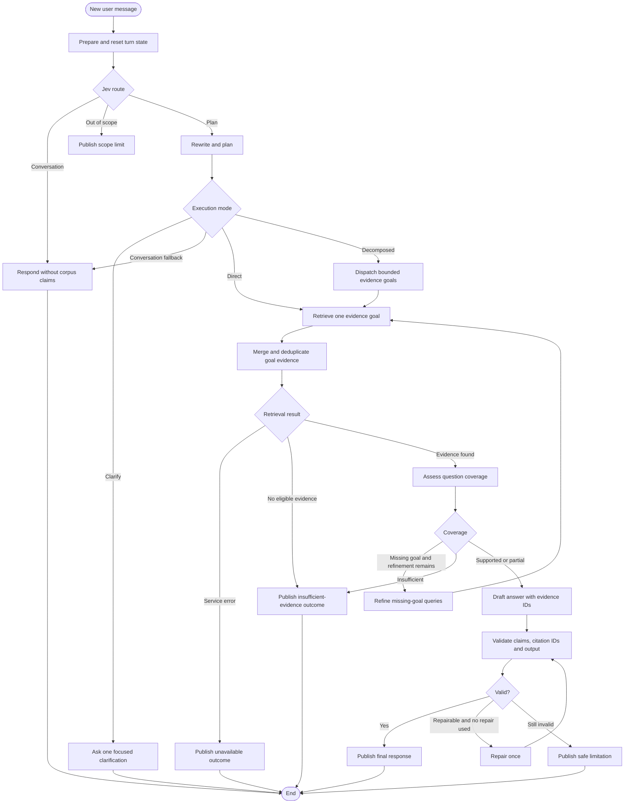

# Agent Phase 1: adaptive, trustworthy research answers

Date: 2026-10-28
Status: Design analysis; open decisions remain. No runtime behavior is approved
or implemented by this document.

## Goal

Phase 1 should deliver one complete production-shaped path:

> A user asks a question in French about the BRH corpus. The assistant determines
> the intent, resolves or clarifies the scope, rewrites the request for retrieval,
> chooses a direct or decomposed execution path, and returns either a concise,
> source-supported answer with page-level citations, a useful partial answer with
> its limitation, or a clear explanation that evidence is missing or unavailable.

This is a workflow foundation for the broader research assistant. It uses an
adaptive planner and bounded goal workers, without becoming an open-ended agent
team. Its purpose is to settle the planning, evidence, state, citation, streaming,
thread and failure contracts that later analysis roles will reuse.

## Three possible Phase 1 scopes

| Scope | What it delivers | Assessment |
| --- | --- | --- |
| Minimal scaffold completion | `retrieve -> generate/refuse`, with prompt and model factory | Fast, but cannot adapt to comparisons, follow-ups or compound goals |
| Adaptive vertical slice | Structured intent/planning, constrained query rewriting, direct and decomposed retrieval, evidence assessment, validated drafting and real UI integration | Recommended; supports query-dependent depth with explicit limits |
| Free-form research agent | Open tool selection, arbitrary replanning, page exploration, analysis and review loops | Valuable later; too many unconstrained failure and cost modes for the first live path |

The recommended slice begins with one structured planning call. It then makes one
structured evidence-assessment call and one structured answer-drafting call when
evidence exists, followed by semantic answer review. Planning, assessment,
refinement and review use the decision model; drafting and answer repair use
the chat model. Additional calls are bounded by the single plan repair,
missing-goal refinement and answer repair allowances. This makes
cost and failure behavior explicit while allowing simple questions to take the
short path and compound questions to use multiple bounded steps.

## User-visible scope

### Included

- Intent detection for factual lookup, explanation, comparison, trend, synthesis,
  document discovery, relationship exploration, numerical analysis,
  conversational and out-of-scope requests.
- Immediate localized replies for high-confidence greetings, thanks, farewells
  and short acknowledgements, with no planner or retrieval call.
- Conversation-aware standalone-question rewriting with explicit preservation of
  entities, dates, periods, units, polarity and document scope.
- Direct factual/explanatory questions through one evidence goal.
- Compound comparisons, syntheses and multi-part questions through bounded goal
  decomposition and merged evidence.
- One clarification turn when missing scope would materially change the answer.
- Answers in French, unless the user is only asking for a brief conversational
  acknowledgement that requires no corpus claim.
- Page-level citations that open the canonical document source.
- Explicit supported, partial, insufficient-evidence, unavailable and cancelled
  outcomes.
- One active conversation thread, new-conversation behavior, stop/cancel and
  reload of the current thread.
- Progress states such as searching, checking evidence and preparing the answer.
- LangSmith traces when configured; tracing failure cannot break an answer.

### Deferred

- Unbounded autonomous replanning and arbitrary tool selection.
- More than the configured number of goals or refinement rounds.
- Deep page-range exploration beyond the bounded retrieval/read tools.
- Numerical calculations, tables, charts and knowledge-graph artifacts.
- External web search, document uploads, ingestion or extraction from chat.
- Long-term user memory and personalization.
- Public cross-device conversation history until user/session ownership exists.

Follow-ups use only the bounded recent conversation needed to construct a
standalone question. Previous assistant prose is context, not evidence. If the
referent or period cannot be resolved without guessing, the graph asks one focused
clarification and ends the turn.

## Proposed execution graph



This expands ADR-0002 and therefore needs an ADR amendment before implementation.
There is no generic ReAct loop in Phase 1. Every cycle is visible and bounded:
missing goals may trigger one targeted query refinement, validation may request
one repair, and then execution terminates.

## Node responsibilities

### `prepare_turn`

- Accept exactly one new human message and derive the current question.
- Reject blank input and enforce a request-size ceiling.
- Create a stable `turn_id` and clear all per-turn fields left by the previous
  checkpoint.
- Set the visible phase to `preparing`.
- Do not use earlier assistant answers as evidence.

After preparation, Jev selects `conversation`, `plan` or `out_of_scope`.
Greetings, thanks and farewells become `conversation` and skip planning and
retrieval; greeting-prefixed research reaches `understand_and_plan` and remains
eligible for `direct` or `decomposed`. The chat model writes the natural
conversational reply in the user's apparent language.

### `understand_and_plan`

- Resolve the current user request into a standalone question using only the
  bounded recent conversation context.
- Classify intent and select `conversation`, `clarify`, `direct` or `decomposed`.
- Extract hard constraints: entities, dates, periods, units, polarity, requested
  documents and desired response shape.
- Rewrite the question into retrieval queries while preserving every hard
  constraint and the original meaning.
- For compound work, create evidence goals with stable IDs, objectives, required
  evidence, dependencies and a small query list.
- Prefer one direct goal when decomposition adds no value.
- Ask for clarification when multiple reasonable interpretations would lead to
  materially different evidence or answers.

The output is a structured `TaskPlan`; free-form chain-of-thought is neither
stored nor shown. Original, standalone and retrieval queries are retained for
tracing and semantic-drift evaluation.

### `retrieve_goal`

- Call `RetrievalService.search()` only for the assigned goal/query. The agent
  never queries Pinecone or Postgres directly.
- Run independent goals concurrently with isolated worker state. Respect declared
  dependencies for goals that cannot run independently.
- Preserve canonical chunk IDs, document IDs, pages, scores and citation data.
- Build explicit associations from each evidence item to its canonical citation
  IDs; the existing parallel chunk/citation arrays do not express that mapping.
- Apply a context budget after retrieval. Current retrieval can return six hits
  and bounded adjacent table chunks, so prompt size can be much larger than six
  chunks.
- Distinguish an empty valid result from Postgres, Pinecone, timeout and stale
  corpus failures. A service failure must never become a refusal.

### `merge_goal_evidence`

- Merge worker results by goal while preserving which query found each item.
- Deduplicate canonical chunks and citations without losing goal coverage.
- Record per-goal ready, empty or error status.
- Enforce global context and evidence budgets before model assessment.

### `assess_evidence`

- Use structured output to classify overall and per-goal coverage as `supported`,
  `partial` or `insufficient`.
- Return supported points and gaps using evidence IDs only.
- Treat excerpts as untrusted source data. Instruction-like text inside a BRH
  document cannot override the system rules.
- Do not create titles, URLs, pages or facts absent from evidence.
- Identify only the missing goals eligible for the single refinement step.

### `draft_answer`

- Receive the question, supported points and a bounded evidence bundle.
- Return structured output containing answer Markdown and referenced evidence
  IDs. Canonical citation metadata is added later by code.
- Attribute statements to the relevant publication when documents disagree or
  describe different periods.
- State the limitation inside a partial answer. Do not conceal missing coverage.
- Produce no charts or generated UI in this phase.

### `validate_answer`

- Use code for structural checks and the decision model for semantic support and
  completeness review. The chat model performs the single answer repair when
  needed; review runs again on the repaired answer.
- Reject unknown evidence IDs, uncited substantive paragraphs, malformed output,
  empty model content and citations unrelated to the retrieved bundle.
- Resolve evidence IDs to page-level citations deterministically.
- Apply output length and Markdown constraints.
- Record machine-readable issues for tracing and the one repair attempt.
- Never publish the unvalidated draft as an assistant message.

### Terminal nodes

- `publish_answer` appends the reviewed AI message and a typed turn result.
- `publish_insufficient` uses deterministic French copy and does not call the
  model when retrieval is empty.
- `publish_unavailable` explains a temporary service problem and invites retry.
- `publish_safe_limitation` discards an invalid draft and reports only what the
  validated pipeline can safely say.

## State and contracts

Keep persistent conversation state small and make per-turn state explicit.
Suggested shapes are conceptual; names should be finalized in the ADR and tests.

```text
Persistent:
  messages                 append-only LangChain messages
  current_thread_title     deterministic title from the first question

Per turn, overwritten by prepare_turn:
  turn_id
  original_question
  standalone_question
  intent
  execution_mode          conversation | clarify | direct | decomposed
  task_plan
  goals[]
  goal_results[]
  rewritten_queries[]
  phase                    preparing | searching | assessing | drafting | validating
  retrieval_status         pending | ready | empty | error
  evidence[]               canonical evidence items
  support_status           supported | partial | insufficient
  supported_points[]
  evidence_gaps[]
  draft
  validation_issues[]
  repair_count
  result                    typed terminal response
```

Use frozen Pydantic models for evidence, assessment, validation issues and the
terminal result; use a typed LangGraph state for orchestration. Model-facing
structured outputs are separate from canonical domain models. The model can
select evidence IDs but cannot construct authoritative citations.

Suggested planning contracts:

```text
TaskPlan
  original_question
  standalone_question
  intent
  execution_mode
  clarification_question
  constraints
  expected_response
  goals[]

EvidenceGoal
  goal_id
  objective
  retrieval_queries[]
  required_evidence
  dependencies[]
```

The planner is not allowed to silently drop user constraints. A deterministic
post-check confirms that explicit dates, numbers, named entities, negations and
document restrictions remain represented in the standalone question or plan.
Failures route to clarification or safe limitation rather than retrieval with a
changed question.

The existing `grounded: bool` is too ambiguous for the new contract. If retained
for frontend compatibility, it must mean only `retrieval_status == ready` and
must not be presented as semantic support. `support_status` and terminal result
kind carry the product meaning.

Each final AI message needs its own citation metadata so citations survive thread
reload and remain associated with the correct answer. A top-level `citations`
field containing only the latest turn is insufficient for multi-turn history.
The implementation should either store a response envelope keyed by message ID
or serialize citations in the AI message metadata; tests must prove round-trip
behavior through the Agent Server SDK before choosing one.

## Evidence and citation design

The current backend creates canonical `Citation` values, but the current web
renderer appends every citation badge to the first paragraph. Phase 1 needs a
claim-level citation protocol.

Recommended contract:

1. The model references retrieved evidence by opaque evidence ID.
2. Backend code resolves those IDs into a stable ordered citation list.
3. Backend code renders safe markers in the answer, such as an internal citation
   token tied to the resolved citation ID.
4. The web renderer converts those tokens into citation buttons at the exact
   claim location.
5. Unknown or unresolved tokens make validation fail; raw model-generated URLs
   are never treated as citations.

Citation identity should include document ID and page. A chunk can span pages,
and multiple chunks can point to the same page; this requires explicit
many-to-many mapping and deterministic de-duplication. Snippets, titles and PDF
links always come from `RetrievalService`, not from generated text.

The source rail should show sources for the selected answer and may also offer
conversation-wide sources later. Its current conversation-wide union can make an
old source look like support for a new answer, so Phase 1 must preserve the
selected message ID when opening citations.

## Retrieval readiness

The retrieval implementation is real and already rejects stale chunks and index
manifests. Phase 1 still requires product calibration:

- `BRH_RETRIEVAL_MIN_SCORE` defaults to `0.35`, but no reviewed French answerability
  evaluation in the current agent design approves that as a production refusal
  threshold.
- The environment template exposes `BRH_RETRIEVAL_TOP_K` but omits
  `BRH_RETRIEVAL_MIN_SCORE`; the deployed value would therefore be implicit.
- Retrieval output can expand table neighbours, so an agent-specific context
  limit and deterministic truncation policy are required.
- Index readiness and corpus publication readiness must be observable separately.

Use the repository's experiment boundary: a notebook fixes the supported and
unanswerable question set and decision rule, reports recall/false-support tradeoffs
across the French corpus, and receives sign-off before a new production threshold
or default is encoded. Implementation may proceed against configurable values,
but public readiness cannot claim reliable refusal until calibration is approved.

## Model and prompt requirements

Use separately configured chat and decision models. Defaults are OpenRouter
Ministral `mistralai/ministral-8b-2512` and Jev `typesafe/jev-1.14`. The chat
model writes plans, queries, conversational replies, clarifications, answers and
repairs.
Jev returns typed choices/judgments for intent, candidate plan/query selection,
coverage and semantic review; it cannot generate plans or query text. This
provider-specific constraint supersedes the earlier generic call allocation.
Retrieval, arithmetic,
scheduling, schema validation and citation resolution remain code operations.

Implement the accepted provider-independent factory for Anthropic and
OpenAI-compatible chat models. It must validate credentials, base URL, temperature
and maximum output tokens, and expose explicit request timeout/retry settings.
Provider retries are bounded and do not repeat deterministic nodes.

Provide separate chat and typed-decision clients with injected test doubles.
`BRH_CHAT_*` and `BRH_DECISION_*` settings configure provider, model, base URL,
timeout and retries; chat also has temperature and output-token settings.
`BRH_DECISION_API_PATH` defaults to `/alpha/decisions` under the `/api` base.
Both agent roles use `OPENROUTER_API_KEY`; embedding credentials stay separate.
Existing `BRH_LLM_*` settings retain their legacy meaning and do not override
either explicit role. Provider clients remain unimplemented.
Do not silently substitute one role's client when the other is unavailable.

Separate prompts by responsibility:

- Intent, rewrite and decomposition prompt with a typed `TaskPlan` schema.
- Evidence assessment system prompt and structured schema.
- Answer drafting system prompt and structured schema.
- Semantic answer-review prompt and structured issues schema.
- Repair prompt containing only validation issues, original evidence and draft.
- Deterministic terminal copy for empty evidence and service failures.

Research prompts state that the corpus is data, answers are in French, evidence
IDs are mandatory, and unsupported claims are omitted. Social prompts permit
the user's apparent language and require no citations. The planning prompt must
preserve user constraints, prefer the shortest valid plan and avoid speculative
subgoals. Prompt construction must have a deterministic order, context budget
and escaping/delimiting strategy. Log model and prompt versions in traces without
logging credentials.

Model selection, semantic-support thresholds and context budgets require evals;
this phase design does not approve a model merely because a default exists in
configuration.

## Resource ownership

`build_retrieval_service()` returns `(service, pool)`, while the node scaffold
currently describes a cached service only. The corpus HTTP app already owns a
separate service and pool. Implementing the graph as written risks duplicate pools
and unclear shutdown.

Create one lazy process resource owner for the Agent Server that retains the
retrieval service, Postgres pool, chat model and decision model, supports
dependency injection in tests and closes resources once. Importing the graph
must remain free of network
I/O. The graph and corpus routes should share resources when they run in the same
process; deployed graph-only execution must still have a defined lifecycle.

## Frontend integration

`lib/agent.ts` already wraps `useStream`; `useAssistantWorkspace` still owns a
second local message store and canned response timer. Phase 1 replaces that hook
with an adapter over the SDK stream:

- Submit `{messages: [{type: "human", content: question}]}`.
- Render SDK messages as the single conversation source of truth.
- Map the typed terminal result and per-message citation metadata into existing
  `ChatMessage` components.
- Map graph `phase`, loading and error states into the current progress row.
- Wire stop to `stream.stop()` and distinguish cancellation from failure.
- Persist the active `threadId` so reload can rejoin an in-flight or completed run.
- Reset to a null thread ID for a new conversation.

The official SDK exposes thread search and history, but this repository has no
user authentication or thread-ownership policy. The assistant must never list all
deployment threads. Phase 1 can keep only the active thread or a browser-local
registry of thread IDs created in that session. Server-side searchable history
becomes a public feature only after authenticated ownership or a signed anonymous
session boundary exists.

The current sidebar promises searchable history. Until ownership exists, either
limit it to the browser-local registry or hide the history search/list while
preserving New conversation. This is a product decision, not a styling detail.

## Streaming decision

Post-generation validation and immediate token streaming conflict: once an
unsupported token is shown, validation cannot retract it cleanly. The recommended
Phase 1 behavior streams trustworthy progress updates, then publishes the final
answer atomically after validation. This changes ADR-0008's token-by-token wording
and must be recorded.

If token streaming is a firm product requirement, Phase 1 must either expose a
clearly provisional draft or move validation before generation and accept that
format/citation failures can reach the UI. Neither gives the same guarantee as
validated atomic publication.

## Failure and abuse boundaries

| Condition | User outcome | Internal behavior |
| --- | --- | --- |
| No hit above calibrated threshold | Insufficient evidence | Deterministic terminal node; no assessment or drafting call |
| Evidence related but incomplete | Partial answer or limitation | Preserve supported subset and explicit gap |
| Postgres/Pinecone unavailable | Service unavailable | Trace error; bounded retry; never call it no evidence |
| LLM timeout/rate limit | Service unavailable | Provider retry policy; no fabricated fallback |
| Empty model response | Service unavailable or safe limitation | Treat as model failure, including thinking-only responses |
| Invalid citation/output | Delayed while one repair runs; then safe limitation | Never publish invalid draft |
| User cancellation | Cancelled run | Preserve human message; do not append a partial AI answer |
| Oversized input | Validation message | Reject before retrieval/model calls |

For a public release, add request/rate budgets around graph runs. The existing
corpus semantic route has an in-process global limiter; the graph has none. CORS
is not authentication. Thread isolation, run rate limits and provider spend caps
are public launch gates.

## Observability

Every run should expose:

- Thread ID, run ID and turn ID.
- Detected intent, execution mode, goal count, rewritten-query count and
  constraint-preservation validation.
- Node durations and terminal result kind.
- Retrieval count, score distribution, selected evidence IDs and context size.
- Support status, validation issues and repair count.
- Model/provider/prompt version, token usage, latency and retry count.
- Error class without secret values.

Do not use answer confidence percentages in the UI. Retrieval score is a ranking
signal, and a model evaluator is not calibrated truth confidence. LangSmith trace
upload failure should be logged and ignored by the answer path, especially given
the repository's prior quota issue.

## Test and evaluation plan

### Offline unit and graph tests

- Provider factory for each supported provider, gateway URL, missing key, timeout
  and empty response.
- Prompt construction, evidence ordering, context truncation and source-text
  prompt injection.
- Intent routing for conversation, clarification, direct and decomposed modes.
- Conversational fast-route tests, including `Hi` and `What's up?`, plus negative
  cases such as `What's up with inflation?` and greeting-prefixed research.
- Rewrite preservation for dates, named entities, units, negation and document
  scope; reject semantic drift.
- No unnecessary decomposition for simple questions, bounded decomposition for
  comparisons and synthesis, independent goal fan-out and dependency ordering.
- Retrieval ready, empty and exception paths using `RetrievalService` fakes.
- Supported, partial and insufficient structured assessments.
- Unknown citation ID, missing claim citation, duplicate page citation, multi-page
  chunk, malformed Markdown, empty draft and one-repair ceiling.
- Cancellation and state reset between two turns.
- Separate threads cannot leak messages, evidence or citations.
- Full compiled graph behavior, rather than topology-only smoke tests.

### Web tests

- SDK message conversion and per-message citation round trip.
- Inline citation markers select the correct document page.
- Submit, disabled submit, stop, retry, new conversation and reload/rejoin.
- Loading, insufficient, partial, unavailable and cancelled presentation.
- No local canned answer or timer remains.
- Browser-local history never calls an unscoped server thread search.

### Evaluation and acceptance

Create a reviewed French set with direct and compound questions, follow-ups,
ambiguous requests, semantic-preservation traps, supported questions, near-miss
questions, unanswerable questions, temporal ambiguity, conflicting publications,
tables and prompt-injection-like source text. Report:

- Retrieval recall and false-support rate.
- Intent accuracy, clarification appropriateness, rewrite fidelity, decomposition
  quality and unnecessary-step rate.
- Semantic support and answer completeness.
- Citation precision and page correctness.
- Appropriate abstention and partial-answer quality.
- Latency, input/output tokens and cost by terminal path.

Set numerical launch thresholds before implementation is called production-ready.
Live acceptance then covers known direct, compound and unanswerable questions
against current Postgres/Pinecone plus the configured LLM, with each citation
opened at the expected published page.

## Work packages and dependency order

1. **Decision and ADR** — approve atomic validated publication, thread scope,
   Phase 1 task boundary and the expanded graph.
2. **Contracts** — frozen task-plan, goal, evidence and result models; state reset
   semantics and citation identity; mirror the public subset in TypeScript.
3. **Resources and model** — shared lazy resource owner, provider factory,
   timeout/retry configuration and injected fakes.
4. **Planning** — intent taxonomy, constrained rewriting, decomposition,
   deterministic constraint checks and planner evals.
5. **Evidence assembly** — execute direct/goal retrieval, merge results, map
   evidence/citations and enforce the context budget.
6. **Graph nodes** — prepare, plan, retrieve/dispatch, merge, assess, refine,
   draft, validate, repair and terminal paths with behavioral tests.
7. **Frontend adapter** — replace the canned controller with `useStream`, add
   per-message citations, progress/error mapping, stop and rejoin.
8. **Citation UI** — render claim-level markers and selected-answer sources.
9. **Evaluation** — planning/retrieval/support dataset, threshold sign-off and
   prompt/model comparison according to the experiment workflow.
10. **End-to-end verification** — local server, real dependencies, trace review,
   responsive interaction and citation-page checks.

Contracts and offline tests can be implemented before paid/live model calls.
Frontend work depends on the public state/message contract but can use a fake
SDK stream. Threshold sign-off is required before public readiness, not before
the graph can be built and tested offline.

## Files likely to change

- `services/agent/src/brh_agent/{state,graph,nodes,llm,prompts}.py`
- New focused agent contract/resource/evidence modules as needed; avoid turning
  `nodes.py` into a mixed-responsibility file.
- `services/agent/tests/` behavioral node, graph and model-factory tests.
- `packages/core/src/brh_core/config.py` and `.env.example` for explicit timeout,
  retry, context and retrieval-threshold settings.
- `apps/web/lib/agent.ts`, `apps/web/lib/hooks/use-assistant-workspace.ts` and
  `apps/web/lib/chat/types.ts` for the SDK/state adapter.
- `apps/web/components/assistant/message-content.tsx` and source components for
  claim-level, per-message citations.
- Web unit/browser tests for the real stream states.
- ADR-0002/0008 follow-up and this progression log.

## Definition of done

Phase 1 is complete when simple questions take the direct path, compound questions
produce bounded evidence goals, rewrites preserve user meaning, ambiguous requests
ask for clarification, and both paths traverse the real graph and UI. Supported
claims have canonical page citations; empty evidence, partial support,
infrastructure failure and cancellation are visibly distinct; invalid drafts
never reach the user; the current thread survives reload; offline behavior tests
pass; live direct/compound/unanswerable acceptance cases pass; and planning,
retrieval, support, citation, latency and cost gates have documented evaluation
evidence.
