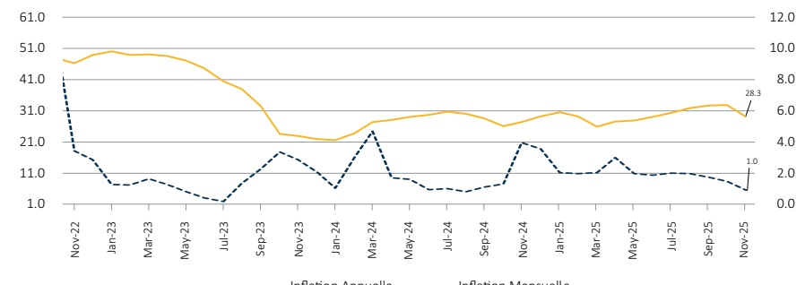

### I. - INTRODUCTION

Cette note analyse l'évolution de l'indice des prix à la consommation (IPC) en Haïti au cours du mois de novembre 2025. Elle apporte quelques éléments explicatifs permettant de comprendre les facteurs qui influencent la variation de l'IPC durant cette période.

### II. - ÉVOLUTION DE L'INFLATION GLOBALE EN NOVEMBRE 2025

En novembre 2025, le taux d'inflation s'est décéléré tant en variation mensuelle qu'en rythme annuel. Ainsi, il s'est contracté de 50 points de base sur un mois pour atteindre 1 %. Sur une base annuelle, il est passé de 32,2 % en octobre 2025 à 28,3 % au cours du mois sous revue.

Sur les deux (2) premiers mois de l'exercice 2025-2026, l'inflation mensuelle cumulée a atteint 2,5 %, nettement inférieure par rapport aux 5,4 % observés sur la même période de l'exercice précédent. Par ailleurs, le taux d'inflation moyen mensuel s'est inscrit à 1 %, soit 3 points de pourcentage de moins que sur le même intervalle de l'exercice antérieur, tout en demeurant supérieur à celui enregistré en République dominicaine (0,7 %).

Évolution de l'inflation mensuelle et annuelle en novembre 2025 (en %)

Source : Institut haïtien de statistique et d'informatique (IHSI)