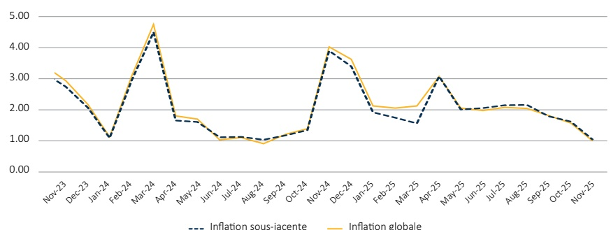
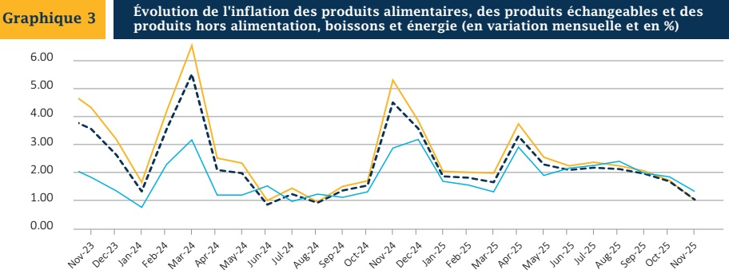

### V. - ÉVOLUTION DE L'INFLATION SOUS-JACENTE

L'inflation sous-jacente annuelle a accusé une décélération sur la période sous revue, en se portant à 27 % en novembre 2025, contre 30,6 % un mois auparavant. En variation mensuelle, elle est demeurée supérieure à l'inflation globale en s'inscrivant à 1 % en novembre 2025, soit une baisse de 60 points de base. Par ailleurs, le rythme de progression de l'IPC des produits alimentaires s'est contracté de 69 points de base (pb) pour atteindre 0,9 %, ainsi que celui des produits échangeables (-0,7 pb à 0,9 %), des biens industriels (-0,5 pb à 0,8 %) et non échangeables (-0,3 pb à 1,1 %).

Évolution de l'inflation globale et de l'inflation sous-jacente (en rythme mensuel et en %)

Sources : IHSI et BRH

— Inflation des produits alimentaires ___ Inflation des produits échangeables — Inflation des produits hors alimentation, boissons et énergie

Sources : IHSI et BRH