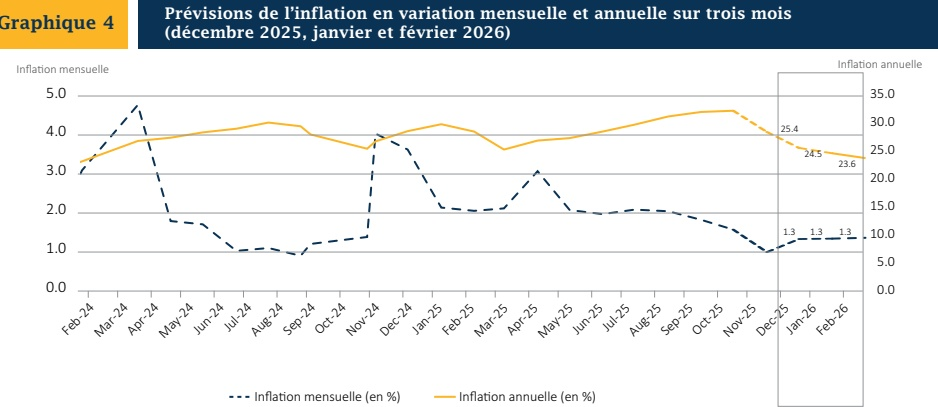

### VI. - FACTEURS EXPLICATIFS DE L'ÉVOLUTION DE L'INFLATION MENSUELLE EN NOVEMBRE 2025

Le ralentissement de l'inflation au mois de novembre 2025 est lié à l'atténuation continue de l'impact des chocs antérieurs dans un contexte marqué par la bonne tenue du marché des changes. En effet, le maintien de la relative stabilité du taux de change (baisse mensuelle de 0,08 % du taux en novembre après -0,04 % en octobre 2025), soutenue par les transferts sans contrepartie et les mesures prises par la Banque centrale, a aussi contribué à la décélération de l'inflation importée (0,77 % contre 1,42 % en octobre 2025), alors qu'on observe une modération des cours internationaux des matières premières (contraction de 1,0 % de l'indice des prix alimentaires de la FAO en septembre, après -0,2 % en août 2025) et un manque de dynamisme de la demande intérieure en raison du ralentissement de l'activité économique.

### VII. - PRÉVISIONS D'INFLATION

Les prévisions réalisées par la Direction Monnaie et Analyse Économique (MAE) de la BRH laissent augurer une poursuite de la baisse de l'inflation annuelle au cours des trois (3) prochains mois. Cette dernière devrait ralentir à 25,4 % en décembre 2025, avant de se porter à 24,5 % et 23,6 % respectivement en janvier et en février 2026. Parallèlement, l'inflation mensuelle devrait s'inscrire à 1,3 % en décembre 2025, tout comme en janvier et février 2026.

S'agissant de la composante sous-jacente de l'inflation, en variation mensuelle, elle devrait s'établir à 1,3 % en décembre 2025 contre 1,4 % en janvier comme en février 2026, alors qu'en rythme annuel, elle se porterait à 24,5 %, 23,9 % et 23,4 % respectivement en décembre 2025, janvier et février 2026.

Source : Prévisions du Service de Modélisation et Prévisions Macroéconomiques de la Direction MAE/BRH