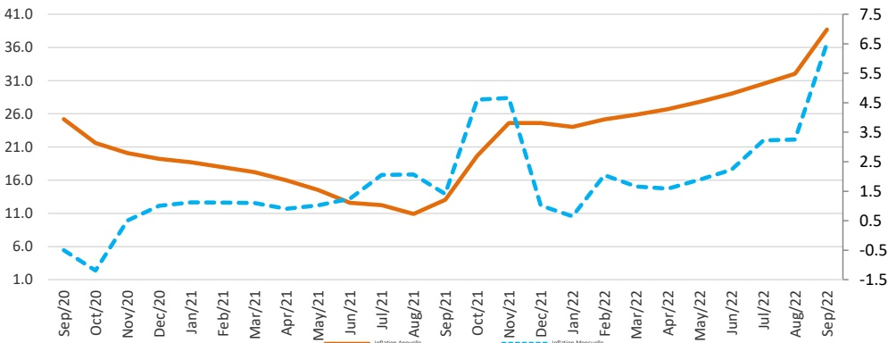

### I. - Introduction

Cette note analyse l'évolution de l'indice des prix à la consommation (IPC) en Haïti au cours du mois de septembre 2022. Elle apporte quelques éléments explicatifs permettant de comprendre les facteurs qui influencent la variation mensuelle de l'IPC.

### II. - Évolution de l'inflation courante en septembre 2022

L’indice des prix à la consommation (IPC) a été estimé à 250,2 en septembre 2022 contre 234,9 le mois précédent et 180,1 un an plus tôt. Ainsi, en rythme mensuel, l’inflation est passée de 3,2 % en août 2022 à 6,5 % en septembre 2022. Parallèlement, sur base annuelle, le taux d’inflation a connu une accélération de 6,7 points de pourcentage par rapport au mois d’août pour se porter à 38,7 % en septembre 2022.

D’octobre 2021 à septembre 2022, l’inflation mensuelle a évolué autour d’une moyenne de 2,8 % contre 1 % au cours de la même période de l’exercice fiscal 2020-2021. Ce taux moyen d’inflation mensuel est supérieur à celui de nos principaux partenaires commerciaux au cours de la même période (République Dominicaine : 0,69 % et les États-Unis : 0,65 %). Cumulé d’octobre 2021 à septembre 2022, le taux d’inflation mensuel s’est porté à 33,3 %, soit près de trois fois le niveau (12,4 %) enregistré au cours de la même période un an auparavant.

Graphique 1. Évolution de l'inflation annuelle de septembre 2020 à septembre 2022 (en %)

Source : IHSI