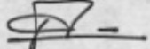

La période de pénalité s'étend du jour où un formulaire aurait du être transmis à l'UCREF au jour où cette dernière le reçoit.

## d) Pénalité pour non transmission de formulaire

En cas de non transmission de formulaire de transactions dûment rempli à l'UCREF, les maisons de transfert encourent une pénalité de cent mille gourdes (Gdes. 100,000.⁰⁰) par jour d'infraction.

La période de pénalité s'étend du jour où un formulaire aurait dû être transmis au jour où la BRH constate l'infraction.

La présente circulaire entre en vigueur le 3 novembre 2008 et remplace la circulaire 95 du 1^{er} aout 2000.

Port-au-Prince, le 30 octobre 2008

Philippe W. Lahens

Vice-Gouverneur

p.j. : Formulaire déclaration de transaction